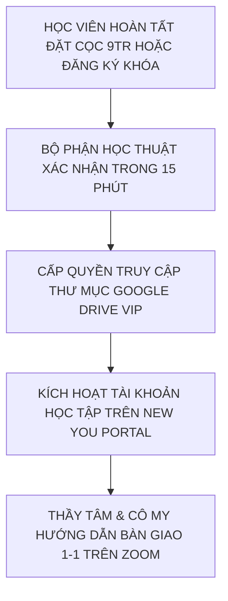

# CẨM NANG & KHO TÀI NGUYÊN BỘ 8 QUÀ TẶNG TRUYỀN NGHỀ ĐỘC BẢN
## THE ULTIMATE FAST-ACTION BONUSES VAULT — TRỊ GIÁ 42.000.000 VNĐ (TẶNG 0Đ)
### HỆ THỐNG ĐÀO TẠO GIÁO VIÊN TIẾNG ANH THỰC CHIẾN 12 THÁNG — NEW YOU TEACHER ACADEMY

---

* **Đơn vị ban hành:** Ban Giảng Huấn New You English (**Cô Sophie Diễm My** & **Thầy Huỳnh Trường Thanh Tâm**)
* **Đối tượng sở hữu:** Học viên đăng ký Khóa Khai Mở Founding Batch 1 (Gói Pro Teacher, Dual-Degree Master, VIP Mentorship 1-1) hoặc ứng viên hoàn tất cọc thẩm định 9.000.000đ.
* **Mục đích tài liệu:** Cung cấp toàn văn nội dung chi tiết, biểu mẫu thực thi, mã nguồn prompts và tài nguyên số của toàn bộ 8 món quà tặng trị giá 42 triệu đồng. Học viên có thể sử dụng trực tiếp để phục vụ việc học, đứng lớp giảng dạy và chiêu sinh lớp học riêng.
* **Quy chuẩn bảo mật:** Tài sản trí tuệ độc quyền của New You English & Shin Digital Ecosystem. Nghiêm cấm phân phối ra ngoài hệ thống khi chưa có sự đồng thuận bằng văn bản.

---

```
╔═══════════════════════════════════════════════════════════════════════════════════════════╗
║                   BẢNG TỔNG HỢP GIÁ TRỊ BỘ 8 QUÀ TẶNG ĐỘC QUYỀN                           ║
╠═══════════════════════════════════════════════════════════════════════════════════════════╣
║  #01. Trọn bộ 52 Video Master Phát Âm Chuẩn IPA Anh - Mỹ (Cô My)        :  3.500.000 VNĐ  ║
║  #02. Sách In Cứng & Ebook Bản Quyền "New You English"                  :    500.000 VNĐ  ║
║  #03. Thư Viện 100+ Mega Prompts AI Chuyên Sâu Dạy Học (Thầy Tâm)       :  5.000.000 VNĐ  ║
║  #04. 01 Chatbot AI Trợ Giảng Riêng 24/7 (Custom GPTs Cá Nhân Hóa)     :  8.000.000 VNĐ  ║
║  #05. Kho 30 Kịch Bản Video Ngắn Triệu View Bắt Trend Đã Kiểm Chứng     :  6.000.000 VNĐ  ║
║  #06. Bộ Kịch Bản Tư Vấn Thấu Cảm 5 Bước & Demo Zoom 45 Phút Chốt Combo:  7.000.000 VNĐ  ║
║  #07. Bản Quyền Bộ SOP Quy Trình Vận Hành 60+ Lớp Học Online            : 10.000.000 VNĐ  ║
║  #08. Thẻ Hội Viên Trọn Đời CLB Tiếng Anh LOÉ & Săn Tây                 :  2.000.000 VNĐ  ║
╠═══════════════════════════════════════════════════════════════════════════════════════════╣
║  🎁 TỔNG GIÁ TRỊ THỰC TẾ NIÊM YẾT: 42.000.000 VNĐ ➔ TẶNG MIỄN PHÍ 0Đ (BATCH 1)            ║
╚═══════════════════════════════════════════════════════════════════════════════════════════╝
```

---

# MỤC LỤC KHO QUÀ TẶNG

* [QUÀ TẶNG #01: Trọn Bộ 52 Video Master Phát Âm Chuẩn IPA Anh - Mỹ](#quà-tặng-01-trọn-bộ-52-video-master-phát-âm-chuẩn-ipa-anh---mỹ)
* [QUÀ TẶNG #02: Sách In Cứng & Ebook Bản Quyền "New You English"](#quà-tặng-02-sách-in-cứng--ebook-bản-quyền-new-you-english)
* [QUÀ TẶNG #03: Thư Viện 100+ Mega Prompts AI Chuyên Sâu Cho Giáo Viên Tiếng Anh](#quà-tặng-03-thư-viện-100-mega-prompts-ai-chuyên-sâu-cho-giáo-viên-tiếng-anh)
* [QUÀ TẶNG #04: Cài Đặt 01 Chatbot AI Trợ Giảng Riêng 24/7 (Custom GPTs)](#quà-tặng-04-cài-đặt-01-chatbot-ai-trợ-giảng-riêng-247-custom-gpts)
* [QUÀ TẶNG #05: Kho 30 Kịch Bản Video Ngắn Triệu View Bắt Trend Đã Kiểm Chứng](#quà-tặng-05-kho-30-kịch-bản-video-ngắn-triệu-view-bắt-trend-đã-kiểm-chứng)
* [QUÀ TẶNG #06: Bộ Kịch Bản Tư Vấn Thấu Cảm 5 Bước & Demo Zoom 45 Phút Chốt Combo](#quà-tặng-06-bộ-kịch-bản-tư-vấn-thấu-cảm-5-bước--demo-zoom-45-phút-chốt-combo)
* [QUÀ TẶNG #07: Bản Quyền Toàn Diện Bộ SOP Vận Hành 60+ Lớp Học Online](#quà-tặng-07-bản-quyền-toàn-diện-bộ-sop-vận-hành-60-lớp-học-online)
* [QUÀ TẶNG #08: Thẻ Hội Viên Trọn Đời Mạng Lưới Săn Tây & Phát Triển LOÉ Club](#quà-tặng-08-thẻ-hội-viên-trọn-đời-mạng-lưới-săn-tây--phát-triển-loé-club)
* [QUÀ TẶNG ĐẶC BIỆT #09: Bộ Lead Magnet Studio Kit Dành Cho Giáo Viên Đi Chiêu Sinh](#quà-tặng-đặc-biệt-09-bộ-lead-magnet-studio-kit-dành-cho-giáo-viên-đi-chiêu-sinh)
* [HƯỚNG DẪN KÍCH HOẠT & TIẾP NHẬN TÀI NGUYÊN](#hướng-dẫn-kích-hoạt--tiếp-nhận-tài-nguyên)

---

# QUÀ TẶNG #01: Trọn Bộ 52 Video Master Phát Âm Chuẩn IPA Anh - Mỹ
* **Định giá niêm yết:** 3.500.000 VNĐ  
* **Tác giả & Hướng dẫn trực tiếp:** **Cô Sophie Diễm My** (Chứng chỉ TKT Cambridge, 8+ năm kinh nghiệm, Giám đốc Học thuật New You English).
* **Định dạng bàn giao:** Kho video chất lượng Full HD 1080p lưu trữ trên Google Drive VIP + Tài khoản học tập trên nền tảng số New You Portal.

### 1. Cấu Trúc Khóa Học 52 Video Master IPA:
Kho tài nguyên được phân chia khoa học thành 4 học phần chuyên sâu:
* **Học phần 1 (Video 01 - 12): 12 Nguyên Âm Đơn (Monophthongs)**
  - Các cặp âm dài - ngắn tương phản: `/iː/` vs `/ɪ/` (sheep vs ship), `/uː/` vs `/ʊ/` (fool vs full), `/ɔː/` vs `/ɒ/` (cord vs cod), `/ɑː/` vs `/ʌ/` (calm vs come), `/ɜː/` vs `/ə/` (bird vs ago), `/e/` vs `/æ/` (bed vs bad).
* **Học phần 2 (Video 13 - 20): 8 Nguyên Âm Đôi (Diphthongs)**
  - Âm lướt chuyển khẩu hình: `/eɪ/` (face), `/aɪ/` (price), `/ɔɪ/` (boy), `/aʊ/` (mouth), `/əʊ/` (goat), `/ɪə/` (near), `/eə/` (hair), `/ʊə/` (cure).
* **Học phần 3 (Video 21 - 44): 24 Phụ Âm Chuẩn Quốc Tế (Consonants)**
  - 8 Cặp phụ âm vô thanh & hữu thanh (Voiceless vs Voiced): `/p/` - `/b/`, `/t/` - `/d/`, `/k/` - `/g/`, `/f/` - `/v/`, `/θ/` - `/ð/` (cặp âm bẻ khớp răng lưỡi kinh điển), `/s/` - `/z/`, `/ʃ/` - `/ʒ/`, `/tʃ/` - `/dʒ/`.
  - Các phụ âm mũi, bên và bán nguyên âm: `/m/`, `/n/`, `/ŋ/`, `/h/`, `/l/`, `/r/`, `/w/`, `/j/`.
* **Học phần 4 (Video 45 - 52): Âm Tiết Nâng Cao & Ngữ Điệu Tự Nhiên (Connected Speech & Intonation)**
  - Video 45: Quy tắc bật âm đuôi và phát âm đuôi `-s/-es` (`/s/`, `/z/`, `/ɪz/`).
  - Video 46: Quy tắc phát âm đuôi `-ed` (`/t/`, `/d/`, `/ɪd/`).
  - Video 47: Kỹ thuật nối âm liên hoàn (Consonant to Vowel Linking).
  - Video 48: Hiện tượng nuốt âm (Elision) và đồng hóa âm (Assimilation).
  - Video 49: Trọng âm từ (Word Stress Rules) và nguyên tắc âm yếu Schwa `/ə/`.
  - Video 50: Trọng âm câu (Sentence Stress) - Phân biệt từ nội dung và từ chức năng.
  - Video 51: Ngữ điệu lên xuống biểu cảm (Intonation Patterns: Falling vs Rising).
  - Video 52: Kỹ thuật nhại giọng (Shadowing Technique) để nói tự nhiên như người bản xứ.

### 2. Phương Pháp Độc Quyền: "Mouth-Engine 3 Bước" Của Cô My:
1. **Bước 1 — Xem Khẩu Hình Chậm:** Video cận cảnh 3 góc (góc thẳng, góc nghiêng 45 độ, và góc cận miệng) kèm hình vẽ mô phỏng vị trí răng - môi - lưỡi.
2. **Bước 2 — Cảm Nhận Luồng Hơi & Dây Thanh:** Sử dụng tờ giấy đặt trước miệng để kiểm tra độ bật hơi (âm vô thanh làm bay giấy; âm hữu thanh đặt tay lên cổ họng rung thanh quản).
3. **Bước 3 — Bẻ Khớp Ghép Từ:** Thực hành từ cấp độ âm lẻ $\rightarrow$ Từ đơn $\rightarrow$ Cụm từ (collocation) $\rightarrow$ Câu hoàn chỉnh.

> **QUYỀN LỢI ĐẶC CÁCH CỦA HỌC VIÊN TRUYỀN NGHỀ:**
> Học viên được cấp quyền sử dụng kho 52 video này làm **HỌC LIỆU MẪU ĐỂ CHIẾU CHO HỌC SINH CỦA MÌNH XEM** trong các lớp học trực tuyến riêng!

---

# QUÀ TẶNG #02: Sách In Cứng & Ebook Bản Quyền "New You English"
* **Định giá niêm yết:** 500.000 VNĐ  
* **Tác giả:** **Sophie Diễm My** (Kèm lời tựa & Lời chúc ký tay của tác giả gửi tận nhà học viên).
* **Định dạng:** Bản in bìa cứng mạ vàng cao cấp + File Ebook PDF tương tác (kèm link bấm nghe audio).

### 1. Tóm Tắt Cấu Trúc Sách (5 Chương Trọng Tâm):
* **Chương 1 — Cởi Bỏ Rào Cản Tâm Lý:** Tại sao hàng triệu người Việt sợ nói tiếng Anh? Bí quyết giải phóng nỗi sợ sai, sợ bị phán xét và cách thiết lập tư duy "Nói để truyền đạt, không phải nói để khoe khoang".
* **Chương 2 — Tái Cấu Trúc Khẩu Hình & Ngữ Âm:** Bản đồ bẻ khớp 44 âm quốc tế, cách phát hiện lỗi nuốt âm đuôi và làm chủ phản xạ ngữ âm vô thức.
* **Chương 3 — Phương Pháp Nạp Từ Vựng Khắc Sâu:** Thoát khỏi bẫy chép từ 20 lần; phương pháp ghi nhớ từ vựng theo cụm tình huống (Chunking), ngữ cảnh đời thực và kỹ thuật lặp lại ngắt quãng (Spaced Repetition).
* **Chương 4 — Phản Xạ Ngữ Pháp Quy Nạp (Inductive Grammar):** Cách học ngữ pháp tự nhiên như đứa trẻ thông qua ví dụ và câu chuyện, không học thuộc công thức khô khan.
* **Chương 5 — Hành Trình Bước Lên Bục Giảng:** Từ một học sinh nhút nhát trở thành người giáo viên truyền cảm hứng, phương pháp quản trị năng lượng lớp học và kết nối cảm xúc với từng học trò.

---

# QUÀ TẶNG #03: Thư Viện 100+ Mega Prompts AI Chuyên Sâu Cho Giáo Viên Tiếng Anh
* **Định giá niêm yết:** 5.000.000 VNĐ  
* **Biên soạn & Thử nghiệm thực tế:** **Thầy Huỳnh Trường Thanh Tâm**
* **Định dạng:** File Notion Database & Markdown Cheat Sheet tổng hợp 100+ Mega Prompts tối ưu hóa riêng cho ChatGPT Plus, Claude 3.5 Sonnet và Gemini Advanced.

### Phân Bổ 5 Nhóm Prompts Thực Chiến:

```
┌────────────────────────────────────────────────────────────────────────┐
│             DANH MỤC 100+ MEGA PROMPTS CHO GIÁO VIÊN TIẾNG ANH         │
├────────────────────────────────────────────────────────────────────────┤
│ Nhóm 1: Soạn Kế hoạch Bài dạy (Lesson Plans: PPP, TTT, TBL, ESA)       │ (20 Prompts)
│ Nhóm 2: Sản xuất Ngữ liệu Đọc hiểu & Hội thoại Chuẩn CEFR (A1 - C1)    │ (25 Prompts)
│ Nhóm 3: Tạo Ngân hàng Bài tập Trắc nghiệm, Điền từ & Sửa lỗi sai       │ (20 Prompts)
│ Nhóm 4: Thiết kế Câu hỏi Bẫy tư duy CCQs, ICQs & Đóng vai (Role-play)   │ (20 Prompts)
│ Nhóm 5: Tự động hóa Slide bài giảng Gamma.app & Đề thi trắc nghiệm     │ (15 Prompts)
└────────────────────────────────────────────────────────────────────────┘
```

#### Trích Đoạn 3 Mega Prompts Tiêu Biểu Trong Thư Viện:

##### Prompt 1: Tạo Bộ 10 Câu Hỏi Bẫy Tư Duy (CCQs) Bóc Tách Khái Niệm Ngữ Pháp
```text
Tôi đang dạy học sinh cấu trúc ngữ pháp tiếng Anh: [Nhập cấu trúc, ví dụ: "Used to + V" vs "Be used to + V-ing"].
Hãy đóng vai Trưởng bộ môn Khảo thí Sư phạm Cambridge.
Hãy tạo:
1. Bản chất cốt lõi (Core Meaning) phân biệt rõ 2 cấu trúc này bằng tiếng Việt trong 3 dòng.
2. 5 câu hỏi CCQs (Concept Checking Questions) siêu ngắn cho cấu trúc 1, và 5 câu hỏi CCQs cho cấu trúc 2. Mỗi câu hỏi chỉ dùng từ vựng cực kỳ đơn giản (dưới trình độ A2), học sinh chỉ cần trả lời Yes/No hoặc lựa chọn ngắn.
3. Kèm theo đáp án chuẩn xác mà học sinh phải đưa ra để chứng minh đã hiểu bài 100%.
```

##### Prompt 2: Tạo Đề Đọc Hiểu Phân Hóa Đa Trình Độ (Differentiated Reading Passage)
```text
Hãy đóng vai một chuyên gia phát triển học liệu khảo thí.
Hãy viết một đoạn văn ngắn khoảng 150 từ về chủ đề: [Ví dụ: Artificial Intelligence in Daily Life].
Yêu cầu viết thành 2 phiên bản:
- Phiên bản 1: Chuẩn CEFR A2 (Từ vựng cơ bản Oxford 1000, câu ngắn, thì Hiện tại đơn).
- Phiên bản 2: Chuẩn CEFR B1+ (Từ vựng học thuật Oxford 3000, sử dụng câu ghép, mệnh đề quan hệ và từ nối liên kết).
Kèm theo 5 câu hỏi trắc nghiệm kiểm tra khả năng suy luận (Inference Questions) cho phiên bản 2.
```

##### Prompt 3: Soạn Đề Thi Trắc Nghiệm Đảo Đáp Án Định Dạng Chuẩn Nhập Vào Quizizz/Google Forms
```text
Tôi cần một bài kiểm tra 15 câu trắc nghiệm 4 lựa chọn (A, B, C, D) kiểm tra kiến thức về: [Ví dụ: Cặp từ dễ nhầm lẫn trong giao tiếp công sở].
Định dạng xuất ra: Bảng Markdown 6 cột gồm:
- Cột 1: Số câu hỏi
- Cột 2: Nội dung câu hỏi (chỗ trống điền từ dùng dấu _____)
- Cột 3, 4, 5, 6: Đáp án A, B, C, D
- Cột 7: Đáp án đúng
- Cột 8: Lời giải thích sư phạm chi tiết bằng tiếng Việt (tại sao đáp án này đúng, tại sao 3 đáp án kia sai).
```

---

# QUÀ TẶNG #04: Cài Đặt 01 Chatbot AI Trợ Giảng Riêng 24/7 (Custom GPTs)
* **Định giá niêm yết:** 8.000.000 VNĐ  
* **Chuyên gia hỗ trợ kỹ thuật 1-1:** **Thầy Huỳnh Trường Thanh Tâm**
* **Nội dung quà tặng:** Học viên được Thầy Tâm hỗ trợ thiết lập, huấn luyện dữ liệu sư phạm và bàn giao 01 con Chatbot AI (Custom GPTs) mang tên riêng của học viên để phục vụ học sinh lớp của mình.

### 1. Quy Trình 3 Bước Triển Khai Cho Học Viên:
1. **Bước 1 — Xác định Chân dung Trợ giảng:** Chọn tên bot (ví dụ: *Teacher Lan Assistant, Sophie Buddy*), phong cách trò chuyện (Thân thiện, Vui vẻ, Nghiêm túc, Động viên).
2. **Bước 2 — Nạp Dữ Liệu Học Thuật (Knowledge Base):** Nạp vào bot toàn bộ giáo trình lớp học, danh mục 4.500 từ vựng New You, các quy tắc phát âm và bộ bài tập về nhà.
3. **Bước 3 — Thử Nghiệm & Cấp Quyền Cho Học Sinh:** Cung cấp link bot độc quyền cho toàn bộ học sinh trong lớp. Học sinh gửi bài viết, bài dịch hoặc đoạn ghi âm; bot tự động sửa lỗi và chấm điểm theo tiêu chí chuẩn mực trong 30 giây!

### 2. File Cấu Hình System Instructions Chuẩn (Sẵn Sàng Copy - Paste):
*(Toàn bộ mã lệnh cấu hình chi tiết đã được tích hợp tại Bài 4 của Giáo trình Thực chiến Thầy Tâm).*

---

# QUÀ TẶNG #05: Kho 30 Kịch Bản Video Ngắn Triệu View Bắt Trend Đã Kiểm Chứng
* **Định giá niêm yết:** 6.000.000 VNĐ  
* **Đơn vị phát triển:** Ban Giảng Huấn New You English.
* **Đặc tính:** Các kịch bản được viết sẵn theo đúng công thức phân tích dữ liệu triệu view trên TikTok, Reels và YouTube Shorts. Giáo viên chỉ cần xem kịch bản, bật điện thoại lên quay theo hướng dẫn là có ngay video cuốn hút!

### Danh Mục 30 Tiêu Đề & Chủ Đề Kịch Bản Mẫu:

| Nhóm Chủ Đề | Số lượng | Ví dụ Tiêu đề & Hook Giữ Chân |
| :--- | :---: | :--- |
| **Nhóm 1: Bóc Phốt Phát Âm Sai Kinh Điển** | 8 Kịch bản | - *"Dừng lại! Đọc từ này là 'Com-pho-tây-bồ' thì Tây ngất xỉu!"*<br>- *"Từ 'Wednesday' có chữ D nhưng ai đọc chữ D là sai bét!"*<br>- *"3 từ tiếng Anh 99% người Việt nuốt mất âm đuôi khiến Tây không hiểu."* |
| **Nhóm 2: Lỗi Sai Ngữ Pháp Người Đi Làm Hay Mắc** | 6 Kịch bản | - *"Đừng bao giờ dịch câu 'Tôi rất thích nó' là 'I very like it'!"*<br>- *"Viết email cho sếp Tây đừng bao giờ dùng từ này nếu không muốn bị đánh giá kém chuyên nghiệp."*<br>- *"Phân biệt 'See - Look - Watch' trong 30 giây bằng quy tắc bóng đá."* |
| **Nhóm 3: Tình Huống Thực Tế Đời Sống (Đóng 2 vai)** | 6 Kịch bản | - *"Đi cà phê Starbucks ở Mỹ gọi đồ thế nào cho sang chảnh?"*<br>- *"Cách từ chối khéo lời mời đi nhậu của đồng nghiệp nước ngoài bằng tiếng Anh tự nhiên."*<br>- *"Bị lạc đường ở sân bay nước ngoài: Chỉ cần nhớ đúng 3 câu này!"* |
| **Nhóm 4: Mẹo Nhớ Siêu Tốc 60 Giây (Fast Hacks)** | 5 Kịch bản | - *"Quy tắc 5 ngón tay không bao giờ nhầm In - On - At chỉ địa điểm."*<br>- *"Bài thơ 4 câu nhớ trọn trật tự tính từ OSASCOMP không bao giờ quên."*<br>- *"Cách nhớ 10 động từ bất quy tắc chỉ bằng một nhịp vỗ tay."* |
| **Nhóm 5: Câu Chuyện Học Trò & Truyền Cảm Hứng** | 5 Kịch bản | - *"Hành trình bạn học trò 32 tuổi từ sợ tiếng Anh đến tự tin thuyết trình trước đối tác Singapore."*<br>- *"Đừng để con bạn mất gốc tiếng Anh chỉ vì học vẹt ngữ pháp trên trường!"*<br>- *"Tâm sự của một người từng mất gốc tiếng Anh: Bí quyết không nằm ở năng khiếu!"* |

---

# QUÀ TẶNG #06: Bộ Kịch Bản Tư Vấn Thấu Cảm 5 Bước & Demo Zoom 45 Phút Chốt Combo
* **Định giá niêm yết:** 7.000.000 VNĐ  
* **Đặc điểm:** Bộ tài liệu chuyển hóa giáo viên từ "ngại bán hàng" thành chuyên gia tư vấn giáo dục đáng tin cậy.

### 1. File Word Bộ Kịch Bản Tư Vấn Tin Nhắn Zalo Chuẩn Hóa Cho 3 Tệp Khách:
* **Tệp 1: Phụ huynh có con Tiểu học / THCS:** Đánh trúng nỗi lo con chán học, con bị điểm kém trên trường, phát âm sai từ nhỏ khó sửa.
* **Tệp 2: Người đi làm mất gốc:** Đánh trúng nỗi sợ mất cơ hội thăng tiến, sợ bị sa thải, ngại giao tiếp trong các cuộc họp quốc tế.
* **Tệp 3: Sinh viên cần bằng ra trường & đi xin việc:** Đánh trúng mục tiêu vượt qua vòng phỏng vấn tiếng Anh, đạt chứng chỉ B1/B2/IELTS.

### 2. File Slide Trình Chiếu Chuẩn 15 Trang Cho Buổi Demo Class 45 Phút:
* Slide mở đầu phá băng, câu hỏi khảo sát nhanh trong chatbox.
* Slide hướng dẫn bẻ khớp âm bằng hình ảnh 3D trực quan.
* Slide Bảng Giá Trị Đảo Ngược (Value-Reversal Matrix) so sánh mức đầu tư học kèm 1-1 bên ngoài vs Gói Combo New You.
* Slide hiển thị mã VietQR động thanh toán và chính sách bảo hiểm hoàn tiền 100% trong 14 ngày.

---

# QUÀ TẶNG #07: Bản Quyền Toàn Diện Bộ SOP Vận Hành 60+ Lớp Học Online
* **Định giá niêm yết:** 10.000.000 VNĐ  
* **Nguồn gốc:** Toàn bộ quy trình chuẩn SOP được đúc kết qua hơn 60 lớp học thực tế và hơn 1.000 học viên đã tốt nghiệp tại New You English.
* **Hình thức bàn giao:** Folder Google Drive chứa các Template Google Sheets, Google Docs và Form tự động hóa sẵn sàng sao chép về dùng ngay.

### Danh Mục 6 Biểu Mẫu SOP Cốt Lõi:

```
┌────────────────────────────────────────────────────────────────────────┐
│                   HỆ THỐNG BIỂU MẪU SOP VẬN HÀNH LỚP HỌC               │
├────────────────────────────────────────────────────────────────────────┤
│ 1. SOP-01: File Master Google Sheets Quản lý Lớp học Đa năng           │
│    (Tự động tính tỷ lệ chuyên cần, điểm BTVN, biểu đồ tiến độ học viên)│
│ 2. SOP-02: Quy trình Đón tiếp Học viên Mới & Gửi Thư Chào Mừng (Welcome)│
│ 3. SOP-03: Kịch bản Chăm sóc & Nhắc nhở Học viên Nghỉ học / Trễ hạn BTVN│
│ 4. SOP-04: Mẫu Báo cáo Kết quả Học tập Hàng tháng Gửi Phụ huynh / Cá nhân│
│ 5. SOP-05: Quy trình Tổ chức Thi Định kỳ & Lễ Tốt nghiệp Mini trên Zoom │
│ 6. SOP-06: Kịch bản Xin Lời Đánh Giá (Testimonial & Referral) Tự Nhiên  │
└────────────────────────────────────────────────────────────────────────┘
```

#### Mẫu Tin Nhắn SOP-03: Nhắc Học Viên Nộp BTVN Bằng Sự Thấu Cảm (Không Gây Áp Lực):
> *"Chào [Tên Học Viên] ơi! Thầy/Cô vừa kiểm tra hòm thư bài tập tuần này thì chưa thấy video nộp bài của em nè. Dạo này công việc ở công ty/việc học trên trường có bận rộn và căng thẳng lắm không em?  
> Thầy/Cô biết em đi làm về rất mệt, nhưng nếu bỏ qua bài tập bẻ khớp âm tuần này thì tuần sau học sang âm mới lưỡi của mình sẽ bị cứng lại đấy. Em chỉ cần dành đúng 5 phút tối nay, quay một đoạn clip ngắn 3 câu thoại gửi qua đây, Thầy/Cô sẽ sửa khẩu hình cho em ngay nhé! Cố lên một chút vì mục tiêu tự tin nói tiếng Anh của mình nào!"*

---

# QUÀ TẶNG #08: Thẻ Hội Viên Trọn Đời Mạng Lưới Săn Tây & Phát Triển LOÉ Club
* **Định giá niêm yết:** 2.000.000 VNĐ  
* **Quyền lợi sở hữu:** Cấp mã thẻ Hội viên số hóa (Digital Membership Card) định danh cá nhân trọn đời.

### Các Đặc Quyền Độc Nhất Vô Nhị:
1. **Tham gia miễn phí các buổi Săn Tây Thực Chiến (Offline & Online):** Tổ chức định kỳ hàng tháng tại các địa điểm du lịch / phố Tây hoặc các phòng Zoom kết nối người bản xứ đến từ Mỹ, Anh, Úc, Canada.
2. **Môi trường rèn luyện phản xạ ngôn ngữ không sợ sai:** Không gian sinh hoạt cởi mở, không phán xét, nơi giáo viên và học viên cùng giao lưu, nâng cao năng lực phản xạ tiếng Anh tự nhiên.
3. **Mạng lưới Kết nối & Chia sẻ Nguồn Học Viên (Teacher Referral Network):** Khi các giáo viên trong mạng lưới bị quá tải lịch dạy hoặc học sinh cần học theo khung giờ khác, học viên New You được ưu tiên nhận học sinh chuyển giao từ các đồng nghiệp trong câu lạc bộ!

---

# QUÀ TẶNG ĐẶC BIỆT #09: Bộ Lead Magnet Studio Kit Dành Cho Giáo Viên Đi Chiêu Sinh
*(Quà tặng gia tăng độc quyền do Thầy Tâm thiết kế bổ sung cho học viên New You Teacher Academy)*

Để giúp học viên **tự tin đi tuyển sinh học viên thật ngay từ Tháng thứ 4**, Ban Giảng Huấn tặng thêm trọn bộ "vũ khí chiêu sinh 0 đồng":
1. **01 File Ebook PDF Bản Quyền Được Đổi Tên Tác Giả:** *"Sổ Tay 100 Cụm Từ Tiếng Anh Bẻ Gãy Rào Cản Giao Tiếp Công Sở"* — Học viên chỉ cần gắn tên mình, chèn link Zalo cá nhân và đăng bài tặng miễn phí trên Facebook/TikTok để thu hút phụ huynh và người đi làm để lại số điện thoại!
2. **Bộ 500 Flashcards Anki Cài Sẵn Âm Thanh:** Học viên tặng quà này cho người học thử để giữ chân học sinh.
3. **Mẫu Form Đăng Ký Khảo Sát Trực Tuyến Tự Động (Google Forms / Typeform):** Thu thập nhu cầu, phân loại độ tuổi và tự động gửi thông báo về Zalo giáo viên khi có học sinh mới đăng ký.

---

# HƯỚNG DẪN KÍCH HOẠT & TIẾP NHẬN TÀI NGUYÊN



### Thông Tin Hỗ Trợ Kỹ Thuật & Tiếp Nhận:
* **Hotline / Zalo Tiếp nhận:** **0945.309.115** (Ban Học Thuật New You English)
* **Link Nhóm Zalo Hỗ Trợ Độc Quyền:** [https://zalo.me/g/iqsizbdchqz1p1br3rkx](https://zalo.me/g/iqsizbdchqz1p1br3rkx)
* **Phòng Họp Trực Tuyến Định Kỳ:** [https://meet.google.com/ktd-wymq-aok](https://meet.google.com/ktd-wymq-aok) (Mã phòng: `ktd-wymq-aok`)

---

*Bản quyền tài liệu thuộc về:*  
**HỆ THỐNG ANH NGỮ NEW YOU ENGLISH & SHIN DIGITAL ECOSYSTEM**  
*Cố vấn Chiến lược & Công nghệ: Thầy Huỳnh Trường Thanh Tâm*  
*Giám đốc Học thuật & Đào tạo: Cô Sophie Diễm My*
