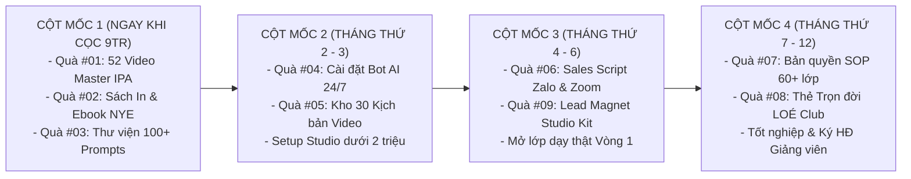
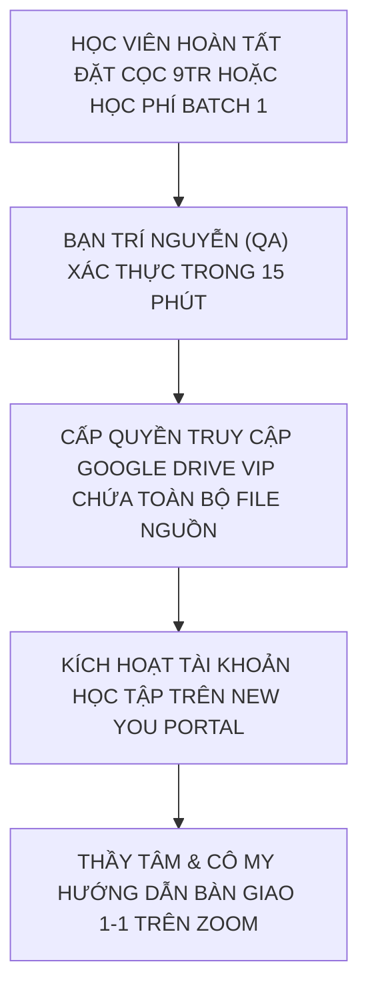

# CẨM NANG & KHO TÀI NGUYÊN BỘ 8 QUÀ TẶNG TRUYỀN NGHỀ ĐỘC BẢN
## THE ULTIMATE FAST-ACTION BONUSES VAULT — TRỊ GIÁ 42.000.000 VNĐ (TẶNG 0Đ)
### HỆ THỐNG ĐÀO TẠO GIÁO VIÊN TIẾNG ANH THỰC CHIẾN 12 THÁNG — NEW YOU TEACHER ACADEMY
#### TÍCH HỢP LỊCH TRÌNH SẢN XUẤT, NGHIỆM THU QA & LỘ TRÌNH MỞ KHÓA THEO CỘT MỐC

---

* **Đơn vị ban hành:** Ban Giảng Huấn New You English (**Cô Sophie Diễm My** & **Thầy Huỳnh Trường Thanh Tâm**)
* **Giám sát Tiến độ & Đảm bảo Chất lượng (QA):** **Bạn Trí Nguyễn** (Project Manager & QA)
* **Đối tượng sở hữu:** Học viên đăng ký Khóa Khai Mở Founding Batch 1 (Gói Pro Teacher, Dual-Degree Master, VIP Mentorship 1-1) hoặc ứng viên hoàn tất cọc thẩm định 9.000.000đ.
* **Mục đích tài liệu:** Quy chuẩn hóa toàn bộ tài nguyên học liệu số, kịch bản thực chiến, quy trình SOP và xác lập **Lịch trình hoàn thiện - nghiệm thu - mở khóa** từng món quà trong suốt 12 tháng.
* **Quy chuẩn bảo mật:** Tài sản trí tuệ độc quyền của New You English & Shin Digital Ecosystem. Nghiêm cấm phân phối ra ngoài hệ thống khi chưa có sự đồng thuận bằng văn bản.

---

```
╔═══════════════════════════════════════════════════════════════════════════════════════════╗
║                   BẢNG TỔNG HỢP GIÁ TRỊ BỘ 8 QUÀ TẶNG ĐỘC QUYỀN                           ║
╠═══════════════════════════════════════════════════════════════════════════════════════════╣
║  #01. Trọn bộ 52 Video Master Phát Âm Chuẩn IPA Anh - Mỹ (Cô My)        :  3.500.000 VNĐ  ║
║  #02. Sách In Cứng & Ebook Bản Quyền "New You English"                  :    500.000 VNĐ  ║
║  #03. Thư Viện 100+ Mega Prompts AI Chuyên Sâu Dạy Học (Thầy Tâm)       :  5.000.000 VNĐ  ║
║  #04. 01 Chatbot AI Trợ Giảng Riêng 24/7 (Custom GPTs Cá Nhân Hóa)     :  8.000.000 VNĐ  ║
║  #05. Kho 30 Kịch Bản Video Ngắn Triệu View Bắt Trend Đã Kiểm Chứng     :  6.000.000 VNĐ  ║
║  #06. Bộ Kịch Bản Tư Vấn Thấu Cảm 5 Bước & Demo Zoom 45 Phút Chốt Combo:  7.000.000 VNĐ  ║
║  #07. Bản Quyền Bộ SOP Quy Trình Vận Hành 60+ Lớp Học Online            : 10.000.000 VNĐ  ║
║  #08. Thẻ Hội Viên Trọn Đời CLB Tiếng Anh LOÉ & Săn Tây                 :  2.000.000 VNĐ  ║
╠═══════════════════════════════════════════════════════════════════════════════════════════╣
║  🎁 TỔNG GIÁ TRỊ THỰC TẾ NIÊM YẾT: 42.000.000 VNĐ ➔ TẶNG MIỄN PHÍ 0Đ (BATCH 1)            ║
║  🚀 QUÀ TẶNG GIA TĂNG #09: Lead Magnet Studio Kit (Vũ khí chiêu sinh 0đ từ Tháng 4)      ║
╚═══════════════════════════════════════════════════════════════════════════════════════════╝
```

---

# PHẦN A: LỊCH TRÌNH HOÀN THIỆN, SẢN XUẤT & NGHIỆM THU QA BỘ QUÀ TẶNG
*(Kế hoạch triển khai nội bộ của Ban Giảng Huấn trước và trong Khóa Khai Mở Batch 1)*

```
┌─────────────────────────────────────────────────────────────────────────────────────────────────────────────────────┐
│                          LỊCH TRÌNH HOÀN THIỆN & SẢN XUẤT BỘ QUÀ TẶNG TRUYỀN NGHỀ NEW YOU                           │
├─────┬────────────────────────────────────┬────────────────────┬───────────┬──────────────┬──────────────────────────┤
│ STT │ Món Quà Tặng Độc Quyền             │ Nhân Sự Phụ Trách  │ Hạn Chót  │ Trạng Thái   │ Tiêu Chuẩn Nghiệm Thu QA │
├─────┼────────────────────────────────────┼────────────────────┼───────────┼──────────────┼──────────────────────────┤
│ #01 │ 52 Video Master IPA Chuẩn Quốc Tế  │ Cô Diễm My         │ 10/11/2026│ Đang hậu kỳ  │ Full HD, chuẩn IPA Oxford│
│ #02 │ Sách In Cứng & Ebook New You       │ Cô My & Đơn vị in  │ 15/11/2026│ Dàn trang    │ Bìa cứng mạ vàng, ký tay │
│ #03 │ Thư Viện 100+ Mega Prompts AI      │ Thầy Tâm           │ Hoàn thành│ Sẵn sàng     │ Notion DB + Test ChatGPT │
│ #04 │ Custom GPTs Trợ Giảng Riêng 24/7   │ Thầy Tâm           │ 20/11/2026│ Hoàn thành   │ Prompt system + Test bot │
│ #05 │ Kho 30 Kịch Bản Video Triệu View   │ Thầy Tâm & Cô My   │ 15/11/2026│ Đang duyệt   │ 30 kịch bản từng giây    │
│ #06 │ Bộ Sales Script Zalo & Demo Zoom   │ Thầy Tâm           │ Hoàn thành│ Sẵn sàng     │ 5 bước Zalo + Slide 15 tr│
│ #07 │ Bản Quyền SOP Vận Hành 60+ Lớp     │ Thầy Tâm & Bạn Trí │ 18/11/2026│ Hoàn thiện   │ Google Sheets tự động hóa│
│ #08 │ Thẻ Hội Viên Trọn Đời LOÉ Club     │ Ban Chủ Nhiệm LOÉ  │ 25/11/2026│ Thiết kế thẻ │ Digital Card + Group VIP │
│ #09 │ Lead Magnet Studio Kit             │ Thầy Tâm           │ 20/11/2026│ Hoàn thành   │ Ebook đổi tên + Anki 500 │
└─────┴────────────────────────────────────┴────────────────────┴───────────┴──────────────┴──────────────────────────┤
│ 🔍 TIÊU CHUẨN QA DO BẠN TRÍ NGUYỄN KIỂM SOÁT: 100% tài nguyên phải có hướng dẫn sử dụng và file nguồn Google Drive │
└─────────────────────────────────────────────────────────────────────────────────────────────────────────────────────┘
```

---

# PHẦN B: LỘ TRÌNH MỞ KHÓA BỘ QUÀ TẶNG THEO TIẾN ĐỘ HỌC VIÊN (MILESTONE-BASED UNLOCK)

Nhằm đảm bảo học viên tiếp thu đến đâu ứng dụng thực chiến ngay đến đó, New You English áp dụng cơ chế mở khóa quà tặng theo từng cột mốc:



---

# PHẦN C: NỘI DUNG CHI TIẾT TỪNG MÓN QUÀ TẶNG

---

## QUÀ TẶNG #01: Trọn Bộ 52 Video Master Phát Âm Chuẩn IPA Anh - Mỹ
* **Định giá niêm yết:** 3.500.000 VNĐ  
* **Chuyên gia huấn luyện:** **Cô Sophie Diễm My** (Chứng chỉ TKT Cambridge, 8+ năm kinh nghiệm).
* **Thời điểm mở khóa:** Ngay khi hoàn tất đặt cọc thẩm định 9.000.000đ.
* **Định dạng bàn giao:** Link Google Drive VIP + Tài khoản học tập trên New You Portal.

### 1. Phân Bổ 52 Video Theo Khung Chuẩn Quốc Tế:
* **Học phần 1 (Video 01 - 12): 12 Nguyên Âm Đơn (Monophthongs)**
  - Các cặp âm dài - ngắn tương phản: `/iː/` vs `/ɪ/` (sheep vs ship), `/uː/` vs `/ʊ/` (fool vs full), `/ɔː/` vs `/ɒ/` (cord vs cod), `/ɑː/` vs `/ʌ/` (calm vs come), `/ɜː/` vs `/ə/` (bird vs ago), `/e/` vs `/æ/` (bed vs bad).
* **Học phần 2 (Video 13 - 20): 8 Nguyên Âm Đôi (Diphthongs)**
  - Âm lướt chuyển khẩu hình: `/eɪ/` (face), `/aɪ/` (price), `/ɔɪ/` (boy), `/aʊ/` (mouth), `/əʊ/` (goat), `/ɪə/` (near), `/eə/` (hair), `/ʊə/` (cure).
* **Học phần 3 (Video 21 - 44): 24 Phụ Âm Chuẩn Quốc Tế (Consonants)**
  - 8 Cặp phụ âm vô thanh & hữu thanh (Voiceless vs Voiced): `/p/` - `/b/`, `/t/` - `/d/`, `/k/` - `/g/`, `/f/` - `/v/`, `/θ/` - `/ð/` (cặp âm bẻ khớp răng lưỡi kinh điển), `/s/` - `/z/`, `/ʃ/` - `/ʒ/`, `/tʃ/` - `/dʒ/`.
  - Các phụ âm mũi, bên và bán nguyên âm: `/m/`, `/n/`, `/ŋ/`, `/h/`, `/l/`, `/r/`, `/w/`, `/j/`.
* **Học phần 4 (Video 45 - 52): Âm Tiết Nâng Cao & Ngữ Điệu Tự Nhiên (Connected Speech & Intonation)**
  - Video 45: Quy tắc bật âm đuôi và phát âm đuôi `-s/-es` (`/s/`, `/z/`, `/ɪz/`).
  - Video 46: Quy tắc phát âm đuôi `-ed` (`/t/`, `/d/`, `/ɪd/`).
  - Video 47: Kỹ thuật nối âm liên hoàn (Consonant to Vowel Linking).
  - Video 48: Hiện tượng nuốt âm (Elision) và đồng hóa âm (Assimilation).
  - Video 49: Trọng âm từ (Word Stress Rules) và nguyên tắc âm yếu Schwa `/ə/`.
  - Video 50: Trọng âm câu (Sentence Stress) - Phân biệt từ nội dung và từ chức năng.
  - Video 51: Ngữ điệu lên xuống biểu cảm (Intonation Patterns: Falling vs Rising).
  - Video 52: Kỹ thuật nhại giọng (Shadowing Technique) để nói tự nhiên như người bản xứ.

### 2. Đặc Quyền Sử Dụng:
> Học viên được phép sử dụng kho 52 video này làm **HỌC LIỆU MẪU ĐỂ CHIẾU CHO HỌC SINH CỦA MÌNH XEM** trong các lớp học trực tuyến riêng!

---

## QUÀ TẶNG #02: Sách In Cứng & Ebook Bản Quyền "New You English"
* **Định giá niêm yết:** 500.000 VNĐ  
* **Tác giả:** **Sophie Diễm My** (Kèm lời đề tặng & Chữ ký tay gửi tận nhà học viên).
* **Thời điểm bàn giao:** Trong tuần đầu tiên sau khi nhập học chính thức.

### Tóm Tắt 5 Chương Sách:
* **Chương 1 — Cởi Bỏ Rào Cản Tâm Lý:** Giải phóng nỗi sợ nói tiếng Anh, vượt qua tâm lý sợ phán xét.
* **Chương 2 — Tái Cấu Trúc Khẩu Hình & Ngữ Âm:** Bản đồ bẻ khớp 44 âm quốc tế, cách phát hiện lỗi nuốt âm đuôi.
* **Chương 3 — Phương Pháp Nạp Từ Vựng Khắc Sâu:** Thoát khỏi bẫy chép phạt; học từ vựng theo cụm tình huống (Chunking) và lặp lại ngắt quãng (Spaced Repetition).
* **Chương 4 — Phản Xạ Ngữ Pháp Quy Nạp (Inductive Grammar):** Cách dạy ngữ pháp tự nhiên qua câu chuyện và ngữ cảnh thực tế.
* **Chương 5 — Hành Trình Bước Lên Bục Giảng:** Kỹ năng truyền lửa, quản trị năng lượng lớp học và kết nối cảm xúc với học trò.

---

## QUÀ TẶNG #03: Thư Viện 100+ Mega Prompts AI Chuyên Sâu Cho Giáo Viên Tiếng Anh
* **Định giá niêm yết:** 5.000.000 VNĐ  
* **Tác giả:** **Thầy Huỳnh Trường Thanh Tâm**
* **Thời điểm mở khóa:** Ngay trong Buổi học Bài 2 (Tháng thứ 2).
* **Định dạng:** Workspace Notion Database + File Markdown Cheat Sheet.

### Danh Mục 5 Nhóm Prompts Thực Chiến:
1. **Nhóm 1 (20 Prompts):** Soạn Kế hoạch Bài dạy (Lesson Plans theo mô hình PPP, TTT, TBL, ESA) theo chuẩn CEFR A1 - B2.
2. **Nhóm 2 (25 Prompts):** Sản xuất Ngữ liệu Đọc hiểu & Hội thoại Thực tế đa tình huống (Giao tiếp công sở, du lịch, đàm phán).
3. **Nhóm 3 (20 Prompts):** Tạo Ngân hàng Bài tập Trắc nghiệm, Điền từ, Bẻ khớp âm có đáp án giải thích sư phạm chi tiết.
4. **Nhóm 4 (20 Prompts):** Thiết kế Câu hỏi Bẫy tư duy (CCQs - Concept Checking Questions) và Tình huống Đóng vai (Role-play).
5. **Nhóm 5 (15 Prompts):** Tự động hóa Slide bài giảng tương tác trên Gamma.app / Canva và đề thi Quizizz / Google Forms.

---

## QUÀ TẶNG #04: Cài Đặt 01 Chatbot AI Trợ Giảng Riêng 24/7 (Custom GPTs)
* **Định giá niêm yết:** 8.000.000 VNĐ  
* **Chuyên gia hỗ trợ kỹ thuật:** **Thầy Huỳnh Trường Thanh Tâm** (Hỗ trợ cài đặt 1-1 qua Zoom).
* **Thời điểm kích hoạt:** Tháng thứ 2 (Sau khi học viên vượt qua bài kiểm tra Bài 4).

### Quy Trình Bàn Giao & Triển Khai:
1. Thiết lập tên bot định danh thương hiệu cá nhân của học viên.
2. Nạp toàn bộ kho ngữ liệu New You English và 4.500 từ vựng hoạt dụng vào Knowledge Base.
3. Cài đặt System Prompt chuẩn sư phạm New You: Khen ngợi nỗ lực $\rightarrow$ Bảng phân tích lỗi sai $\rightarrow$ Nâng cấp câu tự nhiên $\rightarrow$ Câu hỏi thách thức phản xạ.
4. Xuất bản link độc quyền để học viên cấp cho học sinh trong lớp riêng của mình.

---

## QUÀ TẶNG #05: Kho 30 Kịch Bản Video Ngắn Triệu View Bắt Trend Đã Kiểm Chứng
* **Định giá niêm yết:** 6.000.000 VNĐ  
* **Đơn vị phát triển:** Ban Giảng Huấn New You English.
* **Thời điểm mở khóa:** Tháng thứ 3 (Trước khi bước vào giai đoạn sản xuất 20 video).

### Bảng Phân Bổ 30 Kịch Bản Theo 5 Trụ Cột Nội Dung:
* **Trụ Cột 1 (8 Kịch bản):** Bóc phốt phát âm sai kinh điển (Schedule, Comfortable, Wednesday, Ending sounds...).
* **Trụ Cột 2 (6 Kịch bản):** Lỗi sai ngữ pháp người đi làm hay mắc (I very like it, Discuss about, Marry with...).
* **Trụ Cột 3 (6 Kịch bản):** Tình huống thực tế đời sống đóng 2 vai (Đi cà phê Starbucks, Họp đối tác, Lạc đường sân bay).
* **Trụ Cột 4 (5 Kịch bản):** Mẹo nhớ siêu tốc 60 giây (Quy tắc 5 ngón tay In-On-At, Thơ trật tự tính từ OSASCOMP).
* **Trụ Cột 5 (5 Kịch bản):** Câu chuyện học trò & Động lực học tiếng Anh (Người đi làm 30 tuổi mất gốc bứt phá).

---

## QUÀ TẶNG #06: Bộ Kịch Bản Tư Vấn Thấu Cảm 5 Bước & Demo Zoom 45 Phút Chốt Combo
* **Định giá niêm yết:** 7.000.000 VNĐ  
* **Thời điểm mở khóa:** Tháng thứ 3 (Giai đoạn đào tạo Kỹ năng Sales & Phễu).

### Nội Dung Bàn Giao:
1. **File Word Sales Script 5 Bước Zalo:** Toàn văn câu thoại chẩn đoán nỗi đau, bẻ gãy rào cản giá, so sánh giá trị đảo ngược và kỹ thuật follow-up văn minh không chèo kéo.
2. **Bộ Slide Trình Chiếu Chuẩn 15 Trang (Canva/PowerPoint):** Dành riêng cho buổi Dạy thử Demo Class 45 phút trên Zoom, tối ưu chuyển đổi chốt gói học phí combo 3 - 6 - 12 tháng.

---

## QUÀ TẶNG #07: Bản Quyền Toàn Diện Bộ SOP Vận Hành 60+ Lớp Học Online
* **Định giá niêm yết:** 10.000.000 VNĐ  
* **Thời điểm mở khóa:** Tháng thứ 4 (Khi học viên chính thức mở lớp dạy thật Vòng 1).

### Hệ Thống 6 Biểu Mẫu SOP Sẵn Sàng Nhân Bản:
* **SOP-01:** File Master Google Sheets Quản lý Lớp học Đa năng (Tự động tính chuyên cần, thống kê điểm bài tập về nhà, biểu đồ trực quan).
* **SOP-02:** Quy trình Đón tiếp Học viên Mới & Gửi Thư Chào Mừng (Welcome Letter).
* **SOP-03:** Kịch bản Chăm sóc & Nhắc nhở Học viên Nghỉ học / Trễ hạn BTVN bằng sự thấu cảm.
* **SOP-04:** Mẫu Báo cáo Kết quả Học tập Định kỳ Hàng tháng Gửi Phụ huynh / Cá nhân.
* **SOP-05:** Quy trình Tổ chức Thi Định kỳ & Lễ Tốt nghiệp Mini trên Zoom.
* **SOP-06:** Kịch bản Xin Lời Đánh Giá (Testimonial & Referral) Tự Nhiên.

---

## QUÀ TẶNG #08: Thẻ Hội Viên Trọn Đời Mạng Lưới Săn Tây & Phát Triển LOÉ Club
* **Định giá niêm yết:** 2.000.000 VNĐ  
* **Thời điểm cấp thẻ:** Khi học viên hoàn thành giai đoạn đào tạo nền tảng và bước vào mạng lưới trợ giảng / đứng lớp.

### Đặc Quyền Độc Quyền:
* Tham gia miễn phí các buổi Săn Tây Thực Chiến Offline & Online hàng tháng.
* Môi trường thực hành tiếng Anh cởi mở cùng người bản xứ đến từ Mỹ, Anh, Úc, Canada.
* Tham gia Mạng lưới Giảng viên New You để nhận học sinh chuyển giao từ các lớp quá tải.

---

## QUÀ TẶNG GIA TĂNG #09: Bộ Lead Magnet Studio Kit Dành Cho Giáo Viên Đi Chiêu Sinh
*(Đặc cách trao tặng độc quyền bởi Thầy Tâm)*

* **01 File Ebook PDF Được Đổi Tên Tác Giả:** *"Sổ Tay 100 Cụm Từ Tiếng Anh Bẻ Gãy Rào Cản Công Sở"* — Cho phép học viên gắn tên mình và số Zalo cá nhân để tặng học sinh hút danh sách đăng ký.
* **Bộ 500 Flashcards Anki Cài Sẵn Âm Thanh:** Công cụ mồi tặng học sinh học thử.
* **Mẫu Form Khảo Sát Nhu Cầu Tự Động:** Google Forms chuẩn chuyển đổi thông tin về Zalo giáo viên.

---

# HƯỚNG DẪN KÍCH HOẠT & TIẾP NHẬN TÀI NGUYÊN



### Kênh Tiếp Nhận Chính Thức:
* **Hotline / Zalo Tiếp nhận:** **0945.309.115** (Ban Học Thuật New You English)
* **Link Nhóm Zalo Hỗ Trợ Độc Quyền:** [https://zalo.me/g/iqsizbdchqz1p1br3rkx](https://zalo.me/g/iqsizbdchqz1p1br3rkx)
* **Phòng Họp Trực Tuyến Định Kỳ:** [https://meet.google.com/ktd-wymq-aok](https://meet.google.com/ktd-wymq-aok) (Mã phòng: `ktd-wymq-aok`)

---

*Bản quyền tài liệu thuộc về:*  
**HỆ THỐNG ANH NGỮ NEW YOU ENGLISH & SHIN DIGITAL ECOSYSTEM**  
*Cố vấn Chiến lược & Công nghệ: Thầy Huỳnh Trường Thanh Tâm*  
*Giám đốc Học thuật & Đào tạo: Cô Sophie Diễm My*  
*Điều phối Dự án & Đảm bảo Chất lượng: Bạn Trí Nguyễn*
