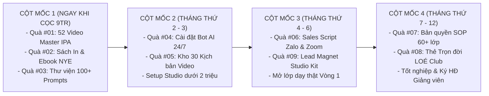

# LỊCH TRÌNH TẬP TRUNG PHÁT TRIỂN & MỞ KHÓA BỘ QUÀ TẶNG (12 THÁNG)
## KẾ HOẠCH HÀNH ĐỘNG CHUYÊN SÂU MẢNG CÔNG NGHỆ, VIDEO & PHỄU SALES CỦA THẦY TÂM
### ĐẢM BẢO CHẤT LƯỢNG (QA): BẠN TRÍ NGUYỄN | CHUYÊN MÔN NGỮ ÂM: CÔ SOPHIE DIỄM MY

---

* [Quay lại Chỉ Mục Bộ Quà Tặng](./00_CHI_MUC_BO_QUA_TANG.md)

---

## 1. KẾ HOẠCH HÀNH ĐỘNG TẬP TRUNG MẢNG CỦA THẦY TÂM (TRƯỚC NGÀY KHAI GIẢNG BATCH 1):

Thầy Huỳnh Trường Thanh Tâm tập trung 100% nguồn lực hoàn thiện các đầu việc công nghệ, kịch bản truyền thông và hạ tầng bán hàng tự động:

```
┌─────────────────────────────────────────────────────────────────────────────────────────────────────────────────────┐
│                            KẾ HOẠCH HÀNH ĐỘNG CHUYÊN SÂU CỦA THẦY TÂM (THÁNG 11/2026)                               │
├────────────┬────────────────────────────────────┬────────────────────────────────────────────┬──────────────────────┤
│ Tuần Lễ    │ Hạng Mục Trọng Tâm                 │ Sản Phẩm Hoàn Thành Cụ Thể                 │ Trạng Thái           │
├────────────┼────────────────────────────────────┼────────────────────────────────────────────┼──────────────────────┤
│ TUẦN 1     │ Thư viện Mega Prompts &            │ - Số hóa 100+ Mega Prompts lên Notion DB   │ ✅ ĐÃ HOÀN THÀNH     │
│ (01 - 07)  │ Kịch bản Sales Zalo 5 bước         │ - Hoàn thiện kịch bản tư vấn Zalo 3 tệp    │                      │
├────────────┼────────────────────────────────────┼────────────────────────────────────────────┼──────────────────────┤
│ TUẦN 2     │ Kho 30 Kịch bản Video &            │ - Viết chi tiết khung 30 kịch bản video    │ 🚀 Đang phối hợp     │
│ (08 - 14)  │ Slide Demo Class Zoom 15 trang     │ - Thiết kế bộ Slide Demo Class Zoom 15 tr  │    Cô My duyệt slot  │
├────────────┼────────────────────────────────────┼────────────────────────────────────────────┼──────────────────────┤
│ TUẦN 3     │ Bản quyền SOP Vận hành &           │ - Số hóa File Master Google Sheets quản lý │ 🚀 Đang phối hợp     │
│ (15 - 21)  │ Cài đặt Custom GPTs Trợ giảng      │ - Cấu hình System Prompt cho Bot AI        │    Bạn Trí QA        │
├────────────┼────────────────────────────────────┼────────────────────────────────────────────┼──────────────────────┤
│ TUẦN 4     │ Cổng VietQR SePay & Bot Telegram   │ - Tích hợp khung VietQR SePay vào Landing  │ 🎯 Sẵn sàng thử      │
│ (22 - 28)  │ Lead Magnet Studio Kit             │ - Cấu hình Webhook Telegram nổ đơn         │    nghiệm thực tế    │
└────────────┴────────────────────────────────────┴────────────────────────────────────────────┴──────────────────────┘
```

---

## 2. LỘ TRÌNH MỞ KHÓA THEO CỘT MỐC HỌC TẬP CỦA HỌC VIÊN (4 CỘT MỐC 12 THÁNG):



* **Cột mốc 1 (Ngay khi cọc 9.000.000đ):** Mở khóa Quà #01, #02 (do Cô My phụ trách chuyên môn) và Quà #03 (Thư viện Mega Prompts do Thầy Tâm phụ trách).
* **Cột mốc 2 (Tháng thứ 2 - 3):** Hoàn thành bài kiểm tra Bài 1-4 để Thầy Tâm cài đặt Quà #04 (Bot AI trợ giảng) và mở khóa Quà #05 (Kho 30 kịch bản video).
* **Cột mốc 3 (Tháng thứ 4 - 6):** Hoàn thành 20 video ngắn và vượt qua bài đóng vai tư vấn để nhận Quà #06 (Sales Scripts & Slide Zoom) và Quà #09 (Lead Magnet Studio Kit) phục vụ mở lớp thật Vòng 1.
* **Cột mốc 4 (Tháng thứ 7 - 12):** Hoàn thành Vòng 1 và mở lớp Vòng 2 để nhận trọn bộ Quà #07 (Bản quyền SOP 60+ lớp), Quà #08 (Thẻ LOÉ Club trọn đời) và ký hợp đồng Giảng viên New You English.
