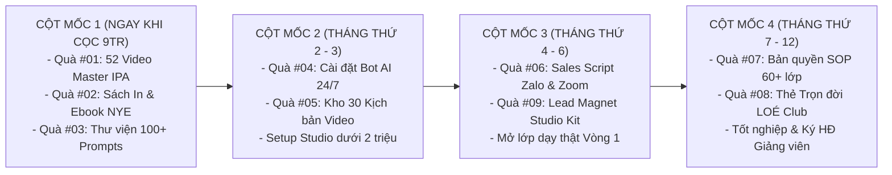

# LỊCH TRÌNH SẢN XUẤT, NGHIỆM THU QA & LỘ TRÌNH MỞ KHÓA BỘ QUÀ TẶNG (12 THÁNG)
## THE ULTIMATE ROADMAP: PRODUCTION, QUALITY GATE & MILESTONE UNLOCK
### BAN GIẢNG HUẤN: CÔ SOPHIE DIỄM MY, THẦY HUỲNH TRƯỜNG THANH TÂM & BẠN TRÍ NGUYỄN QA

---

* [Quay lại Chỉ Mục Bộ Quà Tặng](./00_CHI_MUC_BO_QUA_TANG.md)

---

## 1. TIẾN ĐỘ SẢN XUẤT & NGHIỆM THU NỘI BỘ TRƯỚC NGÀY KHAI GIẢNG BATCH 1:

```
┌─────────────────────────────────────────────────────────────────────────────────────────────────────────────────────┐
│                          LỊCH TRÌNH HOÀN THIỆN & SẢN XUẤT BỘ QUÀ TẶNG TRUYỀN NGHỀ NEW YOU                           │
├─────┬────────────────────────────────────┬────────────────────┬───────────┬──────────────┬──────────────────────────┤
│ STT │ Món Quà Tặng Độc Quyền             │ Nhân Sự Phụ Trách  │ Hạn Chót  │ Trạng Thái   │ Tiêu Chuẩn Nghiệm Thu QA │
├─────┼────────────────────────────────────┼────────────────────┼───────────┼──────────────┼──────────────────────────┤
│ #01 │ 52 Video Master IPA Chuẩn Quốc Tế  │ Cô Diễm My         │ 10/11/2026│ Đang hậu kỳ  │ Full HD, chuẩn IPA Oxford│
│ #02 │ Sách In Cứng & Ebook New You       │ Cô My & Đơn vị in  │ 15/11/2026│ Dàn trang    │ Bìa cứng mạ vàng, ký tay │
│ #03 │ Thư Viện 100+ Mega Prompts AI      │ Thầy Tâm           │ Hoàn thành│ Sẵn sàng     │ Notion DB + Test ChatGPT │
│ #04 │ Custom GPTs Trợ Giảng Riêng 24/7   │ Thầy Tâm           │ 20/11/2026│ Hoàn thành   │ Prompt system + Test bot │
│ #05 │ Kho 30 Kịch Bản Video Triệu View   │ Thầy Tâm & Cô My   │ 15/11/2026│ Đang duyệt   │ 30 kịch bản từng giây    │
│ #06 │ Bộ Sales Script Zalo & Demo Zoom   │ Thầy Tâm           │ Hoàn thành│ Sẵn sàng     │ 5 bước Zalo + Slide 15 tr│
│ #07 │ Bản Quyền SOP Vận Hành 60+ Lớp     │ Thầy Tâm & Bạn Trí │ 18/11/2026│ Hoàn thiện   │ Google Sheets tự động hóa│
│ #08 │ Thẻ Hội Viên Trọn Đời LOÉ Club     │ Ban Chủ Nhiệm LOÉ  │ 25/11/2026│ Thiết kế thẻ │ Digital Card + Group VIP │
│ #09 │ Lead Magnet Studio Kit             │ Thầy Tâm           │ 20/11/2026│ Hoàn thành   │ Ebook đổi tên + Anki 500 │
└─────┴────────────────────────────────────┴────────────────────┴───────────┴──────────────┴──────────────────────────┤
│ 🔍 TIÊU CHUẨN QA DO BẠN TRÍ NGUYỄN KIỂM SOÁT: 100% tài nguyên phải có hướng dẫn sử dụng và file nguồn Google Drive │
└─────────────────────────────────────────────────────────────────────────────────────────────────────────────────────┘
```

---

## 2. LỘ TRÌNH MỞ KHÓA THEO CỘT MỐC HỌC TẬP CỦA HỌC VIÊN (4 CỘT MỐC):



* **Cột mốc 1 (Ngay khi cọc 9.000.000đ):** Mở khóa Quà #01, #02, #03 để học viên bứt phá phát âm và làm quen với công nghệ AI soạn giảng.
* **Cột mốc 2 (Tháng thứ 2 - 3):** Hoàn thành bài kiểm tra Bài 1-4 để mở khóa Quà #04 (Bot AI trợ giảng) và Quà #05 (Kho 30 kịch bản video).
* **Cột mốc 3 (Tháng thứ 4 - 6):** Hoàn thành 20 video ngắn và vượt qua bài đóng vai chốt sale để nhận Quà #06 (Sales Scripts & Slide Zoom) và Quà #09 (Lead Magnet Studio Kit) phục vụ mở lớp thật Vòng 1.
* **Cột mốc 4 (Tháng thứ 7 - 12):** Hoàn thành Vòng 1 và mở lớp Vòng 2 để nhận trọn bộ Quà #07 (Bản quyền SOP 60+ lớp), Quà #08 (Thẻ LOÉ Club trọn đời) và ký hợp đồng Giảng viên New You English.
