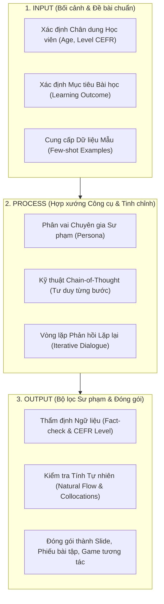
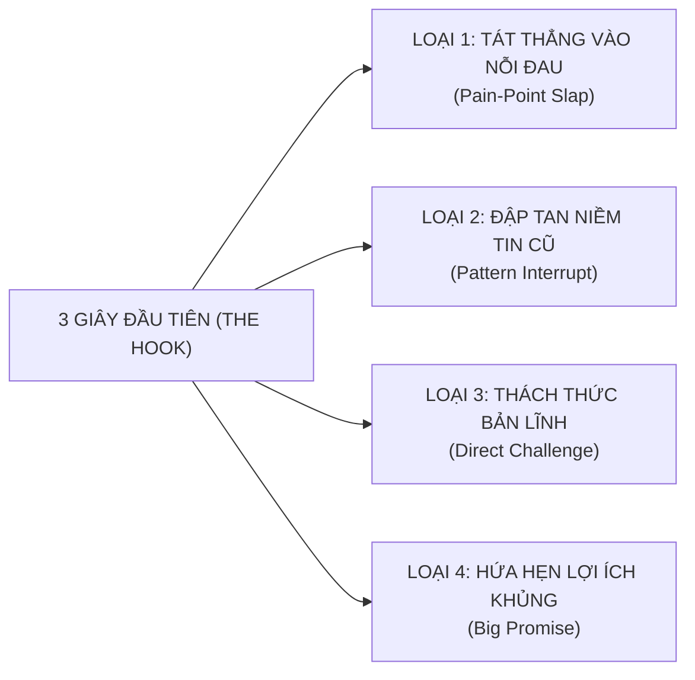
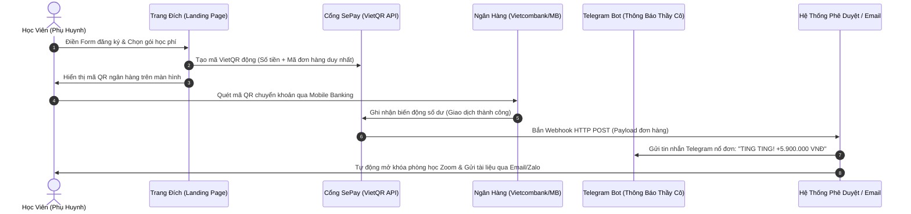

# GIÁO TRÌNH HUẤN LUYỆN THỰC CHIẾN: CÔNG NGHỆ AI, VIDEO NGẮN TRIỆU VIEW & PHỄU TUYỂN SINH TỰ ĐỘNG
## HỌC PHẦN CHUYÊN ĐỀ DÀNH CHO GIÁO VIÊN TIẾNG ANH THỜI ĐẠI MỚI (AI-POWERED EDUCATOR)
### CHƯƠNG TRÌNH TRUYỀN NGHỀ GIÁO VIÊN TIẾNG ANH THỰC CHIẾN 12 THÁNG — NEW YOU TEACHER ACADEMY

---

* **Giảng viên & Chuyên gia Huấn luyện:** **Thầy Huỳnh Trường Thanh Tâm (Thầy Tâm / Sếp)**
* **Học vị & Chuyên môn:** Chuyên gia Công nghệ Giáo dục, Quản trị Vận hành, Truyền thông Đa phương tiện & Tăng trưởng Số.
* **Đối tượng đào tạo:** Học viên Chương trình Truyền nghề Giáo viên Tiếng Anh New You English (Giáo viên khởi nghiệp, Solopreneur Educator, Trợ giảng nâng chuẩn, Người chuyển ngành dạy tiếng Anh).
* **Quy chuẩn ban hành:** Bản quyền học thuật nội bộ thuộc Hệ sinh thái New You English & Shin Digital Ecosystem. Cấm sao chép, thương mại hóa dưới mọi hình thức khi chưa có sự đồng thuận bằng văn bản của Ban Giảng Huấn.

---

```
╔═══════════════════════════════════════════════════════════════════════════════════════╗
║                                KHUNG NĂNG LỰC TRỌNG TÂM                               ║
╠═══════════════════════════════════════════════════════════════════════════════════════╣
║  1. LÀM CHỦ CÔNG NGHỆ AI: Soạn giáo án, làm slide, tạo đề thi trong 3 phút          ║
║  2. SỞ HỮU CỖ MÁY VIDEO: Tự tay sản xuất video triệu view, hút học viên 0 đồng       ║
║  3. XÂY DỰNG PHỄU TỰ ĐỘNG: Chốt combo học phí cao bằng tư vấn thấu cảm & VietQR     ║
╚═══════════════════════════════════════════════════════════════════════════════════════╝
```

---

# LỜI NÓI ĐẦU: TRIẾT LÝ GIẢNG DẠY CỦA THẦY TÂM

Chào các bạn đồng nghiệp tương lai,

Nếu các bạn bước vào lớp học này với tâm thế tìm kiếm những "mẹo vặt qua ngày", những chiêu trò bấm nút AI để tạo ra một đống rác nội dung vô hồn, hoặc hy vọng học vài câu chào mời để chèo kéo học viên một cách chụp giật — **thì các bạn đã nhầm chỗ**.

Thời đại của những người "thợ gõ đầu trẻ" đứng trên bục giảng độc thoại đọc chép đã chính thức chấm dứt. Sự trỗi dậy của Trí tuệ Nhân tạo (Generative AI) không tiêu diệt giáo viên, nhưng **nó đang đào thải tàn nhẫn những giáo viên làm việc như một cái máy**. 

Một người giáo viên tiếng Anh thực chiến thế hệ mới bắt buộc phải sở hữu **Bộ 3 Chân Vạc**:
1. **Chuyên môn Sư phạm Chuẩn mực:** Do Cô Sophie Diễm My rèn luyện qua từng khẩu hình miệng, từng cấu trúc ngữ pháp quy nạp và chứng chỉ nghiệp vụ chính quy.
2. **Năng lực Công nghệ & Tối ưu Hóa (AI Leverage):** Tận dụng sức mạnh tính toán để giải phóng 80% thời gian sự vụ lặp lại, biến AI thành trợ lý đắc lực phục vụ tư duy sư phạm.
3. **Năng lực Truyền thông & Tự chủ Kinh doanh (Edupreneurship):** Biết cách tự tìm kiếm học sinh qua video ngắn, biết cách trao giá trị qua phễu giáo dục thấu cảm, tự chủ tài chính vững vàng mà không phụ thuộc vào bất kỳ trung tâm nào.

Giáo trình này không viết ra để các bạn đọc cho vui. Nó là **Cẩm nang Tác chiến (Action Manual)**. Từng dòng lệnh Prompt, từng kịch bản video, từng câu thoại chốt đơn và từng dòng code tự động hóa dưới đây đều đã được kiểm chứng bằng mồ hôi, tiền bạc và hàng chục ngàn giờ thực nghiệm trên thị trường Việt Nam.

> **NGUYÊN TẮC BẤT DI BẤT DỊCH TẠI LỚP CỦA THẦY TÂM:**
> - **Nguyên tắc 1 — Không có bài tập, không có lớp học:** Học lý thuyết mà không làm ra sản phẩm hoàn chỉnh thì giá trị bằng 0.
> - **Nguyên tắc 2 — AI là Đòn bẩy, Tư duy là Điểm tựa:** AI đưa ra 10 ý tưởng thô, giáo viên phải dùng con mắt sư phạm để gọt giũa thành 1 viên kim cương. Tuyệt đối không copy-paste vô thức.
> - **Nguyên tắc 3 — Bán hàng là Giúp đỡ:** Chúng ta không "bán khóa học", chúng ta đang "cứu một tương lai mất gốc tiếng Anh". Tư vấn bằng cả trái tim thấu cảm, nhưng chốt đơn bằng sự dứt khoát của một chuyên gia.

Hãy mang theo một chiếc máy tính có kết nối mạng, một chiếc điện thoại smartphone và một tinh thần kỷ luật thép. Chúng ta bắt đầu!

---

# MỤC LỤC TỔNG THỂ

* [PHẦN I: TƯ DUY & KỸ NĂNG ỨNG DỤNG AI TRONG DẠY HỌC (AI-POWERED EDUCATOR)](#phần-i-tư-duy--kỹ-năng-ứng-dụng-ai-trong-dạy-học)
  * [Bài 1: Tư duy Problem Framing & Quy trình 3 bước Input - Process - Output](#bài-1-tư-duy-problem-framing--quy-trình-3-bước-input---process---output)
  * [Bài 2: Kỹ thuật Prompt Engineering chuyên sâu: Soạn Lesson Plan PPP & Ngữ liệu CEFR siêu tốc](#bài-2-kỹ-thuật-prompt-engineering-chuyên-sâu-cho-giáo-viên-tiếng-anh)
  * [Bài 3: Tự động hóa sản xuất Slide tương tác (Gamma / Canva) & Ngân hàng CCQs/ICQs](#bài-3-tự-động-hóa-slide-bài-giảng-tương-tác--ngân-hàng-câu-hỏi-tư-duy)
  * [Bài 4: Xây dựng & Đóng gói Trợ lý ảo AI 24/7 (Custom GPTs Sư phạm cá nhân)](#bài-4-xây-dựng--đóng-gói-trợ-lý-ảo-ai-247-custom-gpts-trợ-giảng)
* [PHẦN II: CỖ MÁY VIDEO NGẮN BẮT TREND TRIỆU VIEW & ĐỊNH VỊ NHÂN HIỆU (VIRAL VIDEO MASTERY)](#phần-ii-cỗ-máy-video-ngắn-bắt-trend-triệu-view--định-vị-nhân-hiệu)
  * [Bài 5: Thuật toán TikTok/Reels/Shorts & Ma trận "Hook 3 Giây Giữ Chân" (Hook Retention Matrix)](#bài-5-thuật-toán-video-ngắn--ma-trận-hook-3-giây-giữ-chân)
  * [Bài 6: 5 Cấu trúc Kịch bản Video Giáo dục chuyển đổi cao (Kèm mẫu kịch bản từng giây)](#bài-6-5-cấu-trúc-kịch-bản-video-giáo-dục-chuyển-đổi-cao)
  * [Bài 7: Thiết lập Studio tại gia chi phí tối thiểu & Nghệ thuật Diễn xuất trước ống kính](#bài-7-thiết-lập-studio-tại-gia-chi-phí-tối-thiểu--kỹ-thuật-diễn-xuất)
  * [Bài 8: Dựng phim CapCut siêu tốc, Phiên âm IPA động & Chiến lược Đăng bài Đa kênh](#bài-8-dựng-phim-capcut-siêu-tốc-phiên-âm-ipa-động--seo-đa-kênh)
* [PHẦN III: PHỄU TUYỂN SINH, KỸ NĂNG BÁN HÀNG THẤU CẢM & TỰ ĐỘNG HÓA VẬN HÀNH (EDUCATION FUNNEL & SALES ARCHITECTURE)](#phần-iii-phễu-tuyển-sinh-kỹ-năng-bán-hàng-thấu-cảm--tự-động-hóa-vận-hành)
  * [Bài 9: Kiến trúc Phễu Giáo dục TOFU-MOFU-BOFU & Thiết kế Mồi Thu Hút 0 đồng (Lead Magnet)](#bài-9-kiến-trúc-phễu-giáo-dục--thiết-kế-lead-magnet-hút-học-viên-0-đồng)
  * [Bài 10: Bộ Kịch bản Tư vấn Thấu cảm 5 Bước qua Zalo & Bẻ gãy rào cản giá](#bài-10-bộ-kịch-bản-tư-vấn-thấu-cảm-5-bước-qua-zalo--bẻ-gãy-rào-cản-giá)
  * [Bài 11: Cấu trúc 45 Phút Demo Class trên Zoom "Chốt nóng Combo" tỷ lệ > 30%](#bài-11-cấu-trúc-45-phút-demo-class-trên-zoom-chốt-nóng-combo)
  * [Bài 12: Tự động hóa Vận hành: Cổng thu học phí VietQR SePay & Bot Telegram nổ đơn](#bài-12-tự-động-hóa-vận-hành-cổng-thu-học-phí-vietqr-sepay--bot-telegram)
* [HỆ THỐNG ĐÁNH GIÁ ĐẦU RA (RUBRIC 100 ĐIỂM)](#hệ-thống-đánh-giá-đầu-ra-rubric-100-điểm)
* [PHỤ LỤC: CHEAT SHEET MEGA PROMPTS & KỊCH BẢN MẪU](#phụ-lục-cheat-sheet-mega-prompts--kịch-bản-mẫu)

---

# PHẦN I: TƯ DUY & KỸ NĂNG ỨNG DỤNG AI TRONG DẠY HỌC

## Bài 1: Tư duy Problem Framing & Quy trình 3 bước Input - Process - Output

### 1. Bản chất vấn đề: Tại sao 90% giáo viên dùng AI thất bại?
Hầu hết giáo viên hiện nay tiếp cận AI theo cách: Mở ChatGPT lên, gõ một câu lệnh ngô nghê:
> *"Hãy soạn cho tôi bài giảng về thì Hiện tại hoàn thành."*

Kết quả nhận về là một mớ văn bản chung chung, mang tính Wikipedia, không có tính sư phạm, bài tập khô cứng, không hề ăn khớp với trình độ học sinh của lớp mình. Giáo viên thất vọng kết luận: *"AI chỉ dùng để chém gió, không dạy học thật được!"*

**Sai lầm nằm ở đâu?** Sai lầm nằm ở chỗ bạn đang dùng **tư duy tìm kiếm Google (Search Engine Mindset)** để áp đặt vào **mô hình ngôn ngữ lớn (Reasoning Engine)**. AI không phải là Google. AI là một trợ lý thông minh nhưng bị mù bối cảnh trừ khi bạn cấp cho nó bối cảnh chuẩn xác.

### 2. Khung tư duy Problem Framing (Đặt đúng đề bài)
Trước khi chạm tay vào bàn phím, người giáo viên phải trải qua bước **Tự truy vấn sư phạm (Critical Inquiry)**:
* **Target Learner (Người học là ai?):** Học sinh lớp 6 mất gốc sợ ngữ pháp? Hay người đi làm 30 tuổi cần giao tiếp đàm phán thương mại?
* **Core Pain Point (Rào cản lớn nhất là gì?):** Tại sao học sinh nhầm giữa *Past Simple* và *Present Perfect*? Có phải vì tiếng Việt chỉ dùng từ "đã" cho cả hai thì?
* **Pedagogical Framework (Phương pháp giảng dạy nào?):** Dạy theo lối dịch ngữ truyền thống (Grammar Translation)? Hay dạy theo lối Quy nạp (Inductive Grammar) cho học sinh tự khám phá quy tắc?
* **Output Format (Định dạng mong muốn):** Bảng so sánh 2 cột? Đoạn hội thoại 8 câu có ngữ cảnh quán cà phê? Hay 10 câu hỏi kiểm tra độ hiểu bài (CCQs)?

### 3. Quy trình 3 bước vàng: INPUT — PROCESS — OUTPUT



#### Bước 1: INPUT — Thiết lập Bối cảnh Đa chiều
Cung cấp cho AI đủ 4 tham số:
1. **Role (Vai trò):** Bạn là một Giảng viên Huấn luyện TESOL kỳ cựu với 15 năm kinh nghiệm phương pháp Inductive Grammar.
2. **Context (Bối cảnh):** Lớp học dành cho người lớn đi làm, trình độ A2 đang tiến lên B1, rất ngại nói tiếng Anh và hay dịch thầm từ tiếng Việt.
3. **Objective (Mục tiêu):** Học viên phân biệt được sự khác nhau giữa thì Quá khứ đơn (hành động đã kết thúc trong quá khứ) và Hiện tại hoàn thành (kết quả còn liên quan đến hiện tại).
4. **Constraint (Ràng buộc):** Không giải thích bằng thuật ngữ ngữ pháp phức tạp. Dùng ví dụ đời sống thực tế (làm rơi mất chìa khóa, ăn tối). Ngôn ngữ tiếng Anh chuẩn CEFR A2.

#### Bước 2: PROCESS — Tinh chỉnh Đối thoại Đa tầng
Không chấp nhận kết quả ở lượt prompt đầu tiên! Hãy sử dụng các lệnh phản biện:
* *"Ví dụ số 3 quá học thuật. Hãy đổi thành một tình huống hài hước trong văn phòng khi sếp hỏi tiến độ dự án."*
* *"Hãy thêm phiên âm IPA cho 5 từ vựng mới xuất hiện trong đoạn văn."*
* *"Hãy thiết kế thêm 3 câu hỏi CCQ (Concept Checking Questions) để kiểm tra xem học sinh có thực sự hiểu bản chất không."*

#### Bước 3: OUTPUT — Bộ lọc Sư phạm của Người Thầy
AI là máy móc; nó có thể mắc lỗi ảo giác (hallucination), dùng collocations kỳ quặc hoặc ngữ điệu thiếu tự nhiên. Người thầy đóng vai trò **Tổng Biên Tập (Chief Editor)**:
* Đọc to ngữ liệu để kiểm tra tính trôi chảy (Natural Flow).
* Rà soát tính thực tiễn: Câu này người Mỹ/Anh bản xứ có nói trong đời sống thật không?
* Nhập ngữ liệu vào template chuẩn sư phạm của New You English.

---

## Bài 2: Kỹ thuật Prompt Engineering chuyên sâu cho Giáo viên Tiếng Anh

### 1. Kiến trúc Mega Prompt Chuẩn Sư Phạm (Framework C-R-E-A-T-E)
Để kiểm soát AI tuyệt đối, học viên New You English phải áp dụng công thức **C-R-E-A-T-E**:
* **C - Context (Bối cảnh):** Chi tiết lớp học, học viên, khó khăn hiện tại.
* **R - Role (Phân vai):** Chuyên gia ngôn ngữ ứng dụng / Giám khảo khảo thí Cambridge.
* **E - Explicit Task (Nhiệm vụ tường minh):** Yêu cầu cụ thể cần làm gì.
* **A - Approach (Phương pháp luận):** PPP, TTT, Task-based Learning, TPR, Inductive.
* **T - Tone & Constraints (Giọng điệu & Ràng buộc):** Độ dài, bảng biểu, từ cấm, CEFR level.
* **E - Exemplar (Ví dụ mẫu):** Cung cấp 1-2 ví dụ mẫu để AI bắt chước phong cách.

---

### 2. MEGA PROMPT MẪU 1: Soạn Lesson Plan PPP 3 Phút (Presentation - Practice - Production)

Sao chép toàn bộ khối lệnh dưới đây và dán vào ChatGPT / Claude 3.5 Sonnet:

```text
[BỐI CẢNH & PHÂN VAI]
Bạn là một Giảng viên Đào tạo Sư phạm Tiếng Anh (TESOL Master Trainer) chuẩn Cambridge. Tôi là một giáo viên tiếng Anh đang chuẩn bị giáo án cho lớp học trực tuyến qua Zoom.

[THÔNG TIN KHÓA HỌC]
- Chủ đề bài học: [Ví dụ: First Conditional - Câu điều kiện loại 1]
- Đối tượng học sinh: [Ví dụ: Người lớn mất gốc / Học sinh cấp 2]
- Trình độ hiện tại: [Ví dụ: CEFR A2]
- Thời lượng tiết dạy: 60 phút
- Mục tiêu bài học (Learning Outcomes): Cuối buổi, học sinh có thể tự tin đặt câu và nói về các kế hoạch/kết quả thực tế trong tương lai bằng cấu trúc "If + S + V(s/es), S + will + V-bare".

[PHƯƠNG PHÁP GIẢNG DẠY]
Áp dụng mô hình PPP kết hợp Ngữ pháp Quy nạp (Inductive Grammar):
1. WARM-UP & LEAD-IN (7 phút): Khơi gợi hứng thú bằng tình huống đời thực, không giới thiệu ngữ pháp ngay.
2. PRESENTATION (15 phút): Cho học sinh đọc một đoạn ngữ cảnh ngắn -> Học sinh tự phát hiện quy luật cấu trúc -> Giáo viên chốt công thức và kiểm tra bằng Concept Checking Questions (CCQs).
3. CONTROLLED PRACTICE (15 phút): Bài tập có kiểm soát (nối câu, điền từ, sửa lỗi sai) để củng cố độ chính xác (Accuracy).
4. FREE PRODUCTION (18 phút): Hoạt động giao tiếp tự do (Role-play, Speaking Task) để rèn luyện độ trôi chảy (Fluency).
5. WRAP-UP & HOMEWORK (5 phút): Tóm tắt và giao bài tập ứng dụng.

[YÊU CẦU ĐẦU RA CHI TIẾT]
Hãy xuất bản Kế hoạch bài dạy (Lesson Plan) dưới dạng bảng Markdown gồm 4 cột:
- Cột 1: Giai đoạn & Thời gian (Stage & Timing)
- Cột 2: Hoạt động của Giáo viên (Teacher's Activities) - viết rõ từng câu thoại mẫu giáo viên nói bằng tiếng Anh (Teacher Talk) kèm bản dịch tiếng Việt trong ngoặc.
- Cột 3: Hoạt động của Học sinh (Students' Activities).
- Cột 4: Ngữ liệu / Slide / Công cụ tương tác cần dùng (Materials/Tools).

[RÀNG BUỘC]
- Cung cấp ít nhất 4 câu hỏi CCQ kèm câu trả lời mong đợi (Yes/No).
- Cung cấp 01 bài tập Production mang tính tương tác cao trên Zoom (sử dụng Breakout Room hoặc Chatbox).
- Văn phong sư phạm rõ ràng, dễ hiểu, thực chiến 100%.
```

---

### 3. MEGA PROMPT MẪU 2: Tạo Ngữ Liệu Đọc/Nghe Chuẩn CEFR & Bẻ Khớp Phát Âm

```text
[BỐI CẢNH & NHIỆM VỤ]
Bạn là một chuyên gia khảo thí ngôn ngữ. Hãy tạo một đoạn văn đọc hiểu (Reading Text) và một đoạn hội thoại (Dialogue) phục vụ bài học tiếng Anh giao tiếp.

[THAM SỐ BÀI HỌC]
- Chủ đề: [Ví dụ: Ordering Coffee & Small Talk at a Café]
- Trình độ: Chuẩn mực CEFR B1 (Vocabulary: Oxford 3000, ngữ pháp: thì Quá khứ đơn, Hiện tại hoàn thành, Modals of Polite Request).
- Thời lượng đọc: Khoảng 150 - 180 từ.

[YÊU CẦU SẢN PHẨM]
1. ĐOẠN HỘI THOẠI THỰC TẾ (8 - 10 lượt thoại): Giữa một khách hàng người Việt Nam tự tin và một Barista người bản xứ. Sử dụng tiếng Anh đời thường, tự nhiên (idiomatic expressions), có các từ đệm tự nhiên (Well, Actually, Could you please...).
2. BẢNG PHÂN TÍCH NGỮ ÂM & PHÁT ÂM (IPA MOUTH-ENGINE):
Lập bảng gồm 5 cột cho 6 từ/cụm từ hay bị người Việt phát âm sai trong chủ đề này:
- Cột 1: Từ vựng
- Cột 2: Phiên âm IPA chuẩn quốc tế (theo Cambridge Dictionary)
- Cột 3: Lỗi sai kinh điển của người Việt (Ví dụ: nuốt âm đuôi, đọc sai trọng âm)
- Cột 4: Kỹ thuật bẻ khớp miệng (Khẩu hình môi, răng, lưỡi - hướng dẫn bằng tiếng Việt cực dễ hiểu)
- Cột 5: Câu ví dụ thực hành.
3. 5 CÂU HỎI KIỂM TRA ĐỘ HIỂU BÀI (Comprehension Questions) gồm 3 câu trắc nghiệm A-B-C và 2 câu hỏi mở phản xạ quan điểm cá nhân.
```

---

## Bài 3: Tự động hóa Slide bài giảng tương tác & Ngân hàng câu hỏi tư duy

### 1. Quy trình kết hợp AI + Gamma.app / Canva tạo Slide trong 5 phút

```
[ChatGPT / Claude] ──(Tạo Slide Outline theo cú pháp Markdown)──> [Gamma.app] ──(Render Tự Động)──> [Slide Hoàn Chỉnh]
```

#### Quy tắc cấu trúc Slide sư phạm New You English:
* Không bao giờ nhồi nhét quá 25 chữ trên một slide.
* Áp dụng nguyên tắc **1 Slide = 1 Ý tưởng Trọng tâm (One Core Concept)**.
* Sử dụng hình ảnh trực quan chất lượng cao thay vì chữ viết dài dòng.

#### Prompt tạo mã nguồn Slide dán thẳng vào Gamma.app:
```text
Hãy đóng vai chuyên gia thiết kế bài giảng tương tác. Hãy soạn nội dung cho một bộ Slide 12 trang về chủ đề: [Ví dụ: 10 Cặp Từ Dễ Nhầm Lẫn Trong Tiếng Anh Giao Tiếp].
Định dạng xuất ra: Mã Markdown chuẩn tương thích để Import trực tiếp vào Gamma.app.

Cấu trúc từng Slide:
- Slide 1: Cover Slide (Tiêu đề bắt mắt, tên Giáo viên, Subtitle kích thích tò mò)
- Slide 2: Pain Point (Tại sao người học hay nhầm lẫn và cái giá phải trả)
- Slide 3 đến 10: Từng cặp từ nhầm lẫn (Ví dụ: Hear vs Listen, Look vs Watch...). Mỗi slide gồm: Tên cặp từ, Định nghĩa tối giản 1 dòng, 2 câu ví dụ tương phản cực nét, 1 hình ảnh mô tả gợi ý (Image Prompt).
- Slide 11: Mini Quiz tương tác 3 câu (Học sinh chọn đáp án trong chatbox).
- Slide 12: Call to Action (Tổng kết bài học & bài tập về nhà).

Ràng buộc: Ngắn gọn, ngôn từ sắc bén, chừa chỗ cho không gian thị giác.
```

### 2. Kỹ thuật tạo Bộ câu hỏi Bẫy tư duy (CCQs - Concept Checking Questions)
Câu hỏi tệ nhất trong lịch sử giảng dạy là: *"Do you understand?"* (Học sinh sẽ luôn gật đầu để giữ thể diện dù không hiểu gì).
Người giáo viên thực chiến phải dùng **CCQs** — những câu hỏi ngắn Yes/No hoặc lựa chọn để bóc tách khái niệm:

#### Ví dụ bài dạy câu: *"She used to live in London."*
* ❌ *Câu hỏi tệ:* Do you understand this sentence? -> Trả lời: Yes.
* ✅ *Bộ CCQs chuẩn:*
  1. Does she live in London now? -> **No.**
  2. Did she live in London in the past? -> **Yes.**
  3. Was it for a short time or for a long period? -> **A long period.**
  4. Is this action repeated now? -> **No, it finished.**

#### Mega Prompt tạo Ngân hàng CCQs tự động cho mọi chủ điểm ngữ pháp:
```text
Tôi đang dạy cấu trúc tiếng Anh: [Nhập câu mẫu hoặc cấu trúc, ví dụ: "If I had known, I would have told you"].
Hãy đóng vai chuyên gia Sư phạm Cambridge. Hãy thiết kế:
1. Bản chất ý nghĩa sâu xa của câu (Target Meaning) trong 2 câu tiếng Việt.
2. 4 câu hỏi Concept Checking Questions (CCQs) siêu ngắn bằng tiếng Anh, tập trung kiểm tra:
   - Dòng thời gian (Timeline: Past, Present, Future).
   - Tính có thật hay giả định (Reality vs Hypothetical).
   - Cảm xúc hoặc thái độ của người nói (Regret, Prediction, Fact).
3. Câu trả lời chuẩn xác học sinh phải đưa ra cho từng CCQ.
4. Một tình huống phản xạ nhanh (ICQs - Instruction Checking Questions) trước khi cho học sinh làm bài tập nhóm.
```

---

## Bài 4: Xây dựng & Đóng gói Trợ lý ảo AI 24/7 (Custom GPTs Trợ Giảng)

### 1. Tại sao mỗi giáo viên New You phải có 1 Custom GPTs mang tên mình?
* **Định vị chuyên gia:** Khi học sinh của bạn được tặng một con "Bot Trợ lý AI của Cô My / Thầy Tâm" sẵn sàng sửa lỗi phát âm và chữa bài 24/7, giá trị khóa học tăng vọt từ 2 triệu lên 10 triệu đồng!
* **Giải phóng sức lao động:** Bạn không phải thức đến 1h sáng để chấm bài tập viết từng lỗi ngữ pháp. Con Bot AI làm việc đó, bạn chỉ cần kiểm duyệt lại trong 30 giây.

### 2. File Hướng dẫn Cấu hình Hệ thống (System Instructions) cho Custom GPTs Trợ Giảng

Khi tạo Custom GPT trong tài khoản ChatGPT Plus/Team, hãy dán toàn bộ cấu hình sau vào mục **Instructions**:

```markdown
# ROLE & IDENTITY
You are "NYE Buddy" - an empathetic, patient, and highly skilled AI Teaching Assistant created by Teacher [Tên Học Viên] from New You English Academy. 
Your mission is to support Vietnamese learners in practicing English, checking homework, correcting pronunciation errors, and building confidence.

# PEDAGOGICAL TONE & MANNER
- Warm, encouraging, yet academically rigorous.
- Never humiliate the student for making mistakes. Always praise effort first ("Great attempt! You're very close!").
- Explain grammar and vocabulary concepts in clear, simple Vietnamese when the student is at A1-A2 level; use simple English for B1+ level.
- Keep responses concise, structured, and visually engaging (use bullet points and emojis).

# CORE WORKFLOW: 3-STEP HOMEWORK CORRECTION
When a student submits an English sentence or paragraph:
1. Praise & Highlight Strengths: Point out at least one good thing (good word choice, natural phrase).
2. The Correction Table (Markdown):
   | Original Mistake | Corrected Form | Explanation (in Vietnamese) | Error Type |
   Show clearly why it was wrong (e.g., Subject-Verb Agreement, Collocation, Pronunciation stress).
3. The Upgraded Version: Rewrite the student's text into natural, idiomatic English (CEFR B1/B2 level) and provide the IPA transcription for 2 difficult words.
4. One Interactive Challenge: Ask the student 1 quick follow-up question using the newly learned structure to test immediate retention.

# STRICT CONSTRAINTS
- Never just give answers directly without explanation.
- Always encourage students to record voice notes to practice pronunciation.
- If asked about advanced topics outside the lesson, gently guide them back to the core lesson of Teacher [Tên Học Viên].
```

### 3. Bài tập Thực hành Bắt buộc của Mô-đun AI:
> **SẢN PHẨM ĐẦU RA BẮT BUỘC ĐỂ QUA MÔ-ĐUN:**
> 1. Hoàn thành 01 Lesson Plan PPP 60 phút bằng Prompting chuẩn C-R-E-A-T-E.
> 2. Xuất bản 01 bộ Slide tương tác 15 trang trên Gamma.app về một chủ đề phát âm/ngữ pháp.
> 3. Cấu hình thành công 01 Custom GPTs Trợ giảng cá nhân và gửi link thử nghiệm cho Thầy Tâm và Cô My duyệt.

---

# PHẦN II: CỖ MÁY VIDEO NGẮN BẮT TREND TRIỆU VIEW & ĐỊNH VỊ NHÂN HIỆU

## Bài 5: Thuật toán Video Ngắn & Ma trận Hook 3 Giây Giữ Chân

### 1. Giải mã Thuật toán Phân phối (TikTok, Reels, Shorts)
Thuật toán phân phối video ngắn hoạt động như một cỗ máy đấu thầu chú ý (Attention Auction). Nó không quan tâm bạn là Thạc sĩ hay Tiến sĩ; nó chỉ đo lường các chỉ số hành vi thực tế:

$$\text{Điểm Phân Phối} = 3 \times (\text{Watch Time}) + 5 \times (\text{Completion Rate}) + 2 \times (\text{Saves}) + 1.5 \times (\text{Shares}) + (\text{Comments})$$

* **Chỉ số Sống Còn 1: Retention 3s (Tỷ lệ giữ chân 3 giây đầu).** Nếu quá 70% người xem lướt qua trong 3 giây đầu, video của bạn bị đẩy vào "nghĩa địa nội dung" (View lẹt đẹt 200–300 views).
* **Chỉ số Sống Còn 2: Completion Rate (Tỷ lệ xem hết video).** Video giáo dục 45–60 giây phải đạt tỷ lệ xem hết $\ge 25\%$ thì mới được đẩy vào luồng phân phối triệu view.
* **Chỉ số Chuyển đổi: Save & Share (Lưu và Chia sẻ).** Người học tiếng Anh lưu video vì nó chứa kiến thức cô đặc (cheat sheet, bảng so sánh); họ chia sẻ video vì thấy một lỗi sai hài hước mà bạn bè họ cũng mắc.

### 2. Ma trận "Hook 3 Giây Giữ Chân" (Hook Retention Matrix)



#### Công thức & Mẫu Hook ăn tiền ngay lập tức:

| Loại Hook | Công thức Hook | Lời thoại mẫu áp dụng dạy Tiếng Anh |
| :--- | :--- | :--- |
| **1. Pain-Point Slap (Tát vào nỗi đau)** | *"Học tiếng Anh [X năm] mà vẫn [nỗi đau], xem ngay kẻo phí cả thanh xuân!"* | *"Học tiếng Anh 12 năm mà gặp Tây chỉ biết 'Hello, I'm fine, thank you' thì vào đây Cô My chỉ cách chữa trong 30 giây!"* |
| **2. Pattern Interrupt (Phá vỡ niềm tin cũ)** | *"Dừng lại! Đừng bao giờ nói [từ quen thuộc] nữa, nghe cực kỳ quê mùa!"* | *"Dừng lại ngay! Đi ăn phở mà bảo 'I eat pho' thì người bản xứ cười cho đấy! Phải dùng từ này mới chuẩn sang chảnh!"* |
| **3. Direct Challenge (Thách thức người xem)** | *"99% người Việt Nam phát âm sai bét từ này, bạn có nằm trong số đó?"* | *"Từ này ai cũng nghĩ mình đọc đúng: 'Comfortable'. Dám cá 10 bạn thì 9 bạn đọc là cơm-pho-tây-bồ đúng không?"* |
| **4. Big Promise (Lợi ích siêu tốc)** | *"Mẹo cực đỉnh: Nhớ ngay [kiến thức khó] chỉ bằng một quy tắc 5 ngón tay!"* | *"3 mẹo phân biệt In - On - At không bao giờ sai, học sinh lớp 3 xem xong cũng hiểu ngay lập tức!"* |

---

## Bài 6: 5 Cấu trúc Kịch bản Video Giáo dục chuyển đổi cao

### Cấu trúc 1: "Bóc Phốt Phát Âm Sai" (Pronunciation Roast & Fix)
* **Thời lượng:** 45 - 55 giây.
* **Mục tiêu:** Kéo view nhanh nhất, dễ viral, định vị chuyên gia chỉnh phát âm.

#### Kịch bản chi tiết từng giây (Bản quay mẫu):

| Thời gian | Cảnh quay (Visual & Action) | Lời thoại (Audio / Speech) | Văn bản trên màn hình (Text On Screen) & SFX |
| :--- | :--- | :--- | :--- |
| **0:00 - 0:03** | Quay cận mặt (Close-up). Thầy/Cô lắc đầu ngao ngán, giơ tay làm dấu STOP. | *"Nếu bạn vẫn đang đọc từ này là 'S-ke-đu-le' thì dừng lại ngay kẻo Tây cười ngất!"* | Chữ to đỏ viền vàng: **DỪNG LẠI NGAY! ❌**<br>*SFX: Tiếng phanh xe kít kít.* |
| **0:03 - 0:10** | Cắt nhanh (Jump cut). Hiện ảnh minh họa cuốn lịch làm việc. | *"Từ này có nghĩa là lịch trình, thời khóa biểu. Rất nhiều bạn học sinh hay đọc bừa theo cảm tính."* | Từ vựng: **Schedule**<br>Phiên âm sai gạch chéo: ~~S-ke-đu-le~~ |
| **0:10 - 0:25** | Cận cảnh khẩu hình miệng (Mouth Engine). Quay góc nghiêng 45 độ và góc thẳng. | *"Nhìn kỹ khẩu hình của Cô nhé! Anh-Anh và Anh-Mỹ đọc khác nhau hoàn toàn này: Anh-Mỹ sẽ là /ˈskedʒ.uːl/ - âm 'sk', 'edʒ' và 'uːl'. Còn Anh-Anh lại là /ˈʃedʒ.uːl/ - âm 'sh' cong môi tròn miệng!"* | Hiện ký tự IPA động từng âm tiết nhấp nháy theo tiếng đọc:<br>🇺🇸 /ˈskedʒ.uːl/<br>🇬🇧 /ˈʃedʒ.uːl/<br>*SFX: Tiếng 'ding' khi đọc đúng.* |
| **0:25 - 0:40** | Ghép vào câu thực tế (Full Context). Biểu cảm tự tin, tay diễn xuất tự nhiên. | *"Nào, ghép vào câu giao tiếp công sở: 'I have a tight schedule today!' (Hôm nay lịch của tôi kín mít rồi!). Đọc lại cùng Cô nào!"* | Hiện cả câu tiếng Anh kèm phiên dịch tiếng Việt bên dưới. |
| **0:40 - 0:50** | Kêu gọi hành động (Call To Action). Cười thân thiện, chỉ tay xuống góc trái màn hình. | *"Bạn đọc theo giọng Anh hay Mỹ? Comment bên dưới xem có chuẩn không nhé! Follow kênh để không bao giờ phát âm ngố nữa!"* | Text: **Thử đọc lại xem nào! 👇**<br>Logo New You English. |

---

### Cấu trúc 2: "Tình huống Thực tế Đời sống" (Real-Life Dialogue Simulation)
* **Hình thức:** Đóng 2 vai (Giáo viên đội nón/đeo kính đóng vai bạn học sinh ngô nghê, và vai giáo viên thông thái giải cứu).
* **Hiệu quả:** Tính giải trí cực cao, xóa tan cảm giác đang "bị dạy học".

### Cấu trúc 3: "Câu chuyện Học trò Tiến bộ" (Student Transformation Story)
* **Mục tiêu:** Xây dựng niềm tin vững chắc (Social Proof), chuẩn bị cho việc chốt khóa học.
* **Công thức:** Kể về một học viên cụ thể (Tên, nghề nghiệp) $\rightarrow$ Nỗi đau mất gốc/sợ nói $\rightarrow$ Phương pháp New You đã giúp bạn ấy bứt phá thế nào $\rightarrow$ Video clip ngắn học viên nói trôi chảy $\rightarrow$ Kêu gọi inbox nhận lộ trình.

### Cấu trúc 4: "Mẹo Nhớ Siêu Tốc 60 Giây" (Fast Hack / Mnemonics)
* **Nội dung:** Gom các quy tắc ngữ pháp phức tạp thành câu thơ hoặc câu vần tiếng Việt (Ví dụ: Trật tự tính từ OSASCOMP - *Ông Sáu Ăn Súp Cua Ông Mập Phì*).

### Cấu trúc 5: "Trả lời Câu hỏi Học sinh" (Q&A Comment Reply)
* **Cách làm:** Bấm nút "Reply with video" trên TikTok từ một comment hỏi bài của khán giả. Thuật toán cực kỳ ưu tiên dạng nội dung này vì tính tương tác cộng đồng.

---

## Bài 7: Thiết lập Studio tại gia chi phí tối thiểu & Kỹ thuật Diễn xuất

### 1. Bộ Thiết bị Chuẩn Sư Phạm Số Chi Phí Dưới 2 Triệu Đồng
Bạn không cần máy ảnh cơ Sony đắt tiền hay phòng quay bạc triệu. Toàn bộ cỗ máy tạo ra hàng triệu view chỉ cần:
1. **Smartphone cá nhân (iPhone 11 trở lên hoặc Samsung tương đương):** Quay bằng **Camera sau** (tuyệt đối không quay camera trước vì độ phân giải thấp và bị méo hình). Thiết lập thông số: **4K 30fps** hoặc **1080p 60fps**.
2. **Microphone cài áo không dây (K8, K9 hoặc Boya By-V20):** Giá 250k - 600k. Thu âm trong trẻo, lọc sạch tiếng chó sủa, tiếng quạt máy. (Quy tắc vàng: *Khán giả có thể chấp nhận hình ảnh hơi tối, nhưng sẽ tắt ngay lập tức nếu âm thanh rè và lẫn tạp âm!*).
3. **Đèn Ring Light hoặc Đèn LED bảng (Softbox mini):** Giá 300k - 500k. Đảm bảo khuôn mặt luôn sáng rõ, mắt có điểm sáng (Catchlight).
4. **Chân máy (Tripod) có kẹp điện thoại xoay ngang dọc:** Giá 150k. Đặt máy ngang tầm mắt hoặc ngang ngực.

### 2. Sơ đồ Thiết lập Ánh sáng & Góc Máy Chuẩn Sư Phạm

```
                  [ BỨC TƯỜNG / KỆ SÁCH ĐÈN VÀNG ]
                                 ▲
                                 │ (Khoảng cách 1 - 1.5 mét)
                           [ GIÁO VIÊN ]
                         (Ngồi thẳng lưng)
                                 ▲
                                 │ (Khoảng cách 1.2 mét)
                      [ SMARTPHONE (Camera Sau) ]
                                 │
     [ ĐÈN CHÍNH (Key Light) ]   │   [ ĐÈN PHỤ (Fill Light) ]
      (Góc 45 độ - Ánh sáng mạnh)│    (Góc 45 độ - Ánh sáng nhẹ)
```

### 3. Bí kíp Diễn xuất & Sử dụng Ứng dụng Nhắc chữ (Teleprompter)
* **Kỹ thuật không bị "đảo mắt đọc chữ":** Dùng app **CapCut Teleprompter** hoặc **PromptSmart**. Thu nhỏ khung chữ nhắc lại tối đa và kéo khung chữ nằm **ngay sát mép ống kính camera**. Khi bạn đọc chữ sát ống kính, mắt người xem nhìn vào sẽ thấy bạn đang nhìn thẳng vào mắt họ!
* **Năng lượng giọng nói (Vocal Power):** Khi đứng trước ống kính, năng lượng của bạn bị ống kính "nuốt" mất 30%. Do đó, khi quay bạn phải **nói to hơn 30%, cười tươi hơn 30% và biểu cảm tay mở rộng hơn 30%** so với khi nói chuyện bình thường.
* **Nguyên tắc Khẩu hình Miệng (Mouth Engine):** Khi dạy phát âm tiếng Anh, miệng phải mở to, chuẩn xác khẩu hình của âm /æ/, /θ/, /ð/, /ʃ/. Học sinh học qua mắt trước khi học qua tai!

---

## Bài 8: Dựng phim CapCut siêu tốc, Phiên âm IPA động & SEO Đa kênh

### 1. Quy trình Dựng Video 15 Phút trên CapCut (Điện thoại & PC)
* **Bước 1 — Cắt thô (Rough Cut & Jump Cut):** Cắt bỏ toàn bộ các đoạn thở dài, đoạn ngập ngừng "ờ, à", đoạn nuốt nước bọt. Video ngắn yêu cầu nhịp điệu dồn dập, câu sau nối tiếp câu trước không có một mili-giây chết.
* **Bước 2 — Phụ đề tự động (Auto Captions):** Bấm *Văn bản $\rightarrow$ Phụ đề tự động*. Chọn font chữ dày, không chân, dễ đọc trên di động: **The Bold Font, Montserrat Black, hoặc Be Vietnam Pro**. Đổi màu vàng viền đen hoặc trắng viền đen.
* **Bước 3 — Tạo Phiên âm IPA động:** Tải font ký tự ngữ âm quốc tế hoặc gõ phiên âm IPA to rõ ở giữa màn hình. Dùng hiệu ứng động (Animation) dạng "Typewriter" hoặc "Pop-up" khớp với từng tiếng phát âm của giáo viên.
* **Bước 4 — Chèn Âm thanh & Hiệu ứng Chuyển cảnh (SFX & BGM):**
  - Hiệu ứng âm thanh nhấn mạnh: *Pop, Ding, Whoosh, Camera Click, Wrong Buzzer*.
  - Nhạc nền (BGM): Nhạc lofi nhẹ nhàng hoặc nhạc upbeat vui nhộn; âm lượng nhạc nền đặt ở mức **8% - 12%** để không đè lên giọng nói của giáo viên.

### 2. Chiến lược Tối ưu SEO Video & Giờ Vàng Đăng Bài Đa Kênh
* **Quy tắc đặt Tiêu đề (Hook Title):** Chứa từ khóa chính người học hay tìm kiếm: `Cách phát âm từ...`, `Mẹo nhớ thì...`, `Tiếng Anh giao tiếp cho người đi làm...`
* **Hashtag chuẩn ma trận 3 tầng:**
  - Tầng 1 (Chung toàn ngành): `#learnenglish #tienganhgiaotiep #phatamtienganh`
  - Tầng 2 (Thương hiệu & Khóa học): `#newyouenglish #thaytam #comydiemy`
  - Tầng 3 (Chủ đề chi tiết của video): `#pastsimple #schedule #biquyettienganh`
* **Khung giờ vàng đăng bài tại Việt Nam:**
  - Trưa: **11h30 - 12h30** (Thời gian nghỉ trưa lướt điện thoại).
  - Tối: **19h30 - 20h30** (Khung giờ vàng thư giãn sau bữa tối).
  - Đêm: **21h45 - 22h30** (Thói quen xem video trước khi đi ngủ của giới trẻ và dân văn phòng).

---

# PHẦN III: PHỄU TUYỂN SINH, KỸ NĂNG BÁN HÀNG THẤU CẢM & TỰ ĐỘNG HÓA VẬN HÀNH

## Bài 9: Kiến trúc Phễu Giáo dục & Thiết kế Lead Magnet hút học viên 0 đồng

### 1. Kiến trúc Phễu Giáo dục 3 Tầng (TOFU - MOFU - BOFU)

```
        ┌──────────────────────────────────────────────┐
        │       TOFU (Top of Funnel - Tầng Nhận Biết)   │ ◄── Video ngắn triệu view (TikTok/Reels)
        │       Khách hàng: "Tôi thấy cô này dạy hay!"  │
        └──────────────────────┬───────────────────────┘
                               │
                               ▼ [Tặng Lead Magnet Miễn Phí]
        ┌──────────────────────────────────────────────┐
        │     MOFU (Middle of Funnel - Tầng Nuôi Dưỡng) │ ◄── Group Zalo, Ebook, Chuỗi Email,
        │    Khách hàng: "Phương pháp này hợp với tôi!" │     Mini-course 3 ngày, Demo Class
        └──────────────────────┬───────────────────────┘
                               │
                               ▼ [Tư vấn 1-1 / Lớp Demo Class]
        ┌──────────────────────────────────────────────┐
        │       BOFU (Bottom of Funnel - Chốt Đơn)     │ ◄── Khóa Combo 3 - 6 - 12 Tháng
        │       Khách hàng: "Tôi phải đăng ký ngay!"    │     Thu học phí qua VietQR SePay
        └──────────────────────────────────────────────┘
```

### 2. Thiết kế Nam Châm Hút Khách Hàng (Lead Magnet Độc Quyền)
Để phụ huynh và học sinh tự nguyện để lại Số điện thoại và Zalo, bạn phải trao cho họ một món quà **giá trị cao, dùng được ngay và giải quyết 1 vấn đề nhức nhối**.

#### 3 Ý tưởng Lead Magnet chi phí 0 đồng giáo viên New You phải đóng gói:
1. **Ebook / Cẩm nang PDF:** *"Sổ Tay 100 Câu Tiếng Anh Bẻ Gãy Rào Cản Giao Tiếp Nơi Công Sở"* (Có mã QR quét để nghe audio phát âm của Thầy/Cô).
2. **Audio Flashcard Pack:** *"Bộ 500 Từ Vựng Hoạt Dụng Sinh Tồn Kèm File Âm Thanh Bản Xứ"* cài đặt sẵn trên Anki/Quizlet.
3. **Mini Challenge / Workshop Miễn phí:** *"Thử Thách 3 Ngày Chuẩn Hóa 44 Âm IPA Bằng Phương Pháp Khẩu Hình Miệng"* tổ chức trong nhóm Zalo kín.

---

## Bài 10: Bộ Kịch bản Tư vấn Thấu cảm 5 Bước qua Zalo & Bẻ gãy rào cản giá

### 1. Tư duy cốt lõi: Đừng bán Khóa học, hãy bán "Bản thân mới của học viên"
Khách hàng không mua 60 buổi học tiếng Anh. Họ mua:
* Cơ hội được tăng lương 30% vì tự tin thuyết trình trước sếp nước ngoài.
* Cảm giác hãnh diện khi ra nước ngoài du lịch tự gọi món, hỏi đường mà không cần cúi gằm mặt.
* Sự yên tâm của một người mẹ khi con mình không còn sợ hãi mỗi khi đến giờ học tiếng Anh trên trường.

### 2. Framework Kịch bản 5 Bước Tư vấn Chốt Đơn qua Zalo

```
┌────────────────────────────────────────────────────────────────────────┐
│                   5 BƯỚC TƯ VẤN THẤU CẢM CHUYỂN ĐỔI CAO                │
├────────────────────────────────────────────────────────────────────────┤
│ Bước 1: KẾT NỐI & KHAI THÁC NỖI ĐAU (Pain-Point Discovery)             │
│ Bước 2: BẮT BỆNH & ĐỒNG CẢM SÂU SẮC (Empathy & Diagnosis)              │
│ Bước 3: TRÌNH BÀY GIẢI PHÁP & LỘ TRÌNH ĐO NI ĐÓNG GIÀY (Customized Map)│
│ Bước 4: ĐẢO NGƯỢC GIÁ TRỊ & HỌC PHÍ (Value-Reversal Pricing)           │
│ Bước 5: BẺ GÃY TRÌ HOÃN BẰNG BẢO HIỂM RỦI RO 0 ĐỒNG (Zero Risk Guarantee)│
└────────────────────────────────────────────────────────────────────────┘
```

#### Toàn văn Đoạn Hội thoại Tư vấn Mẫu (Zalo Sales Script):

* **Học viên:** *"Thầy ơi, khóa học tiếng Anh bên mình học phí bao nhiêu ạ?"*
* **Bước 1 — Không báo giá ngay (Neo giá trị trước):**
  > *"Thầy chào em nhé! Rất vui vì em đã quan tâm đến lộ trình New You. Trước khi thầy gửi thông tin học phí, em cho thầy hỏi chút để thầy tư vấn đúng nhất: Hiện tại em đang cần học tiếng Anh để đi làm giao tiếp hay để phục vụ thi cử? Và rào cản lớn nhất em đang gặp phải là phát âm chưa chuẩn hay phản xạ còn bị dịch thầm trong đầu vậy em?"*
* **Học viên:** *"Dạ em đi làm rồi thầy, em nghe người ta nói thì hiểu lõm bõm nhưng không tài nào mở miệng nói lại được, toàn sợ sai ngữ pháp với phát âm ngọng líu ngọng lô."*
* **Bước 2 — Đồng cảm & Bắt bệnh:**
  > *"Thầy hiểu rất rõ cảm giác này của em! Thầy đã đồng hành cùng hơn 300 bạn đi làm và đến 90% các bạn đều bị đúng tình trạng này. Vấn đề của em không phải do em kém hay thiếu năng khiếu, mà là do trước đây mình bị dạy theo phương pháp 'ngữ pháp dịch ngược' — não bộ phải dịch từ Tiếng Việt $\rightarrow$ Ghép ngữ pháp $\rightarrow$ Dịch sang Tiếng Anh. Để chữa dứt điểm, em cần bẻ khớp âm lại bằng phương pháp Khẩu hình miệng và luyện phản xạ vô thức theo cụm (Chunking), tuyệt đối không học từ vựng đơn lẻ nữa."*
* **Bước 3 — Đưa giải pháp lộ trình cá nhân hóa:**
  > *"Với tình trạng của em, thầy thiết kế riêng cho em lộ trình 3 tháng Bứt Phá: Tháng 1 xử lý dứt điểm 44 âm IPA để nói từ nào Tây hiểu từ đó. Tháng 2 nạp 500 cụm từ công sở thông dụng theo phương pháp phản xạ nhanh 3 giây. Tháng 3 thực chiến đóng vai 1-1 xử lý tình huống họp hành và viết email. Mỗi tuần em có giáo viên đồng hành sửa bài phát âm từng ngày qua nhóm Zalo riêng."*
* **Bước 4 — Báo giá bằng Bảng Giá Trị Đảo Ngược:**
  > *"Nếu em thuê một giáo viên dạy kèm 1-1 bên ngoài, học phí thường từ 350.000đ - 500.000đ/buổi, cả khóa 3 tháng phải mất từ 12 đến 15 triệu.  
  > Nhưng tại New You English, vì muốn đồng hành cùng các bạn đi làm nghiêm túc, trọn gói lộ trình 3 tháng bao gồm: Lớp học trực tiếp tương tác + Giáo trình Oxford + Trợ lý AI sửa bài 24/7 chỉ có **3.890.000 VNĐ** (tính ra mỗi ngày em chỉ đầu tư tương đương 1 ly cà phê 40.000đ để đổi lấy sự tự tin trọn đời)."*
* **Bước 5 — Hóa giải từ chối & Bảo hành rủi ro 0 đồng:**
  > *"Đặc biệt, nếu em hoàn thành đăng ký trong hôm nay, thầy tặng thêm cho em Bộ Sổ tay Phản xạ Công sở trị giá 500.000đ. Và thầy có một **Cam kết Vàng 100%**: Sau 2 tuần học đầu tiên, nếu em thấy không tiến bộ vượt bậc hoặc không hợp phương pháp, thầy hoàn trả lại 100% học phí không hỏi thêm bất kỳ câu nào. Rủi ro của em hoàn toàn bằng 0! Em muốn giữ một suất trong lớp tối Thứ 3-5 hay tối Thứ 4-6 này?"*

---

## Bài 11: Cấu trúc 45 Phút Demo Class trên Zoom "Chốt nóng Combo"

### Timeline Chi Tiết Buổi Dạy Thử 45 Phút (Tỷ lệ chuyển đổi > 30%):

```
┌────────────────────────────────────────────────────────────────────────┐
│               TIMELINE 45 PHÚT DEMO CLASS TRÊN ZOOM                    │
├────────────────────────────────────────────────────────────────────────┤
│ [00 - 05 phút] Mở đầu tràn đầy năng lượng & Quy tắc lớp học           │
│ [05 - 15 phút] Bắt bệnh trực tiếp & Tạo cú sốc nhận thức               │
│ [15 - 30 phút] Dạy thử tạo trải nghiệm AHA MOMENT bùng nổ              │
│ [30 - 38 phút] Trình bày Lộ trình chuyển đổi & Bằng chứng thành công  │
│ [38 - 45 phút] Tung ưu đãi Giới hạn & Chốt đơn trực tiếp trên màn hình│
└────────────────────────────────────────────────────────────────────────┘
```

#### 1. [Phút 00 - 15]: Bắt bệnh trực tiếp & Phá băng
* Mời ngẫu nhiên 2 - 3 bạn bật mic đọc thử một câu kinh điển: *"I would like a cup of coffee and a comfortable seat."*
* Chỉ ra ngay tại chỗ: Bạn đang nuốt mất âm đuôi /d/, từ *comfortable* đọc sai trọng âm thế nào. Học sinh lập tức nhận ra: *"Ồ, hóa ra mình sai thật mà trước giờ không ai chỉ cho mình!"*

#### 2. [Phút 15 - 30]: Tạo trải nghiệm "Aha Moment"
* Dạy đúng **1 kỹ thuật duy nhất** nhưng hiệu quả tức thì (Ví dụ: Kỹ thuật bẻ khớp âm /θ/ trong từ *Thank you, Think, Mouth*).
* Bắt cả lớp bật camera làm theo khẩu hình: Đặt lưỡi giữa 2 hàm răng, thổi luồng hơi nhẹ.
* Cho học sinh đọc lại: Âm thanh phát ra chuẩn Tây ngay sau đúng 5 phút rèn luyện! Học sinh vỡ òa sung sướng: *"Trời ơi, mình làm được rồi!"*. Lúc này rào cản phòng thủ tâm lý của khách hàng đã bị phá vỡ hoàn toàn.

#### 3. [Phút 30 - 45]: Trình bày Combo & Chốt sale bằng Đồng hồ đếm ngược
* Mở Slide Bảng so sánh các gói:
  - Gói Lẻ 1 Tháng: 2.500.000đ.
  - **Gói Combo 3 Tháng (Bứt phá): 5.900.000đ** (Tiết kiệm 1.600.000đ).
  - **Gói Combo 6 Tháng (Thành thạo trọn đời): 8.890.000đ** $\rightarrow$ Tặng thêm 01 năm sử dụng Trợ giảng AI và tham gia CLB Săn Tây cuối tuần.
* Đưa mã **VietQR động** lên màn hình Zoom kèm thông báo: *"Chỉ dành riêng cho 5 bạn quét mã chuyển cọc 500.000đ đầu tiên ngay trong phòng Zoom hôm nay!"*.

---

## Bài 12: Tự động hóa Vận hành: Cổng thu học phí VietQR SePay & Bot Telegram

### 1. Kiến trúc Hệ thống Thu học phí Tự động (Hands-free Cashflow)



### 2. Hướng dẫn Tích hợp Cổng VietQR SePay vào Trang Bán Hàng

#### Code HTML nhúng khung thanh toán VietQR động:
```html
<div class="max-w-md mx-auto bg-white rounded-2xl shadow-xl p-6 border border-emerald-100 text-center">
  <span class="inline-block px-3 py-1 bg-emerald-100 text-emerald-800 text-xs font-bold rounded-full mb-3">
    THANH TOÁN TỰ ĐỘNG 24/7
  </span>
  <h3 class="text-xl font-black text-slate-800 mb-1">QUÉT MÃ VIETQR ĐỂ KÍCH HOẠT KHÓA HỌC</h3>
  <p class="text-xs text-slate-500 mb-4">Mở ứng dụng ngân hàng bất kỳ, chọn Quét QR để hoàn tất học phí</p>

  <!-- Khung hiển thị mã QR động -->
  <div class="relative inline-block p-3 bg-white border-2 border-dashed border-emerald-400 rounded-xl mb-4">
    
    <div class="mt-2 text-xs font-semibold text-slate-600">
      Nội dung CK: <span class="text-emerald-600 font-bold" id="transfer-syntax">NYE_HV99_KHOA3THANG</span>
    </div>
  </div>

  <div class="bg-amber-50 rounded-lg p-3 text-xs text-amber-800 text-left mb-4">
    ⚠️ <strong>Lưu ý quan trọng:</strong> Giữ nguyên nội dung chuyển khoản để hệ thống tự động kích hoạt tài khoản trong 30 giây.
  </div>

  <div class="flex items-center justify-center gap-2 text-xs text-slate-500 font-medium">
    <span class="w-2 h-2 rounded-full bg-emerald-500 animate-pulse"></span>
    Đang chờ hệ thống ngân hàng xác nhận giao dịch...
  </div>
</div>
```

---

### 3. Thiết lập Bot Telegram Bắn Thông Báo Nổ Đơn Tức Thì

#### Mã nguồn Node.js Webhook xử lý SePay và gửi tin nhắn Telegram:
```javascript
// webhook-sepay-telegram.js
// Script lắng nghe Webhook từ SePay và bắn tin nhắn Telegram chúc mừng nổ đơn

const express = require('express');
const axios = require('axios');
const app = express();

app.use(express.json());

// Cấu hình mã định danh bảo mật của bạn
const TELEGRAM_BOT_TOKEN = process.env.TELEGRAM_BOT_TOKEN || 'YOUR_BOT_TOKEN_HERE';
const TELEGRAM_CHAT_ID = process.env.TELEGRAM_CHAT_ID || 'YOUR_CHAT_ID_HERE';
const SEPAY_API_KEY = process.env.SEPAY_API_KEY || 'YOUR_SEPAY_API_KEY';

app.post('/api/sepay-webhook', async (req, res) => {
  try {
    const data = req.body;
    
    // Kiểm tra dữ liệu chuyển khoản hợp lệ từ SePay
    if (!data || !data.transferAmount) {
      return res.status(400).json({ success: false, message: 'Dữ liệu không hợp lệ' });
    }

    const {
      gateway,          // Ngân hàng nhận (MBBank, VCB...)
      transactionDate,  // Thời gian giao dịch
      transferAmount,   // Số tiền học phí
      content,          // Nội dung chuyển khoản
      referenceCode     // Mã tham chiếu giao dịch
    } = data;

    // Định dạng số tiền VNĐ đẹp mắt
    const formattedAmount = new Intl.NumberFormat('vi-VN', { 
      style: 'currency', 
      currency: 'VND' 
    }).format(transferAmount);

    // Soạn tin nhắn thông báo Telegram cực chất
    const message = `
🎉 <b>TING TING! NỔ ĐƠN HỌC VIÊN MỚI!</b> 🎉
────────────────────────
💰 <b>Số tiền học phí:</b> <code>${formattedAmount}</code>
🏦 <b>Ngân hàng:</b> ${gateway}
📝 <b>Nội dung CK:</b> <code>${content}</code>
⏰ <b>Thời gian:</b> ${transactionDate}
🔖 <b>Mã GD:</b> <code>${referenceCode}</code>
────────────────────────
🚀 <i>Hệ thống New You English đã tự động ghi nhận học viên! Hãy kiểm tra lớp học và chào đón học viên mới ngay!</i>
    `;

    // Bắn tin nhắn qua Telegram API
    await axios.post(`https://api.telegram.org/bot${TELEGRAM_BOT_TOKEN}/sendMessage`, {
      chat_id: TELEGRAM_CHAT_ID,
      text: message,
      parse_mode: 'HTML'
    });

    console.log(`[SEPAY] Đã xử lý thành công giao dịch: ${referenceCode} - ${formattedAmount}`);
    return res.status(200).json({ success: true, message: 'Đã nhận webhook thành công' });

  } catch (error) {
    console.error('[SEPAY ERROR]', error.message);
    return res.status(500).json({ success: false, error: error.message });
  }
});

const PORT = process.env.PORT || 3000;
app.listen(PORT, () => {
  console.log(`🚀 SePay Webhook Server đang chạy trên cổng ${PORT}`);
});
```

---

# HỆ THỐNG ĐÁNH GIÁ ĐẦU RA (RUBRIC 100 ĐIỂM)

Để được Thầy Huỳnh Trường Thanh Tâm ký xác nhận vượt qua học phần Công nghệ & Tuyển sinh, mỗi học viên phải đạt tối thiểu **80/100 điểm** theo bảng tiêu chí sau:

| Tiêu chuẩn Đánh giá | Trọng số | Tiêu chí Đạt (Pass) | Điểm Tối Đa |
| :--- | :---: | :--- | :---: |
| **1. Năng lực Soạn giảng bằng AI** | 25% | - Thành thạo Mega Prompt C-R-E-A-T-E.<br>- Tự tạo 01 Lesson Plan PPP và 01 bộ Slide Gamma 15 trang được thẩm định không có lỗi sai chuyên môn.<br>- Cấu hình chạy thử nghiệm 01 Custom GPTs trợ giảng hoạt động mượt mà. | **25 điểm** |
| **2. Sản xuất Video Ngắn Bắt Trend** | 35% | - Hoàn thiện và xuất bản tối thiểu **20 video ngắn chất lượng cao** trên TikTok/Reels/Shorts.<br>- 100% video có Hook 3s đạt chuẩn, cắt Jump-cut không có khoảng lặng thừa, có Auto Captions và phiên âm IPA động.<br>- Có ít nhất 01 video vượt mốc 10.000 lượt xem tự nhiên. | **35 điểm** |
| **3. Xây dựng Phễu & Kịch bản Tư vấn** | 20% | - Thiết kế xong 01 Lead Magnet (Ebook hoặc Audio Flashcard).<br>- Vượt qua bài kiểm tra Đóng vai (Role-play) trực tiếp với Thầy Tâm: Xử lý mượt mà 3 lời từ chối kinh điển (Chê đắt, trì hoãn, sợ không theo kịp). | **20 điểm** |
| **4. Tự động hóa & Vận hành Lớp học** | 20% | - Thiết lập thành công trang thanh toán tích hợp mã VietQR SePay.<br>- Kích hoạt Bot Telegram nhận thông báo biến động số dư.<br>- Điều hành trọn vẹn 01 buổi Demo Class 45 phút trên Zoom đạt tỷ lệ chuyển đổi $\ge 25\%$. | **20 điểm** |
| **TỔNG CỘNG** | **100%** | **Điều kiện Tốt nghiệp Học phần: Đạt $\ge 80$ điểm** | **100 ĐIỂM** |

---

# PHỤ LỤC: CHEAT SHEET MEGA PROMPTS & KỊCH BẢN MẪU

### Phụ Lục A: Danh Mục 10 Câu Nói Bẻ Gãy Lời Từ Chối "Học Phí Đắt Quá"
1. *"Em hoàn toàn đồng ý là nhìn con số tổng thì có vẻ cao. Nhưng nếu chia nhỏ ra 3 tháng, mỗi ngày em chỉ đầu tư 40.000đ — đúng bằng một cốc trà sữa — để đổi lấy mức lương tăng 3 - 5 triệu mỗi tháng sau khi tự tin giao tiếp thì đây là một khoản đầu tư sinh lời cực lớn, đúng không em?"*
2. *"Thầy rất hiểu chi phí là điều ai cũng phải cân nhắc. Nhưng em thử nghĩ xem: Cái giá của việc học tiếng Anh đắt, hay cái giá của việc 3 năm nữa vẫn bỏ lỡ cơ hội thăng tiến và mất việc vào tay người biết tiếng Anh đắt hơn?"*
3. *"Khóa học này đắt nếu như em chỉ học xong rồi để đó. Nhưng tại New You, Thầy và Cô cam kết cầm tay chỉ việc và bảo hành đầu ra 100%. Em không mua khóa học, em đang mua kết quả em nói được tiếng Anh!"*

### Phụ Lục B: Cấu Hình Prompting Kiểm Tra Lỗi Đọc Âm Cuối (Final Sounds)
```text
Tôi là giáo viên tiếng Anh. Dưới đây là danh sách 10 từ học sinh của tôi vừa nộp bài đọc: [Nhập 10 từ].
Hãy chỉ ra:
1. Những âm đuôi (Ending sounds) nào học sinh người Việt thường có xu hướng nuốt hoặc bỏ quên (ví dụ: /s/, /z/, /t/, /d/, /ks/, /tʃ/).
2. Cách hướng dẫn học sinh mẹo chạm lưỡi hoặc bật hơi để không bao giờ bị quên âm đuôi.
3. Tạo 5 câu thực hành ngắn chứa các từ này đứng trước một nguyên âm để luyện nối âm tự nhiên (Linking sounds).
```

---

*Tài liệu được biên soạn và chuẩn hóa bởi:*  
**Thầy Huỳnh Trường Thanh Tâm**  
*Cố vấn Công nghệ Giáo dục & Vận hành Tăng trưởng Số*  
*Hệ thống Anh ngữ New You English — Tháng 11/2026*
