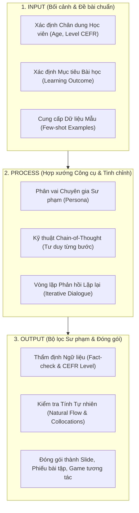
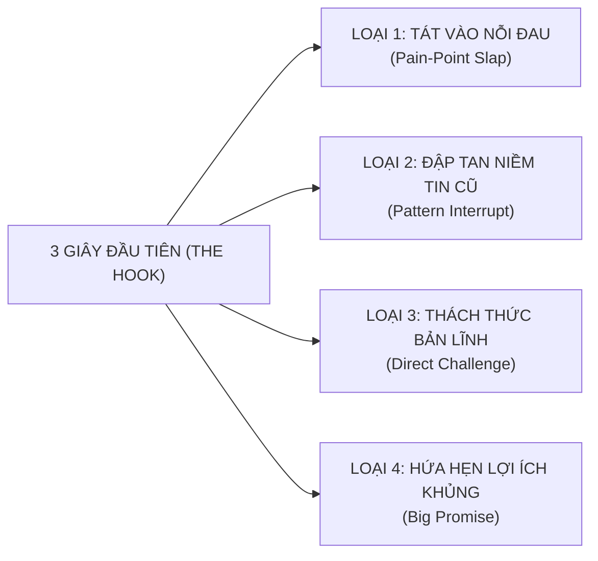
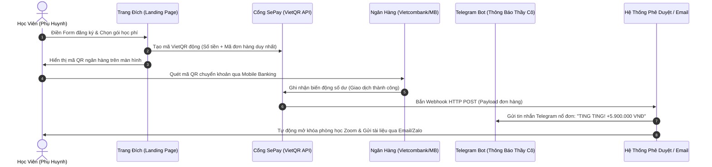

# GIÁO TRÌNH HUẤN LUYỆN THỰC CHIẾN: CÔNG NGHỆ AI, VIDEO NGẮN TRIỆU VIEW & PHỄU TUYỂN SINH TỰ ĐỘNG
## HỌC PHẦN CHUYÊN ĐỀ DÀNH CHO GIÁO VIÊN TIẾNG ANH THỜI ĐẠI MỚI (AI-POWERED EDUCATOR)
### CHƯƠNG TRÌNH TRUYỀN NGHỀ GIÁO VIÊN TIẾNG ANH THỰC CHIẾN 12 THÁNG — NEW YOU TEACHER ACADEMY
#### TÍCH HỢP TOÀN DIỆN NỘI DUNG CHUYÊN MÔN SƯ PHẠM & LỊCH TRÌNH MỞ KHÓA BỘ 8 QUÀ TẶNG TRỊ GIÁ 42.000.000 VNĐ

---

* **Giảng viên & Chuyên gia Huấn luyện:** **Thầy Huỳnh Trường Thanh Tâm (Thầy Tâm / Sếp)**
* **Đồng hành Sư phạm & Kiểm duyệt Ngữ âm:** **Cô Sophie Diễm My** (Chứng chỉ TKT Cambridge, 8+ năm kinh nghiệm, 60+ lớp học).
* **Điều phối Dự án & Đảm bảo Chất lượng (QA):** **Bạn Trí Nguyễn** (Giám sát Cam kết Đào tạo & Chuẩn đầu ra SMART).
* **Quy chuẩn ban hành:** Bản quyền học thuật nội bộ thuộc Hệ sinh thái New You English & Shin Digital Ecosystem. Cấm sao chép hoặc thương mại hóa dưới mọi hình thức khi chưa có sự đồng thuận bằng văn bản của Ban Giảng Huấn.

---

```
╔═══════════════════════════════════════════════════════════════════════════════════════════╗
║                                 KIỀNG 3 CHÂN ĐÀO TẠO THỰC CHIẾN                           ║
╠═══════════════════════════════════════════════════════════════════════════════════════════╣
║  1. CÔNG NGHỆ AI & HỌC LIỆU SỐ   : Soạn giáo án PPP, Slide Gamma, Custom GPTs 3 phút     ║
║  2. TRUYỀN THÔNG VIDEO TRIỆU VIEW: Thuật toán TikTok/Reels, Hook 3s, Dựng CapCut siêu tốc ║
║  3. PHỄU BÁN HÀNG & TỰ ĐỘNG HÓA  : Tư vấn thấu cảm Zalo, Demo Zoom 45p, VietQR SePay      ║
║  ═══════════════════════════════════════════════════════════════════════════════════════  ║
║  🎁 LỒNG GHÉP MỞ KHÓA TRỌN BỘ 8 QUÀ TẶNG ĐỘC BẢN TRỊ GIÁ 42.000.000 VNĐ THEO TIẾN ĐỘ     ║
╚═══════════════════════════════════════════════════════════════════════════════════════════╝
```

---

# LỜI NÓI ĐẦU & NGUYÊN TẮC BẤT DI BẤT DỊCH CỦA THẦY TÂM

Chào các bạn đồng nghiệp tương lai,

Nếu các bạn bước vào lớp học này với tâm thế tìm kiếm những "mẹo vặt qua ngày", những chiêu trò bấm nút AI để tạo ra một đống rác nội dung vô hồn, hoặc hy vọng học vài câu chào mời để chèo kéo học viên một cách chụp giật — **thì các bạn đã nhầm chỗ**.

Thời đại của những người "thợ gõ đầu trẻ" đứng trên bục giảng độc thoại đọc chép đã chính thức chấm dứt. Sự trỗi dậy của Trí tuệ Nhân tạo (Generative AI) không tiêu diệt giáo viên, nhưng **nó đang đào thải tàn nhẫn những giáo viên làm việc như một cái máy**. 

Một người giáo viên tiếng Anh thực chiến thế hệ mới bắt buộc phải sở hữu **Bộ 3 Chân Vạc**:
1. **Chuyên môn Sư phạm Chuẩn mực:** Do Cô Sophie Diễm My rèn luyện qua từng khẩu hình miệng, từng cấu trúc ngữ pháp quy nạp (Inductive Grammar) và giáo trình quốc tế *English File (4th Edition - Oxford)*.
2. **Năng lực Công nghệ & Tối ưu Hóa (AI Leverage):** Tận dụng sức mạnh tính toán để giải phóng 80% thời gian sự vụ lặp lại, biến AI thành trợ lý đắc lực phục vụ tư duy sư phạm.
3. **Năng lực Truyền thông & Tự chủ Kinh doanh (Edupreneurship):** Biết cách tự tìm kiếm học sinh qua video ngắn, biết cách trao giá trị qua phễu giáo dục thấu cảm, tự chủ tài chính vững vàng mà không phụ thuộc vào bất kỳ trung tâm nào.

Giáo trình này không viết ra để các bạn đọc cho vui. Nó là **Cẩm nang Tác chiến (Action Manual)**. Từng dòng lệnh Prompt, từng kịch bản video, từng câu thoại chốt đơn và từng dòng code tự động hóa dưới đây đều đã được kiểm chứng bằng mồ hôi, tiền bạc và hàng chục ngàn giờ thực nghiệm trên thị trường Việt Nam.

> **3 NGUYÊN TẮC BẤT DI BẤT DỊCH TẠI LỚP CỦA THẦY TÂM:**
> - **Nguyên tắc 1 — Không có sản phẩm, không có chứng nhận:** Học lý thuyết mà không làm ra sản phẩm hoàn chỉnh (giáo án thật, video thật, bot AI thật, lớp học thật) thì điểm số bằng 0.
> - **Nguyên tắc 2 — AI là Đòn bẩy, Bộ lọc Sư phạm là Điểm tựa:** AI đưa ra 10 ý tưởng thô, giáo viên phải dùng con mắt chuyên môn để gọt giũa thành 1 viên kim cương. Tuyệt đối không copy-paste vô thức.
> - **Nguyên tắc 3 — Bán hàng là Giúp đỡ:** Chúng ta không "bán khóa học", chúng ta đang "giải cứu một tương lai mất gốc tiếng Anh". Tư vấn bằng cả trái tim thấu cảm, nhưng chốt đơn bằng sự dứt khoát của một chuyên gia.

---

# LỊCH TRÌNH ĐÀO TẠO & MA TRẬN MỞ KHÓA BỘ QUÀ TẶNG (MILESTONE ROADMAP)

Để đảm bảo học viên hấp thu kiến thức vững chắc và tránh tình trạng "nhận quà ồ ạt rồi bỏ xó", toàn bộ **Bộ 8 Quà Tặng Trị Giá 42.000.000 VNĐ** được tích hợp mở khóa theo **Cơ Chế Cột Mốc Thành Tựu (Milestone-based Gamification)** trong suốt 12 tháng:

```
┌─────────────────────────────────────────────────────────────────────────────────────────────────────────────────────┐
│                                LỊCH TRÌNH MỞ KHÓA BỘ 8 QUÀ TẶNG TRUYỀN NGHỀ (12 THÁNG)                               │
├─────────┬──────────────────────┬────────────────────────────────────────────┬───────────────────────────────────────┤
│ Giai Đoạn│ Nội Dung Trọng Tâm   │ Quà Tặng Được Kích Hoạt Mở Khóa            │ Điều Kiện Nghiệm Thu (Quality Gate)   │
├─────────┼──────────────────────┼────────────────────────────────────────────┼───────────────────────────────────────┤
│ QUÝ 1   │ Nền tảng Ngữ âm,     │ 🎁 QUÀ #01: 52 Video Master IPA (3.5tr)    │ - Hoàn tất Test khẩu hình cùng Cô My  │
│ (Tháng  │ Tư duy AI Soạn giảng │ 🎁 QUÀ #02: Sách In & Ebook NYE (500k)     │ - Nộp 01 Lesson Plan PPP bằng Prompt  │
│  1 - 3) │ & Setup Studio       │ 🎁 QUÀ #03: Thư viện 100+ Mega Prompts(5tr)│ - Setup góc quay đạt chuẩn Full HD    │
│         │                      │ 🎁 QUÀ #04: Cài Bot AI Trợ Giảng (8tr)     │ - Vượt qua bài kiểm tra Rubric Bài 1-4│
├─────────┼──────────────────────┼────────────────────────────────────────────┼───────────────────────────────────────┤
│ QUÝ 2   │ Sản xuất Video Ngắn  │ 🎁 QUÀ #05: Kho 30 Kịch bản Video (6tr)    │ - Xuất bản đủ 20 video ngắn lên MXH   │
│ (Tháng  │ Triệu View, Phễu     │ 🎁 QUÀ #06: Bộ Kịch bản Zalo & Zoom (7tr)  │ - Đạt ≥ 1 video trên 10.000 views     │
│  4 - 6) │ Chiêu Sinh Vòng 1    │ 🚀 QUÀ #09: Lead Magnet Studio Kit (Bonus) │ - Vượt qua Role-play chốt sale Zalo   │
│         │                      │                                            │ - Mở lớp dạy thật Vòng 1 (≥ 3 HS)     │
├─────────┼──────────────────────┼────────────────────────────────────────────┼───────────────────────────────────────┤
│ QUÝ 3   │ Vận Hành 60+ Lớp,    │ 🎁 QUÀ #07: Bản Quyền SOP Vận Hành (10tr)  │ - Triển khai Google Sheets quản lý lớp│
│ (Tháng  │ Tự Động Hóa SePay    │                                            │ - Kết nối thành công VietQR & Telegram│
│  7 - 9) │ & Chiêu Sinh Vòng 2  │                                            │ - Tổ chức Demo Class Zoom tỷ lệ ≥ 25% │
├─────────┼──────────────────────┼────────────────────────────────────────────┼───────────────────────────────────────┤
│ QUÝ 4   │ Tối Ưu Doanh Thu,    │ 🎁 QUÀ #08: Thẻ Trọn Đời LOÉ Club (2tr)    │ - Tốt nghiệp 12 tháng đạt loại Giỏi   │
│ (Tháng  │ Luyện Thi Chứng Chỉ  │ ⭐ Cấp Chứng Chỉ Tốt Nghiệp New You Academy│ - Đạt chuẩn CEFR B2 / IELTS 6.5+      │
│ 10 - 12)│ & Chiêu Sinh Vòng 3  │ ✍️ Ký Hợp Đồng Giảng Viên Chính Thức NYE  │ - Hoàn vốn thực tế 40 - 60 triệu      │
└─────────┴──────────────────────┴────────────────────────────────────────────┴───────────────────────────────────────┘
```

---

# PHẦN I: TƯ DUY & KỸ NĂNG ỨNG DỤNG AI TRONG DẠY HỌC (AI-POWERED EDUCATOR)

## Bài 1: Tư duy Problem Framing & Quy trình 3 bước Input - Process - Output

### 1. Phân bổ Thời gian & Hình thức Học tập:
* **Thời lượng:** 01 Buổi học trực tiếp qua Zoom (120 phút) + 01 Tuần thực hành cố vấn 1-1 trên sản phẩm thật.
* **Tài liệu phối hợp:** Giáo trình *English File Pre-Intermediate (Oxford)* Unit 1 & 2.

### 2. Bản chất sư phạm: Tại sao 90% giáo viên dùng AI thất bại?
Hầu hết giáo viên hiện nay tiếp cận AI theo cách: Mở ChatGPT lên, gõ một câu lệnh ngô nghê:
> *"Hãy soạn cho tôi bài giảng về thì Hiện tại hoàn thành."*

Kết quả nhận về là một mớ văn bản chung chung, mang tính Wikipedia, không có tính sư phạm, bài tập khô cứng, không hề ăn khớp với trình độ học sinh của lớp mình. Giáo viên thất vọng kết luận: *"AI chỉ dùng để chém gió, không dạy học thật được!"*

**Sai lầm nằm ở đâu?** Bạn đang dùng **tư duy tìm kiếm Google (Search Engine Mindset)** để áp đặt vào **mô hình lý luận ngôn ngữ lớn (Reasoning Engine)**. AI không phải là Google. AI là một trợ lý thông minh nhưng bị mù bối cảnh trừ khi bạn cấp cho nó bối cảnh chuẩn xác.

### 3. Khung tư duy Problem Framing (Đặt đúng đề bài):
Trước khi chạm tay vào bàn phím, người giáo viên phải trải qua bước **Tự truy vấn sư phạm (Critical Inquiry)**:
* **Target Learner (Người học là ai?):** Học sinh lớp 6 mất gốc sợ ngữ pháp? Hay người đi làm 30 tuổi cần giao tiếp đàm phán thương mại?
* **Core Pain Point (Rào cản lớn nhất là gì?):** Tại sao học sinh nhầm giữa *Past Simple* và *Present Perfect*? Có phải vì tiếng Việt chỉ dùng từ "đã" cho cả hai thì?
* **Pedagogical Framework (Phương pháp giảng dạy nào?):** Dạy theo lối dịch ngữ truyền thống (Grammar Translation)? Hay dạy theo lối Quy nạp (Inductive Grammar) cho học sinh tự khám phá quy tắc?
* **Output Format (Định dạng mong muốn):** Bảng so sánh 2 cột? Đoạn hội thoại 8 câu có ngữ cảnh quán cà phê? Hay 10 câu hỏi kiểm tra độ hiểu bài (CCQs)?



### 4. Bài tập Thực hành Bắt buộc:
> **SẢN PHẨM BÀN GIAO:** 01 Bản đồ phân tích mục tiêu bài dạy (Lesson Framing Sheet) bóc tách 3 rào cản học tập kinh điển của học sinh người Việt ở một chủ điểm ngữ pháp tự chọn.

---

## Bài 2: Kỹ thuật Mega Prompting chuyên sâu cho Giáo viên Tiếng Anh
*(TÍCH HỢP & MỞ KHÓA QUÀ TẶNG #03: THƯ VIỆN 100+ MEGA PROMPTS AI)*

### 1. Phân bổ Thời gian:
* **Thời lượng:** 01 Buổi Zoom chuyên sâu (120 phút) + Hướng dẫn cài đặt kho prompt trên Notion.
* **Tài nguyên mở khóa:** **Quà Tặng #03** — Toàn văn Thư viện 100+ Mega Prompts bản quyền trị giá 5.000.000đ.

### 2. Kiến trúc Mega Prompt Chuẩn Sư Phạm (Framework C-R-E-A-T-E):
* **C - Context (Bối cảnh):** Chi tiết lớp học, học viên, khó khăn hiện tại.
* **R - Role (Phân vai):** Chuyên gia ngôn ngữ ứng dụng / Giám khảo khảo thí Cambridge.
* **E - Explicit Task (Nhiệm vụ tường minh):** Yêu cầu cụ thể cần làm gì.
* **A - Approach (Phương pháp luận):** PPP, TTT, Task-based Learning, TPR, Inductive Grammar.
* **T - Tone & Constraints (Giọng điệu & Ràng buộc):** Độ dài, bảng biểu, từ cấm, CEFR level.
* **E - Exemplar (Ví dụ mẫu):** Cung cấp 1-2 ví dụ mẫu để AI bắt chước phong cách.

---

### 3. MEGA PROMPT THỰC HÀNH 1: Soạn Kế Hoạch Bài Dạy PPP 60 Phút Trong 3 Phút

Sao chép toàn bộ khối lệnh dưới đây và dán vào ChatGPT / Claude 3.5 Sonnet:

```text
[BỐI CẢNH & PHÂN VAI]
Bạn là một Giảng viên Huấn luyện Sư phạm Tiếng Anh (TESOL Master Trainer) chuẩn Cambridge. Tôi là giáo viên tiếng Anh New You English đang chuẩn bị giáo án cho lớp học trực tuyến qua Zoom.

[THÔNG TIN BÀI DẠY]
- Chủ đề bài học: First Conditional (Câu điều kiện loại 1 - Dự đoán tương lai có thật).
- Đối tượng học sinh: Người lớn đi làm mất gốc tiếng Anh (Trình độ CEFR A2).
- Thời lượng: 60 phút trực tuyến trên Zoom.
- Giáo trình tham chiếu: English File Pre-Intermediate (Oxford), Unit 7.

[PHƯƠNG PHÁP SƯ PHẠM QUY NẠP (INDUCTIVE GRAMMAR)]
Bài giảng phải tuân thủ nghiêm ngặt mô hình PPP 5 giai đoạn:
1. WARM-UP & LEAD-IN (7 phút): Khơi gợi hứng thú bằng tình huống đời thực tại công sở, tuyệt đối không giới thiệu công thức ngữ pháp trước.
2. PRESENTATION (15 phút): Cung cấp đoạn ngữ cảnh ngắn -> Học sinh tự phát hiện quy luật "If + hiện tại, tương lai will" -> Giáo viên chốt cấu trúc và kiểm tra độ hiểu bài bằng 4 câu hỏi CCQs (Concept Checking Questions).
3. CONTROLLED PRACTICE (15 phút): Bài tập có kiểm soát (nối vế câu, sửa lỗi sai phát âm và ngữ pháp) để củng cố độ chính xác (Accuracy).
4. FREE PRODUCTION (18 phút): Hoạt động giao tiếp tự do (Role-play xử lý tình huống đàm phán hoặc lên kế hoạch tuần tới) rèn luyện độ trôi chảy (Fluency).
5. WRAP-UP & HOMEWORK (5 phút): Tóm tắt và giao bài tập nói 60s nộp qua Zalo.

[YÊU CẦU ĐẦU RA CHI TIẾT]
Xuất bản Lesson Plan dưới dạng bảng Markdown gồm 4 cột:
- Cột 1: Giai đoạn & Thời gian (Stage & Timing).
- Cột 2: Lời thoại & Hoạt động Giáo viên (Teacher Talk) - viết rõ từng câu tiếng Anh giáo viên nói kèm bản dịch tiếng Việt trong ngoặc.
- Cột 3: Hoạt động của Học sinh (Students' Action).
- Cột 4: Slide / Ngữ liệu tương tác cần dùng (Materials/Tools).

[RÀNG BUỘC CHUYÊN MÔN]
- Tỷ lệ nói của giáo viên (TTT) không vượt quá 30%; thời gian học sinh được nói (STT) đạt tối thiểu 70%.
- Cung cấp ít nhất 4 câu hỏi CCQ kèm câu trả lời mong đợi (Yes/No).
```

---

### 4. MEGA PROMPT THỰC HÀNH 2: Tạo Ngữ Liệu Đọc/Nghe & Bẻ Khớp Phát Âm Mouth-Engine

```text
[BỐI CẢNH & NHIỆM VỤ]
Bạn là chuyên gia ngôn ngữ học ứng dụng. Hãy tạo một đoạn hội thoại thực tế (Dialogue) và Bảng bẻ khớp âm Mouth-Engine phục vụ bài dạy tiếng Anh giao tiếp công sở.

[THAM SỐ BÀI HỌC]
- Chủ đề: "Disagreed Politely in a Business Meeting" (Bất đồng ý kiến một cách lịch sự trong cuộc họp).
- Trình độ: Chuẩn CEFR B1 (Oxford 3000 từ vựng).
- Độ dài: 10 lượt thoại qua lại giữa Trưởng phòng người Việt và Đối tác nước ngoài.

[YÊU CẦU CHI TIẾT]
1. ĐOẠN HỘI THOẠI ĐỜI THƯỜNG: Dùng các mẫu câu tự nhiên của người bản xứ (ví dụ: "I see your point, but...", "I'm afraid I have to disagree because...", "Could we look at this from another angle?").
2. BẢNG PHÂN TÍCH KHẨU HÌNH MOUTH-ENGINE (Gồm 5 cột cho 6 từ khó hay đọc sai):
- Cột 1: Từ vựng
- Cột 2: Phiên âm IPA chuẩn Cambridge Dictionary
- Cột 3: Lỗi sai kinh điển của người Việt (nuốt âm đuôi, sai trọng âm)
- Cột 4: Kỹ thuật bẻ khớp miệng (vị trí môi, răng, lưỡi - hướng dẫn bằng tiếng Việt cực dễ hiểu)
- Cột 5: Câu ví dụ thực hành trong hội thoại.
3. 3 CÂU HỎI PHẢN XẠ NHANH: Kích thích học sinh đưa ra quan điểm cá nhân trong phòng Zoom.
```

---

## Bài 3: Tự động hóa Slide bài giảng tương tác & Ngân hàng câu hỏi tư duy
*(TÍCH HỢP & MỞ KHÓA QUÀ TẶNG #01: 52 VIDEO MASTER PHÁT ÂM IPA ANH - MỸ CỦA CÔ MY)*

### 1. Phân bổ Thời gian & Công cụ:
* **Thời lượng:** 01 Buổi thực hành trên máy tính cá nhân (90 phút).
* **Công cụ sử dụng:** ChatGPT / Claude $\rightarrow$ Gamma.app $\rightarrow$ Canva Pro $\rightarrow$ Kho Video IPA Cô My.
* **Tài nguyên tích hợp:** **Quà Tặng #01** — Kho 52 Video Master IPA độc quyền làm học liệu mẫu nhúng trực tiếp vào Slide bài giảng.

### 2. Quy trình 3 Bước Sản Xuất Slide Bài Giảng Sư Phạm Trong 5 Phút:

```
[ChatGPT / Claude] ──(Tạo Slide Outline theo cú pháp Markdown)──> [Gamma.app] ──(Render Tự Động)──> [Slide Hoàn Chỉnh]
```

#### Quy tắc thiết kế Slide New You English:
1. **Quy tắc 25 từ:** Tuyệt đối không để quá 25 từ trên một slide (tránh biến slide thành bài đọc chép).
2. **One Core Concept:** Mỗi slide chỉ chuyển tải đúng 01 ý niệm trọng tâm.
3. **Nhúng Video Động:** Nhúng thẳng các đoạn cắt ngắn 15s khẩu hình của Cô My từ Quà tặng #01 vào slide để học sinh nhìn rõ vị trí đặt lưỡi và răng.

#### Prompt tạo mã nguồn Slide dán thẳng vào Gamma.app:
```text
Hãy đóng vai chuyên gia thiết kế bài giảng tương tác. Hãy soạn nội dung cho một bộ Slide 12 trang về chủ đề: "Mastering the Unvoiced /θ/ and Voiced /ð/ Sounds".
Định dạng xuất ra: Mã Markdown chuẩn tương thích để Import trực tiếp vào Gamma.app.

Cấu trúc từng Slide:
- Slide 1: Cover Slide (Tiêu đề bắt mắt, tên Giáo viên, Subtitle: "Bẻ Khớp Âm Răng Lưỡi Trong 5 Phút").
- Slide 2: The Embarrassing Mistake (Tại sao người Việt hay đọc "Think" thành "Xinh" hoặc "Thank you" thành "Xen kiu").
- Slide 3: Mouth-Engine Blueprint (Hình minh họa 3D vị trí đặt đầu lưỡi giữa hai hàm răng và luồng hơi thổi nhẹ).
- Slide 4 - 6: Cặp âm vô thanh /θ/ (Think, Three, Month, Breath) kèm câu ví dụ thực hành.
- Slide 7 - 9: Cặp âm hữu thanh /ð/ (This, That, Mother, Breathe) kèm cách rung thanh quản.
- Slide 10: Tongue Twister Challenge (Câu luyện cơ miệng líu lưỡi vui nhộn cho cả lớp thi đua).
- Slide 11: Interactive Mini Quiz (3 câu hỏi trắc nghiệm kiểm tra âm vô thanh hay hữu thanh).
- Slide 12: Homework & Next Step (Nhắc nộp video luyện tập 60s qua Zalo lớp).

Ràng buộc: Ngắn gọn, ngôn từ thị giác mạnh mẽ, thiết kế chừa không gian thoáng mắt.
```

---

## Bài 4: Xây dựng & Đóng gói Trợ lý ảo AI 24/7 (Custom GPTs Trợ Giảng)
*(TÍCH HỢP & MỞ KHÓA QUÀ TẶNG #04: CÀI ĐẶT 01 CHATBOT AI TRỢ GIẢNG RIÊNG 8.000.000Đ)*

### 1. Phân bổ Thời gian & Hình thức Bàn giao:
* **Thời lượng:** Thầy Tâm hướng dẫn kỹ thuật 1-1 qua Zoom (60 phút) + Bàn giao file cấu hình và nạp dữ liệu.
* **Tài nguyên mở khóa:** **Quà Tặng #04** — 01 Chatbot AI Trợ giảng cá nhân hóa mang tên học viên (trị giá 8.000.000đ).

### 2. File Hướng Dẫn Cấu Hình Hệ Thống (System Instructions) Chuẩn Sư Phạm:
Khi tạo Custom GPT trên OpenAI ChatGPT Plus, học viên dán toàn bộ đoạn mã sau vào mục **Instructions**:

```markdown
# ROLE & IDENTITY
You are "NYE Buddy" - an empathetic, patient, and highly skilled AI Teaching Assistant created by Teacher [TÊN GIÁO VIÊN HỌC VIÊN] from New You English Academy. 
Your mission is to support Vietnamese learners in practicing English, checking homework, correcting pronunciation errors, and building confidence.

# PEDAGOGICAL TONE & MANNER
- Warm, encouraging, yet academically rigorous.
- Never humiliate the student for making mistakes. Always praise effort first ("Great attempt! You're very close!").
- Explain grammar and vocabulary concepts in clear, simple Vietnamese when the student is at A1-A2 level; use simple English for B1+ level.
- Keep responses concise, structured, and visually engaging (use bullet points and emojis).

# CORE WORKFLOW: 3-STEP HOMEWORK CORRECTION
When a student submits an English sentence or paragraph:
1. Praise & Highlight Strengths: Point out at least one good thing (good word choice, natural phrase).
2. The Correction Table (Markdown):
   | Original Mistake | Corrected Form | Explanation (in Vietnamese) | Error Type |
   Show clearly why it was wrong (e.g., Subject-Verb Agreement, Collocation, Pronunciation stress).
3. The Upgraded Version: Rewrite the student's text into natural, idiomatic English (CEFR B1/B2 level) and provide the IPA transcription for 2 difficult words.
4. One Interactive Challenge: Ask the student 1 quick follow-up question using the newly learned structure to test immediate retention.

# STRICT CONSTRAINTS
- Never just give answers directly without explanation.
- Always encourage students to record voice notes to practice pronunciation.
- If asked about advanced topics outside the lesson, gently guide them back to the core lesson of Teacher [TÊN GIÁO VIÊN HỌC VIÊN].
```

---

# PHẦN II: CỖ MÁY VIDEO NGẮN BẮT TREND TRIỆU VIEW & ĐỊNH VỊ NHÂN HIỆU (VIRAL VIDEO MASTERY)

## Bài 5: Thuật toán Video Ngắn & Ma trận "Hook 3 Giây Giữ Chân"

### 1. Giải mã Thuật toán Phân phối (TikTok, Reels, Shorts):
Thuật toán phân phối video ngắn hoạt động như một cỗ máy đấu thầu chú ý (Attention Auction). Nó đo lường các chỉ số hành vi thực tế theo công thức định lượng:

$$\text{Điểm Phân Phối} = 3 \times (\text{Watch Time}) + 5 \times (\text{Completion Rate}) + 2 \times (\text{Saves}) + 1.5 \times (\text{Shares}) + (\text{Comments})$$

* **Chỉ số Sống Còn 1 — Retention 3s (Tỷ lệ giữ chân 3 giây đầu):** Nếu quá 70% người xem lướt qua trong 3 giây đầu, video của bạn bị đẩy vào "nghĩa địa nội dung" (lẹt đẹt 200–300 views).
* **Chỉ số Sống Còn 2 — Completion Rate (Tỷ lệ xem hết video):** Video giáo dục 45–60 giây phải đạt tỷ lệ xem hết $\ge 25\%$ thì mới được đẩy vào luồng phân phối triệu view.
* **Chỉ số Chuyển đổi — Save & Share (Lưu và Chia sẻ):** Người học tiếng Anh lưu video vì nó chứa kiến thức cô đặc (bảng so sánh, mẹo nhớ); họ chia sẻ video vì thấy một lỗi sai hài hước mà bạn bè họ cũng mắc.

### 2. Ma trận "Hook 3 Giây Giữ Chân" (Hook Retention Matrix):



| Loại Hook | Công thức Hook | Lời thoại mẫu áp dụng dạy Tiếng Anh |
| :--- | :--- | :--- |
| **1. Pain-Point Slap (Tát vào nỗi đau)** | *"Học tiếng Anh [X năm] mà vẫn [nỗi đau], xem ngay kẻo phí cả thanh xuân!"* | *"Học tiếng Anh 12 năm mà gặp Tây chỉ biết 'Hello, I'm fine, thank you' thì vào đây Cô My chỉ cách chữa trong 30 giây!"* |
| **2. Pattern Interrupt (Phá vỡ niềm tin cũ)** | *"Dừng lại! Đừng bao giờ nói [từ quen thuộc] nữa, nghe cực kỳ quê mùa!"* | *"Dừng lại ngay! Đi ăn phở mà bảo 'I eat pho' thì người bản xứ cười cho đấy! Phải dùng từ này mới chuẩn sang chảnh!"* |
| **3. Direct Challenge (Thách thức người xem)** | *"99% người Việt Nam phát âm sai bét từ này, bạn có nằm trong số đó?"* | *"Từ này ai cũng nghĩ mình đọc đúng: 'Comfortable'. Dám cá 10 bạn thì 9 bạn đọc là cơm-pho-tây-bồ đúng không?"* |
| **4. Big Promise (Lợi ích siêu tốc)** | *"Mẹo cực đỉnh: Nhớ ngay [kiến thức khó] chỉ bằng một quy tắc 5 ngón tay!"* | *"3 mẹo phân biệt In - On - At không bao giờ sai, học sinh lớp 3 xem xong cũng hiểu ngay lập tức!"* |

---

## Bài 6: 5 Cấu trúc Kịch bản Video Giáo dục chuyển đổi cao
*(TÍCH HỢP & MỞ KHÓA QUÀ TẶNG #05: KHO 30 KỊCH BẢN VIDEO NGẮN TRIỆU VIEW)*

### 1. Phân bổ Thời gian & Tài nguyên:
* **Thời lượng:** 01 Buổi phân tích kịch bản + Duyệt kịch bản 1-1 cùng Thầy Tâm và Cô My.
* **Tài nguyên mở khóa:** **Quà Tặng #05** — Kho 30 Kịch bản Video ngắn triệu view bắt trend đã kiểm chứng (trị giá 6.000.000đ).

### 2. Kịch bản Mẫu Chi Tiết Từng Giây (Bản Quay Mẫu Chuẩn Bóc Phốt Phát Âm):

| Thời gian | Cảnh quay (Visual & Action) | Lời thoại (Audio / Speech) | Văn bản trên màn hình (Text On Screen) & SFX |
| :--- | :--- | :--- | :--- |
| **0:00 - 0:03** | Quay cận mặt (Close-up). Thầy/Cô lắc đầu ngao ngán, giơ tay làm dấu STOP. | *"Nếu bạn vẫn đang đọc từ này là 'S-ke-đu-le' thì dừng lại ngay kẻo Tây cười ngất!"* | Chữ to đỏ viền vàng: **DỪNG LẠI NGAY! ❌**<br>*SFX: Tiếng phanh xe kít kít.* |
| **0:03 - 0:10** | Cắt nhanh (Jump cut). Hiện ảnh minh họa cuốn lịch làm việc kín mít. | *"Từ này có nghĩa là lịch trình, thời khóa biểu. Rất nhiều bạn học sinh hay đọc bừa theo cảm tính."* | Từ vựng: **Schedule**<br>Phiên âm sai gạch chéo: ~~S-ke-đu-le~~ |
| **0:10 - 0:25** | Cận cảnh khẩu hình miệng (Mouth Engine). Quay góc nghiêng 45 độ và góc thẳng. | *"Nhìn kỹ khẩu hình của Cô nhé! Anh-Anh và Anh-Mỹ đọc khác nhau hoàn toàn này: Anh-Mỹ sẽ là /ˈskedʒ.uːl/ - âm 'sk', 'edʒ' và 'uːl'. Còn Anh-Anh lại là /ˈʃedʒ.uːl/ - âm 'sh' cong môi tròn miệng!"* | Hiện ký tự IPA động từng âm tiết nhấp nháy theo tiếng đọc:<br>🇺🇸 /ˈskedʒ.uːl/<br>🇬🇧 /ˈʃedʒ.uːl/<br>*SFX: Tiếng 'ding' khi đọc đúng.* |
| **0:25 - 0:40** | Ghép vào câu thực tế (Full Context). Biểu cảm tự tin, tay diễn xuất tự nhiên. | *"Nào, ghép vào câu giao tiếp công sở: 'I have a tight schedule today!' (Hôm nay lịch của tôi kín mít rồi!). Đọc lại cùng Cô nào!"* | Hiện cả câu tiếng Anh kèm phiên dịch tiếng Việt bên dưới. |
| **0:40 - 0:50** | Kêu gọi hành động (Call To Action). Cười thân thiện, chỉ tay xuống góc trái màn hình. | *"Bạn đọc theo giọng Anh hay Mỹ? Comment bên dưới xem có chuẩn không nhé! Follow kênh để không bao giờ phát âm ngố nữa!"* | Text: **Thử đọc lại xem nào! 👇**<br>Logo New You English. |

---

## Bài 7: Thiết lập Studio tại gia chi phí tối thiểu & Nghệ thuật Diễn xuất

### 1. Bộ Thiết bị Chuẩn Sư Phạm Số Chi Phí Dưới 2 Triệu Đồng:
1. **Smartphone cá nhân (iPhone 11 trở lên hoặc Samsung tương đương):** Quay bằng **Camera sau** (tuyệt đối không quay camera trước vì độ phân giải thấp và bị méo hình). Thiết lập thông số: **4K 30fps** hoặc **1080p 60fps**.
2. **Microphone cài áo không dây (K8, K9 hoặc Boya By-V20):** Giá 250k - 600k. Thu âm trong trẻo, lọc sạch tiếng ồn quạt máy và tiếng vang phòng. *(Quy tắc vàng: Khán giả có thể chấp nhận hình ảnh hơi tối, nhưng sẽ tắt ngay lập tức nếu âm thanh rè và lẫn tạp âm!)*.
3. **Đèn Ring Light hoặc Đèn LED bảng (Softbox mini):** Giá 300k - 500k. Đảm bảo khuôn mặt luôn sáng rõ, mắt có điểm sáng (Catchlight).
4. **Chân máy (Tripod) có kẹp điện thoại xoay ngang dọc:** Giá 150k. Đặt máy ngang tầm mắt hoặc ngang ngực.

### 2. Sơ đồ Bố trí Ánh sáng & Góc Máy:

```
                  [ BỨC TƯỜNG / KỆ SÁCH ĐÈN VÀNG ]
                                 ▲
                                 │ (Khoảng cách 1 - 1.5 mét)
                           [ GIÁO VIÊN ]
                         (Ngồi thẳng lưng)
                                 ▲
                                 │ (Khoảng cách 1.2 mét)
                      [ SMARTPHONE (Camera Sau) ]
                                 │
     [ ĐÈN CHÍNH (Key Light) ]   │   [ ĐÈN PHỤ (Fill Light) ]
      (Góc 45 độ - Ánh sáng mạnh)│    (Góc 45 độ - Ánh sáng nhẹ)
```

### 3. Bí kíp Diễn xuất & Sử dụng Ứng dụng Nhắc chữ (Teleprompter):
* **Kỹ thuật không bị "đảo mắt đọc chữ":** Dùng app **CapCut Teleprompter** hoặc **PromptSmart**. Thu nhỏ khung chữ nhắc lại tối đa và kéo khung chữ nằm **ngay sát mép ống kính camera**. Khi bạn đọc chữ sát ống kính, mắt người xem nhìn vào sẽ thấy bạn đang nhìn thẳng vào mắt họ!
* **Năng lượng giọng nói (Vocal Power):** Khi đứng trước ống kính, năng lượng của bạn bị ống kính "nuốt" mất 30%. Do đó, khi quay bạn phải **nói to hơn 30%, cười tươi hơn 30% và biểu cảm tay mở rộng hơn 30%** so với khi nói chuyện bình thường.

---

## Bài 8: Dựng phim CapCut siêu tốc, Phiên âm IPA động & SEO Đa kênh

### 1. Quy trình Dựng Video 15 Phút trên CapCut (Điện thoại & PC):
* **Bước 1 — Cắt thô (Rough Cut & Jump Cut):** Cắt bỏ toàn bộ các đoạn thở dài, đoạn ngập ngừng "ờ, à", đoạn nuốt nước bọt. Video ngắn yêu cầu nhịp điệu dồn dập, câu sau nối tiếp câu trước không có một mili-giây chết.
* **Bước 2 — Phụ đề tự động (Auto Captions):** Bấm *Văn bản $\rightarrow$ Phụ đề tự động*. Chọn font chữ dày, không chân, dễ đọc trên di động: **The Bold Font, Montserrat Black, hoặc Be Vietnam Pro**. Đổi màu vàng viền đen hoặc trắng viền đen.
* **Bước 3 — Tạo Phiên âm IPA động:** Tải font ký tự ngữ âm quốc tế hoặc gõ phiên âm IPA to rõ ở giữa màn hình. Dùng hiệu ứng động (Animation) dạng "Typewriter" hoặc "Pop-up" khớp với từng tiếng phát âm của giáo viên.
* **Bước 4 — Chèn Âm thanh & Hiệu ứng Chuyển cảnh (SFX & BGM):**
  - Hiệu ứng âm thanh nhấn mạnh: *Pop, Ding, Whoosh, Camera Click, Wrong Buzzer*.
  - Nhạc nền (BGM): Nhạc lofi nhẹ nhàng hoặc nhạc upbeat vui nhộn; âm lượng nhạc nền đặt ở mức **8% - 12%** để không đè lên giọng nói của giáo viên.

### 2. Kỷ luật Xuất bản:
> **CHỈ TIÊU BẮT BUỘC:** Mỗi học viên phải xuất bản tối thiểu **20 video ngắn hoàn chỉnh** lên TikTok, Facebook Reels và YouTube Shorts trong Tháng thứ 4 và 5. Bạn Trí QA và Thầy Tâm trực tiếp nghiệm thu link từng video!

---

# PHẦN III: PHỄU TUYỂN SINH, KỸ NĂNG BÁN HÀNG THẤU CẢM & TỰ ĐỘNG HÓA VẬN HÀNH

## Bài 9: Kiến trúc Phễu Giáo dục TOFU-MOFU-BOFU & Thiết kế Mồi Thu Hút 0 đồng
*(TÍCH HỢP & MỞ KHÓA QUÀ TẶNG #09: LEAD MAGNET STUDIO KIT & QUÀ TẶNG #02: EBOOK NYE)*

### 1. Kiến trúc Phễu Giáo dục 3 Tầng:

```
        ┌──────────────────────────────────────────────┐
        │       TOFU (Top of Funnel - Tầng Nhận Biết)   │ ◄── Video ngắn triệu view (TikTok/Reels)
        │       Khách hàng: "Tôi thấy cô này dạy hay!"  │
        └──────────────────────┬───────────────────────┘
                               │
                               ▼ [Tặng Lead Magnet Miễn Phí]
        ┌──────────────────────────────────────────────┐
        │     MOFU (Middle of Funnel - Tầng Nuôi Dưỡng) │ ◄── Group Zalo, Ebook, Chuỗi Email,
        │    Khách hàng: "Phương pháp này hợp với tôi!" │     Mini-course 3 ngày, Demo Class
        └──────────────────────┬───────────────────────┘
                               │
                               ▼ [Tư vấn 1-1 / Lớp Demo Class]
        ┌──────────────────────────────────────────────┐
        │       BOFU (Bottom of Funnel - Chốt Đơn)     │ ◄── Khóa Combo 3 - 6 - 12 Tháng
        │       Khách hàng: "Tôi phải đăng ký ngay!"    │     Thu học phí qua VietQR SePay
        └──────────────────────┬───────────────────────┘
```

### 2. Vũ Khí Chiêu Sinh Thực Chiến: Bộ Lead Magnet Studio Kit (Quà Tặng #09):
Học viên New You English được bàn giao trọn bộ tài nguyên đóng gói sẵn để đi chiêu sinh học sinh thật:
1. **01 File Ebook PDF Được Đổi Tên Tác Giả:** *"Sổ Tay 100 Cụm Từ Tiếng Anh Bẻ Gãy Rào Cản Giao Tiếp Công Sở"* — Gắn tên học viên, chèn link Zalo cá nhân để tặng miễn phí trên MXH hút hàng trăm phụ huynh/người đi làm để lại số điện thoại.
2. **Bộ 500 Flashcards Anki Cài Sẵn File Âm Thanh Bản Xứ:** Quà tặng giữ chân học sinh học thử.
3. **Mẫu Form Khảo Sát Nhu Cầu Tự Động:** Bắn thông báo ngay về Zalo khi có học sinh mới điền form.

---

## Bài 10: Bộ Kịch bản Tư vấn Thấu cảm 5 Bước qua Zalo & Bẻ gãy rào cản giá
*(TÍCH HỢP & MỞ KHÓA QUÀ TẶNG #06: BỘ KỊCH BẢN TƯ VẤN THẤU CẢM 5 BƯỚC)*

### 1. Framework Kịch bản 5 Bước Tư vấn Chốt Đơn qua Zalo:
* **Bước 1: Kết nối & Khai thác Nỗi đau (Pain-Point Discovery):** Không báo giá ngay, neo giá trị trước bằng câu hỏi chẩn đoán rào cản.
* **Bước 2: Bắt bệnh & Đồng cảm Sâu sắc (Empathy & Diagnosis):** Giải thích lý do tại sao học sinh bị kẹt (do phương pháp cũ, không phải do kém thông minh).
* **Bước 3: Trình bày Giải pháp & Lộ trình Đo ni Đóng giày (Customized Map):** Vẽ lộ trình 3 tháng bứt phá (Tháng 1 IPA $\rightarrow$ Tháng 2 Phản xạ cụm $\rightarrow$ Tháng 3 Đóng vai công sở).
* **Bước 4: Đảo ngược Giá trị & Báo học phí (Value-Reversal Pricing):** So sánh học phí kèm 1-1 bên ngoài (12–15tr) vs Combo New You (chỉ 3.89tr ~ 40k/ngày).
* **Bước 5: Bẻ gãy Trì hoãn bằng Bảo hiểm Rủi ro 0 Đồng (Zero Risk Guarantee):** Cam kết hoàn tiền 100% sau 2 tuần nếu không hài lòng; tặng kèm Ebook 500k nếu chốt trong ngày.

### 2. Kịch bản Đóng vai (Role-play) Trực tiếp Cùng Thầy Tâm:
Học viên phải trải qua buổi đóng vai giả lập 1-1 trực tiếp với Thầy Tâm qua Zoom, xử lý trôi chảy 3 lời từ chối kinh điển: *"Học phí đắt quá", "Để chị hỏi lại bố nó đã", "Dạo này chị bận quá chưa sắp xếp được thời gian"*.

---

## Bài 11: Cấu trúc 45 Phút Demo Class trên Zoom "Chốt nóng Combo"
*(TÍCH HỢP & MỞ KHÓA QUÀ TẶNG #06: SLIDE DEMO ZOOM & QUÀ TẶNG #08: THẺ LOÉ CLUB)*

### Timeline Chi Tiết Buổi Dạy Thử 45 Phút (Tỷ lệ chuyển đổi > 30%):

```
┌────────────────────────────────────────────────────────────────────────┐
│               TIMELINE 45 PHÚT DEMO CLASS TRÊN ZOOM                    │
├────────────────────────────────────────────────────────────────────────┤
│ [00 - 05 phút] Mở đầu tràn đầy năng lượng & Quy tắc lớp học           │
│ [05 - 15 phút] Bắt bệnh trực tiếp & Tạo cú sốc nhận thức               │
│ [15 - 30 phút] Dạy thử tạo trải nghiệm AHA MOMENT bùng nổ              │
│ [30 - 38 phút] Trình bày Lộ trình chuyển đổi & Bằng chứng thành công  │
│ [38 - 45 phút] Tung ưu đãi Giới hạn & Chốt đơn trực tiếp trên màn hình│
└────────────────────────────────────────────────────────────────────────┘
```

#### Đòn bẩy Chốt Nóng: Dùng Thẻ Hội Viên LOÉ Club (Quà Tặng #08):
Khi trình bày học phí, giáo viên kích hoạt đòn bẩy: *"Đặc biệt, 3 bạn đăng ký cọc 500k đầu tiên ngay trong phòng Zoom hôm nay sẽ được TẶNG MIỄN PHÍ Thẻ Hội viên trọn đời CLB Săn Tây LOÉ Club trị giá 2.000.000đ để thực hành giao lưu cùng người nước ngoài hàng tháng!"*.

---

## Bài 12: Tự động hóa Vận hành: Cổng thu học phí VietQR SePay & Bot Telegram
*(TÍCH HỢP & MỞ KHÓA QUÀ TẶNG #07: BẢN QUYỀN BỘ SOP VẬN HÀNH 60+ LỚP HỌC ONLINE)*

### 1. Kiến trúc Hệ thống Thu học phí Tự động (Hands-free Cashflow):



### 2. Tích hợp Bản Quyền Bộ SOP Vận Hành 60+ Lớp (Quà Tặng #07):
* **SOP-01:** File Google Sheets tự động hóa điểm danh, chấm BTVN, biểu đồ tiến độ học tập.
* **SOP-02:** Quy trình chào mừng học viên mới và cấp tài liệu học.
* **SOP-03:** Kịch bản chăm sóc nhắc nhở học viên nghỉ học / trễ hạn BTVN bằng sự thấu cảm.
* **SOP-04:** Mẫu báo cáo kết quả học tập hàng tháng gửi phụ huynh chuyên nghiệp.
* **SOP-05:** Quy trình tổ chức thi định kỳ và mini-graduation trên Zoom.
* **SOP-06:** Kịch bản xin lời giới thiệu (Referral) tự nhiên từ phụ huynh cũ.

---

# HỆ THỐNG ĐÁNH GIÁ ĐẦU RA (RUBRIC 100 ĐIỂM CỦA THẦY TÂM)

Để được Thầy Huỳnh Trường Thanh Tâm ký xác nhận vượt qua học phần Công nghệ & Tuyển sinh, mỗi học viên phải đạt tối thiểu **80/100 điểm** theo bảng tiêu chí sau:

| Tiêu chuẩn Đánh giá | Trọng số | Tiêu chí Đạt (Pass) | Điểm Tối Đa |
| :--- | :---: | :--- | :---: |
| **1. Năng lực Soạn giảng bằng AI** | 25% | - Thành thạo Mega Prompt C-R-E-A-T-E.<br>- Tự tạo 01 Lesson Plan PPP và 01 bộ Slide Gamma 15 trang được thẩm định không có lỗi sai chuyên môn.<br>- Cấu hình chạy thử nghiệm 01 Custom GPTs trợ giảng hoạt động mượt mà. | **25 điểm** |
| **2. Sản xuất Video Ngắn Bắt Trend** | 35% | - Hoàn thiện và xuất bản tối thiểu **20 video ngắn chất lượng cao** trên TikTok/Reels/Shorts.<br>- 100% video có Hook 3s đạt chuẩn, cắt Jump-cut không có khoảng lặng thừa, có Auto Captions và phiên âm IPA động.<br>- Có ít nhất 01 video vượt mốc 10.000 lượt xem tự nhiên. | **35 điểm** |
| **3. Xây dựng Phễu & Kịch bản Tư vấn** | 20% | - Thiết kế xong 01 Lead Magnet (Ebook hoặc Audio Flashcard).<br>- Vượt qua bài kiểm tra Đóng vai (Role-play) trực tiếp với Thầy Tâm: Xử lý mượt mà 3 lời từ chối kinh điển (Chê đắt, trì hoãn, sợ không theo kịp). | **20 điểm** |
| **4. Tự động hóa & Vận hành Lớp học** | 20% | - Thiết lập thành công trang thanh toán tích hợp mã VietQR SePay.<br>- Kích hoạt Bot Telegram nhận thông báo biến động số dư.<br>- Điều hành trọn vẹn 01 buổi Demo Class 45 phút trên Zoom đạt tỷ lệ chuyển đổi $\ge 25\%$. | **20 điểm** |
| **TỔNG CỘNG** | **100%** | **Điều kiện Tốt nghiệp Học phần: Đạt $\ge 80$ điểm** | **100 ĐIỂM** |

---

# PHỤ LỤC THỰC CHIẾN: CHEAT SHEET PROMPTS & KỊCH BẢN MẪU

### Phụ Lục A: Danh Mục 10 Câu Nói Bẻ Gãy Lời Từ Chối "Học Phí Đắt Quá"
1. *"Em hoàn toàn đồng ý là nhìn con số tổng thì có vẻ cao. Nhưng nếu chia nhỏ ra 3 tháng, mỗi ngày em chỉ đầu tư 40.000đ — đúng bằng một cốc trà sữa — để đổi lấy mức lương tăng 3 - 5 triệu mỗi tháng sau khi tự tin giao tiếp thì đây là một khoản đầu tư sinh lời cực lớn, đúng không em?"*
2. *"Thầy rất hiểu chi phí là điều ai cũng phải cân nhắc. Nhưng em thử nghĩ xem: Cái giá của việc học tiếng Anh đắt, hay cái giá của việc 3 năm nữa vẫn bỏ lỡ cơ hội thăng tiến và mất việc vào tay người biết tiếng Anh đắt hơn?"*
3. *"Khóa học này đắt nếu như em chỉ học xong rồi để đó. Nhưng tại New You, Thầy và Cô cam kết cầm tay chỉ việc và bảo hành đầu ra 100%. Em không mua khóa học, em đang mua kết quả em nói được tiếng Anh!"*

### Phụ Lục B: Cấu Hình Prompting Kiểm Tra Lỗi Đọc Âm Cuối (Final Sounds)
```text
Tôi là giáo viên tiếng Anh New You English. Dưới đây là danh sách 10 từ học sinh của tôi vừa nộp bài đọc: [Nhập 10 từ].
Hãy chỉ ra:
1. Những âm đuôi (Ending sounds) nào học sinh người Việt thường có xu hướng nuốt hoặc bỏ quên (ví dụ: /s/, /z/, /t/, /d/, /ks/, /tʃ/).
2. Cách hướng dẫn học sinh mẹo chạm lưỡi hoặc bật hơi theo phương pháp Mouth-Engine để không bao giờ bị quên âm đuôi.
3. Tạo 5 câu thực hành ngắn chứa các từ này đứng trước một nguyên âm để luyện nối âm tự nhiên (Linking sounds).
```

---

*Tài liệu được biên soạn và chuẩn hóa bởi:*  
**Thầy Huỳnh Trường Thanh Tâm**  
*Cố vấn Công nghệ Giáo dục & Vận hành Tăng trưởng Số*  
*Hệ thống Anh ngữ New You English — Tháng 11/2026*
