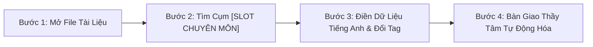

# BẢNG HƯỚNG DẪN BÀN GIAO & PHỐI HỢP HỌC THUẬT
## DÀNH RIÊNG CHO CÔ SOPHIE DIỄM MY (GIÁM ĐỐC HỌC THUẬT & CHUYÊN MÔN TIẾNG ANH)
### DỰ ÁN: NEW YOU TEACHER ACADEMY (HỆ SINH THÁI ĐÀO TẠO GIÁO VIÊN TIẾNG ANH 12 THÁNG)

---

> [!IMPORTANT]
> **NGUYÊN TẮC PHÂN ĐỊNH VAI TRÒ BẤT DI BẤT DỊCH (TRÁNH CHỒNG CHÉO PHẠM VI):**
> 1. **Thầy Huỳnh Trường Thanh Tâm (Cố vấn Công nghệ & Tăng trưởng):** Phụ trách toàn bộ Kiến trúc Hệ thống, Ứng dụng Công nghệ AI, Kỹ thuật Video Giữ chân người xem (Retention & Hook), Phễu Tuyển sinh tự động và Cơ chế vận hành số hóa (VietQR SePay, Bot Telegram, CRM). **Tuyệt đối không can thiệp hoặc viết thay chuyên môn tiếng Anh.**
> 2. **Cô Sophie Diễm My (Chủ nhiệm Học thuật):** Độc quyền toàn quyền quyết định về mặt sư phạm: Hệ thống 44 âm IPA, phương pháp dạy ngữ pháp quy nạp (Inductive Grammar), bộ giáo trình Oxford English File, tiêu chuẩn chấm thi khẩu hình và chất lượng bài học tiếng Anh.
> 3. **Quy tắc Vàng trong Tài liệu:** Toàn bộ giáo trình và quà tặng của Thầy Tâm chỉ dừng ở mức **Khung sườn kỹ thuật (Architecture)** và để sẵn các vị trí **`[SLOT CHUYÊN MÔN - CÔ MY DUYỆT]`**. Cô My chỉ cần nạp dữ liệu tiếng Anh vào đúng các slot này.

---

## 1. BẢNG DANH MỤC CÁC SLOT CHUYÊN MÔN CẦN CÔ MY NẠP DỮ LIỆU

### A. Trong Kho 30 Kịch Bản Video Ngắn Triệu View (`QUA_05`):
*Tài liệu gốc:* [`QUA_05_KHO_30_KICH_BAN_VIDEO_TRIEU_VIEW.md`](file:///D:/Hyrta-One/cmubeta2/My%20Drive/SHIN/He%20sinh%20thai%20Shin/BoQuaTang_NewYou/QUA_05_KHO_30_KICH_BAN_VIDEO_TRIEU_VIEW.md)

| STT | Mã Kịch Bản | Tiêu Đề Chủ Đề | Nội Dung Khung Kỹ Thuật (Thầy Tâm) | Slot Chuyên Môn Cần Cô My Điền / Thẩm Định |
|:---:|:---:|:---|:---|:---|
| **01** | `KB-01` | Phát âm từ "Schedule" | Hook bóc phốt 3s, phân tích tâm lý người Việt | Ghi chú khẩu hình âm `/ʃ/` (Anh-Anh) vs `/sk/` (Anh-Mỹ). |
| **02** | `KB-02` | Phát âm từ "Comfortable" | Kỹ thuật nuốt âm tạo nhịp điệu tự nhiên | Xác nhận phát âm 3 âm tiết `/ˈkʌmftəbl/` thay vì 4 âm tiết. |
| **03** | `KB-03` | Phát âm từ "Wednesday" | Triệt tiêu lỗi đọc phụ âm câm "d" | Hướng dẫn vị trí đặt lưỡi âm `/w/` và `/z/`. |
| **04** | `KB-04` | Phát âm từ "Pizza" | Lỗi phát âm sai âm đôi `/ts/` | Mẹo bật hơi âm `/ts/` không bị thành "pi-da". |
| **05** | `KB-05` | Phát âm từ "Island" | Xóa bỏ thói quen đọc âm 's' câm | Phiên âm IPA chuẩn và câu ví dụ ngữ cảnh. |
| **06** | `KB-06` | Quy tắc đuôi `-ed` | Cấu trúc phân loại 3 nhóm âm `/t/`, `/d/`, `/ɪd/` | Bộ ví dụ 6 động từ kinh điển hay gặp nơi công sở. |
| **07** | `KB-07` | Âm cuối `-s` và `-es` | Bí quyết không nuốt âm cuối (Ending sounds) | Bảng phân biệt âm vô thanh (voiceless) và hữu thanh (voiced). |
| **08** | `KB-08` | Cặp âm răng lưỡi `/θ/` & `/ð/` | Động tác đặt lưỡi giữa 2 răng bẻ khớp khẩu hình | Bài tập 1 câu "luyện môi răng lưỡi" đọc chuẩn trong 5 giây. |
| **09** | `KB-09` | Lỗi "I very like it" | Cấu trúc phản biện tư duy dịch Word-by-Word | Cung cấp 3 cách diễn đạt tự nhiên bản xứ: "I really like...", "I'm a big fan of...". |
| **10** | `KB-10` | Lỗi "Discuss about" | Chỉ ra các ngoại động từ không đi kèm giới từ | Danh sách 5 động từ tương tự: Mention, Reach, Contact, Marry. |
| **11** | `KB-11` | Lỗi "Marry with someone" | Bẻ gãy tư duy dịch nghĩa tiếng Việt "Cưới với..." | Cấu trúc chuẩn: "Marry someone" / "Be married to someone". |
| **12** | `KB-12` | Phân biệt See - Look - Watch | Minh họa tình huống hành động vô tình vs tập trung | 3 câu ví dụ tương phản cực sắc nét dễ thuộc. |
| **13** | `KB-13` | Phân biệt Hear - Listen to | Nhận thức thụ động âm thanh vs chủ động lắng nghe | Bài tập tình huống 15 giây kiểm tra người xem. |
| **14** | `KB-14` | Viết email chào sếp Tây | Lỗi dùng "Dear Mr. John" sai văn hóa công sở | Quy chuẩn chào hỏi: "Dear John", "Hi Mr. Smith". |
| **15** | `KB-15` | Gọi món tại Starbucks | Kịch bản 2 vai khách hàng và Barista | Bộ câu order: Size, Sweetness, Milk type, Take away/For here. |
| **16** | `KB-16` | Từ chối khéo khi bị ép đi nhậu | Văn hóa từ chối lịch sự bằng tiếng Anh | 3 mẫu câu từ chối chuyên nghiệp giữ vững mối quan hệ. |
| **17** | `KB-17` | Lạc đường ở Sân bay quốc tế | Hỏi đường Gate, Transit, Hành lý thất lạc | Mẫu câu sinh tồn khẩn cấp cho người mất gốc. |
| **18** | `KB-18` | Mặc cả / Trả giá khi mua sắm | Cách thương lượng giá mềm mỏng, tự nhiên | Cụm từ: "Can you do better on the price?", "Any discount?". |
| **19** | `KB-19` | Small talk trong thang máy 30s | Chủ đề thời tiết, kế hoạch cuối tuần | 2 câu mở đầu tự nhiên không bị gượng gạo. |
| **20** | `KB-20` | Đi khám bệnh ở nước ngoài | Mô tả triệu chứng đau đầu, sốt, dị ứng | Bộ từ vựng: Sore throat, Runny nose, Dizziness, Prescribe. |
| **21** | `KB-21` | Mẹo 5 ngón tay In - On - At | Định vị không gian và thời gian từ rộng đến hẹp | Xác nhận tính chuẩn xác của các mốc thời gian/địa điểm. |
| **22** | `KB-22` | Bài thơ vị trí tính từ OSASCOMP | Nhịp điệu vần điệu cho người hay quên thứ tự | Ví dụ cụm danh từ: "A lovely small old round black English wooden dining table". |
| **23** | `KB-23` | Vỗ tay Động từ bất quy tắc | Nhóm các động từ đổi âm giống nhau (Sing-Sang-Sung) | Danh mục 4 nhóm động từ đổi âm tương đồng. |
| **24** | `KB-24` | Phân biệt Borrow vs Lend | Quy tắc chiều di chuyển của món đồ (Vào vs Ra) | Mẹo nhớ: Borrow (Mượn về) - Lend (Cho mượn). |
| **25** | `KB-25` | Phương tiện giao thông In vs On | Đứng lên đi lại được (On) vs Phải khom lưng (In) | Phân biệt: On a bus/plane/train vs In a car/taxi. |
| **26** - **30** | `KB-26` đến `KB-30` | Chuỗi truyền cảm hứng & Động lực | Câu chuyện thực tế vượt qua nỗi sợ mất gốc | Cô My bổ sung các trích dẫn (Quotes) tiếng Anh truyền cảm hứng. |

---

### B. Trong Kịch Bản 15 Slide Demo Zoom Class 45 Phút (`QUA_06`):
*Tài liệu gốc:* [`QUA_06_BO_SALES_SCRIPTS_ZALO_VA_ZOOM_DEMO.md`](file:///D:/Hyrta-One/cmubeta2/My%20Drive/SHIN/He%20sinh%20thai%20Shin/BoQuaTang_NewYou/QUA_06_BO_SALES_SCRIPTS_ZALO_VA_ZOOM_DEMO.md)

* **Slide 4 (Bắt Bệnh Thực Tế):** Cô My duyệt câu kiểm tra phát âm hiển thị trên màn hình:
  * *Câu đề xuất:* *"She sells seashells by the seashore on Thursday."*
  * *Nhiệm vụ của Cô My:* Xác nhận câu này hoặc đổi thành một câu khác tiêu biểu hơn để phát hiện học viên bị dính lỗi âm `/s/`, `/ʃ/`, `/θ/`.
* **Slide 6 - 8 (Dạy Thử 15 Phút Bẻ Khớp Âm IPA):**
  * *Nhiệm vụ của Cô My:* Chọn ra **2 âm IPA "tử huyệt"** của người Việt (Ví dụ: cặp âm `/iː/` dài và `/ɪ/` ngắn, hoặc âm răng lưỡi `/θ/`). Cung cấp 3 bước bẻ khớp khẩu hình chuẩn để giáo viên demo trong 15 phút khiến học viên thốt lên *"Aha! Hóa ra trước giờ mình đọc sai"*.

---

### C. Trong Ebook White-Label 100 Cụm Từ Nơi Công Sở (`QUA_09`):
*Tài liệu gốc:* [`QUA_09_LEAD_MAGNET_STUDIO_KIT.md`](file:///D:/Hyrta-One/cmubeta2/My%20Drive/SHIN/He%20sinh%20thai%20Shin/BoQuaTang_NewYou/QUA_09_LEAD_MAGNET_STUDIO_KIT.md)

* **Nhiệm vụ của Cô My:**
  1. Thẩm định danh sách 100 cụm từ công sở (tính ứng dụng thực tế trong môi trường doanh nghiệp đa quốc gia).
  2. Bổ sung ký hiệu phiên âm quốc tế IPA chuẩn Oxford vào sau mỗi cụm từ.
  3. Ghi âm file audio phát âm mẫu chuẩn (nếu có thể) để đính kèm link Drive vào Ebook.

---

### D. Trong Bộ 52 Video Master IPA (`QUA_01`):
*Tài liệu gốc:* [`QUA_01_52_VIDEO_MASTER_IPA.md`](file:///D:/Hyrta-One/cmubeta2/My%20Drive/SHIN/He%20sinh%20thai%20Shin/BoQuaTang_NewYou/QUA_01_52_VIDEO_MASTER_IPA.md)

* **Nhiệm vụ của Cô My:**
  1. Cung cấp đường dẫn liên kết lưu trữ Video gốc (Google Drive/YouTube Unlisted/Vimeo).
  2. Cung cấp file tài liệu bài tập PDF phát tay đi kèm mỗi video.
  3. Thầy Tâm sẽ chịu trách nhiệm tích hợp toàn bộ vào hệ thống phân phối tự động qua Bot Telegram hoặc Cổng học tập số.

---

## 2. QUY TRÌNH THỰC HIỆN 3 BƯỚC ĐƠN GIẢN CHO CÔ MY

1. **Bước 1:** Cô My mở trực tiếp file kịch bản hoặc tài liệu trong thư mục `BoQuaTang_NewYou/`.
2. **Bước 2:** Nhấn phím tắt `Ctrl + F`, tìm kiếm từ khóa: `[SLOT CHUYÊN MÔN - CÔ MY DUYỆT]`.
3. **Bước 3:** Điền nội dung ví dụ/khẩu hình chuẩn xác và sửa tag thành:  
   `[ĐÃ DUYỆT BỞI CÔ DIỄM MY - NGÀY .../11/2026]`.
4. **Bước 4:** Báo lại cho Thầy Tâm hoặc Trí Nguyễn để hệ thống chạy script tự động cập nhật lên Web và xuất bản bản in/bản số!

---

*Tài liệu được lập bởi Shin (Cố vấn Kỹ thuật số) theo định hướng chuẩn hóa quy trình của Thầy Huỳnh Trường Thanh Tâm.*
