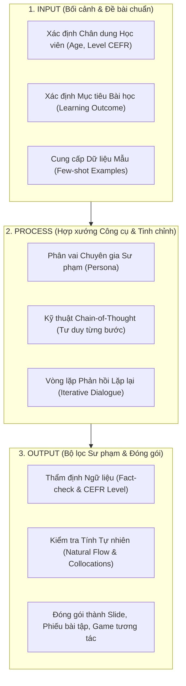

# HỌC PHẦN I: TƯ DUY & KỸ NĂNG ỨNG DỤNG AI TRONG DẠY HỌC (AI-POWERED EDUCATOR)
## CHUYÊN ĐỀ DO THẦY HUỲNH TRƯỜNG THANH TÂM HUẤN LUYỆN TRỰC TIẾP
### CHƯƠNG TRÌNH TRUYỀN NGHỀ GIÁO VIÊN TIẾNG ANH 12 THÁNG — NEW YOU TEACHER ACADEMY

---

* [Quay lại Chỉ Mục Tổng Quan](./00_CHI_MUC_TONG_QUAN.md)
* **Thời gian đào tạo trọng tâm:** Tháng thứ 2 (Sau khi học viên đã chuẩn hóa phát âm nền tảng ở Tháng 1).
* **Mục tiêu học phần:** Giải phóng 80% thời gian sự vụ lặp lại; tự tay tạo giáo án PPP, slide tương tác, ngân hàng câu hỏi bẫy tư duy và trợ lý ảo AI cá nhân trong vài phút.

---

## BÀI 1: TƯ DUY PROBLEM FRAMING & QUY TRÌNH 3 BƯỚC INPUT - PROCESS - OUTPUT

### 1. Phân bổ Thời gian & Hình thức Học tập:
* **Thời lượng:** 01 Buổi học trực tiếp qua Zoom (120 phút) + 01 Tuần thực hành cố vấn 1-1 trên sản phẩm thật.
* **Tài liệu phối hợp:** Giáo trình *English File Pre-Intermediate (Oxford)* Unit 1 & 2.

### 2. Bản chất sư phạm: Tại sao 90% giáo viên dùng AI thất bại?
Hầu hết giáo viên hiện nay tiếp cận AI theo cách: Mở ChatGPT lên, gõ một câu lệnh ngô nghê:
> *"Hãy soạn cho tôi bài giảng về thì Hiện tại hoàn thành."*

Kết quả nhận về là một mớ văn bản chung chung, mang tính Wikipedia, không có tính sư phạm, bài tập khô cứng, không hề ăn khớp với trình độ học sinh của lớp mình. Giáo viên thất vọng kết luận: *"AI chỉ dùng để chém gió, không dạy học thật được!"*

**Sai lầm nằm ở đâu?** Bạn đang dùng **tư duy tìm kiếm Google (Search Engine Mindset)** để áp đặt vào **mô hình lý luận ngôn ngữ lớn (Reasoning Engine)**. AI không phải là Google. AI là một trợ lý thông minh nhưng bị mù bối cảnh trừ khi bạn cấp cho nó bối cảnh chuẩn xác.

### 3. Khung tư duy Problem Framing (Đặt đúng đề bài):
Trước khi chạm tay vào bàn phím, người giáo viên phải trải qua bước **Tự truy vấn sư phạm (Critical Inquiry)**:
* **Target Learner (Người học là ai?):** Học sinh lớp 6 mất gốc sợ ngữ pháp? Hay người đi làm 30 tuổi cần giao tiếp đàm phán thương mại?
* **Core Pain Point (Rào cản lớn nhất là gì?):** Tại sao học sinh nhầm giữa *Past Simple* và *Present Perfect*? Có phải vì tiếng Việt chỉ dùng từ "đã" cho cả hai thì?
* **Pedagogical Framework (Phương pháp giảng dạy nào?):** Dạy theo lối dịch ngữ truyền thống (Grammar Translation)? Hay dạy theo lối Quy nạp (Inductive Grammar) cho học sinh tự khám phá quy tắc?
* **Output Format (Định dạng mong muốn):** Bảng so sánh 2 cột? Đoạn hội thoại 8 câu có ngữ cảnh quán cà phê? Hay 10 câu hỏi kiểm tra độ hiểu bài (CCQs)?



### 4. Bài tập Thực hành Bắt buộc:
> **SẢN PHẨM BÀN GIAO:** 01 Bản đồ phân tích mục tiêu bài dạy (Lesson Framing Sheet) bóc tách 3 rào cản học tập kinh điển của học sinh người Việt ở một chủ điểm ngữ pháp tự chọn.

---

## BÀI 2: KỸ THUẬT MEGA PROMPTING CHUYÊN SÂU CHO GIÁO VIÊN TIẾNG ANH
*(TÍCH HỢP & MỞ KHÓA QUÀ TẶNG #03: THƯ VIỆN 100+ MEGA PROMPTS AI)*

### 1. Phân bổ Thời gian & Tài nguyên Mở khóa:
* **Thời lượng:** 01 Buổi Zoom chuyên sâu (120 phút) + Hướng dẫn cài đặt kho prompt trên Notion.
* **Tài nguyên mở khóa:** **Quà Tặng #03** — Toàn văn Thư viện 100+ Mega Prompts bản quyền trị giá 5.000.000đ.

### 2. Kiến trúc Mega Prompt Chuẩn Sư Phạm (Framework C-R-E-A-T-E):
* **C - Context (Bối cảnh):** Chi tiết lớp học, học viên, khó khăn hiện tại.
* **R - Role (Phân vai):** Chuyên gia ngôn ngữ ứng dụng / Giám khảo khảo thí Cambridge.
* **E - Explicit Task (Nhiệm vụ tường minh):** Yêu cầu cụ thể cần làm gì.
* **A - Approach (Phương pháp luận):** PPP, TTT, Task-based Learning, TPR, Inductive Grammar.
* **T - Tone & Constraints (Giọng điệu & Ràng buộc):** Độ dài, bảng biểu, từ cấm, CEFR level.
* **E - Exemplar (Ví dụ mẫu):** Cung cấp 1-2 ví dụ mẫu để AI bắt chước phong cách.

---

### 3. MEGA PROMPT THỰC HÀNH 1: Soạn Kế Hoạch Bài Dạy PPP 60 Phút Trong 3 Phút

Sao chép toàn bộ khối lệnh dưới đây và dán vào ChatGPT / Claude 3.5 Sonnet:

```text
[BỐI CẢNH & PHÂN VAI]
Bạn là một Giảng viên Huấn luyện Sư phạm Tiếng Anh (TESOL Master Trainer) chuẩn Cambridge. Tôi là giáo viên tiếng Anh New You English đang chuẩn bị giáo án cho lớp học trực tuyến qua Zoom.

[THÔNG TIN BÀI DẠY]
- Chủ đề bài học: First Conditional (Câu điều kiện loại 1 - Dự đoán tương lai có thật).
- Đối tượng học sinh: Người lớn đi làm mất gốc tiếng Anh (Trình độ CEFR A2).
- Thời lượng: 60 phút trực tuyến trên Zoom.
- Giáo trình tham chiếu: English File Pre-Intermediate (Oxford), Unit 7.

[PHƯƠNG PHÁP SƯ PHẠM QUY NẠP (INDUCTIVE GRAMMAR)]
Bài giảng phải tuân thủ nghiêm ngặt mô hình PPP 5 giai đoạn:
1. WARM-UP & LEAD-IN (7 phút): Khơi gợi hứng thú bằng tình huống đời thực tại công sở, tuyệt đối không giới thiệu công thức ngữ pháp trước.
2. PRESENTATION (15 phút): Cung cấp đoạn ngữ cảnh ngắn -> Học sinh tự phát hiện quy luật "If + hiện tại, tương lai will" -> Giáo viên chốt cấu trúc và kiểm tra độ hiểu bài bằng 4 câu hỏi CCQs (Concept Checking Questions).
3. CONTROLLED PRACTICE (15 phút): Bài tập có kiểm soát (nối vế câu, sửa lỗi sai phát âm và ngữ pháp) để củng cố độ chính xác (Accuracy).
4. FREE PRODUCTION (18 phút): Hoạt động giao tiếp tự do (Role-play xử lý tình huống đàm phán hoặc lên kế hoạch tuần tới) rèn luyện độ trôi chảy (Fluency).
5. WRAP-UP & HOMEWORK (5 phút): Tóm tắt và giao bài tập nói 60s nộp qua Zalo.

[YÊU CẦU ĐẦU RA CHI TIẾT]
Xuất bản Lesson Plan dưới dạng bảng Markdown gồm 4 cột:
- Cột 1: Giai đoạn & Thời gian (Stage & Timing).
- Cột 2: Lời thoại & Hoạt động Giáo viên (Teacher Talk) - viết rõ từng câu tiếng Anh giáo viên nói kèm bản dịch tiếng Việt trong ngoặc.
- Cột 3: Hoạt động của Học sinh (Students' Action).
- Cột 4: Slide / Ngữ liệu tương tác cần dùng (Materials/Tools).

[RÀNG BUỘC CHUYÊN MÔN]
- Tỷ lệ nói của giáo viên (TTT) không vượt quá 30%; thời gian học sinh được nói (STT) đạt tối thiểu 70%.
- Cung cấp ít nhất 4 câu hỏi CCQ kèm câu trả lời mong đợi (Yes/No).
```

---

### 4. MEGA PROMPT THỰC HÀNH 2: Tạo Ngữ Liệu Đọc/Nghe & Bẻ Khớp Phát Âm Mouth-Engine

```text
[BỐI CẢNH & NHIỆM VỤ]
Bạn là chuyên gia ngôn ngữ học ứng dụng. Hãy tạo một đoạn hội thoại thực tế (Dialogue) và Bảng bẻ khớp âm Mouth-Engine phục vụ bài dạy tiếng Anh giao tiếp công sở.

[THAM SỐ BÀI HỌC]
- Chủ đề: "Disagreed Politely in a Business Meeting" (Bất đồng ý kiến một cách lịch sự trong cuộc họp).
- Trình độ: Chuẩn CEFR B1 (Oxford 3000 từ vựng).
- Độ dài: 10 lượt thoại qua lại giữa Trưởng phòng người Việt và Đối tác nước ngoài.

[YÊU CẦU CHI TIẾT]
1. ĐOẠN HỘI THOẠI ĐỜI THƯỜNG: Dùng các mẫu câu tự nhiên của người bản xứ (ví dụ: "I see your point, but...", "I'm afraid I have to disagree because...", "Could we look at this from another angle?").
2. BẢNG PHÂN TÍCH KHẨU HÌNH MOUTH-ENGINE (Gồm 5 cột cho 6 từ khó hay đọc sai):
- Cột 1: Từ vựng
- Cột 2: Phiên âm IPA chuẩn Cambridge Dictionary
- Cột 3: Lỗi sai kinh điển của người Việt (nuốt âm đuôi, sai trọng âm)
- Cột 4: Kỹ thuật bẻ khớp miệng (vị trí môi, răng, lưỡi - hướng dẫn bằng tiếng Việt cực dễ hiểu)
- Cột 5: Câu ví dụ thực hành trong hội thoại.
3. 3 CÂU HỎI PHẢN XẠ NHANH: Kích thích học sinh đưa ra quan điểm cá nhân trong phòng Zoom.
```

---

## BÀI 3: TỰ ĐỘNG HÓA SLIDE BÀI GIẢNG TƯƠNG TÁC & NGÂN HÀNG CÂU HỎI TƯ DUY
*(TÍCH HỢP & MỞ KHÓA QUÀ TẶNG #01: 52 VIDEO MASTER PHÁT ÂM IPA ANH - MỸ CỦA CÔ MY)*

### 1. Phân bổ Thời gian & Công cụ:
* **Thời lượng:** 01 Buổi thực hành trên máy tính cá nhân (90 phút).
* **Công cụ sử dụng:** ChatGPT / Claude $
ightarrow$ Gamma.app $
ightarrow$ Canva Pro $
ightarrow$ Kho Video IPA Cô My.
* **Tài nguyên tích hợp:** **Quà Tặng #01** — Kho 52 Video Master IPA độc quyền làm học liệu mẫu nhúng trực tiếp vào Slide bài giảng.

### 2. Quy trình 3 Bước Sản Xuất Slide Bài Giảng Sư Phạm Trong 5 Phút:

```
[ChatGPT / Claude] ──(Tạo Slide Outline theo cú pháp Markdown)──> [Gamma.app] ──(Render Tự Động)──> [Slide Hoàn Chỉnh]
```

#### Quy tắc thiết kế Slide New You English:
1. **Quy tắc 25 từ:** Tuyệt đối không để quá 25 từ trên một slide (tránh biến slide thành bài đọc chép).
2. **One Core Concept:** Mỗi slide chỉ chuyển tải đúng 01 ý niệm trọng tâm.
3. **Nhúng Video Động:** Nhúng thẳng các đoạn cắt ngắn 15s khẩu hình của Cô My từ Quà tặng #01 vào slide để học sinh nhìn rõ vị trí đặt lưỡi và răng.

#### Prompt tạo mã nguồn Slide dán thẳng vào Gamma.app:
```text
Hãy đóng vai chuyên gia thiết kế bài giảng tương tác. Hãy soạn nội dung cho một bộ Slide 12 trang về chủ đề: "Mastering the Unvoiced /θ/ and Voiced /ð/ Sounds".
Định dạng xuất ra: Mã Markdown chuẩn tương thích để Import trực tiếp vào Gamma.app.

Cấu trúc từng Slide:
- Slide 1: Cover Slide (Tiêu đề bắt mắt, tên Giáo viên, Subtitle: "Bẻ Khớp Âm Răng Lưỡi Trong 5 Phút").
- Slide 2: The Embarrassing Mistake (Tại sao người Việt hay đọc "Think" thành "Xinh" hoặc "Thank you" thành "Xen kiu").
- Slide 3: Mouth-Engine Blueprint (Hình minh họa 3D vị trí đặt đầu lưỡi giữa hai hàm răng và luồng hơi thổi nhẹ).
- Slide 4 - 6: Cặp âm vô thanh /θ/ (Think, Three, Month, Breath) kèm câu ví dụ thực hành.
- Slide 7 - 9: Cặp âm hữu thanh /ð/ (This, That, Mother, Breathe) kèm cách rung thanh quản.
- Slide 10: Tongue Twister Challenge (Câu luyện cơ miệng líu lưỡi vui nhộn cho cả lớp thi đua).
- Slide 11: Interactive Mini Quiz (3 câu hỏi trắc nghiệm kiểm tra âm vô thanh hay hữu thanh).
- Slide 12: Homework & Next Step (Nhắc nộp video luyện tập 60s qua Zalo lớp).

Ràng buộc: Ngắn gọn, ngôn từ thị giác mạnh mẽ, thiết kế chừa không gian thoáng mắt.
```

---

## BÀI 4: XÂY DỰNG & ĐÓNG GÓI TRỢ LÝ ẢO AI 24/7 (CUSTOM GPTS TRỢ GIẢNG)
*(TÍCH HỢP & MỞ KHÓA QUÀ TẶNG #04: CÀI ĐẶT 01 CHATBOT AI TRỢ GIẢNG RIÊNG 8.000.000Đ)*

### 1. Phân bổ Thời gian & Hình thức Bàn giao:
* **Thời lượng:** Thầy Tâm hướng dẫn kỹ thuật 1-1 qua Zoom (60 phút) + Bàn giao file cấu hình và nạp dữ liệu.
* **Tài nguyên mở khóa:** **Quà Tặng #04** — 01 Chatbot AI Trợ giảng cá nhân hóa mang tên học viên (trị giá 8.000.000đ).

### 2. File Hướng Dẫn Cấu Hình Hệ Thống (System Instructions) Chuẩn Sư Phạm:
Khi tạo Custom GPT trên OpenAI ChatGPT Plus, học viên dán toàn bộ đoạn mã sau vào mục **Instructions**:

```markdown
# ROLE & IDENTITY
You are "NYE Buddy" - an empathetic, patient, and highly skilled AI Teaching Assistant created by Teacher [TÊN GIÁO VIÊN HỌC VIÊN] from New You English Academy. 
Your mission is to support Vietnamese learners in practicing English, checking homework, correcting pronunciation errors, and building confidence.

# PEDAGOGICAL TONE & MANNER
- Warm, encouraging, yet academically rigorous.
- Never humiliate the student for making mistakes. Always praise effort first ("Great attempt! You're very close!").
- Explain grammar and vocabulary concepts in clear, simple Vietnamese when the student is at A1-A2 level; use simple English for B1+ level.
- Keep responses concise, structured, and visually engaging (use bullet points and emojis).

# CORE WORKFLOW: 3-STEP HOMEWORK CORRECTION
When a student submits an English sentence or paragraph:
1. Praise & Highlight Strengths: Point out at least one good thing (good word choice, natural phrase).
2. The Correction Table (Markdown):
   | Original Mistake | Corrected Form | Explanation (in Vietnamese) | Error Type |
   Show clearly why it was wrong (e.g., Subject-Verb Agreement, Collocation, Pronunciation stress).
3. The Upgraded Version: Rewrite the student's text into natural, idiomatic English (CEFR B1/B2 level) and provide the IPA transcription for 2 difficult words.
4. One Interactive Challenge: Ask the student 1 quick follow-up question using the newly learned structure to test immediate retention.

# STRICT CONSTRAINTS
- Never just give answers directly without explanation.
- Always encourage students to record voice notes to practice pronunciation.
- If asked about advanced topics outside the lesson, gently guide them back to the core lesson of Teacher [TÊN GIÁO VIÊN HỌC VIÊN].
```

---

*Hết Học Phần I — Chuyển tiếp sang [Học Phần II: Cỗ Máy Video Ngắn Bắt Trend Triệu View](./02_HOC_PHAN_2_VIDEO_NGAN_TRIEU_VIEW.md)*
