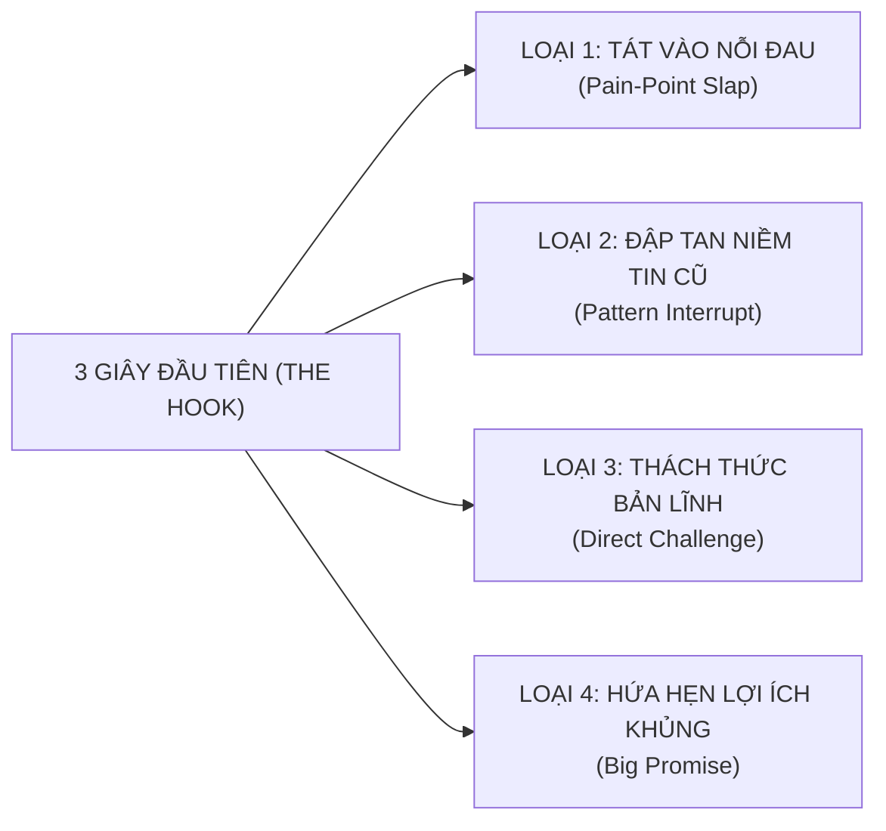

# HỌC PHẦN II: CỖ MÁY VIDEO NGẮN BẮT TREND TRIỆU VIEW & ĐỊNH VỊ NHÂN HIỆU (VIRAL VIDEO MASTERY)
## CHUYÊN ĐỀ DO THẦY HUỲNH TRƯỜNG THANH TÂM HUẤN LUYỆN TRỰC TIẾP
### ĐIỀU PHỐI & KIỂM DUYỆT CHUYÊN MÔN TIẾNG ANH: CÔ SOPHIE DIỄM MY
### CHƯƠNG TRÌNH TRUYỀN NGHỀ GIÁO VIÊN TIẾNG ANH 12 THÁNG — NEW YOU TEACHER ACADEMY

---

* [Quay lại Chỉ Mục Tổng Quan](./00_CHI_MUC_TONG_QUAN.md)
* **Thời gian đào tạo & thực chiến:** Tháng thứ 2 (đào tạo kỹ thuật) $\rightarrow$ Duy trì sản xuất tối thiểu 2 video/tuần trong suốt 12 tháng.
* **Mục tiêu học phần:** Tự tay làm chủ kỹ thuật sản xuất video ngắn triệu view trên TikTok, Reels, Shorts để hút học viên liên tục 0 đồng; xuất bản tối thiểu **20 video ngắn chất lượng cao**.

> [!NOTE]
> **PHÂN ĐỊNH PHẠM VI CHUYÊN MÔN:**
> Thầy Tâm huấn luyện toàn bộ về: Thuật toán, kịch bản giữ chân, thiết bị quay dựng, diễn xuất trước ống kính, dựng phim CapCut và SEO đa kênh. Kiến thức chuyên môn tiếng Anh xuất hiện trong video phải được **Cô Sophie Diễm My** duyệt trước khi bấm máy.

---

## BÀI 5: THUẬT TOÁN VIDEO NGẮN & MA TRẬN "HOOK 3 GIÂY GIỮ CHÂN"

### 1. Giải mã Thuật toán Phân phối (TikTok, Reels, Shorts):
Thuật toán phân phối video ngắn hoạt động như một cỗ máy đấu thầu chú ý (Attention Auction). Nó đo lường các chỉ số hành vi thực tế theo công thức định lượng:

$$\text{Điểm Phân Phối} = 3 \times (\text{Watch Time}) + 5 \times (\text{Completion Rate}) + 2 \times (\text{Saves}) + 1.5 \times (\text{Shares}) + (\text{Comments})$$

* **Chỉ số Sống Còn 1 — Retention 3s (Tỷ lệ giữ chân 3 giây đầu):** Nếu quá 70% người xem lướt qua trong 3 giây đầu, video của bạn bị đẩy vào "nghĩa địa nội dung" (lẹt đẹt 200–300 views).
* **Chỉ số Sống Còn 2 — Completion Rate (Tỷ lệ xem hết video):** Video giáo dục 45–60 giây phải đạt tỷ lệ xem hết $\ge 25\%$ thì mới được đẩy vào luồng phân phối triệu view.
* **Chỉ số Chuyển đổi — Save & Share (Lưu và Chia sẻ):** Người học tiếng Anh lưu video vì nó chứa kiến thức cô đặc (bảng so sánh, mẹo nhớ); họ chia sẻ video vì thấy một lỗi sai hài hước mà bạn bè họ cũng mắc.

### 2. Ma trận "Hook 3 Giây Giữ Chân" (Hook Retention Matrix):



| Loại Hook | Công thức Hook | Ví dụ gợi ý minh họa |
| :--- | :--- | :--- |
| **1. Pain-Point Slap (Tát vào nỗi đau)** | *"Học [X năm] mà vẫn [nỗi đau], xem ngay kẻo phí cả thanh xuân!"* | *"Học tiếng Anh 12 năm mà gặp Tây chỉ biết cười trừ thì xem ngay video này!"* |
| **2. Pattern Interrupt (Phá vỡ niềm tin cũ)** | *"Dừng lại! Đừng bao giờ nói [cụm từ quen thuộc] nữa, nghe cực kỳ lỗi thời!"* | *"Dừng lại ngay! Đi ăn phở mà bảo 'I eat pho' thì người bản xứ cười đấy!"* |
| **3. Direct Challenge (Thách thức người xem)** | *"99% người học phát âm sai từ này, bạn có nằm trong số đó?"* | *"Từ này ai cũng tưởng mình đọc đúng: [Nhập từ khó], thử đọc xem nào!"* |
| **4. Big Promise (Lợi ích siêu tốc)** | *"Mẹo cực đỉnh: Nhớ ngay [kiến thức khó] chỉ bằng một quy tắc 3 bước!"* | *"3 mẹo phân biệt [Cặp kiến thức dễ nhầm] không bao giờ sai trong 30 giây!"* |

---

## BÀI 6: 5 CẤU TRÚC KỊCH BẢN VIDEO GIÁO DỤC CHUYỂN ĐỔI CAO
*(TÍCH HỢP QUÀ TẶNG #05: KHO 30 KỊCH BẢN VIDEO NGẮN TRIỆU VIEW)*

### 1. Phân bổ Thời gian & Công thức Cấu trúc:
* **Thời lượng:** 01 Buổi phân tích cấu trúc + Hướng dẫn tùy biến kịch bản.
* **Khung kịch bản 5 phần bất biến:**
  1. `[0 - 3s]` The Hook (Kéo chú ý, giật title thị giác).
  2. `[3 - 10s]` Agitate Pain-Point (Mô tả tình huống bối rối thực tế).
  3. `[10 - 30s]` The Aha Solution (Đưa ra giải pháp/mẹo nhớ đắt giá).
  4. `[30 - 45s]` Application / Context (Ghép vào câu giao tiếp hoàn chỉnh).
  5. `[45 - 55s]` Call to Action (Kêu gọi comment, follow nhận tài liệu).

### 2. Bảng Phân Bổ 5 Cấu Trúc Kịch Bản:
1. **Cấu trúc 1 — Bóc phốt lỗi sai kinh điển:** Chỉ ra lỗi sai phổ biến $\rightarrow$ Đưa giải pháp chuẩn.
2. **Cấu trúc 2 — Đóng 2 vai (Tình huống thực tế):** Học sinh ngô nghê vs Giáo viên giải cứu.
3. **Cấu trúc 3 — Mẹo nhớ nhanh 60 giây (Fast Hacks):** Dùng thơ, vần, quy tắc ngón tay.
4. **Cấu trúc 4 — Câu chuyện học trò tiến bộ (Social Proof):** Chuyển biến từ sợ hãi đến tự tin.
5. **Cấu trúc 5 — Trả lời bình luận của khán giả (Q&A Reply):** Khai thác comment tạo video phễu.

---

## BÀI 7: THIẾT LẬP STUDIO TẠI GIA CHI PHÍ TỐI THIỂU & NGHỆ THUẬT DIỄN XUẤT

### 1. Bộ Thiết bị Chuẩn Sư Phạm Số Chi Phí Dưới 2 Triệu Đồng:
1. **Smartphone cá nhân (Camera sau):** Thiết lập thông số **4K 30fps** hoặc **1080p 60fps** (tuyệt đối không dùng camera trước).
2. **Microphone cài áo không dây (K8/K9/Boya):** Giá 250k - 600k (Lọc sạch tiếng ồn quạt máy và tiếng vang).
3. **Đèn Ring Light hoặc Đèn LED bảng mini:** Giá 300k - 500k (Đảm bảo khuôn mặt luôn sáng rõ, mắt có catchlight).
4. **Chân máy (Tripod) kẹp điện thoại xoay linh hoạt:** Giá 150k (Đặt máy ngang ngực/tầm mắt).

### 2. Sơ đồ Bố trí Ánh sáng 3 Điểm Chuẩn Studio:

```
                  [ BỨC TƯỜNG / KỆ SÁCH ĐÈN VÀNG ]
                                 ▲
                                 │ (Khoảng cách 1 - 1.5 mét)
                           [ GIÁO VIÊN ]
                         (Ngồi thẳng lưng)
                                 ▲
                                 │ (Khoảng cách 1.2 mét)
                      [ SMARTPHONE (Camera Sau) ]
                                 │
     [ ĐÈN CHÍNH (Key Light) ]   │   [ ĐÈN PHỤ (Fill Light) ]
      (Góc 45 độ - Ánh sáng mạnh)│    (Góc 45 độ - Ánh sáng nhẹ)
```

### 3. Bí kíp Diễn xuất & Sử dụng Ứng dụng Nhắc chữ (Teleprompter):
* **Mẹo không đảo mắt:** Kéo khung app Teleprompter thu nhỏ lại tối đa và đặt **ngay sát mép ống kính camera**.
* **Năng lượng giọng nói:** Tăng âm lượng to hơn 30%, cười tươi hơn 30% và ngôn ngữ hình thể mở rộng hơn 30% so với nói chuyện bình thường.

---

## BÀI 8: DỰNG PHIM CAPCUT SIÊU TỐC, HIỆU ỨNG ĐỘNG & SEO ĐA KÊNH

### 1. Quy trình Dựng Video 15 Phút trên CapCut (Điện thoại & PC):
* **Bước 1 — Cắt Jump-cut nhịp nhanh:** Cắt bỏ 100% khoảng lặng thở, đoạn ngập ngừng "ờ, à".
* **Bước 2 — Auto Captions:** Phụ đề tự động font chữ to rõ (The Bold Font, Be Vietnam Pro viền đen nền vàng).
* **Bước 3 — Text/Hình ảnh động:** Chèn từ khóa nổi bật nhấp nháy khớp với lời thoại.
* **Bước 4 — Chèn Sound Effects (SFX) & Nhạc nền:** Âm thanh nhấn mạnh (Pop, Ding, Whoosh); nhạc nền để ở mức **8% - 12%**.

### 2. Kỷ luật Xuất bản:
> **CHỈ TIÊU BẮT BUỘC:** Mỗi học viên phải xuất bản tối thiểu **20 video ngắn hoàn chỉnh** lên TikTok, Facebook Reels và YouTube Shorts trong Tháng thứ 4 và 5. Thầy Tâm trực tiếp nghiệm thu link từng video!

---

*Hết Học Phần II — Chuyển tiếp sang [Học Phần III: Phễu Tuyển Sinh & Tự Động Hóa](./03_HOC_PHAN_3_PHEU_TUYEN_SINH_VA_TU_DONG_HOA.md)*
