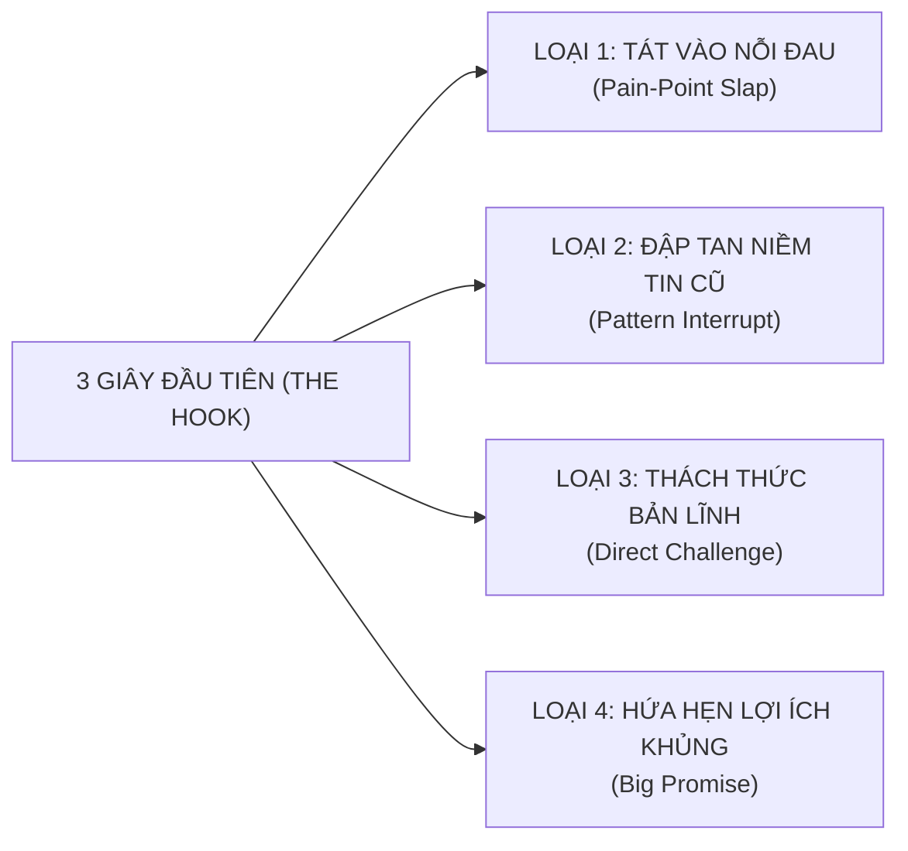

# HỌC PHẦN II: CỖ MÁY VIDEO NGẮN BẮT TREND TRIỆU VIEW & ĐỊNH VỊ NHÂN HIỆU (VIRAL VIDEO MASTERY)
## CHUYÊN ĐỀ DO THẦY HUỲNH TRƯỜNG THANH TÂM HUẤN LUYỆN TRỰC TIẾP
### ĐIỀU PHỐI & KIỂM DUYỆT NGỮ ÂM: CÔ SOPHIE DIỄM MY
### CHƯƠNG TRÌNH TRUYỀN NGHỀ GIÁO VIÊN TIẾNG ANH 12 THÁNG — NEW YOU TEACHER ACADEMY

---

* [Quay lại Chỉ Mục Tổng Quan](./00_CHI_MUC_TONG_QUAN.md)
* **Thời gian đào tạo & thực chiến:** Tháng thứ 2 (đào tạo kỹ thuật) $
ightarrow$ Duy trì sản xuất tối thiểu 2 video/tuần trong suốt 12 tháng.
* **Mục tiêu học phần:** Tự tay sản xuất video triệu view trên TikTok, Reels, Shorts để hút học viên liên tục 0 đồng; bắt buộc xuất bản tối thiểu **20 video ngắn chất lượng cao**.

---

## BÀI 5: THUẬT TOÁN VIDEO NGẮN & MA TRẬN "HOOK 3 GIÂY GIỮ CHÂN"

### 1. Giải mã Thuật toán Phân phối (TikTok, Reels, Shorts):
Thuật toán phân phối video ngắn hoạt động như một cỗ máy đấu thầu chú ý (Attention Auction). Nó đo lường các chỉ số hành vi thực tế theo công thức định lượng:

$$\text{Điểm Phân Phối} = 3 \times (\text{Watch Time}) + 5 \times (\text{Completion Rate}) + 2 \times (\text{Saves}) + 1.5 \times (\text{Shares}) + (\text{Comments})$$

* **Chỉ số Sống Còn 1 — Retention 3s (Tỷ lệ giữ chân 3 giây đầu):** Nếu quá 70% người xem lướt qua trong 3 giây đầu, video của bạn bị đẩy vào "nghĩa địa nội dung" (lẹt đẹt 200–300 views).
* **Chỉ số Sống Còn 2 — Completion Rate (Tỷ lệ xem hết video):** Video giáo dục 45–60 giây phải đạt tỷ lệ xem hết $\ge 25\%$ thì mới được đẩy vào luồng phân phối triệu view.
* **Chỉ số Chuyển đổi — Save & Share (Lưu và Chia sẻ):** Người học tiếng Anh lưu video vì nó chứa kiến thức cô đặc (bảng so sánh, mẹo nhớ); họ chia sẻ video vì thấy một lỗi sai hài hước mà bạn bè họ cũng mắc.

### 2. Ma trận "Hook 3 Giây Giữ Chân" (Hook Retention Matrix):



| Loại Hook | Công thức Hook | Lời thoại mẫu áp dụng dạy Tiếng Anh |
| :--- | :--- | :--- |
| **1. Pain-Point Slap (Tát vào nỗi đau)** | *"Học tiếng Anh [X năm] mà vẫn [nỗi đau], xem ngay kẻo phí cả thanh xuân!"* | *"Học tiếng Anh 12 năm mà gặp Tây chỉ biết 'Hello, I'm fine, thank you' thì vào đây Cô My chỉ cách chữa trong 30 giây!"* |
| **2. Pattern Interrupt (Phá vỡ niềm tin cũ)** | *"Dừng lại! Đừng bao giờ nói [từ quen thuộc] nữa, nghe cực kỳ quê mùa!"* | *"Dừng lại ngay! Đi ăn phở mà bảo 'I eat pho' thì người bản xứ cười cho đấy! Phải dùng từ này mới chuẩn sang chảnh!"* |
| **3. Direct Challenge (Thách thức người xem)** | *"99% người Việt Nam phát âm sai bét từ này, bạn có nằm trong số đó?"* | *"Từ này ai cũng nghĩ mình đọc đúng: 'Comfortable'. Dám cá 10 bạn thì 9 bạn đọc là cơm-pho-tây-bồ đúng không?"* |
| **4. Big Promise (Lợi ích siêu tốc)** | *"Mẹo cực đỉnh: Nhớ ngay [kiến thức khó] chỉ bằng một quy tắc 5 ngón tay!"* | *"3 mẹo phân biệt In - On - At không bao giờ sai, học sinh lớp 3 xem xong cũng hiểu ngay lập tức!"* |

---

## BÀI 6: 5 CẤU TRÚC KỊCH BẢN VIDEO GIÁO DỤC CHUYỂN ĐỔI CAO
*(TÍCH HỢP & MỞ KHÓA QUÀ TẶNG #05: KHO 30 KỊCH BẢN VIDEO NGẮN TRIỆU VIEW)*

### 1. Phân bổ Thời gian & Tài nguyên Mở khóa:
* **Thời lượng:** 01 Buổi phân tích kịch bản + Duyệt kịch bản 1-1 cùng Thầy Tâm và Cô My.
* **Tài nguyên mở khóa:** **Quà Tặng #05** — Kho 30 Kịch bản Video ngắn triệu view bắt trend đã kiểm chứng (trị giá 6.000.000đ).

### 2. Kịch bản Mẫu Chi Tiết Từng Giây (Bản Quay Mẫu Chuẩn Bóc Phốt Phát Âm):

| Thời gian | Cảnh quay (Visual & Action) | Lời thoại (Audio / Speech) | Văn bản trên màn hình (Text On Screen) & SFX |
| :--- | :--- | :--- | :--- |
| **0:00 - 0:03** | Quay cận mặt (Close-up). Thầy/Cô lắc đầu ngao ngán, giơ tay làm dấu STOP. | *"Nếu bạn vẫn đang đọc từ này là 'S-ke-đu-le' thì dừng lại ngay kẻo Tây cười ngất!"* | Chữ to đỏ viền vàng: **DỪNG LẠI NGAY! ❌**<br>*SFX: Tiếng phanh xe kít kít.* |
| **0:03 - 0:10** | Cắt nhanh (Jump cut). Hiện ảnh minh họa cuốn lịch làm việc kín mít. | *"Từ này có nghĩa là lịch trình, thời khóa biểu. Rất nhiều bạn học sinh hay đọc bừa theo cảm tính."* | Từ vựng: **Schedule**<br>Phiên âm sai gạch chéo: ~~S-ke-đu-le~~ |
| **0:10 - 0:25** | Cận cảnh khẩu hình miệng (Mouth Engine). Quay góc nghiêng 45 độ và góc thẳng. | *"Nhìn kỹ khẩu hình của Cô nhé! Anh-Anh và Anh-Mỹ đọc khác nhau hoàn toàn này: Anh-Mỹ sẽ là /ˈskedʒ.uːl/ - âm 'sk', 'edʒ' và 'uːl'. Còn Anh-Anh lại là /ˈʃedʒ.uːl/ - âm 'sh' cong môi tròn miệng!"* | Hiện ký tự IPA động từng âm tiết nhấp nháy theo tiếng đọc:<br>🇺🇸 /ˈskedʒ.uːl/<br>🇬🇧 /ˈʃedʒ.uːl/<br>*SFX: Tiếng 'ding' khi đọc đúng.* |
| **0:25 - 0:40** | Ghép vào câu thực tế (Full Context). Biểu cảm tự tin, tay diễn xuất tự nhiên. | *"Nào, ghép vào câu giao tiếp công sở: 'I have a tight schedule today!' (Hôm nay lịch của tôi kín mít rồi!). Đọc lại cùng Cô nào!"* | Hiện cả câu tiếng Anh kèm phiên dịch tiếng Việt bên dưới. |
| **0:40 - 0:50** | Kêu gọi hành động (Call To Action). Cười thân thiện, chỉ tay xuống góc trái màn hình. | *"Bạn đọc theo giọng Anh hay Mỹ? Comment bên dưới xem có chuẩn không nhé! Follow kênh để không bao giờ phát âm ngố nữa!"* | Text: **Thử đọc lại xem nào! 👇**<br>Logo New You English. |

---

## BÀI 7: THIẾT LẬP STUDIO TẠI GIA CHI PHÍ TỐI THIỂU & NGHỆ THUẬT DIỄN XUẤT

### 1. Bộ Thiết bị Chuẩn Sư Phạm Số Chi Phí Dưới 2 Triệu Đồng:
1. **Smartphone cá nhân (iPhone 11 trở lên hoặc Samsung tương đương):** Quay bằng **Camera sau** (tuyệt đối không quay camera trước vì độ phân giải thấp và bị méo hình). Thiết lập thông số: **4K 30fps** hoặc **1080p 60fps**.
2. **Microphone cài áo không dây (K8, K9 hoặc Boya By-V20):** Giá 250k - 600k. Thu âm trong trẻo, lọc sạch tiếng ồn quạt máy và tiếng vang phòng. *(Quy tắc vàng: Khán giả có thể chấp nhận hình ảnh hơi tối, nhưng sẽ tắt ngay lập tức nếu âm thanh rè và lẫn tạp âm!)*.
3. **Đèn Ring Light hoặc Đèn LED bảng (Softbox mini):** Giá 300k - 500k. Đảm bảo khuôn mặt luôn sáng rõ, mắt có điểm sáng (Catchlight).
4. **Chân máy (Tripod) có kẹp điện thoại xoay ngang dọc:** Giá 150k. Đặt máy ngang tầm mắt hoặc ngang ngực.

### 2. Sơ đồ Bố trí Ánh sáng & Góc Máy:

```
                  [ BỨC TƯỜNG / KỆ SÁCH ĐÈN VÀNG ]
                                 ▲
                                 │ (Khoảng cách 1 - 1.5 mét)
                           [ GIÁO VIÊN ]
                         (Ngồi thẳng lưng)
                                 ▲
                                 │ (Khoảng cách 1.2 mét)
                      [ SMARTPHONE (Camera Sau) ]
                                 │
     [ ĐÈN CHÍNH (Key Light) ]   │   [ ĐÈN PHỤ (Fill Light) ]
      (Góc 45 độ - Ánh sáng mạnh)│    (Góc 45 độ - Ánh sáng nhẹ)
```

### 3. Bí kíp Diễn xuất & Sử dụng Ứng dụng Nhắc chữ (Teleprompter):
* **Kỹ thuật không bị "đảo mắt đọc chữ":** Dùng app **CapCut Teleprompter** hoặc **PromptSmart**. Thu nhỏ khung chữ nhắc lại tối đa và kéo khung chữ nằm **ngay sát mép ống kính camera**. Khi bạn đọc chữ sát ống kính, mắt người xem nhìn vào sẽ thấy bạn đang nhìn thẳng vào mắt họ!
* **Năng lượng giọng nói (Vocal Power):** Khi đứng trước ống kính, năng lượng của bạn bị ống kính "nuốt" mất 30%. Do đó, khi quay bạn phải **nói to hơn 30%, cười tươi hơn 30% và biểu cảm tay mở rộng hơn 30%** so với khi nói chuyện bình thường.

---

## BÀI 8: DỰNG PHIM CAPCUT SIÊU TỐC, PHIÊN ÂM IPA ĐỘNG & SEO ĐA KÊNH

### 1. Quy trình Dựng Video 15 Phút trên CapCut (Điện thoại & PC):
* **Bước 1 — Cắt thô (Rough Cut & Jump Cut):** Cắt bỏ toàn bộ các đoạn thở dài, đoạn ngập ngừng "ờ, à", đoạn nuốt nước bọt. Video ngắn yêu cầu nhịp điệu dồn dập, câu sau nối tiếp câu trước không có một mili-giây chết.
* **Bước 2 — Phụ đề tự động (Auto Captions):** Bấm *Văn bản $\rightarrow$ Phụ đề tự động*. Chọn font chữ dày, không chân, dễ đọc trên di động: **The Bold Font, Montserrat Black, hoặc Be Vietnam Pro**. Đổi màu vàng viền đen hoặc trắng viền đen.
* **Bước 3 — Tạo Phiên âm IPA động:** Tải font ký tự ngữ âm quốc tế hoặc gõ phiên âm IPA to rõ ở giữa màn hình. Dùng hiệu ứng động (Animation) dạng "Typewriter" hoặc "Pop-up" khớp với từng tiếng phát âm của giáo viên.
* **Bước 4 — Chèn Âm thanh & Hiệu ứng Chuyển cảnh (SFX & BGM):**
  - Hiệu ứng âm thanh nhấn mạnh: *Pop, Ding, Whoosh, Camera Click, Wrong Buzzer*.
  - Nhạc nền (BGM): Nhạc lofi nhẹ nhàng hoặc nhạc upbeat vui nhộn; âm lượng nhạc nền đặt ở mức **8% - 12%** để không đè lên giọng nói của giáo viên.

### 2. Kỷ luật Xuất bản:
> **CHỈ TIÊU BẮT BUỘC:** Mỗi học viên phải xuất bản tối thiểu **20 video ngắn hoàn chỉnh** lên TikTok, Facebook Reels và YouTube Shorts trong Tháng thứ 4 và 5. Bạn Trí QA và Thầy Tâm trực tiếp nghiệm thu link từng video!

---

*Hết Học Phần II — Chuyển tiếp sang [Học Phần III: Phễu Tuyển Sinh & Tự Động Hóa](./03_HOC_PHAN_3_PHEU_TUYEN_SINH_VA_TU_DONG_HOA.md)*
