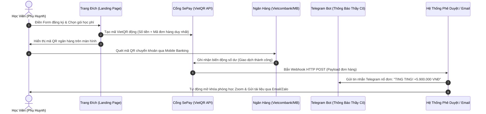

# HỌC PHẦN III: PHỄU TUYỂN SINH, KỸ NĂNG BÁN HÀNG THẤU CẢM & TỰ ĐỘNG HÓA VẬN HÀNH (EDUCATION FUNNEL & SALES ARCHITECTURE)
## CHUYÊN ĐỀ DO THẦY HUỲNH TRƯỜNG THANH TÂM HUẤN LUYỆN TRỰC TIẾP
### CHƯƠNG TRÌNH TRUYỀN NGHỀ GIÁO VIÊN TIẾNG ANH 12 THÁNG — NEW YOU TEACHER ACADEMY

---

* [Quay lại Chỉ Mục Tổng Quan](./00_CHI_MUC_TONG_QUAN.md)
* **Thời gian đào tạo & thực chiến:** Tháng thứ 3 (đào tạo chuyên sâu) $
ightarrow$ Triển khai mở lớp cuốn chiếu trong suốt 3 chu kỳ (Tháng 4-6, Tháng 7-9, Tháng 10-12).
* **Mục tiêu học phần:** Chuyển hóa tư duy từ giáo viên "ngại bán hàng" thành chuyên gia tư vấn giải pháp thấu cảm; chốt combo học phí cao qua Zalo và Zoom Demo Class; tự động hóa thu tiền bằng VietQR SePay & bot Telegram.

---

## BÀI 9: KIẾN TRÚC PHỄU GIÁO DỤC TOFU-MOFU-BOFU & THIẾT KẾ MỒI THU HÚT 0 ĐỒNG
*(TÍCH HỢP & MỞ KHÓA QUÀ TẶNG #09: LEAD MAGNET STUDIO KIT & QUÀ TẶNG #02: EBOOK NYE)*

### 1. Kiến trúc Phễu Giáo dục 3 Tầng:

```
        ┌──────────────────────────────────────────────┐
        │       TOFU (Top of Funnel - Tầng Nhận Biết)   │ ◄── Video ngắn triệu view (TikTok/Reels)
        │       Khách hàng: "Tôi thấy cô này dạy hay!"  │
        └──────────────────────┬───────────────────────┘
                               │
                               ▼ [Tặng Lead Magnet Miễn Phí]
        ┌──────────────────────────────────────────────┐
        │     MOFU (Middle of Funnel - Tầng Nuôi Dưỡng) │ ◄── Group Zalo, Ebook, Chuỗi Email,
        │    Khách hàng: "Phương pháp này hợp với tôi!" │     Mini-course 3 ngày, Demo Class
        └──────────────────────┬───────────────────────┘
                               │
                               ▼ [Tư vấn 1-1 / Lớp Demo Class]
        ┌──────────────────────────────────────────────┐
        │       BOFU (Bottom of Funnel - Chốt Đơn)     │ ◄── Khóa Combo 3 - 6 - 12 Tháng
        │       Khách hàng: "Tôi phải đăng ký ngay!"    │     Thu học phí qua VietQR SePay
        └──────────────────────┬───────────────────────┘
```

### 2. Vũ Khí Chiêu Sinh Thực Chiến: Bộ Lead Magnet Studio Kit (Quà Tặng #09):
Học viên New You English được bàn giao trọn bộ tài nguyên đóng gói sẵn để đi chiêu sinh học sinh thật:
1. **01 File Ebook PDF Được Đổi Tên Tác Giả:** *"Sổ Tay 100 Cụm Từ Tiếng Anh Bẻ Gãy Rào Cản Giao Tiếp Công Sở"* — Gắn tên học viên, chèn link Zalo cá nhân để tặng miễn phí trên MXH hút hàng trăm phụ huynh/người đi làm để lại số điện thoại.
2. **Bộ 500 Flashcards Anki Cài Sẵn File Âm Thanh Bản Xứ:** Quà tặng giữ chân học sinh học thử.
3. **Mẫu Form Khảo Sát Nhu Cầu Tự Động:** Bắn thông báo ngay về Zalo khi có học sinh mới điền form.

---

## BÀI 10: BỘ KỊCH BẢN TƯ VẤN THẤU CẢM 5 BƯỚC QUA ZALO & BẺ GÃY RÀO CẢN GIÁ
*(TÍCH HỢP & MỞ KHÓA QUÀ TẶNG #06: BỘ KỊCH BẢN TƯ VẤN THẤU CẢM 5 BƯỚC)*

### 1. Framework Kịch bản 5 Bước Tư vấn Chốt Đơn qua Zalo:
* **Bước 1: Kết nối & Khai thác Nỗi đau (Pain-Point Discovery):** Không báo giá ngay, neo giá trị trước bằng câu hỏi chẩn đoán rào cản.
* **Bước 2: Bắt bệnh & Đồng cảm Sâu sắc (Empathy & Diagnosis):** Giải thích lý do tại sao học sinh bị kẹt (do phương pháp cũ, không phải do kém thông minh).
* **Bước 3: Trình bày Giải pháp & Lộ trình Đo ni Đóng giày (Customized Map):** Vẽ lộ trình 3 tháng bứt phá (Tháng 1 IPA $\rightarrow$ Tháng 2 Phản xạ cụm $\rightarrow$ Tháng 3 Đóng vai công sở).
* **Bước 4: Đảo ngược Giá trị & Báo học phí (Value-Reversal Pricing):** So sánh học phí kèm 1-1 bên ngoài (12–15tr) vs Combo New You (chỉ 3.89tr ~ 40k/ngày).
* **Bước 5: Bẻ gãy Trì hoãn bằng Bảo hiểm Rủi ro 0 Đồng (Zero Risk Guarantee):** Cam kết hoàn tiền 100% sau 2 tuần nếu không hài lòng; tặng kèm Ebook 500k nếu chốt trong ngày.

### 2. Kịch bản Đóng vai (Role-play) Trực tiếp Cùng Thầy Tâm:
Học viên phải trải qua buổi đóng vai giả lập 1-1 trực tiếp với Thầy Tâm qua Zoom, xử lý trôi chảy 3 lời từ chối kinh điển: *"Học phí đắt quá", "Để chị hỏi lại bố nó đã", "Dạo này chị bận quá chưa sắp xếp được thời gian"*.

---

## BÀI 11: CẤU TRÚC 45 PHÚT DEMO CLASS TRÊN ZOOM "CHỐT NÓNG COMBO"
*(TÍCH HỢP & MỞ KHÓA QUÀ TẶNG #06: SLIDE DEMO ZOOM & QUÀ TẶNG #08: THẺ LOÉ CLUB)*

### Timeline Chi Tiết Buổi Dạy Thử 45 Phút (Tỷ lệ chuyển đổi > 30%):

```
┌────────────────────────────────────────────────────────────────────────┐
│               TIMELINE 45 PHÚT DEMO CLASS TRÊN ZOOM                    │
├────────────────────────────────────────────────────────────────────────┤
│ [00 - 05 phút] Mở đầu tràn đầy năng lượng & Quy tắc lớp học           │
│ [05 - 15 phút] Bắt bệnh trực tiếp & Tạo cú sốc nhận thức               │
│ [15 - 30 phút] Dạy thử tạo trải nghiệm AHA MOMENT bùng nổ              │
│ [30 - 38 phút] Trình bày Lộ trình chuyển đổi & Bằng chứng thành công  │
│ [38 - 45 phút] Tung ưu đãi Giới hạn & Chốt đơn trực tiếp trên màn hình│
└────────────────────────────────────────────────────────────────────────┘
```

#### Đòn bẩy Chốt Nóng: Dùng Thẻ Hội Viên LOÉ Club (Quà Tặng #08):
Khi trình bày học phí, giáo viên kích hoạt đòn bẩy: *"Đặc biệt, 3 bạn đăng ký cọc 500k đầu tiên ngay trong phòng Zoom hôm nay sẽ được TẶNG MIỄN PHÍ Thẻ Hội viên trọn đời CLB Săn Tây LOÉ Club trị giá 2.000.000đ để thực hành giao lưu cùng người nước ngoài hàng tháng!"*.

---

## BÀI 12: TỰ ĐỘNG HÓA VẬN HÀNH: CỔNG THU HỌC PHÍ VIETQR SEPAY & BOT TELEGRAM
*(TÍCH HỢP & MỞ KHÓA QUÀ TẶNG #07: BẢN QUYỀN BỘ SOP VẬN HÀNH 60+ LỚP HỌC ONLINE)*

### 1. Kiến trúc Hệ thống Thu học phí Tự động (Hands-free Cashflow):



### 2. Tích hợp Bản Quyền Bộ SOP Vận Hành 60+ Lớp (Quà Tặng #07):
* **SOP-01:** File Google Sheets tự động hóa điểm danh, chấm BTVN, biểu đồ tiến độ học tập.
* **SOP-02:** Quy trình chào mừng học viên mới và cấp tài liệu học.
* **SOP-03:** Kịch bản chăm sóc nhắc nhở học viên nghỉ học / trễ hạn BTVN bằng sự thấu cảm.
* **SOP-04:** Mẫu báo cáo kết quả học tập hàng tháng gửi phụ huynh chuyên nghiệp.
* **SOP-05:** Quy trình tổ chức thi định kỳ và mini-graduation trên Zoom.
* **SOP-06:** Kịch bản xin lời giới thiệu (Referral) tự nhiên từ phụ huynh cũ.

---

*Hết Học Phần III — Chuyển tiếp sang [Hệ Thống Đánh Giá Rubric 100 Điểm & Phụ Lục](./04_RUBRIC_DANH_GIA_VA_PHU_LUC.md)*
