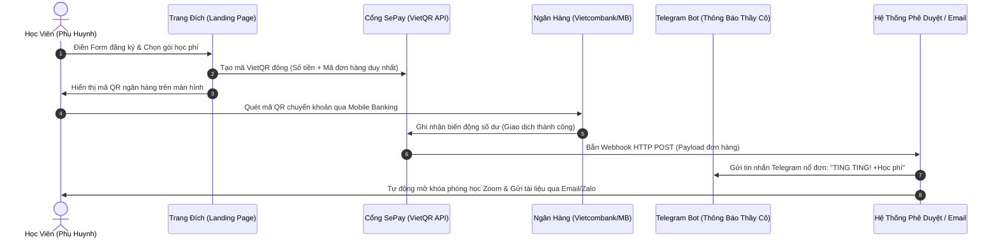

# HỌC PHẦN III: PHỄU TUYỂN SINH, KỸ NĂNG BÁN HÀNG THẤU CẢM & TỰ ĐỘNG HÓA VẬN HÀNH (EDUCATION FUNNEL & SALES ARCHITECTURE)
## CHUYÊN ĐỀ DO THẦY HUỲNH TRƯỜNG THANH TÂM HUẤN LUYỆN TRỰC TIẾP
### CHƯƠNG TRÌNH TRUYỀN NGHỀ GIÁO VIÊN TIẾNG ANH 12 THÁNG — NEW YOU TEACHER ACADEMY

---

* [Quay lại Chỉ Mục Tổng Quan](./00_CHI_MUC_TONG_QUAN.md)
* **Thời gian đào tạo & thực chiến:** Tháng thứ 3 (đào tạo chuyên sâu) $\rightarrow$ Triển khai mở lớp cuốn chiếu trong suốt 3 chu kỳ (Tháng 4-6, Tháng 7-9, Tháng 10-12).
* **Mục tiêu học phần:** Chuyển hóa tư duy từ giáo viên "ngại bán hàng" thành chuyên gia tư vấn giải pháp thấu cảm; chốt combo học phí cao qua Zalo và Zoom Demo Class; tự động hóa thu tiền bằng VietQR SePay & bot Telegram.

> [!NOTE]
> **RANH GIỚI VẬN HÀNH & HỌC THUẬT:**
> Thầy Tâm chịu trách nhiệm toàn bộ về: Kiến trúc phễu, kịch bản tư vấn Zalo, kỹ năng điều phối chốt đơn trên Zoom, cổng thanh toán tự động và hệ thống SOP. Nội dung chuyên môn giảng dạy trong buổi Demo Class do **Cô Sophie Diễm My** chuẩn hóa.

---

## BÀI 9: KIẾN TRÚC PHỄU GIÁO DỤC TOFU-MOFU-BOFU & THIẾT KẾ MỒI THU HÚT 0 ĐỒNG
*(TÍCH HỢP QUÀ TẶNG #09: LEAD MAGNET STUDIO KIT)*

### 1. Kiến trúc Phễu Giáo dục 3 Tầng:

```
        ┌──────────────────────────────────────────────┐
        │       TOFU (Top of Funnel - Tầng Nhận Biết)   │ ◄── Video ngắn triệu view (TikTok/Reels)
        │       Khách hàng: "Tôi thấy cô này dạy hay!"  │
        └──────────────────────┬───────────────────────┘
                               │
                               ▼ [Tặng Lead Magnet Miễn Phí]
        ┌──────────────────────────────────────────────┐
        │     MOFU (Middle of Funnel - Tầng Nuôi Dưỡng) │ ◄── Group Zalo, Ebook, Chuỗi Email,
        │    Khách hàng: "Phương pháp này hợp với tôi!" │     Mini-course 3 ngày, Demo Class
        └──────────────────────┬───────────────────────┘
                               │
                               ▼ [Tư vấn 1-1 / Lớp Demo Class]
        ┌──────────────────────────────────────────────┐
        │       BOFU (Bottom of Funnel - Chốt Đơn)     │ ◄── Khóa Combo 3 - 6 - 12 Tháng
        │       Khách hàng: "Tôi phải đăng ký ngay!"    │     Thu học phí qua VietQR SePay
        └──────────────────────┬───────────────────────┘
```

### 2. Thiết kế Mồi Thu Hút (Lead Magnet 0đ):
Học viên được chuyển giao các tài nguyên mồi thu hút (Ebook PDF, Flashcards, Form khảo sát) để tự động thu thập số điện thoại và danh sách phụ huynh/người học quan tâm.

---

## BÀI 10: BỘ KỊCH BẢN TƯ VẤN THẤU CẢM 5 BƯỚC QUA ZALO & BẺ GÃY RÀO CẢN GIÁ
*(TÍCH HỢP QUÀ TẶNG #06: BỘ SALES SCRIPTS ZALO)*

### 1. Framework Kịch bản 5 Bước Tư vấn Chốt Đơn qua Zalo:
* **Bước 1: Kết nối & Khai thác Nỗi đau (Pain-Point Discovery):** Không báo giá ngay, neo giá trị trước bằng câu hỏi chẩn đoán rào cản.
* **Bước 2: Bắt bệnh & Đồng cảm Sâu sắc (Empathy & Diagnosis):** Giải thích lý do tại sao học sinh bị kẹt (do phương pháp cũ, không phải do kém thông minh).
* **Bước 3: Trình bày Giải pháp & Lộ trình Đo ni Đóng giày (Customized Map):** Vẽ lộ trình chuyển đổi từng giai đoạn.
* **Bước 4: Đảo ngược Giá trị & Báo học phí (Value-Reversal Pricing):** So sánh học phí kèm 1-1 bên ngoài vs Combo của bạn (chia nhỏ theo ngày ~ 40k/ngày).
* **Bước 5: Bẻ gãy Trì hoãn bằng Bảo hiểm Rủi ro 0 Đồng (Zero Risk Guarantee):** Cam kết hoàn tiền 100% sau 2 tuần nếu không hài lòng.

### 2. Kịch bản Đóng vai (Role-play) Trực tiếp Cùng Thầy Tâm:
Học viên trải qua buổi đóng vai giả lập 1-1 trực tiếp với Thầy Tâm qua Zoom, xử lý trôi chảy 3 lời từ chối kinh điển: *"Học phí đắt quá", "Để chị hỏi lại gia đình đã", "Dạo này bận quá chưa sắp xếp được thời gian"*.

---

## BÀI 11: CẤU TRÚC 45 PHÚT DEMO CLASS TRÊN ZOOM "CHỐT NÓNG COMBO"
*(TÍCH HỢP QUÀ TẶNG #06: SLIDE DEMO ZOOM)*

### Timeline Chi Tiết Buổi Dạy Thử 45 Phút (Tỷ lệ chuyển đổi > 30%):

```
┌────────────────────────────────────────────────────────────────────────┐
│               TIMELINE 45 PHÚT DEMO CLASS TRÊN ZOOM                    │
├────────────────────────────────────────────────────────────────────────┤
│ [00 - 05 phút] Mở đầu tràn đầy năng lượng & Quy tắc lớp học           │
│ [05 - 15 phút] Khảo sát nhanh & Bắt bệnh thực tế                       │
│ [15 - 30 phút] Dạy thử tạo trải nghiệm AHA MOMENT bùng nổ              │
│ [30 - 38 phút] Trình bày Lộ trình chuyển đổi & Bằng chứng thành công  │
│ [38 - 45 phút] Tung ưu đãi Giới hạn & Chốt đơn trực tiếp trên màn hình│
└────────────────────────────────────────────────────────────────────────┘
```

---

## BÀI 12: TỰ ĐỘNG HÓA VẬN HÀNH: CỔNG THU HỌC PHÍ VIETQR SEPAY & BOT TELEGRAM
*(TÍCH HỢP QUÀ TẶNG #07: BẢN QUYỀN BỘ SOP VẬN HÀNH 60+ LỚP HỌC ONLINE)*

### 1. Kiến trúc Hệ thống Thu học phí Tự động (Hands-free Cashflow):



---

*Hết Học Phần III — Chuyển tiếp sang [Hệ Thống Đánh Giá Rubric 100 Điểm & Phụ Lục](./04_RUBRIC_DANH_GIA_VA_PHU_LUC.md)*
