# BẢN KIỂM TOÁN TÀI NGUYÊN & KẾ HOẠCH BỔ SUNG TOÀN DIỆN (100% FULL NỘI DUNG)
## DỰ ÁN: NEW YOU TEACHER ACADEMY (HỆ SINH THÁI ĐÀO TẠO GIÁO VIÊN TIẾNG ANH 12 THÁNG)
### ĐƠN VỊ KIỂM TOÁN: SHIN (CỐ VẤN KỸ THUẬT SỐ) — THEO YÊU CẦU CỦA SẾP HUỲNH TRƯỜNG THANH TÂM

---

> [!IMPORTANT]
> **MỤC TIÊU KIỂM TOÁN:**
> Rà soát từng file Markdown (`.md`) trong hệ thống tài liệu dự án xem **đã có đầy đủ nội dung toàn văn như phần giới thiệu, mục lục và tiêu đề đã công bố hay chưa**. Phát hiện các khoảng trống (gaps) hoặc các phần mới chỉ dừng ở mức khung sườn/trích đoạn mẫu để lên kế hoạch bổ sung 100% đầy đủ, không để tồn tại bất kỳ nội dung sơ sài nào.

---

## PHẦN 1: BẢNG KIỂM TOÁN HIỆN TRẠNG TOÀN BỘ 28 TÀI LIỆU

### I. CỤM TÀI LIỆU ĐIỀU HÀNH & KHUNG CHƯƠNG TRÌNH GỐC
| Tên File Tài Liệu | Dung Lượng | Số Dòng | Hiện Trạng Nội Dung | Đánh Giá Độ Đầy Đủ | Hạng Mục Cần Bổ Sung (Nếu Có) |
|:---|:---:|:---:|:---|:---:|:---|
| `KE_HOACH_TONG_THE_NEW_YOU_ENGLISH_ACADEMY.md` | 20.3 KB | 239 | Tổng hợp toàn diện sứ mệnh, kiềng 3 chân, kiến trúc, 9 quà tặng, tự động hóa, roadmap, sitemap. | **100% ĐẠT** | Không cần bổ sung thêm. |
| `README.md` | 5.6 KB | 70 | Hướng dẫn cấu trúc thư mục, ban giảng huấn, link live web. | **100% ĐẠT** | Cập nhật thêm link đến file Kế hoạch kiểm toán này. |
| `CHANGELOG.md` | 32.4 KB | 295 | Đầy đủ nhật ký nâng cấp từ v1.7.0 đến v1.8.0. | **100% ĐẠT** | Duy trì ghi nhật ký khi nâng cấp các gói tiếp theo. |
| `UPDATE.md` | 2.3 KB | 25 | Định hướng kế hoạch cho v1.8.x và v1.9.0. | **100% ĐẠT** | Tích hợp các gói công việc bổ sung. |
| `01_KhungChuongTrinh_Goc/...` | 68.6 KB | 544 | Toàn văn văn bản đóng góp ý kiến từ Trí Nguyễn ngày 31/10/2026. | **100% ĐẠT** | Lưu trữ nguyên bản làm căn cứ đối soát. |

---

### II. CỤM GIÁO TRÌNH HUẤN LUYỆN CỦA THẦY TÂM (`02_GiaoTrinh_ThayTam/`)
| Tên File Tài Liệu | Dung Lượng | Số Dòng | Hiện Trạng Nội Dung | Đánh Giá Độ Đầy Đủ | Hạng Mục Cần Bổ Sung (Nếu Có) |
|:---|:---:|:---:|:---|:---:|:---|
| `00_CHI_MUC_TONG_QUAN.md` | 12.4 KB | 92 | Chỉ mục 3 trụ cột, 3 nguyên tắc bất di bất dịch, lộ trình huấn luyện 12 tháng. | **100% ĐẠT** | Không cần bổ sung. |
| `00_HUONG_DAN_BAN_GIAO_HOC_THUAT_CO_MY.md` | 9.9 KB | 99 | Bảng ma trận 30 kịch bản video, 15 slide demo, slot cần Cô My điền. | **100% ĐẠT** | Rất chi tiết và chuẩn ranh giới. |
| `00_PHIEU_DUYET_HOC_THUAT_MAU_CO_MY.md` | 4.8 KB | 76 | Mẫu nghiệm thu chuyên môn cho KB-01, KB-02, KB-08, Slide 4, Slide 6-8. | **100% ĐẠT** | Mẫu DoD chuẩn mực. |
| `01_HOC_PHAN_1_CONG_NGHE_AI.md` | 11.9 KB | 187 | Đầy đủ Bài 1 đến Bài 4: Problem framing, Mega prompt C-R-E-A-T-E, Gamma slide, System prompt Custom GPT. | **95% ĐẠT** | Có thể bổ sung thêm **10 tình huống lỗi thực tế học viên hay gặp khi dùng AI** và cách sửa. |
| `02_HOC_PHAN_2_VIDEO_NGAN_TRIEU_VIEW.md` | 8.3 KB | 112 | Đầy đủ Bài 5 đến Bài 8: Thuật toán phân phối, Ma trận Hook 3s, Setup studio < 2tr, CapCut jump-cut, SEO. | **90% ĐẠT** | Có thể bổ sung thêm **Ngân hàng 50 câu Hook mẫu giật tít** ăn khách trên TikTok. |
| `03_HOC_PHAN_3_PHEU_TUYEN_SINH_VA_TU_DONG_HOA.md` | 13.3 KB | 236 | Đầy đủ Bài 9 đến Bài 12: Phễu 3 tầng, Kịch bản Zalo, 15 Slide Demo Zoom, Code Polling SePay & Apps Script. | **100% ĐẠT** | Rất chi tiết, đã có toàn bộ code. |
| `04_RUBRIC_DANH_GIA_VA_PHU_LUC.md` | 4.7 KB | 50 | Rubric thang điểm 100, 10 câu bẻ gãy từ chối học phí đắt, checklist Zoom. | **90% ĐẠT** | Có thể bổ sung thêm **5 tình huống xử lý khi học viên đòi hoàn tiền**. |
| `tai_nguyen_ky_thuat/HUONG_DAN_CAI_DAT_GOOGLE_SHEETS_CRM.md` | 7.8 KB | 141 | Cấu trúc 5 Sheet CRM, bộ công thức tự động, quy trình cài đặt Apps Script. | **100% ĐẠT** | Hoàn chỉnh, có thể triển khai ngay. |
| `tai_nguyen_ky_thuat/Code_Google_Apps_Script_Webhook_SePay_Telegram.gs` | 10.5 KB | 277 | Mã nguồn Router 3 luồng hoàn chỉnh, xử lý SePay, Khảo sát, Leads, Telegram. | **100% ĐẠT** | Đã khớp chuẩn hợp đồng Web L3. |

---

### III. CỤM BỘ 9 QUÀ TẶNG ĐỘC BẢN (`03_BoQuaTang_NewYou/`) — **TRỌNG TÂM CẦN BỔ SUNG**
| Tên File Tài Liệu | Dung Lượng | Số Dòng | Hiện Trạng Nội Dung | Đánh Giá Độ Đầy Đủ | Hạng Mục Cần Bổ Sung Chi Tiết |
|:---|:---:|:---:|:---|:---:|:---|
| `00_CHI_MUC_BO_QUA_TANG.md` | 5.6 KB | 60 | Chỉ mục bảng giá trị 47tr tặng 0đ, quy trình nhận quà. | **100% ĐẠT** | Đầy đủ tổng quan. |
| ❌ `QUA_01_52_VIDEO_MASTER_IPA.md` | 1.3 KB | 22 | Mới có 22 dòng giới thiệu ngắn gọn, chưa có danh mục các video! | **THIẾU 85%** | **CẦN BỔ SUNG TOÀN BỘ DANH MỤC 52 VIDEO CHI TIẾT:** Mã số, tên âm IPA, thời lượng, mục tiêu, khẩu hình tóm tắt, bài tập mẫu và slot link Drive. |
| ❌ `QUA_02_SACH_VA_EBOOK_NEW_YOU.md` | 1.4 KB | 25 | Mới có 25 dòng liệt kê 5 gạch đầu dòng tên 5 chương! | **THIẾU 80%** | **CẦN BỔ SUNG ĐỀ CƯƠNG TOÀN VĂN & TRÍCH ĐOẠN CHI TIẾT:** Lời tựa tác giả, đề cương 5 chương (mỗi chương 3-4 bài con), nội dung thực chiến và bài tập ứng dụng. |
| ❌ `QUA_03_THU_VIEN_100_MEGA_PROMPTS_AI.md` | 4.1 KB | 60 | Mới có 3 câu lệnh trích đoạn mẫu trong tổng số 100 câu lệnh! | **THIẾU 75%** | **CẦN BỔ SUNG ĐỦ TOÀN BỘ 100+ CÂU LỆNH PROMPTS:** Viết chi tiết từng câu lệnh theo khung C-R-E-A-T-E phân bổ vào 5 nhóm sư phạm. |
| ⚠️ `QUA_04_CHATBOT_AI_TRO_GIANG_CUSTOM_GPTS.md` | 2.9 KB | 48 | Có System Instructions nhưng phần Knowledge Base chỉ có 3 gạch đầu dòng! | **THIẾU 50%** | **CẦN BỔ SUNG:** Bộ 4 Conversation Starters, Bộ tri thức mẫu (Knowledge Base FAQ 20 câu hỏi người học hay hỏi) và 5 kịch bản kiểm thử Bot. |
| ✅ `QUA_05_KHO_30_KICH_BAN_VIDEO_TRIEU_VIEW.md` | 16.1 KB | 190 | Toàn văn 30 kịch bản chi tiết từ KB-01 đến KB-30 thuộc 5 trụ cột. | **100% ĐẠT** | Đã có đầy đủ 30 kịch bản thực tế. |
| ✅ `QUA_06_BO_SALES_SCRIPTS_ZALO_VA_ZOOM_DEMO.md` | 8.8 KB | 93 | Toàn văn lời thoại Zalo 5 bước và 15 Slide điều phối Zoom Demo. | **100% ĐẠT** | Đầy đủ kịch bản tư vấn và chốt đơn. |
| ✅ `QUA_07_BAN_QUYEN_SOP_VAN_HANH_60_LOP.md` | 9.4 KB | 126 | Toàn văn 6 bộ quy trình chuẩn SOP vận hành lớp học trực tuyến. | **100% ĐẠT** | Rất chi tiết từ Google Sheets đến thư chào mừng. |
| ❌ `QUA_08_THE_HOI_VIEN_TRON_DOI_LOE_CLUB.md` | 1.5 KB | 16 | Mới có 16 dòng mô tả sơ lược 3 đặc quyền! | **THIẾU 80%** | **CẦN BỔ SUNG TOÀN BỘ:** Quy chế sinh hoạt CLB, Sổ tay Săn Tây (10 địa điểm hot, 5 kịch bản phá băng), Lịch trình 52 tuần sinh hoạt, Quy trình chuyển giao học viên. |
| ⚠️ `QUA_09_LEAD_MAGNET_STUDIO_KIT.md` | 7.8 KB | 121 | Phần Ebook mới chỉ có 16/100 cụm từ; Flashcards mới có định dạng khung chưa có danh mục từ! | **THIẾU 60%** | **CẦN BỔ SUNG:** Đủ trọn vẹn 100 Cụm từ công sở (tiếng Anh + IPA Oxford + nghĩa + ví dụ); Bảng danh mục 500 từ vựng cốt lõi Anki (A1 - B2). |
| `LICH_TRINH_SAN_XUAT_VA_MO_KHOA.md` | 6.2 KB | 50 | Kế hoạch 4 mốc mở khóa quà tặng trong 12 tháng. | **100% ĐẠT** | Rõ ràng, đồng bộ với giáo trình. |

---

## PHẦN 2: KẾ HOẠCH HÀNH ĐỘNG BỔ SUNG TOÀN DIỆN (5 GÓI CÔNG VIỆC)

Để đưa toàn bộ 100% tài liệu về trạng thái **TOÀN VĂN CHI TIẾT & SẴN SÀNG TRIỂN KHAI THỰC TẾ**, Shin chia kế hoạch thành 5 Gói Công Việc (Work Packages - WP) thực thi theo thứ tự ưu tiên:

```mermaid
flowchart TD
    subgraph WP1["GÓI 1: DANH MỤC 52 VIDEO MASTER IPA (QUA_01)"]
        W1A["Xây dựng danh mục chi tiết 52 Video"]
        W1B["12 Nguyên âm đơn + 8 Nguyên âm đôi"]
        W1C["24 Phụ âm + 8 Chuyên đề Kỹ thuật Ngữ điệu"]
        W1D["Mã số, thời lượng, mục tiêu, khẩu hình, bài tập, link Drive"]
    end

    subgraph WP2["GÓI 2: ĐỀ CƯƠNG TOÀN VĂN SÁCH & EBOOK NEW YOU (QUA_02)"]
        W2A["Lời tựa từ Cô Sophie Diễm My & Thầy Huỳnh Trường Thanh Tâm"]
        W2B["Đề cương chi tiết 5 Chương (Mỗi chương 3-4 bài con)"]
        W2C["Trích đoạn nội dung thực chiến & Phương pháp độc quyền"]
        W2D["Cẩm nang hướng dẫn sử dụng sách làm quà tặng tuyển sinh"]
    end

    subgraph WP3["GÓI 3: TOÀN BỘ 100+ MEGA PROMPTS AI SƯ PHẠM (QUA_03)"]
        W3A["Nhóm 1: 20 Prompts Soạn Lesson Plans (PPP, TTT, TBL, ESA)"]
        W3B["Nhóm 2: 25 Prompts Ngữ liệu Đọc hiểu & Hội thoại CEFR A1-C1"]
        W3C["Nhóm 3: 20 Prompts Ngân hàng Bài tập & Sửa lỗi sai"]
        W3D["Nhóm 4: 20 Prompts Bẫy tư duy CCQs, ICQs & Role-play"]
        W3E["Nhóm 5: 15 Prompts Tự động hóa Slide Gamma & Quizizz"]
    end

    subgraph WP4["GÓI 4: KNOWLEDGE BASE BOT AI (QUA_04) & SỔ TAY SĂN TÂY (QUA_08)"]
        W4A["QUA_04: Bộ 4 Conversation Starters + 20 Câu FAQ tri thức mẫu"]
        W4B["QUA_04: 5 Kịch bản test Bot & Quy trình xử lý ca khó"]
        W4C["QUA_08: Quy chế hoạt động CLB LOÉ + Lịch trình 52 tuần"]
        W4D["QUA_08: Sổ tay Săn Tây 10 địa điểm + 5 Kịch bản bắt chuyện Tây"]
    end

    subgraph WP5["GÓI 5: TRỌN BỘ 100 CỤM TỪ & 500 FLASHCARDS ANKI (QUA_09)"]
        W5A["Viết đầy đủ 100 Cụm từ công sở (tiếng Anh + IPA + nghĩa + ví dụ)"]
        W5B["Đủ 5 chủ đề: Họp hành, Email, Đàm phán, Small talk, Báo cáo"]
        W5C["Bảng danh mục 500 từ vựng Anki phân cấp theo A1, A2, B1, B2"]
        W5D["File CSV định dạng nhập trực tiếp vào phần mềm Anki"]
    end

    WP1 --> WP2 --> WP3 --> WP4 --> WP5
```

---

### CHI TIẾT TỪNG GÓI CÔNG VIỆC:

#### 1. GÓI WP-01: Bổ sung toàn văn Danh mục 52 Video Master IPA (`QUA_01`)
* **Mục tiêu:** Mở rộng từ 22 dòng lên một cẩm nang học liệu đầy đủ ~250 dòng.
* **Chi tiết danh mục 52 video:**
  - **Phần 1: 12 Nguyên âm đơn (Monophthongs - Video 01 đến 12):** `/iː/`, `/ɪ/`, `/ʊ/`, `/uː/`, `/e/`, `/ə/`, `/ɜː/`, `/ɔː/`, `/æ/`, `/ʌ/`, `/ɑː/`, `/ɒ/`.
  - **Phần 2: 8 Nguyên âm đôi (Diphthongs - Video 13 đến 20):** `/eɪ/`, `/aɪ/`, `/ɔɪ/`, `/aʊ/`, `/əʊ/`, `/ɪə/`, `/eə/`, `/ʊə/`.
  - **Phần 3: 24 Phụ âm (Consonants - Video 21 đến 44):** 8 Cặp âm đối ứng vô thanh/hữu thanh (`/p/-/b/`, `/t/-/d/`, `/tʃ/-/dʒ/`, `/k/-/ɡ/`, `/f/-/v/`, `/θ/-/ð/`, `/s/-/z/`, `/ʃ/-/ʒ/`) và các âm đơn lẻ (`/m/`, `/n/`, `/ŋ/`, `/h/`, `/l/`, `/r/`, `/w/`, `/j/`).
  - **Phần 4: 8 Chuyên đề Biến âm & Ngữ điệu Nâng cao (Video 45 đến 52):** Nối âm (Linking /r/, /j/, /w/), Nuốt âm (Elision), Đồng hóa âm (Assimilation), Trọng âm từ & câu (Sentence Stress), Nhịp điệu (Rhythm), Ngữ điệu lên/xuống (Intonation), Flap T & Glottal stop.
* **Quy chuẩn mỗi video:** Mã video, Tên âm, Thời lượng (5-8 phút), Điểm mấu chốt khẩu hình, Cặp từ đối chứng và Ghi chú sư phạm.

---

#### 2. GÓI WP-02: Bổ sung toàn văn Đề cương & Trích đoạn Sách Ebook New You (`QUA_02`)
* **Mục tiêu:** Mở rộng từ 25 dòng lên bản thiết kế sách hoàn chỉnh ~250 dòng.
* **Chi tiết cấu trúc sách:**
  - Lời nói đầu từ Founder: Cô Sophie Diễm My ("8 năm biến tiếng Anh từ nỗi sợ thành đôi cánh").
  - Lời tựa từ Co-Founder: Thầy Huỳnh Trường Thanh Tâm ("Công nghệ là đòn bẩy, giá trị con người là cốt lõi").
  - **Chương 1:** Giải mã tâm lý tự ti & Bản đồ xóa bỏ nỗi sợ nói tiếng Anh (3 bài con).
  - **Chương 2:** Tái cấu trúc cơ miệng & Đột phá khẩu hình với 44 âm IPA (4 bài con).
  - **Chương 3:** Nạp từ vựng theo khối tư duy ngôn ngữ Chunking & Collocations (3 bài con).
  - **Chương 4:** Ngữ pháp quy nạp (Inductive Grammar) — Nói đúng mà không cần nghĩ công thức (3 bài con).
  - **Chương 5:** Từ người mất gốc trở thành người truyền cảm hứng ngôn ngữ (3 bài con).
  - Hướng dẫn giáo viên sử dụng Ebook làm phễu thu hút học viên mới.

---

#### 3. GÓI WP-03: Mở rộng Thư viện 100+ Mega Prompts AI Chuyên Sâu (`QUA_03`)
* **Mục tiêu:** Mở rộng từ 60 dòng lên cẩm nang đồ sộ ~500 dòng với **đủ 100 câu lệnh thực chiến**.
* **Phân bổ 5 nhóm câu lệnh:**
  - **Nhóm 1 (20 Prompts):** Soạn Kế hoạch bài dạy (PPP, TTT, Task-based, ESA, Warm-up, Wrap-up, Phân bổ thời gian, TTT $\le 30\%$).
  - **Nhóm 2 (25 Prompts):** Sản xuất Ngữ liệu đọc hiểu, hội thoại đời thực theo 6 bậc CEFR (A1 đến C1), viết kịch bản đóng vai (Role-play), tóm tắt tin tức tiếng Anh.
  - **Nhóm 3 (20 Prompts):** Tạo Ngân hàng bài tập trắc nghiệm đảo đáp án, bài tập điền từ, bài tập đục lỗ (Cloze test), bài tập tìm lỗi sai và viết lại câu.
  - **Nhóm 4 (20 Prompts):** Thiết kế Câu hỏi bẫy tư duy CCQs (Concept Checking Questions), câu hỏi kiểm tra chỉ dẫn ICQs, bài tập tình huống phản xạ nhanh.
  - **Nhóm 5 (15 Prompts):** Tự động hóa Slide bài giảng xuất mã Markdown cho Gamma.app, tạo mã định dạng nhập thẳng vào Quizizz, Kahoot, Google Forms và Bảng điểm tự động.

---

#### 4. GÓI WP-04: Bổ sung Knowledge Base Bot AI (`QUA_04`) & Cẩm Nang Săn Tây (`QUA_08`)
* **`QUA_04` (Chatbot AI Trợ Giảng):**
  - Bổ sung 4 Conversation Starters gợi ý cho học sinh bấm vào hỏi ngay.
  - Bổ sung Knowledge Base mẫu: Bộ 20 câu hỏi thường gặp nhất về ngữ pháp và phát âm mà học sinh Việt Nam hay hỏi.
  - Bổ sung 5 kịch bản thử nghiệm (stress-test) đánh giá năng lực của con Bot trước khi đưa cho học sinh dùng.
* **`QUA_08` (Thẻ Hội Viên Trọn Đời LOÉ Club):**
  - Bản Quy chế sinh hoạt & Bộ quy tắc ứng xử (Code of Conduct) của câu lạc bộ.
  - Sổ tay Săn Tây Thực Chiến: 10 địa điểm đắc địa tại Hà Nội, TP.HCM, Đà Nẵng; 5 kịch bản phá băng mở lời lịch sự; 3 trò chơi kết nối văn hóa.
  - Lịch trình 52 tuần sinh hoạt theo chủ đề thực tế.
  - Quy trình vận hành mạng lưới chia sẻ học viên (Teacher Referral SOP) giữa các thành viên.

---

#### 5. GÓI WP-05: Hoàn thiện trọn bộ 100 Cụm từ công sở & 500 Flashcards Anki (`QUA_09`)
* **`QUA_09` (Lead Magnet Studio Kit):**
  - Soạn trọn vẹn đầy đủ **100 Cụm từ tiếng Anh công sở** (thay vì 16 cụm từ mẫu hiện tại):
    * Chủ đề 1: Họp hành & Tranh biện (20 cụm)
    * Chủ đề 2: Viết Email chuyên nghiệp (20 cụm)
    * Chủ đề 3: Đàm phán & Thỏa thuận (20 cụm)
    * Chủ đề 4: Xã giao công sở Small Talk (20 cụm)
    * Chủ đề 5: Báo cáo tiến độ & Xử lý sự cố (20 cụm)
    * *Mỗi cụm từ có đủ:* Ký hiệu phiên âm IPA chuẩn, nghĩa tiếng Việt súc tích, câu ví dụ giao tiếp thực tế và ngữ cảnh sử dụng.
  - Bổ sung **Bảng danh mục 500 từ vựng cốt lõi Anki**:
    * Phân tầng từ A1 (150 từ), A2 (150 từ), B1 (100 từ), đến B2 (100 từ) theo phương pháp Spaced Repetition.
    * Hướng dẫn nhập file CSV vào Anki để học viên xuất file `.apkg` tặng khách.

---

## PHẦN 3: TIẾN ĐỘ & TRÁCH NHIỆM TRIỂN KHAI

| Gói Công Việc | Tài Liệu Tác Động | Khối Lượng Dự Kiến | Ưu Tiên | Trạng Thái |
|:---:|:---|:---:|:---:|:---:|
| **WP-01** | `QUA_01_52_VIDEO_MASTER_IPA.md` | ~250 dòng (từ 22 dòng) | **Cao (P1)** | Chờ Sếp duyệt để thực thi |
| **WP-02** | `QUA_02_SACH_VA_EBOOK_NEW_YOU.md` | ~250 dòng (từ 25 dòng) | **Cao (P1)** | Chờ Sếp duyệt để thực thi |
| **WP-03** | `QUA_03_THU_VIEN_100_MEGA_PROMPTS_AI.md` | ~500 dòng (từ 60 dòng) | **Khẩn cấp (P0)** | Chờ Sếp duyệt để thực thi |
| **WP-04** | `QUA_04_...` & `QUA_08_...` | ~300 dòng (từ 64 dòng) | **Trung bình (P2)** | Chờ Sếp duyệt để thực thi |
| **WP-05** | `QUA_09_LEAD_MAGNET_STUDIO_KIT.md` | ~450 dòng (từ 121 dòng) | **Khẩn cấp (P0)** | Chờ Sếp duyệt để thực thi |

Sau khi hoàn tất 5 gói công việc trên:
* Toàn bộ các file `.md` sẽ được đồng bộ ngay lập tức sang:
  1. `D:\Hyrta-One\cmubeta2\My Drive\SHIN\New You English Academy\`
  2. `D:\Hyrta-One\cmubeta2\My Drive\SHIN\He sinh thai Shin\`
  3. `C:\temp\new-you-deploy\` (và commit push lên Live GitHub Pages).
* Hệ thống sẽ được nâng cấp lên **Phiên bản Milestone v1.8.1 (Full Content Perfection)**!

---
*Bản kiểm toán và kế hoạch bổ sung được lập bởi Shin — Cố vấn Kỹ thuật số của Sếp Huỳnh Trường Thanh Tâm.*
