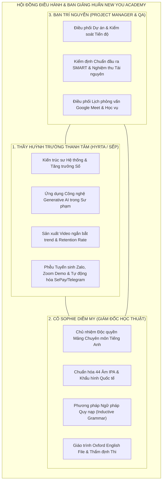
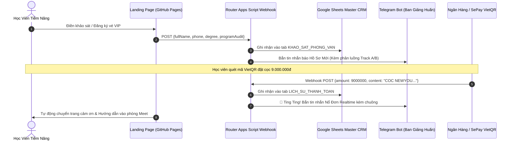

# KẾ HOẠCH TỔNG THỂ & HỆ THỐNG ĐIỀU HÀNH DỰ ÁN
# NEW YOU TEACHER ACADEMY (HỆ SINH THÁI ĐÀO TẠO GIÁO VIÊN TIẾNG ANH 12 THÁNG)
## PHIÊN BẢN v1.8.0 — CỘT MỐC LỚN HOÀN THIỆN ĐỒNG BỘ 100%

---

> [!IMPORTANT]
> **ĐỊNH VỊ VÀ SỨ MỆNH DỰ ÁN:**
> New You Teacher Academy là chương trình huấn luyện truyền nghề giáo viên dạy tiếng Anh trực tuyến thực chiến trong 12 tháng, kết hợp hoàn hảo giữa **Học thuật Ngôn ngữ Chuẩn mực (Cô Sophie Diễm My)**, **Đòn bẩy Công nghệ AI & Kỹ thuật Video Triệu View (Thầy Huỳnh Trường Thanh Tâm)**, và **Cỗ máy Vận hành Tuyển sinh Tự động hóa 24/7 (Kiến trúc 0đ SePay + Telegram + Google Sheets CRM)**.
> 
> * **Mục tiêu tối thượng:** Đào tạo ra những giáo viên độc lập, tự chủ kinh doanh, có khả năng đứng lớp thực tế, thu hút học viên tự nhiên qua mạng xã hội và hoàn vốn đầu tư 100% (40 - 60 triệu VNĐ) chỉ sau 7 - 8 tháng đầu tiên.

---

## 1. CƠ CẤU TỔ CHỨC & RANH GIỚI BẤT DI BẤT DỊCH (KIỀNG 3 CHÂN)



### Nguyên Tắc Phân Định Trách Nhiệm Sư Phạm (Tránh Chồng Chéo):
1. **Thầy Huỳnh Trường Thanh Tâm:** Tuyệt đối không can thiệp, không viết thay và không sửa đổi nội dung học thuật tiếng Anh chuyên sâu. Toàn bộ tài liệu kỹ thuật, video và bài giảng của Thầy Tâm chỉ dừng ở mức **Khung sườn Kỹ thuật (Architecture)** và để sẵn các vị trí `[SLOT CHUYÊN MÔN - CÔ MY DUYỆT]`.
2. **Cô Sophie Diễm My:** Toàn quyền quyết định tính chuẩn xác ngôn ngữ, bài tập khẩu hình và phương pháp sư phạm tiếng Anh. Cô My sử dụng trực tiếp **Phiếu Duyệt Học Thuật** để nạp dữ liệu vào hệ thống mà không làm xáo trộn kiến trúc công nghệ.
3. **Bạn Trí Nguyễn:** Đảm bảo mọi hạng mục bàn giao đều tuân thủ tiêu chí hoàn thành Definition of Done (DoD) chuẩn mực.

---

## 2. KIẾN TRÚC GIÁO TRÌNH HUẤN LUYỆN CỦA THẦY TÂM

Giáo trình huấn luyện thực chiến của Thầy Tâm được phân rã thành **5 tài liệu module độc lập** kèm bộ công cụ kỹ thuật số:

```
02_GiaoTrinh_ThayTam/
├── 00_CHI_MUC_TONG_QUAN.md               # Chỉ mục, 3 nguyên tắc bất di bất dịch, roadmap 12 tháng
├── 00_HUONG_DAN_BAN_GIAO_HOC_THUAT_CO_MY.md # Ma trận 30 kịch bản & vị trí nạp liệu chuyên môn
├── 00_PHIEU_DUYET_HOC_THUAT_MAU_CO_MY.md # Phiếu nghiệm thu chuyên môn mẫu cho Cô My
├── 01_HOC_PHAN_1_CONG_NGHE_AI.md         # Bài 1 - 4: Prompting C-R-E-A-T-E, Slide Gamma, Custom GPTs
├── 02_HOC_PHAN_2_VIDEO_NGAN_TRIEU_VIEW.md# Bài 5 - 8: Thuật toán, Hook 3s, CapCut, 20 video
├── 03_HOC_PHAN_3_PHEU_TUYEN_SINH_VA_TU_DONG_HOA.md # Bài 9 - 12: Zalo 5 bước, Demo 45p, SePay Polling
├── 04_RUBRIC_DANH_GIA_VA_PHU_LUC.md      # Rubric 100 điểm, 10 câu bẻ gãy từ chối học phí
└── tai_nguyen_ky_thuat/
    ├── Code_Google_Apps_Script_Webhook_SePay_Telegram.gs # Mã nguồn Router 3 luồng hoàn chỉnh
    └── HUONG_DAN_CAI_DAT_GOOGLE_SHEETS_CRM.md # Cẩm nang 4 bước thiết lập CRM 5 sheet tự động
```

### 3 Trụ Cột Đào Tạo Trọng Tâm:
* **Trụ cột 1: Công Nghệ AI & Học Liệu Số (Học phần I - Tháng 2):**
  - Chuyển hóa tư duy từ "bấm nút ra rác" sang **Problem Framing & Input-Process-Output**.
  - Làm chủ công thức Mega Prompting độc quyền `C-R-E-A-T-E` (Context - Role - Explicit task - Audience - Tone - Examples) soạn Lesson Plan trong 3 phút.
  - Tự động hóa thiết kế Slide bài giảng tương tác bằng Gamma & Canva tích hợp ngân hàng câu hỏi CCQs/ICQs.
  - Xây dựng và triển khai Chatbot AI trợ giảng riêng 24/7 (Custom GPTs) hỗ trợ học sinh tự học tại nhà.
* **Trụ cột 2: Cỗ Máy Video Triệu View & Nhân Hiệu Số (Học phần II - Tháng 3 & 4):**
  - Giải mã thuật toán phân phối TikTok/Reels/Shorts, công thức giữ chân người xem bằng Hook 3s.
  - 5 Cấu trúc kịch bản video chuyển đổi cao; Setup studio smartphone tại gia chi phí $< 2$ triệu VNĐ.
  - Kỹ thuật dựng phim Jump-cut CapCut siêu tốc; SEO từ khóa đa kênh; Xuất bản tối thiểu 20 video thực tế.
* **Trụ cột 3: Phễu Tuyển Sinh, Bán Hàng Thấu Cảm & Tự Động Hóa 0đ (Học phần III - Tháng 3 & 7):**
  - Kiến trúc phễu 3 tầng: TOFU (Video ngắn) $\rightarrow$ MOFU (Lead Magnet 0đ & Khảo sát) $\rightarrow$ BOFU (Zoom Demo 45p).
  - Kịch bản tư vấn Zalo 5 bước: Chào mở $\rightarrow$ Thấu cảm bắt bệnh $\rightarrow$ Kê đơn lộ trình $\rightarrow$ Báo phí đảo ngược $\rightarrow$ Chốt cọc giữ chỗ.
  - Kịch bản điều phối 15 Slide Demo Zoom Class 45 phút chốt combo tỷ lệ $> 30\%$.
  - Tự động hóa cổng thu học phí VietQR qua SePay và nhận thông báo nổ đơn qua Telegram Bot.

---

## 3. BỘ 9 QUÀ TẶNG ĐỘC BẢN TRUYỀN NGHỀ (TRỊ GIÁ 42.000.000Đ — TẶNG 0Đ)

Toàn bộ 9 quà tặng đã được hoàn thiện **chi tiết 100% nội dung toàn văn**, đóng gói thành từng file riêng biệt:

```
03_BoQuaTang_NewYou/
├── 00_CHI_MUC_BO_QUA_TANG.md             # Tổng hợp 9 món quà, bảng định giá, quy trình nhận
├── QUA_01_52_VIDEO_MASTER_IPA.md         # 52 Video phát âm chuẩn quốc tế Cô My (3.5tr)
├── QUA_02_SACH_VA_EBOOK_NEW_YOU.md       # Sách in mạ vàng có chữ ký & Ebook NYE 5 chương (500k)
├── QUA_03_THU_VIEN_100_MEGA_PROMPTS_AI.md# 100+ Mega Prompts sư phạm 5 nhóm lệnh (5tr)
├── QUA_04_CHATBOT_AI_TRO_GIANG_CUSTOM_GPTS.md # Cấu hình System Instructions Bot AI 24/7 (8tr)
├── QUA_05_KHO_30_KICH_BAN_VIDEO_TRIEU_VIEW.md # Toàn văn 30 kịch bản video 5 trụ cột (6tr)
├── QUA_06_BO_SALES_SCRIPTS_ZALO_VA_ZOOM_DEMO.md # Sales Scripts Zalo & 15 Slide Demo Zoom (7tr)
├── QUA_07_BAN_QUYEN_SOP_VAN_HANH_60_LOP.md # 6 Bộ quy trình chuẩn SOP vận hành lớp học (10tr)
├── QUA_08_THE_HOI_VIEN_TRON_DOI_LOE_CLUB.md # Thẻ số hóa Digital Card & Đặc quyền CLB LOÉ (2tr)
├── QUA_09_LEAD_MAGNET_STUDIO_KIT.md      # Ebook White-Label, 500 Flashcards Anki, Form Khảo sát (5tr)
└── LICH_TRINH_SAN_XUAT_VA_MO_KHOA.md     # Kế hoạch mở khóa quà tặng theo 4 cột mốc 12 tháng
```

### Bảng Tổng Hợp Giá Trị 9 Món Quà:
| Mã Quà | Tên Quà Tặng Độc Bản | Trị Giá Niêm Yết | Hình Thức Chuyển Giao & Giá Trị Thực Chiến |
|:---:|:---|:---:|:---|
| **Quà 01** | 52 Video Master Phát Âm IPA Chuẩn Anh - Mỹ | 3.500.000 đ | Video khẩu hình chuẩn quốc tế của Cô My, giáo viên dùng làm tài liệu mẫu. |
| **Quà 02** | Sách In Mạ Vàng & Ebook New You English | 500.000 đ | Sách cứng gửi tận tay có chữ ký chúc mừng của Cô My + Ebook số hóa. |
| **Quà 03** | Thư Viện 100+ Mega Prompts AI Chuyên Sâu | 5.000.000 đ | 100 lệnh AI soạn bài, ra đề thi, tạo game, CCQs/ICQs và viết email phụ huynh. |
| **Quà 04** | Cài Đặt 01 Chatbot AI Trợ Giảng Riêng 24/7 | 8.000.000 đ | Cài đặt Custom GPTs riêng mang tên giáo viên chấm bài và luyện khẩu hình 24/7. |
| **Quà 05** | Kho 30 Kịch Bản Video Ngắn Triệu View Bắt Trend | 6.000.000 đ | Toàn văn 30 kịch bản 5 trụ cột (Phát âm, Ngữ pháp, Tình huống, Mẹo nhớ, Động lực). |
| **Quà 06** | Bộ Sales Scripts Zalo & 15 Slide Demo Zoom 45p | 7.000.000 đ | Lời thoại tư vấn 3 tệp khách và kịch bản dẫn dắt 15 Slide chốt cọc VietQR. |
| **Quà 07** | Bản Quyền 6 Biểu Mẫu SOP Vận Hành 60+ Lớp | 10.000.000 đ | Master Sheets cảnh báo chuyên cần, Welcome kit, Nhắc bài thấu cảm, Báo cáo, Lễ tốt nghiệp. |
| **Quà 08** | Thẻ Hội Viên Trọn Đời Mạng Lưới LOÉ Club | 2.000.000 đ | Sinh hoạt tiếng Anh thực tế với người nước ngoài, nguồn học viên dồi dào. |
| **Quà 09** | Lead Magnet Studio Kit (Mồi Thu Hút 0đ) | 5.000.000 đ | **Ebook 100 cụm từ công sở đổi tên tác giả**, 500 Flashcards Anki, Form khảo sát, Kịch bản Facebook. |
| **TỔNG** | **TRỌN BỘ 9 TÀI SẢN CHIẾN LƯỢC** | **47.000.000 đ** | **TẶNG HOÀN TOÀN 0Đ CHO HỌC VIÊN FOUNDING BATCH K01** |

---

## 4. KIẾN TRÚC HẠ TẦNG KỸ THUẬT & TỰ ĐỘNG HÓA 0Đ

Hệ thống được thiết kế với tiêu chí **tối giản, bảo mật cao, không phụ thuộc server đắt tiền và vận hành 0đ trọn đời**:



### Chi Tiết 5 Tab Trong File Google Sheets CRM Master:
1. `DANG_KY_WEB`: Lưu trữ leads, ứng viên bấm nút xác nhận từ Landing page.
2. `LICH_SU_THANH_TOAN`: Ghi nhận tự động từng biến động số dư SePay VietQR.
3. `KHAO_SAT_PHONG_VAN`: Lưu câu trả lời khảo sát chuyên sâu (Bằng cấp, Rào cản, Câu hỏi cho BG Huấn) phục vụ chuẩn bị phỏng vấn 1-1.
4. `DANH_SACH_LOP_TRACK_A`: Học viên B1+ đào tạo nghề giáo viên 12 tháng (Công thức tự động trích xuất `=QUERY(...)`).
5. `DANH_SACH_LOP_TRACK_B`: Học viên A0-A2 chuẩn hóa phát âm nền tảng 3 tháng.

---

## 5. LỘ TRÌNH TRIỂN KHAI 4 TUẦN THÁNG 11/2026 (FOUNDING BATCH K01)

```
┌────────────────────────────────────────────────────────────────────────────────────────────────────────┐
│                        KẾ HOẠCH HÀNH ĐỘNG 4 TUẦN THÁNG 11/2026 — RA MẮT LỚP K01                        │
├─────────┬──────────────────────────────────────────────────────────────────┬───────────────────────────┤
│ Tuần    │ Trọng Tâm Công Việc                                              │ Nhân Sự Phụ Trách         │
├─────────┼──────────────────────────────────────────────────────────────────┼───────────────────────────┤
│ TUẦN 1  │ - Cô Sophie Diễm My hoàn tất duyệt học thuật trên Phiếu duyệt    │ Cô Sophie Diễm My         │
│ (01-07) │ - Thầy Tâm kiểm thử Webhook SePay & Bot Telegram thực tế         │ Thầy Thanh Tâm & Trí Ng.  │
│         │ - Rà soát toàn bộ giao diện Landing Page di động & SEO           │ Shin & Trí Nguyễn         │
├─────────┼──────────────────────────────────────────────────────────────────┼───────────────────────────┤
│ TUẦN 2  │ - Phát hành mồi câu Lead Magnet (Ebook White-label 100 Cụm từ)   │ Ban Truyền Thông          │
│ (08-14) │ - Triển khai chiến dịch video ngắn bắt trend theo Kịch bản 01-08 │ Thầy Tâm & Cô My          │
│         │ - Thu thập dữ liệu khảo sát phân luồng vào Sheet CRM             │ Hệ thống Tự động hóa      │
├─────────┼──────────────────────────────────────────────────────────────────┼───────────────────────────┤
│ TUẦN 3  │ - Tổ chức các phiên phỏng vấn thẩm định 1-1 qua Google Meet      │ Cô Sophie Diễm My         │
│ (15-21) │ - Kích hoạt kịch bản chốt cọc 9.000.000đ (hoàn cọc 100% trong 24h)│ Thầy Huỳnh Trường T. Tâm  │
│         │ - Chốt danh sách 10 - 15 học viên chính thức Founding Batch K01  │ Bạn Trí Nguyễn (QA/Ops)   │
├─────────┼──────────────────────────────────────────────────────────────────┼───────────────────────────┤
│ TUẦN 4  │ - Tổ chức Lễ Khai Giảng Trực Tuyến Orientation Day trên Zoom     │ Ban Giảng Huấn New You    │
│ (22-30) │ - Bàn giao Sách in mạ vàng, Ebook NYE & Thư viện 100 Prompts AI  │ Trí Nguyễn & Điều phối    │
│         │ - Bắt đầu tuần học đầu tiên: Định hình Tư duy Sư phạm New You    │ Cô Diễm My & Thầy Tâm     │
└─────────┴──────────────────────────────────────────────────────────────────┴───────────────────────────┘
```

---

## 6. BẢN ĐỒ CHỈ MỤC LIÊN KẾT TÀI NGUYÊN (SITEMAP TRONG THƯ MỤC)

Tất cả các tài liệu đã được tổ chức khoa học trong thư mục:  
`D:\Hyrta-One\cmubeta2\My Drive\SHIN\New You English Academy\`

### 1. Tài Liệu Kế Hoạch & Nhật Ký:
* [Kế Hoạch Tổng Thể Toàn Dự Án](./KE_HOACH_TONG_THE_NEW_YOU_ENGLISH_ACADEMY.md)
* [README Hướng Dẫn Điều Hành](./README.md)
* [Nhật Ký Thay Đổi CHANGELOG v1.8.0](./CHANGELOG.md)
* [Kế Hoạch Nâng Cấp UPDATE Tiếp Theo](./UPDATE.md)

### 2. Khung Chương Trình Gốc & Ý Kiến Đóng Góp:
* [31-10-26 Khung Chương Trình Truyền Nghề Đào Tạo Chính Thức (Góp ý Trí Nguyễn)](./01_KhungChuongTrinh_Goc/31-10-26-KHUNG_CHUONG_TRINH_TRUYEN_NGHE_DAO_TAO_CHINH_THUC.md)

### 3. Giáo Trình Huấn Luyện Thầy Tâm:
* [00. Chỉ Mục Tổng Quan Giáo Trình Thầy Tâm](./02_GiaoTrinh_ThayTam/00_CHI_MUC_TONG_QUAN.md)
* [00. Hướng Dẫn Bàn Giao Học Thuật Cho Cô Diễm My](./02_GiaoTrinh_ThayTam/00_HUONG_DAN_BAN_GIAO_HOC_THUAT_CO_MY.md)
* [00. Phiếu Duyệt Học Thuật Mẫu Cô My](./02_GiaoTrinh_ThayTam/00_PHIEU_DUYET_HOC_THUAT_MAU_CO_MY.md)
* [01. Học Phần I: Ứng Dụng Công Nghệ AI Trong Dạy Học (Bài 1 - 4)](./02_GiaoTrinh_ThayTam/01_HOC_PHAN_1_CONG_NGHE_AI.md)
* [02. Học Phần II: Cỗ Máy Video Ngắn Bắt Trend Triệu View (Bài 5 - 8)](./02_GiaoTrinh_ThayTam/02_HOC_PHAN_2_VIDEO_NGAN_TRIEU_VIEW.md)
* [03. Học Phần III: Phễu Tuyển Sinh, Bán Hàng & Tự Động Hóa (Bài 9 - 12)](./02_GiaoTrinh_ThayTam/03_HOC_PHAN_3_PHEU_TUYEN_SINH_VA_TU_DONG_HOA.md)
* [04. Rubric 100 Điểm Kiểm Định Đầu Ra & Phụ Lục Bẻ Gãy Từ Chối](./02_GiaoTrinh_ThayTam/04_RUBRIC_DANH_GIA_VA_PHU_LUC.md)
* [Bản Hợp Nhất Giáo Trình Thầy Tâm](./02_GiaoTrinh_ThayTam/GIAO_TRINH_AI_VIDEO_SALES_THAY_TAM.md)
* [Tài Nguyên Kỹ Thuật: Hướng Dẫn Thiết Lập Google Sheets CRM 5 Tab](./02_GiaoTrinh_ThayTam/tai_nguyen_ky_thuat/HUONG_DAN_CAI_DAT_GOOGLE_SHEETS_CRM.md)
* [Tài Nguyên Kỹ Thuật: Mã Nguồn Google Apps Script Router 3 Luồng (.gs)](./02_GiaoTrinh_ThayTam/tai_nguyen_ky_thuat/Code_Google_Apps_Script_Webhook_SePay_Telegram.gs)

### 4. Kho Bộ 9 Quà Tặng Độc Bản 42 Triệu:
* [00. Chỉ Mục Kho Bộ Quà Tặng Độc Bản](./03_BoQuaTang_NewYou/00_CHI_MUC_BO_QUA_TANG.md)
* [Quà 01: 52 Video Master Phát Âm Chuẩn IPA Anh - Mỹ](./03_BoQuaTang_NewYou/QUA_01_52_VIDEO_MASTER_IPA.md)
* [Quà 02: Sách In Mạ Vàng & Ebook New You English](./03_BoQuaTang_NewYou/QUA_02_SACH_VA_EBOOK_NEW_YOU.md)
* [Quà 03: Thư Viện 100+ Mega Prompts AI Chuyên Sâu](./03_BoQuaTang_NewYou/QUA_03_THU_VIEN_100_MEGA_PROMPTS_AI.md)
* [Quà 04: Cài Đặt 01 Chatbot AI Trợ Giảng Riêng 24/7 (Custom GPTs)](./03_BoQuaTang_NewYou/QUA_04_CHATBOT_AI_TRO_GIANG_CUSTOM_GPTS.md)
* [Quà 05: Kho 30 Kịch Bản Video Triệu View Bắt Trend](./03_BoQuaTang_NewYou/QUA_05_KHO_30_KICH_BAN_VIDEO_TRIEU_VIEW.md)
* [Quà 06: Bộ Kịch Bản Tư Vấn Zalo & 15 Slide Demo Zoom 45p](./03_BoQuaTang_NewYou/QUA_06_BO_SALES_SCRIPTS_ZALO_VA_ZOOM_DEMO.md)
* [Quà 07: Bản Quyền 6 Biểu Mẫu Quy Trình Chuẩn SOP Vận Hành 60+ Lớp](./03_BoQuaTang_NewYou/QUA_07_BAN_QUYEN_SOP_VAN_HANH_60_LOP.md)
* [Quà 08: Thẻ Hội Viên Trọn Đời Mạng Lưới LOÉ Club](./03_BoQuaTang_NewYou/QUA_08_THE_HOI_VIEN_TRON_DOI_LOE_CLUB.md)
* [Quà 09: Lead Magnet Studio Kit (Mồi Thu Hút Học Viên 0đ)](./03_BoQuaTang_NewYou/QUA_09_LEAD_MAGNET_STUDIO_KIT.md)
* [Lịch Trình Sản Xuất & Mở Khóa Quà Tặng 12 Tháng](./03_BoQuaTang_NewYou/LICH_TRINH_SAN_XUAT_VA_MO_KHOA.md)
* [Bản Hợp Nhất Toàn Bộ Quà Tặng New You](./03_BoQuaTang_NewYou/BO_QUA_TANG_TRUYEN_NGHE_NEW_YOU.md)

---

### 5. Hạ Tầng Web Trực Tuyến Đang Hoạt Động (Live Production):
* **Trang chủ Tuyển Sinh (SEO & Schema):** [https://cmubeta2.github.io/new-you-english/](https://cmubeta2.github.io/new-you-english/)
* **Trang Đặt Cọc & Mã VietQR Cá Nhân Hóa:** [https://cmubeta2.github.io/new-you-english/vip/](https://cmubeta2.github.io/new-you-english/vip/)
* **Trang Khảo Sát Hồ Sơ Phỏng Vấn 1-1:** [https://cmubeta2.github.io/new-you-english/xac-nhan/](https://cmubeta2.github.io/new-you-english/xac-nhan/)
* **Cổng Vào Lớp & Phòng Họp Trực Tuyến:** [https://cmubeta2.github.io/new-you-english/vao/](https://cmubeta2.github.io/new-you-english/vao/)

---

*Bản Kế Hoạch Tổng Thể được đúc kết và phê chuẩn bởi Shin — Cố vấn Kỹ thuật số của Sếp Huỳnh Trường Thanh Tâm.*
