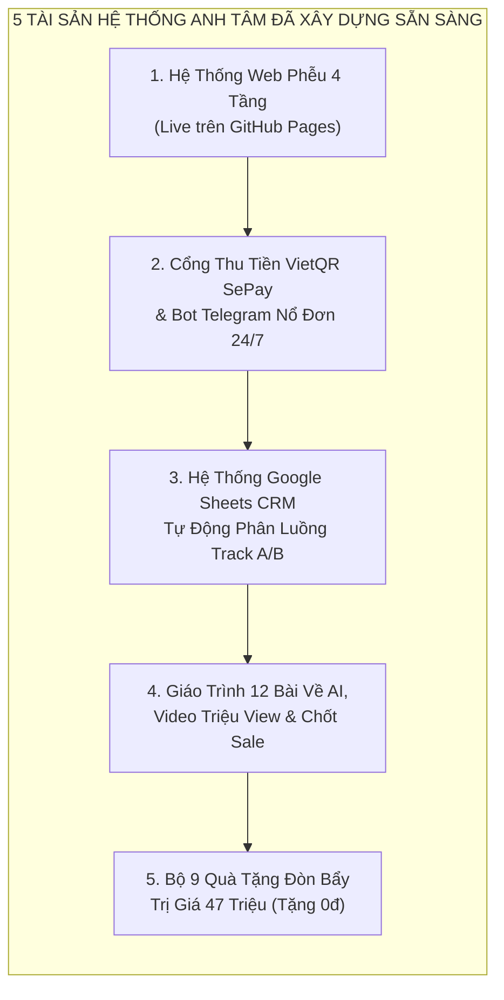

# ĐỀ ÁN HỢP TÁC CHIẾN LƯỢC & KẾ HOẠCH THƯƠNG MẠI HÓA
# NEW YOU TEACHER ACADEMY — KHÓA TRUYỀN NGHỀ GIÁO VIÊN TIẾNG ANH 12 THÁNG
## TÀI LIỆU ĐỀ XUẤT HỢP TÁC & TRIỂN KHAI VẬN HÀNH TẠO DOANH THU THỰC TẾ

---

* **Đơn vị sở hữu thương hiệu & Học thuật:** Cô Sophie Diễm My (Founder New You English)
* **Đối tác Kiến trúc Hệ thống, Công nghệ AI & Tăng trưởng Doanh thu:** Huỳnh Trường Thanh Tâm
* **Điều phối Dự án & Kiểm soát Chất lượng (PM & QA):** Trí Nguyễn
* **Hệ thống Website Demo đã triển khai thực tế:** [https://cmubeta2.github.io/new-you-english/](https://cmubeta2.github.io/new-you-english/)

---

> [!IMPORTANT]
> **TÓM TẮT ĐIỀU HÀNH DÀNH CHO CÔ SOPHIE DIỄM MY (EXECUTIVE SUMMARY):**
> 
> Hiện tại, **New You English** và cá nhân **Cô Diễm My** đang sở hữu một "mỏ vàng" về uy tín chuyên môn: Hơn 8 năm kinh nghiệm thực chiến, hệ thống 60+ lớp học trực tuyến đang vận hành, phương pháp khẩu hình IPA độc quyền và hàng ngàn học viên cũ tin tưởng. Tuy nhiên, nếu chỉ dừng lại ở việc bán các khóa giao tiếp lẻ (vài triệu đồng/khóa), chúng ta sẽ luôn bị **kịch trần về thời gian giảng dạy của Cô My** và biên lợi nhuận bị bó hẹp.
> 
> Bản kế hoạch này trình bày giải pháp do **Huỳnh Trường Thanh Tâm** đã trực tiếp xây dựng sẵn hạ tầng để cùng Cô My **nâng cấp mô hình kinh doanh lên phân khúc Đào tạo Nghề Giá trị cao (High-Ticket 60 – 119 triệu VNĐ/học viên)** mang tên **New You Teacher Academy**.
> 
> **Điểm đặc biệt nhất:** Đây không phải là ý tưởng trên giấy. Toàn bộ **Hệ thống Website chuyển đổi, Cổng thu học phí tự động VietQR, Hệ thống quản lý CRM, Giáo trình AI & Marketing, cùng Bộ 9 Quà tặng trị giá 47 triệu VNĐ ĐÃ ĐƯỢC ANH TÂM THIẾT KẾ VÀ DỰNG SẴN KHUNG SƯỜN**. Cô My chỉ cần ghép mảnh ghép Học thuật Tiếng Anh vào là cỗ máy có thể bấm nút chạy kiếm tiền ngay trong tháng này!

---

## PHẦN 1: BÀI TOÁN KINH DOANH & CƠ HỘI ĐỘT PHÁ DOANH THU (MONETIZATION MODEL)

### 1. Tại Sao Phải Triển Khai Mô Hình "Truyền Nghề Giáo Viên 12 Tháng" Ngay Lúc Này?

| Tiêu Chí So Sánh | Mô Hình Lớp Giao Tiếp Truyền Thống | Mô Hình New You Teacher Academy (Đề Xuất Hợp Tác) |
|:---|:---|:---|
| **Mức học phí / 1 Học viên** | 3.000.000đ – 8.000.000đ / khóa | **60.000.000đ – 119.000.000đ / học viên (12 tháng)** |
| **Để đạt doanh thu ~1 Tỷ VNĐ** | Cần tuyển và dạy **150 – 250 học viên** (Quá tải vận hành) | Chỉ cần tuyển chọn **10 – 12 học viên tinh hoa / khóa** |
| **Áp lực lên thời gian của Cô My** | Cô My phải trực tiếp dạy lặp đi lặp lại rất nhiều ca | Cô My chỉ dạy chuyên môn cốt lõi; Anh Tâm gánh toàn bộ mảng AI, Video, Sales & Tự động hóa |
| **Lợi ích kép cho hệ sinh thái NYE** | Học viên học xong là kết thúc | Học viên học xong **trở thành Trợ giảng & Giáo viên chính thức** gánh vác 60+ lớp học cho Cô My |
| **Rào cản cạnh tranh trên thị trường** | Nhiều trung tâm làm được | **Độc tôn trên thị trường:** Kết hợp Tiếng Anh thực chiến + Bằng Sư phạm chính quy + Công nghệ AI + Cam kết hoàn vốn 40–60tr |

---

### 2. Cấu Trúc Sản Phẩm & Thang Học Phí Đã Thiết Kế (3 Gói Thương Mại)

Chúng ta không bán một "khóa học tiếng Anh", chúng ta bán một **"Sự nghiệp Giáo viên Tiếng Anh Độc lập có Cam kết Thu nhập"**:

1. **GÓI 1 — PRO TEACHER (Khởi Nghiệp Lớp Học): 60.000.000 VNĐ** *(Giá niêm yết: 68.000.000đ)*
   * Dành cho người muốn nắm vững phương pháp sư phạm New You, làm chủ AI và tự mở lớp dạy online.
2. **GÓI 2 — DUAL-DEGREE MASTER (Gói Chủ Lực - Flagship): 88.000.000 VNĐ** *(Giá niêm yết: 108.000.000đ)*
   * Trọn gói đào tạo 12 tháng + Chứng chỉ Nghiệp vụ Sư phạm ĐH chính quy + **Ký hợp đồng làm Giáo viên chính thức tại New You English** + **Bảo trợ bàn giao học sinh từ hệ thống 60+ lớp để thu hồi vốn 40 – 60 triệu VNĐ ngay trong khóa học**.
3. **GÓI 3 — VIP MENTORSHIP 1-1: 119.000.000 VNĐ** *(Giá niêm yết: 139.000.000đ - Giới hạn 3 suất)*
   * Cô My & Anh Tâm kèm cặp 1-1 xây dựng hệ thống trung tâm tiếng Anh trực tuyến riêng cho học viên.

> **Đòn bẩy Tài chính giúp Học viên dễ dàng xuống tiền:**
> * **Phương án 1 (Thu tiền mặt nhanh):** Đóng làm 3 đợt (Đợt 1 đóng 40% ~ 30–35 triệu khi nhập học; Đợt 2 và Đợt 3 đóng từ chính tiền dạy học thu được ở tháng thứ 4 và tháng thứ 7).
> * **Phương án 2 (Trả góp thẻ tín dụng 0%):** Chia nhỏ chỉ còn **~5.000.000đ – 7.330.000đ/tháng** (nhẹ nhàng như chi phí sinh hoạt, giúp chốt sale cực nhanh).
> * **Chốt Cọc Giữ Chỗ Thẩm Định:** **9.000.000 VNĐ** trước khi vào phỏng vấn 1-1 (Cam kết hoàn cọc 100% trong 24h nếu sau phỏng vấn Ban Giảng Huấn đánh giá không phù hợp).

---

### 3. Dự Toán Doanh Thu & Dòng Tiền Thực Tế Cho Khóa Đầu Tiên (Founding Batch K01)

Mục tiêu an toàn và khả thi nhất cho **Khóa K01 (Tháng 11 – 12/2026)** là tuyển sinh **10 – 15 học viên**:

```
╔═════════════════════════════════════════════════════════════════════════════════════════════╗
║                     BẢNG DỰ TOÁN DOANH THU & DÒNG TIỀN KHÓA K01 (12 HỌC VIÊN)               ║
╠═════════════════════════════════════════════╦═══════════════════════╦═══════════════════════╣
║ Hạng Mục Tài Chính                          ║ Kịch Bản Tiêu Chuẩn   ║ Kịch Bản Tốt (15 HV)  ║
║                                             ║ (10 Học Viên)         ║                       ║
╠═════════════════════════════════════════════╬═══════════════════════╬═══════════════════════╣
║ 1. Tổng Doanh Thu Hợp Đồng (Gói TB 80tr/HV) ║   800.000.000 VNĐ     ║ 1.200.000.000 VNĐ     ║
║ 2. Tiền Mặt Thu Ngay Đợt 1 (40% khi mở lớp) ║   320.000.000 VNĐ     ║   480.000.000 VNĐ     ║
║ 3. Tiền Thu Đợt 2 (Tháng thứ 4 - 30%)       ║   240.000.000 VNĐ     ║   360.000.000 VNĐ     ║
║ 4. Tiền Thu Đợt 3 (Tháng thứ 8 - 30%)       ║   240.000.000 VNĐ     ║   360.000.000 VNĐ     ║
╠═════════════════════════════════════════════╬═══════════════════════╬═══════════════════════╣
║ 5. Chi Phí Cố Định & Liên Kết Đào Tạo       ║  ~150.000.000 VNĐ     ║  ~225.000.000 VNĐ     ║
║    (Phí chứng chỉ ĐH, Lệ phí thi, Học liệu) ║  (~15 triệu / HV)     ║  (~15 triệu / HV)     ║
╠═════════════════════════════════════════════╬═══════════════════════╬═══════════════════════╣
║ 6. LỢI NHUẬN GỘP PHÂN BỔ (GROSS PROFIT)     ║   650.000.000 VNĐ     ║   975.000.000 VNĐ     ║
╚═════════════════════════════════════════════╩═══════════════════════╩═══════════════════════╝
```

* **Ưu thế tuyệt đối về dòng tiền:** Ngay khi chốt xong 10–15 học viên đầu tiên, chúng ta thu về ngay **320 – 480 triệu VNĐ tiền mặt đợt 1**, hoàn toàn đủ để trang trải mọi chi phí tổ chức, marketing và chia lợi nhuận ngay từ tháng đầu tiên mà không cần bỏ vốn túi rủi ro!

---

## PHẦN 2: NHỮNG GÌ ANH TÂM ĐÃ XÂY DỰNG XONG 100% ĐỂ ĐƯA VÀO HỢP TÁC

Để Cô My không phải lo lắng về việc *"Làm sao để triển khai kỹ thuật và tuyển sinh?"*, Anh Tâm đã chủ động đầu tư thời gian xây dựng hoàn chỉnh **5 Hệ thống Vũ khí Thực chiến** sau đây:



### 1. Hệ Thống Website Tuyển Sinh Chuyên Nghiệp Đã Lên Sóng (Live Production)
Cô My có thể bấm vào trải nghiệm trực tiếp ngay bây giờ trên điện thoại hoặc máy tính:
* **Trang chủ Bán hàng (Sales Page):** [https://cmubeta2.github.io/new-you-english/](https://cmubeta2.github.io/new-you-english/)  
  *(Thiết kế theo cấu trúc tâm lý học hành vi, tôn vinh uy tín của Cô My, bảng so sánh gói học phí, lộ trình 12 tháng và nút đăng ký mượt mà).*
* **Trang Đặt Cọc Giữ Chỗ Tự Động tạo Mã VietQR:** [https://cmubeta2.github.io/new-you-english/vip/](https://cmubeta2.github.io/new-you-english/vip/)  
  *(Tự động điền tên + số điện thoại của ứng viên vào nội dung chuyển khoản ngân hàng để không bao giờ nhầm lẫn).*
* **Trang Phiếu Khảo Sát Hồ Sơ Phỏng Vấn 1-1:** [https://cmubeta2.github.io/new-you-english/xac-nhan/](https://cmubeta2.github.io/new-you-english/xac-nhan/)  
  *(Thu thập trình độ hiện tại, bằng cấp, nỗi sợ và câu hỏi của ứng viên trước khi gặp Cô My).*
* **Cổng Phòng Chờ Vào Lớp / Phỏng Vấn:** [https://cmubeta2.github.io/new-you-english/vao/](https://cmubeta2.github.io/new-you-english/vao/)

### 2. Hệ Thống Tự Động Hóa Thu Học Phí & Báo Đơn Qua Telegram (Chi Phí Vận Hành 0đ)
* Đã viết xong toàn bộ mã nguồn kết nối **SePay (Ngân hàng) + Google Sheets CRM + Telegram Bot**.
* **Cơ chế hoạt động:** Ngay khi học viên điền form trên Web hoặc quét mã QR chuyển khoản cọc 9.000.000đ, chỉ sau **2 giây**, điện thoại của Cô My và Anh Tâm sẽ nhận được tin nhắn **Ting Ting! Nổ đơn** trên Telegram kèm đầy đủ hồ sơ ứng viên, đồng thời tự động ghi vào bảng tính kế toán. Không cần thuê kế toán trực đêm hay mua phần mềm đắt tiền.

### 3. Hệ Thống Phân Luồng Tuyển Sinh Thông Minh (Dual-Track Protocol)
Giải quyết triệt để bài toán *"Người giỏi và người mất gốc làm sao học chung?"* để mở rộng tối đa tệp khách hàng:
* **Track A (Ứng viên đã có nền tảng B1+ / IELTS 5.0+):** Vào thẳng lộ trình 12 tháng, từ Tháng thứ 4 đã bắt đầu nhận lớp dạy thực tế vòng 1 để thu hồi vốn.
* **Track B (Ứng viên mất gốc A0–A2 yêu nghề giáo hoặc muốn chuyển ngành):** Được học 3 tháng chuẩn hóa phát âm nền tảng cùng Cô My + Làm Trợ giảng có lương tại 60+ lớp của New You English, đến Tháng thứ 6 mới bắt đầu mở lớp dạy kèm 1-1.
* $\rightarrow$ *Nhờ cơ chế này, chúng ta không bỏ sót bất kỳ khách hàng tiềm năng nào!*

### 4. Trọn Bộ Giáo Trình 12 Bài Do Anh Tâm Trực Tiếp Giảng Dạy
Anh Tâm sẽ đứng lớp phụ trách toàn bộ 3 học phần Kỹ năng Hiện đại để giảm tải cho Cô My:
* **Học phần I (Bài 1 – 4):** Ứng dụng AI soạn giáo án chuẩn Cambridge trong 3 phút, tự động làm Slide Gamma.app và tạo Trợ lý ảo AI chấm bài 24/7.
* **Học phần II (Bài 5 – 8):** Kỹ thuật quay dựng Video ngắn triệu view trên TikTok/Reels bằng điện thoại tại nhà để học viên tự hút học sinh 0 đồng.
* **Học phần III (Bài 9 – 12):** Kịch bản tư vấn tâm lý phụ huynh qua Zalo 5 bước, kịch bản dạy thử Demo Zoom 45 phút chốt học phí.

### 5. Trọn Bộ 9 Quà Tặng Độc Bản Trị Giá 47.000.000đ (Vũ Khí Chốt Sale Cực Mạnh)
Khi khách hàng thấy học phí 60–88 triệu, bộ 9 quà tặng miễn phí này sẽ làm cán cân giá trị nghiêng hẳn về phía chúng ta:
1. **Quà #01 (3.5tr):** 52 Video Master Phát Âm Chuẩn IPA Anh - Mỹ của Cô My *(Đã lên danh mục chi tiết 52 bài)*.
2. **Quà #02 (500k):** Sách in mạ vàng có chữ ký Cô My & Ebook New You English.
3. **Quà #03 (5tr):** Thư viện 100+ Mega Prompts AI dạy học của Anh Tâm.
4. **Quà #04 (8tr):** Cài đặt 1-1 Chatbot AI Trợ giảng riêng 24/7 mang tên học viên.
5. **Quà #05 (6tr):** Kho 30 Kịch bản Video ngắn triệu view *(Anh Tâm đã viết sẵn toàn bộ 30 kịch bản, chỉ chờ Cô My duyệt ví dụ tiếng Anh)*.
6. **Quà #06 (7tr):** Bộ Kịch bản Chat Zalo & 15 Slide dạy thử Zoom Demo chốt đơn *(Đã viết xong 100%)*.
7. **Quà #07 (10tr):** Bản quyền 6 Bộ quy trình SOP vận hành 60+ lớp học *(Đã viết xong toàn bộ biểu mẫu)*.
8. **Quà #08 (2tr):** Thẻ Hội viên trọn đời CLB Tiếng Anh & Săn Tây LOÉ Club.
9. **Quà #09 (5tr - Quà đặc biệt):** Bộ công cụ Mồi câu học viên (Ebook 100 cụm từ công sở cho phép học viên đổi tên tác giả thành tên mình để đi hút khách + 500 Flashcards Anki).

---

## PHẦN 3: PHÂN ĐỊNH VAI TRÒ & NGUYÊN TẮC HỢP TÁC (KHÔNG DẪM CHÂN)

Để sự hợp tác giữa Cô My, Anh Tâm và Trí Nguyễn bền vững, minh bạch và hiệu quả nhất, dự án vận hành theo nguyên tắc **"Ai giỏi nhất mảng nào, người đó toàn quyền quyết định mảng đó"**:

| Thành Viên Ban Điều Hành | Vai Trò Cốt Lõi | Phạm Vi Phụ Trách Độc Quyền | Những Việc KHÔNG Cần Bận Tâm |
|:---|:---|:---|:---|
| **1. Cô Sophie Diễm My** | **Giám Đốc Học Thuật & Thương Hiệu** | - Độc quyền 100% chuyên môn Tiếng Anh, 44 âm IPA, ngữ pháp quy nạp, giáo trình Oxford.<br/>- Giảng dạy các học phần Ngôn ngữ & Sư phạm cốt lõi.<br/>- Phỏng vấn thẩm định chuyên môn đầu vào & chấm thi đầu ra.<br/>- Điều phối phân bổ học sinh từ phễu 60+ lớp cho học viên thực tập. | Không phải lo làm Web, không phải lo cài đặt công nghệ, không phải viết kịch bản bán hàng hay quản lý bảng biểu kỹ thuật. |
| **2. Anh Huỳnh Trường Thanh Tâm** | **Kiến Trúc Sư Hệ Thống, AI & Tăng Trưởng Doanh Thu** | - Độc quyền 100% mảng Công nghệ AI, Kỹ thuật Video ngắn, Xây dựng Phễu Marketing & Tự động hóa.<br/>- Giảng dạy 12 bài về AI, Quay dựng Video và Kỹ năng Tuyển sinh.<br/>- Vận hành hệ thống Web, VietQR SePay, Bot Telegram & chiến dịch thu hút khách hàng tiềm năng (Leads).<br/>- Đồng hành tư vấn chốt sale gói High-Ticket. | **Tuyệt đối không can thiệp chuyên môn tiếng Anh của Cô My.** Mọi ví dụ tiếng Anh trong tài liệu của Anh Tâm đều để trống ô `[SLOT CHUYÊN MÔN - CÔ MY DUYỆT]`. |
| **3. Bạn Trí Nguyễn** | **Quản Trị Dự Án (PM) & Đảm Bảo Chất Lượng (QA)** | - Theo dõi tiến độ học tập, điểm danh, nhắc nhở bài tập về nhà theo 6 bộ SOP.<br/>- Sắp xếp lịch phỏng vấn Google Meet cho Cô My & Anh Tâm.<br/>- Làm việc với đối tác trường Đại học về hồ sơ thi chứng chỉ Sư phạm và IELTS. | Không phải tự thiết kế quy trình vì đã có sẵn 6 bộ SOP tự động hóa. |

---

## PHẦN 4: KẾ HOẠCH HÀNH ĐỘNG 4 BƯỚC ĐỂ RA TIỀN NGAY TRONG 30 NGÀY TỚI

Chúng ta không cần đợi 6 tháng để chuẩn bị hết giáo trình 12 tháng rồi mới bán (vì dạy cuốn chiếu đến đâu hoàn thiện sâu đến đó). Chúng ta áp dụng chiến lược **"Bán trước thu tiền mặt — Đào tạo cuốn chiếu" (Pre-sell & Rollout)** qua 4 tuần lễ:

```
┌────────────────────────────────────────────────────────────────────────────────────────────────────────────────┐
│                        LỘ TRÌNH 30 NGÀY CHẠY CHIẾN DỊCH TUYỂN SINH & THU HỌC PHÍ KHÓA K01                      │
├──────────┬──────────────────────────────┬────────────────────────────────────────────────┬─────────────────────┤
│ Giai Đoạn│ Mục Tiêu Trọng Tâm           │ Hành Động Cụ Thể Của Đội Ngũ                   │ Kết Quả Đầu Ra      │
├──────────┼──────────────────────────────┼────────────────────────────────────────────────┼─────────────────────┤
│ TUẦN 1   │ Chốt Thỏa Thuận Hợp Tác      │ 1. Cô My & Anh Tâm thống nhất cơ chế hợp tác.  │ - Hệ thống sẵn sàng │
│ (Ngày    │ & Khớp Nối Hệ Thống Thu Tiền │ 2. Cô My duyệt nhanh 3 kịch bản video đầu tiên │   100% để đón khách │
│  1 - 7)  │                              │    và câu test phát âm trong Phiếu duyệt mẫu.  │   và nhận tiền cọc. │
│          │                              │ 3. Anh Tâm gắn số TK ngân hàng thật vào VietQR │                     │
│          │                              │    và thêm Cô My vào nhóm Telegram báo đơn.    │                     │
├──────────┼──────────────────────────────┼────────────────────────────────────────────────┼─────────────────────┤
│ TUẦN 2   │ Bơm Traffic & Thu Hút        │ 1. Khai thác "Mỏ vàng có sẵn": Gửi thông báo   │ - Thu về 150 - 300  │
│ (Ngày    │ 200+ Ứng Viên Tiềm Năng      │    tuyển sinh K01 vào cộng đồng học viên cũ,   │   người quan tâm.   │
│  8 - 14) │ (Chi phí Marketing ~ 0đ)     │    CLB LOÉ và mạng lưới 60+ lớp của Cô My.     │ - Có 30 - 50 hồ sơ  │
│          │                              │ 2. Đăng 5 video ngắn bắt trend + Bài viết tặng │   điền phiếu khảo   │
│          │                              │    Ebook 100 cụm từ lên Facebook/TikTok để kéo │   sát đăng ký phỏng │
│          │                              │    khách lạ điền Form trên trang Web.          │   vấn 1-1.          │
├──────────┼──────────────────────────────┼────────────────────────────────────────────────┼─────────────────────┤
│ TUẦN 3   │ Tổ Chức Zoom Định Hướng      │ 1. Tổ chức 01 buổi Zoom "Bản đồ Nghề Giáo viên │ - Chốt thành công   │
│ (Ngày    │ & Phỏng Vấn 1-1 Chốt Cọc     │    Tiếng Anh Thời Đại AI" (theo 15 Slide sẵn). │   10 - 15 học viên  │
│ 15 - 23) │ 9 Triệu -> Đóng Đợt 1        │ 2. Cô My & Anh Tâm phỏng vấn 1-1 (30 phút/ca)  │   đóng cọc 9 triệu. │
│          │                              │    với các ứng viên nét nhất từ bảng khảo sát: │ - Thu về 320 - 480  │
│          │                              │    - Cô My: Test phát âm 5 phút & truyền lửa.  │   triệu VNĐ tiền    │
│          │                              │    - Anh Tâm: Phân tích bài toán hoàn vốn &    │   mặt học phí Đợt 1.│
│          │                              │      chốt quét mã VietQR đặt cọc 9.000.000đ.   │                     │
├──────────┼──────────────────────────────┼────────────────────────────────────────────────┼─────────────────────┤
│ TUẦN 4   │ Khai Giảng Lớp K01           │ 1. Ký hợp đồng đào tạo & thu hoàn tất Đợt 1.   │ - Lớp K01 chính thức│
│ (Ngày    │ & Bàn Giao Bộ Quà Tặng       │ 2. Tổ chức Lễ Khai Giảng (Orientation Day).    │   đi vào hoạt động. │
│ 24 - 30) │ Mở Đầu Tháng 1               │ 3. Gửi tặng Sách in có chữ ký Cô My + Mở khóa  │ - Chia lợi nhuận    │
│          │                              │    52 Video IPA để học viên bắt đầu học Tháng 1│   đợt 1 cho các bên.│
└──────────┴──────────────────────────────┴────────────────────────────────────────────────┴─────────────────────┘
```

---

### Kịch Bản Phối Hợp "Song Kiếm Hợp Bích" Trong 30 Phút Phỏng Vấn 1-1 (Chìa Khóa Chốt Đơn 88 Triệu):

Khi một ứng viên đăng ký trên Web, hệ thống đã tự động gửi câu trả lời khảo sát của họ về Telegram. Trong buổi gặp Google Meet 30 phút:
1. **10 Phút Đầu (Cô Sophie Diễm My chủ trì):**
   * Cô My trò chuyện ấm áp, cho ứng viên đọc thử 1 câu tiếng Anh trên màn hình để "bắt bệnh" khẩu hình.
   * Chỉ trong 5 phút, Cô My sửa ngay 1–2 âm sai giúp ứng viên đọc hay hơn hẳn $\rightarrow$ Ứng viên tâm phục khẩu phục trình độ sư phạm của Cô My.
   * Cô My khẳng định: *"Về mặt chuyên môn tiếng Anh và kỹ năng đứng lớp, chỉ cần em đi đúng lộ trình của chị, chị cam kết rèn em thành giáo viên giỏi!"*
2. **15 Phút Tiếp Theo (Anh Huỳnh Trường Thanh Tâm chủ trì):**
   * Anh Tâm giải quyết nỗi lo lớn nhất của ứng viên: *"Học giỏi rồi lấy học sinh ở đâu? Làm sao thu hồi lại số tiền 88 triệu?"*
   * Anh Tâm chiếu màn hình cho ứng viên thấy kho 30 kịch bản video, con Bot AI trợ giảng và cam kết bàn giao học sinh từ hệ thống 60+ lớp.
   * Anh Tâm tính bài toán kinh tế rõ ràng: *"Em đóng trước 30 triệu đợt 1, hoặc trả góp thẻ tín dụng chỉ 6 triệu/tháng. Từ tháng thứ 4 em đã bắt đầu có thu nhập từ lớp thực tập để tự trả các đợt sau."*
3. **5 Phút Cuối (Chốt Cọc Giữ Chỗ Tại Chỗ):**
   * Anh Tâm gửi đường link trang VIP ([cmubeta2.github.io/new-you-english/vip/](https://cmubeta2.github.io/new-you-english/vip/)) vào khung chat Google Meet.
   * Ứng viên quét mã VietQR đặt cọc **9.000.000đ** giữ suất học bổng Founding Batch K01 ngay trong cuộc gọi!

---

## PHẦN 5: ĐỀ XUẤT KHUNG ĐÀM PHÁN TÀI CHÍNH & PHÂN CHIA DOANH THU (WIN - WIN)

Để Cô My và Anh Tâm dễ dàng đi đến thống nhất hợp tác, dưới đây là cấu trúc phân bổ dòng tiền minh bạch trên mỗi hợp đồng học viên thu về:

```
┌───────────────────────────────────────────────────────────────────────────────────────────────┐
│                  CẤU TRÚC PHÂN BỔ DÒNG TIỀN TRÊN MỖI HỌC VIÊN (ĐỀ XUẤT THẢO LUẬN)             │
├───────────────────────────────────────────────────────────┬───────────────────────────────────┤
│ Hạng Mục Phân Bổ                                          │ Tỷ Lệ / Định Mức Dự Kiến          │
├───────────────────────────────────────────────────────────┼───────────────────────────────────┤
│ 1. Quỹ Chi Phí Trực Tiếp & Pháp Lý (Direct Costs)         │ ~15% – 18% Doanh thu              │
│    (Lệ phí học & thi chứng chỉ NVSP ĐH, Lệ phí thi IELTS, │ (Trích lập riêng vào Quỹ Học vụ   │
│     In sách quà tặng, Chi phí nền tảng Zoom/AI)           │  để chi trả theo tiến độ 12 tháng)│
├───────────────────────────────────────────────────────────┼───────────────────────────────────┤
│ 2. Quỹ Hoa Hồng Tuyển Sinh / Marketing (Customer Acq.)    │ ~10% – 12% Doanh thu              │
│    (Thưởng nóng cho người chốt sale, chi phí chạy Ads     │ (Ai trực tiếp mang khách về hoặc  │
│     nếu có, hoa hồng giới thiệu từ học viên cũ)           │  chốt đơn nhận phần thưởng này)   │
├───────────────────────────────────────────────────────────┼───────────────────────────────────┤
│ 3. Quỹ Quản Trị Vận Hành & Trợ Giảng QA (Operations)      │ ~5% – 8% Doanh thu                │
│    (Thù lao điều phối dự án cho Trí Nguyễn & đội ngũ      │                                   │
│     trợ giảng chấm bài hàng ngày)                         │                                   │
├───────────────────────────────────────────────────────────┼───────────────────────────────────┤
│ 4. LỢI NHUẬN RÒNG & THÙ LAO ĐÀO TẠO CỐT LÕI (NET PROFIT)  │ ~62% – 70% Doanh thu              │
│    Phân chia theo Thỏa thuận Đồng Sáng Lập giữa:          │ -> Cô My và Anh Tâm thống nhất    │
│    - Cô Sophie Diễm My (Thương hiệu, Học thuật, Bảo trợ)  │    tỷ lệ phân chia cụ thể         │
│    - Anh Huỳnh Trường Thanh Tâm (Hệ thống, AI, Video,     │    (Ví dụ: [X]% - [Y]% tùy theo   │
│      Phễu chuyển đổi & Đào tạo Kinh doanh)                │    tỷ trọng giờ dạy và nguồn khách)│
└───────────────────────────────────────────────────────────┴───────────────────────────────────┘
```

---

## PHẦN 6: DANH MỤC TÀI LIỆU ĐÃ HOÀN THIỆN ĐỂ CÔ MY XEM TRƯỚC

Cô My có thể mở xem trực tiếp các tài liệu mà Anh Tâm đã chuẩn bị sẵn trong thư mục dự án:

1. **Tài liệu phối hợp dành riêng cho Cô My:**
   * 📄 [Hướng dẫn Bàn giao & Ma trận các vị trí chờ Cô My duyệt](./02_GiaoTrinh_ThayTam/00_HUONG_DAN_BAN_GIAO_HOC_THUAT_CO_MY.md)
   * 📄 [Phiếu Duyệt Học Thuật Mẫu (Cô My chỉ cần tích chọn)](./02_GiaoTrinh_ThayTam/00_PHIEU_DUYET_HOC_THUAT_MAU_CO_MY.md)
2. **Kho Quà Tặng & Kịch Bản Bán Hàng Thực Chiến:**
   * 🎬 [Kho 30 Kịch Bản Video Ngắn Triệu View (5 Trụ cột)](./03_BoQuaTang_NewYou/QUA_05_KHO_30_KICH_BAN_VIDEO_TRIEU_VIEW.md)
   * 💬 [Bộ Kịch Bản Tư Vấn Zalo & 15 Slide Dạy Thử Zoom Demo 45 Phút](./03_BoQuaTang_NewYou/QUA_06_BO_SALES_SCRIPTS_ZALO_VA_ZOOM_DEMO.md)
   * 📋 [Bản Quyền 6 Bộ Quy Trình Chuẩn SOP Vận Hành 60+ Lớp Học](./03_BoQuaTang_NewYou/QUA_07_BAN_QUYEN_SOP_VAN_HANH_60_LOP.md)
   * 🎥 [Danh Mục Chi Tiết 52 Video Master Phát Âm IPA Anh - Mỹ](./03_BoQuaTang_NewYou/QUA_01_52_VIDEO_MASTER_IPA.md)
3. **Giáo Trình Công Nghệ & Hệ Thống Tự Động Hóa Của Anh Tâm:**
   * 📘 [Chỉ Mục Tổng Quan Giáo Trình Công Nghệ AI, Video & Phễu Tuyển Sinh](./02_GiaoTrinh_ThayTam/00_CHI_MUC_TONG_QUAN.md)
   * ⚙️ [Cẩm Nang Thiết Lập Hệ Thống Google Sheets CRM & Tự Động Hóa 0đ](./02_GiaoTrinh_ThayTam/tai_nguyen_ky_thuat/HUONG_DAN_CAI_DAT_GOOGLE_SHEETS_CRM.md)

---

### BƯỚC TIẾP THEO NGAY SAU BUỔI HỌP HÔM NAY (CALL TO ACTION):

1. **Cô My và Anh Tâm chốt thống nhất:**
   * Cơ chế phân chia doanh thu / lợi nhuận cho khóa đầu tiên **Founding Batch K01**.
   * Ngày mở phễu nhận đơn đăng ký và ngày tổ chức buổi Zoom Định hướng nghề đầu tiên.
2. **Cô My bàn giao nhanh:**
   * Link Google Drive chứa 52 video IPA sẵn có để Anh Tâm gắn vào cổng quà tặng tự động.
   * Duyệt 5 kịch bản video ngắn đầu tiên để tuần sau bấm máy quay thử nghiệm.
3. **Anh Tâm kích hoạt ngay:**
   * Kết nối tài khoản nhận học phí chính thức vào mã VietQR trên trang Web và mở cổng đón những học viên đặt cọc đầu tiên!

---
*Đề án Hợp tác Chiến lược & Kế hoạch Thương mại hóa được xây dựng bởi Huỳnh Trường Thanh Tâm — Sẵn sàng đồng hành cùng Cô Sophie Diễm My đưa New You English vươn tầm Hệ sinh thái Đào tạo Giáo viên hàng đầu.*
