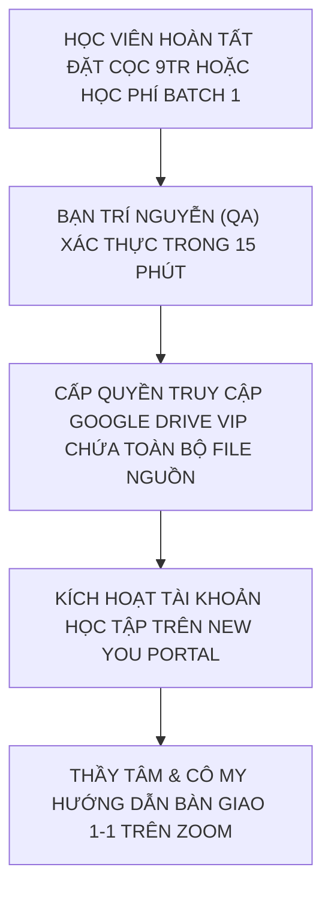
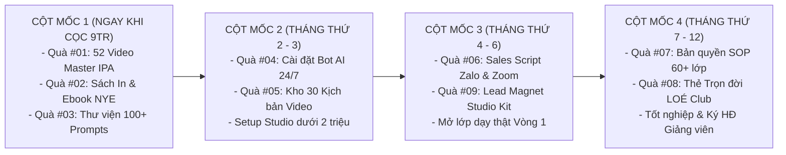

# CHỈ MỤC TỔNG QUAN: BỘ 8 QUÀ TẶNG TRUYỀN NGHỀ ĐỘC BẢN
## THE ULTIMATE FAST-ACTION BONUSES VAULT — TRỊ GIÁ 42.000.000 VNĐ (TẶNG 0Đ)
### HỆ THỐNG ĐÀO TẠO GIÁO VIÊN TIẾNG ANH THỰC CHIẾN 12 THÁNG — NEW YOU TEACHER ACADEMY

---

* **Đơn vị ban hành:** Ban Giảng Huấn New You English (**Cô Sophie Diễm My** & **Thầy Huỳnh Trường Thanh Tâm**)
* **Giám sát Tiến độ & Đảm bảo Chất lượng (QA):** **Bạn Trí Nguyễn** (Project Manager & QA)
* **Đối tượng sở hữu:** Học viên đăng ký Khóa Khai Mở Founding Batch 1 (Gói Pro Teacher, Dual-Degree Master, VIP Mentorship 1-1) hoặc ứng viên hoàn tất cọc thẩm định 9.000.000đ.

---

```
╔═══════════════════════════════════════════════════════════════════════════════════════════╗
║                   BẢNG TỔNG HỢP GIÁ TRỊ BỘ 8 QUÀ TẶNG ĐỘC QUYỀN                           ║
╠═══════════════════════════════════════════════════════════════════════════════════════════╣
║  #01. Trọn bộ 52 Video Master Phát Âm Chuẩn IPA Anh - Mỹ (Cô My)        :  3.500.000 VNĐ  ║
║  #02. Sách In Cứng & Ebook Bản Quyền "New You English"                  :    500.000 VNĐ  ║
║  #03. Thư Viện 100+ Mega Prompts AI Chuyên Sâu Dạy Học (Thầy Tâm)       :  5.000.000 VNĐ  ║
║  #04. 01 Chatbot AI Trợ Giảng Riêng 24/7 (Custom GPTs Cá Nhân Hóa)     :  8.000.000 VNĐ  ║
║  #05. Kho 30 Kịch Bản Video Ngắn Triệu View Bắt Trend Đã Kiểm Chứng     :  6.000.000 VNĐ  ║
║  #06. Bộ Kịch Bản Tư Vấn Thấu Cảm 5 Bước & Demo Zoom 45 Phút Chốt Combo:  7.000.000 VNĐ  ║
║  #07. Bản Quyền Bộ SOP Quy Trình Vận Hành 60+ Lớp Học Online            : 10.000.000 VNĐ  ║
║  #08. Thẻ Hội Viên Trọn Đời CLB Tiếng Anh LOÉ & Săn Tây                 :  2.000.000 VNĐ  ║
╠═══════════════════════════════════════════════════════════════════════════════════════════╣
║  🎁 TỔNG GIÁ TRỊ THỰC TẾ NIÊM YẾT: 42.000.000 VNĐ ➔ TẶNG MIỄN PHÍ 0Đ (BATCH 1)            ║
║  🚀 QUÀ TẶNG GIA TĂNG #09: Lead Magnet Studio Kit (Vũ khí chiêu sinh 0đ từ Tháng 4)      ║
╚═══════════════════════════════════════════════════════════════════════════════════════════╝
```

---

## DANH MỤC CÁC TÀI LIỆU QUÀ TẶNG CHI TIẾT (BẤM ĐỂ TRUY CẬP)

1. 🎁 [Quà #01: Trọn Bộ 52 Video Master Phát Âm Chuẩn IPA Anh - Mỹ (Cô My)](./QUA_01_52_VIDEO_MASTER_IPA.md) *(Trị giá: 3.500.000đ)*
2. 🎁 [Quà #02: Sách In Cứng & Ebook Bản Quyền "New You English"](./QUA_02_SACH_VA_EBOOK_NEW_YOU.md) *(Trị giá: 500.000đ)*
3. 🎁 [Quà #03: Thư Viện 100+ Mega Prompts AI Chuyên Sâu Dạy Học (Thầy Tâm)](./QUA_03_THU_VIEN_100_MEGA_PROMPTS_AI.md) *(Trị giá: 5.000.000đ)*
4. 🎁 [Quà #04: Cài Đặt 01 Chatbot AI Trợ Giảng Riêng 24/7 (Custom GPTs)](./QUA_04_CHATBOT_AI_TRO_GIANG_CUSTOM_GPTS.md) *(Trị giá: 8.000.000đ)*
5. 🎁 [Quà #05: Kho 30 Kịch Bản Video Ngắn Triệu View Bắt Trend Đã Kiểm Chứng](./QUA_05_KHO_30_KICH_BAN_VIDEO_TRIEU_VIEW.md) *(Trị giá: 6.000.000đ)*
6. 🎁 [Quà #06: Bộ Kịch Bản Tư Vấn Thấu Cảm 5 Bước & Demo Zoom 45 Phút Chốt Combo](./QUA_06_BO_SALES_SCRIPTS_ZALO_VA_ZOOM_DEMO.md) *(Trị giá: 7.000.000đ)*
7. 🎁 [Quà #07: Bản Quyền Toàn Diện Bộ SOP Vận Hành 60+ Lớp Học Online](./QUA_07_BAN_QUYEN_SOP_VAN_HANH_60_LOP.md) *(Trị giá: 10.000.000đ)*
8. 🎁 [Quà #08: Thẻ Hội Viên Trọn Đời CLB Tiếng Anh LOÉ & Săn Tây](./QUA_08_THE_HOI_VIEN_TRON_DOI_LOE_CLUB.md) *(Trị giá: 2.000.000đ)*
9. 🚀 [Quà Tặng Gia Tăng #09: Bộ Lead Magnet Studio Kit Dành Cho Giáo Viên Đi Chiêu Sinh](./QUA_09_LEAD_MAGNET_STUDIO_KIT.md) *(Đặc cách trao tặng 0đ)*
10. 📅 [Lịch Trình Sản Xuất, Nghiệm Thu QA & Lộ Trình Mở Khóa Quà Tặng 12 Tháng](./LICH_TRINH_SAN_XUAT_VA_MO_KHOA.md)

---

## HƯỚNG DẪN KÍCH HOẠT & TIẾP NHẬN TÀI NGUYÊN



* **Hotline / Zalo Tiếp nhận:** **0945.309.115** (Ban Học Thuật New You English)
* **Link Nhóm Zalo Hỗ Trợ Độc Quyền:** [https://zalo.me/g/iqsizbdchqz1p1br3rkx](https://zalo.me/g/iqsizbdchqz1p1br3rkx)
* **Phòng Họp Trực Tuyến Định Kỳ:** [https://meet.google.com/ktd-wymq-aok](https://meet.google.com/ktd-wymq-aok) (Mã phòng: `ktd-wymq-aok`)

---

# QUÀ TẶNG #01: TRỌN BỘ 52 VIDEO MASTER PHÁT ÂM CHUẨN IPA ANH - MỸ
## SẢN PHẨM CHUYÊN MÔN HỌC THUẬT: CÔ SOPHIE DIỄM MY PHỤ TRÁCH ĐỘC QUYỀN
### HẠ TẦNG SỐ & PHÂN PHỐI: HỆ SINH THÁI NEW YOU ENGLISH & THẦY HUỲNH TRƯỜNG THANH TÂM
### ĐỊNH GIÁ NIÊM YẾT: 3.500.000 VNĐ (TẶNG MIỄN PHÍ 0Đ BATCH 1)

---

* [Quay lại Chỉ Mục Bộ Quà Tặng](./00_CHI_MUC_BO_QUA_TANG.md)
* **Thời điểm mở khóa:** Ngay sau khi nhập học (Tháng thứ 1) để chuẩn hóa phát âm nền tảng.
* **Hình thức bàn giao:** Tài khoản học tập trên New You Portal + Thư mục Google Drive VIP chứa file Full HD 1080p và tài liệu bài tập PDF phát tay.

> [!IMPORTANT]
> **RANH GIỚI CHUYÊN MÔN HỌC THUẬT:**
> Đây là công trình học thuật đúc kết từ hơn 8 năm nghiên cứu khẩu hình và giảng dạy thực tế của **Cô Sophie Diễm My** (Founder New You English, Cử nhân NNA ĐH Sài Gòn, NVSP Cambridge TKT).
> Thầy Huỳnh Trường Thanh Tâm phụ trách hạ tầng số, thiết kế danh mục hệ thống, cổng phân phối đám mây và quy chuẩn hóa thành tài liệu mẫu cho giáo viên.

---

## 1. TỔNG QUAN CẤU TRÚC 52 VIDEO

```
╔═══════════════════════════════════════════════════════════════════════════════════════════╗
║                  BẢN ĐỒ 52 VIDEO MASTER IPA & NGỮ ĐIỆU CHUẨN MỸ                           ║
╠═══════════════════════════════════════════════════════════════════════════════════════════╣
║  PHẦN 1: 12 NGUYÊN ÂM ĐƠN (Monophthongs)           : Video 01 đến Video 12 (12 Videos)    ║
║  PHẦN 2: 08 NGUYÊN ÂM ĐÔI (Diphthongs)             : Video 13 đến Video 20 (08 Videos)    ║
║  PHẦN 3: 24 PHỤ ÂM ĐỐI ỨNG (Consonants)            : Video 21 đến Video 44 (24 Videos)    ║
║  PHẦN 4: 08 KỸ THUẬT BIẾN ÂM & NGỮ ĐIỆU CAO CẤP    : Video 45 đến Video 52 (08 Videos)    ║
╚═══════════════════════════════════════════════════════════════════════════════════════════╝
```

* **Chuẩn âm thanh & hình ảnh:** 1080p 60fps, quay cận cảnh khẩu hình 3 góc máy (Chính diện, Góc nghiêng 45 độ bóc tách cử động môi - răng - lưỡi, và Đồ họa hoạt hình mặt cắt khoang miệng).
* **Đặc quyền giáo viên:** Được phép phát chiếu video làm tài liệu minh họa trong các lớp học trực tuyến Zoom/Google Meet và giao bài tập kèm link video cho học viên của mình.

---

## 2. BẢNG DANH MỤC CHI TIẾT TOÀN VĂN 52 VIDEO MASTER IPA

### PHẦN 1: 12 NGUYÊN ÂM ĐƠN (MONOPHTHONGS — VIDEO 01 ĐẾN 12)

| Mã Video | Ký Tự IPA | Tên Bài Giảng | Thời Lượng | Mẹo Bẻ Khớp Khẩu Hình (Cô My) | Cặp Từ / Ví Dụ Thực Hành | Link & Tài Liệu |
|:---:|:---:|:---|:---:|:---|:---|:---:|
| `VID-01` | `/iː/` | Nguyên âm E dài (Long E) | 6:30 | Miệng cười tươi tối đa, khóe môi căng sang hai bên, âm ngân dài có độ nén. | *Sheep, Eat, Feel, Leave* | `[DRIVE_VIP_01]` |
| `VID-02` | `/ɪ/` | Nguyên âm I ngắn (Short I) | 5:45 | Thả lỏng khóe môi, hạ hàm nhẹ 1cm, phát âm dứt khoát hơi giật bụng. | *Ship, It, Fill, Live* | `[DRIVE_VIP_02]` |
| `VID-03` | `/ʊ/` | Nguyên âm U ngắn (Short U) | 5:20 | Môi hơi tròn, đầu lưỡi thụt lùi vào trong, âm ngắn gọn không kéo dài. | *Book, Good, Put, Foot* | `[DRIVE_VIP_03]` |
| `VID-04` | `/uː/` | Nguyên âm U dài (Long U) | 6:15 | Chu môi tròn như đang huýt sáo, gốc lưỡi nâng cao hướng về ngạc mềm. | *Moon, Food, Choose, Blue* | `[DRIVE_VIP_04]` |
| `VID-05` | `/e/` | Nguyên âm E ngắn (Short E) | 5:30 | Mở miệng rộng hơn âm `/ɪ/`, khóe môi thả lỏng tự nhiên, âm dứt khoát. | *Bed, Pen, Head, Tell* | `[DRIVE_VIP_05]` |
| `VID-06` | `/ə/` | Âm Schwa (Âm lười) | 7:00 | Toàn bộ cơ mặt thả lỏng hoàn toàn, không nhấn trọng âm, âm phổ biến nhất tiếng Anh. | *About, Teacher, Banana, Lemon* | `[DRIVE_VIP_06]` |
| `VID-07` | `/ɜː/` | Âm ER dài (R-colored vowel) | 7:15 | Môi mở hờ, thân lưỡi cong sâu về phía vòm họng, âm vang từ cuống họng. | *Bird, Work, Learn, Turn* | `[DRIVE_VIP_07]` |
| `VID-08` | `/ɔː/` | Nguyên âm O dài (Long O) | 6:40 | Tròn môi hình chữ O sâu, cuống lưỡi hạ thấp, âm tròn và vang. | *Door, Call, Walk, Law* | `[DRIVE_VIP_08]` |
| `VID-09` | `/æ/` | Âm A bẹt (Cat vowel) | 7:30 | Há miệng rộng theo chiều dọc, đè bẹp lưỡi xuống hàm dưới, âm lai giữa /a/ và /e/. | *Cat, Apple, Bad, Man* | `[DRIVE_VIP_09]` |
| `VID-10` | `/ʌ/` | Âm Á ngắn (Strut vowel) | 5:50 | Hạ cằm nhanh, bật luồng hơi từ bụng lên dứt khoát tương tự âm "á" tiếng Việt. | *Cup, Love, Sun, Money* | `[DRIVE_VIP_10]` |
| `VID-11` | `/ɑː/` | Âm A dài mở rộng (Palm vowel)| 6:20 | Há miệng to như khi bác sĩ khám họng "Ahh", lưỡi nằm phẳng tận đáy miệng. | *Car, Star, Father, Heart* | `[DRIVE_VIP_11]` |
| `VID-12` | `/ɒ/` | Âm O ngắn (Lot vowel) | 5:40 | Miệng hơi tròn, hàm dưới hạ nhẹ, phát âm O dứt khoát (phân biệt Anh-Anh vs Anh-Mỹ). | *Pot, Dog, Box, Watch* | `[DRIVE_VIP_12]` |

---

### PHẦN 2: 8 NGUYÊN ÂM ĐÔI (DIPHTHONGS — VIDEO 13 ĐẾN 20)

| Mã Video | Ký Tự IPA | Tên Bài Giảng | Thời Lượng | Mẹo Trượt Âm (Glide Technique) | Từ Vựng Minh Họa & Câu Ứng Dụng | Link & Tài Liệu |
|:---:|:---:|:---|:---:|:---|:---|:---:|
| `VID-13` | `/eɪ/` | Nguyên âm đôi AY | 6:00 | Bắt đầu từ khẩu hình `/e/` rồi trượt nhanh khép khóe môi về phía `/ɪ/`. | *Face, Day, Rain* — *"Save it for a rainy day."* | `[DRIVE_VIP_13]` |
| `VID-14` | `/aɪ/` | Nguyên âm đôi AI | 6:15 | Mở rộng miệng ở âm `/a/` rồi vuốt nhẹ thu hẹp về phía `/ɪ/`. | *Price, High, Sky* — *"Time flies so fast."* | `[DRIVE_VIP_14]` |
| `VID-15` | `/ɔɪ/` | Nguyên âm đôi OY | 5:45 | Chu tròn môi ở âm `/ɔ/` rồi trượt khóe môi bẹt sang `/ɪ/`. | *Boy, Choice, Noise* — *"Enjoy your choice."* | `[DRIVE_VIP_15]` |
| `VID-16` | `/aʊ/` | Nguyên âm đôi AO | 6:30 | Mở to miệng âm `/a/` sau đó thu tròn môi nhanh chóng về âm `/ʊ/`. | *Mouth, Cow, Now* — *"How are you doing now?"* | `[DRIVE_VIP_16]` |
| `VID-17` | `/əʊ/` | Nguyên âm đôi OU (Go) | 6:20 | Bắt đầu thả lỏng ở Schwa `/ə/` rồi đẩy nhẹ môi tròn về phía `/ʊ/`. | *Go, Home, Slow* — *"Don't throw stones."* | `[DRIVE_VIP_17]` |
| `VID-18` | `/ɪə/` | Nguyên âm đôi EAR | 5:50 | Khởi đầu từ âm `/ɪ/` ngắn và nhả lỏng toàn bộ cơ miệng về Schwa `/ə/`. | *Ear, Near, Here* — *"We're finally here."* | `[DRIVE_VIP_18]` |
| `VID-19` | `/eə/` | Nguyên âm đôi AIR | 6:10 | Mở khẩu hình `/e/` rồi lướt nhẹ về Schwa `/ə/` (cuối âm hơi cong nhẹ ở giọng Mỹ). | *Hair, Care, Bear* — *"Take good care of yourself."* | `[DRIVE_VIP_19]` |
| `VID-20` | `/ʊə/` | Nguyên âm đôi UER | 5:35 | Môi hơi tròn ở `/ʊ/` rồi nhả lỏng về âm lười `/ə/`. | *Tour, Poor, Sure* — *"Are you totally sure?"* | `[DRIVE_VIP_20]` |

---

### PHẦN 3: 24 PHỤ ÂM ĐỐI ỨNG (CONSONANTS — VIDEO 21 ĐẾN 44)

| Mã Video | Ký Tự | Nhóm Phụ Âm & Tính Chất | Thời Lượng | Cơ Chế Phát Âm Vô Thanh / Hữu Thanh | Cặp Từ So Sánh Thực Tế | Link & Tài Liệu |
|:---:|:---:|:---|:---:|:---|:---|:---:|
| `VID-21` | `/p/` | Cặp Môi - Vô thanh (Bật hơi) | 5:40 | Mím chặt 2 môi, nén khí rồi bật mạnh luồng hơi (tờ giấy bay trước miệng). | *Pen, Cap, Stop* | `[DRIVE_VIP_21]` |
| `VID-22` | `/b/` | Cặp Môi - Hữu thanh (Rung cổ) | 5:30 | Mím 2 môi tương tự /p/ nhưng làm rung mạnh dây thanh quản, không bật hơi mạnh. | *Ben, Cab, Big* | `[DRIVE_VIP_22]` |
| `VID-23` | `/t/` | Cặp Đầu Lưỡi - Vô thanh | 6:00 | Đầu lưỡi áp chặt chân răng hàm trên, bật mạnh luồng khí dứt khoát. | *Ten, Cat, Water* | `[DRIVE_VIP_23]` |
| `VID-24` | `/d/` | Cặp Đầu Lưỡi - Hữu thanh | 5:50 | Đặt lưỡi vị trí như /t/ nhưng rung thanh quản, âm trầm và đầm hơn. | *Den, Dog, Bad* | `[DRIVE_VIP_24]` |
| `VID-25` | `/tʃ/` | Cặp Chu Môi - Vô thanh (CH) | 6:20 | Chu môi tròn, đầu lưỡi chạm ngạc cứng rồi bật mạnh hơi "chờ". | *Chair, Catch, Nature* | `[DRIVE_VIP_25]` |
| `VID-26` | `/dʒ/` | Cặp Chu Môi - Hữu thanh (J) | 6:10 | Khẩu hình chu môi như /tʃ/ nhưng rung cổ họng cực mạnh. | *Jam, Bridge, Giant* | `[DRIVE_VIP_26]` |
| `VID-27` | `/k/` | Cặp Ngạc Mềm - Vô thanh | 5:45 | Cuống lưỡi nâng chặn ngạc mềm rồi bật hơi gió dứt khoát từ cổ họng. | *Cat, Key, Back* | `[DRIVE_VIP_27]` |
| `VID-28` | `/ɡ/` | Cặp Ngạc Mềm - Hữu thanh | 5:35 | Cuống lưỡi chặn ngạc mềm như /k/ nhưng tạo độ rung dây thanh quản. | *Go, Game, Bag* | `[DRIVE_VIP_28]` |
| `VID-29` | `/f/` | Cặp Răng Môi - Vô thanh | 5:15 | Răng cửa hàm trên cắn nhẹ môi dưới, thổi luồng hơi nhẹ qua kẽ răng. | *Fan, Coffee, Leaf* | `[DRIVE_VIP_29]` |
| `VID-30` | `/v/` | Cặp Răng Môi - Hữu thanh | 5:25 | Răng trên cắn môi dưới như /f/ nhưng rung cổ tạo âm rù rù như tiếng còi xe. | *Van, Love, Leave* | `[DRIVE_VIP_30]` |
| `VID-31` | `/θ/` | Răng Lưỡi - Vô thanh (Think) | 7:45 | **TỬ HUYỆT 1:** Đặt đầu lưỡi giữa 2 hàm răng, thổi hơi gió không rung cổ. | *Think, Thank, Three, Path* | `[DRIVE_VIP_31]` |
| `VID-32` | `/ð/` | Răng Lưỡi - Hữu thanh (This) | 7:30 | **TỬ HUYỆT 2:** Đặt lưỡi kẹp giữa 2 hàm răng như /θ/ nhưng rung cổ cực mạnh. | *This, That, There, Breathe* | `[DRIVE_VIP_32]` |
| `VID-33` | `/s/` | Răng Rít - Vô thanh | 6:00 | Khép nhẹ 2 hàm răng, đẩy luồng hơi rít nhẹ như tiếng xì hơi lốp xe. | *See, City, Price, Miss* | `[DRIVE_VIP_33]` |
| `VID-34` | `/z/` | Răng Rít - Hữu thanh | 6:15 | Khép răng như /s/ nhưng rung dây thanh quản như tiếng ong bay "zừ zừ". | *Zoo, Busy, Rise, Plays* | `[DRIVE_VIP_34]` |
| `VID-35` | `/ʃ/` | Chu Môi Xì Dài - Vô thanh | 6:40 | Chu môi tròn đưa về phía trước, xì luồng hơi mạnh ra như đang bảo "suỵt". | *She, Shoe, Ocean, Fish* | `[DRIVE_VIP_35]` |
| `VID-36` | `/ʒ/` | Chu Môi Xì - Hữu thanh | 6:20 | Chu môi tròn như /ʃ/ nhưng rung cổ họng mạnh tạo âm rền. | *Vision, Measure, Asia* | `[DRIVE_VIP_36]` |
| `VID-37` | `/m/` | Phụ âm Mũi 2 môi (M) | 4:50 | Ngậm chặt 2 môi, luồng hơi thoát hoàn toàn ra đường mũi. | *Man, Summer, Come* | `[DRIVE_VIP_37]` |
| `VID-38` | `/n/` | Phụ âm Mũi đầu lưỡi (N) | 5:00 | Đầu lưỡi chạm chân răng trên chặn luồng khí qua miệng, âm thoát ra mũi. | *No, Sun, Name* | `[DRIVE_VIP_38]` |
| `VID-39` | `/ŋ/` | Phụ âm Mũi ngạc mềm (NG) | 5:30 | Cuống lưỡi chặn ngạc mềm, âm mũi ngân vang (Ending sound kinh điển). | *Sing, Long, English* | `[DRIVE_VIP_39]` |
| `VID-40` | `/h/` | Phụ âm Hơi thanh hầu (H) | 4:30 | Mở khẩu hình tự nhiên, thở hắt luồng hơi nhẹ từ đáy cổ họng ra ngoài. | *Hat, Home, Behind* | `[DRIVE_VIP_40]` |
| `VID-41` | `/l/` | Phụ âm Bên (Light L vs Dark L) | 7:00 | Phân biệt L đầu câu (Light: Look) vs L đuôi câu (Dark: Milk, Call - đè cuống lưỡi). | *Light, Long vs Milk, Feel* | `[DRIVE_VIP_41]` |
| `VID-42` | `/r/` | Phụ âm Cong lưỡi (R) | 6:30 | Môi hơi tròn, đầu lưỡi uốn cong sâu về phía vòm họng trên nhưng không chạm. | *Red, Run, Car, Very* | `[DRIVE_VIP_42]` |
| `VID-43` | `/w/` | Bán nguyên âm môi (W) | 5:10 | Khởi đầu chu môi thật nhỏ như âm /u/ rồi mở bung nhanh khóe miệng. | *Wet, Win, Water, One* | `[DRIVE_VIP_43]` |
| `VID-44` | `/j/` | Bán nguyên âm ngạc (Y) | 5:15 | Nâng thân lưỡi sát ngạc cứng như âm /i/ rồi trượt nhanh sang nguyên âm sau. | *Yes, Yellow, Unit, Young* | `[DRIVE_VIP_44]` |

---

### PHẦN 4: 8 CHUYÊN ĐỀ BIẾN ÂM & NGỮ ĐIỆU CAO CẤP (VIDEO 45 ĐẾN 52)

| Mã Video | Tên Chuyên Đề Giảng Dạy | Thời Lượng | Bản Chất Kỹ Thuật (Phát Âm Như Người Bản Xứ) | Ví Dụ Đời Thực & Câu Khẩu Quyết | Link & Bài Tập |
|:---:|:---|:---:|:---|:---|:---:|
| `VID-45` | **Nối âm Phụ âm sang Nguyên âm** *(C-to-V Linking)* | 8:30 | Phụ âm cuối từ trước tự động nhảy sang làm phụ âm đầu của từ đứng sau. | *Hold on $\rightarrow$ "Hol-don"; Pick it up $\rightarrow$ "Pi-ki-tup"* | `[DRIVE_VIP_45]` |
| `VID-46` | **Chèn Bán nguyên âm Nối** *(Intrusive /w/ & /j/)* | 7:45 | Khi 2 nguyên âm gặp nhau: Sau môi tròn chèn `/w/`; sau môi dẹp chèn `/j/`. | *Go away $\rightarrow$ "Go-w-away"; See it $\rightarrow$ "See-y-it"* | `[DRIVE_VIP_46]` |
| `VID-47` | **Kỹ thuật Nuốt âm** *(Elision / Dropping sounds)* | 8:15 | Triệt tiêu các âm /t/, /d/ đứng giữa 2 phụ âm hoặc âm Schwa trong từ quen thuộc. | *Next door $\rightarrow$ "Nex-door"; Family $\rightarrow$ "Fam-lee"* | `[DRIVE_VIP_47]` |
| `VID-48` | **Kỹ thuật Đồng hóa âm** *(Assimilation)* | 8:00 | Biến đổi âm cuối từ trước để thích ứng với khẩu hình âm đầu từ tiếp theo. | *Good boy $\rightarrow$ /ɡʊb bɔɪ/; Did you $\rightarrow$ /dɪdʒu/* | `[DRIVE_VIP_48]` |
| `VID-49` | **Quy luật Trọng âm từ** *(Word Stress Patterns)* | 8:45 | Bản đồ đánh trọng âm cho danh từ, động từ 2 âm tiết và các đuôi -tion, -ic, -ity. | *'Record (n) vs Re'cord (v); Eco'nomic, Posi'bility* | `[DRIVE_VIP_49]` |
| `VID-50` | **Trọng âm câu & Nhịp điệu** *(Sentence Stress & Rhythm)* | 9:00 | Nhấn mạnh Content words (Danh, Động, Tính từ) và lướt nhanh Function words. | *"I WANT to BUY a NEW CAR." (Nhịp điệu dồn trọng âm)* | `[DRIVE_VIP_50]` |
| `VID-51` | **Ngữ điệu câu** *(Intonation: Up & Down)* | 8:50 | Câu trần thuật / WH-question xuống giọng cuối câu; Câu hỏi Yes/No lên giọng. | *"Where do you live? ↘" vs "Do you live here? ↗"* | `[DRIVE_VIP_51]` |
| `VID-52` | **Flap T & Glottal Stop** *(Kỹ thuật Mỹ bản xứ)* | 9:30 | Âm /t/ kẹp giữa 2 nguyên âm biến thành âm /d/ nhẹ; Âm /t/ nghẹn trước âm /n/. | *Water $\rightarrow$ "Wa-der"; Butter $\rightarrow$ "Bu-der"; Button $\rightarrow$ "Bu-[glottal]-n"* | `[DRIVE_VIP_52]` |

---

## 3. HƯỚNG DẪN GIÁO VIÊN SỬ DỤNG TRONG GIẢNG DẠY THỰC TẾ

1. **Chuẩn hóa bản thân (Tháng 1):** Giáo viên luyện tập và vượt qua bài kiểm tra khẩu hình với Cô Diễm My bằng cách quay video nộp bài 52 âm.
2. **Làm tài liệu giảng dạy trên Zoom (Từ Tháng 4):**
   - Trước mỗi buổi dạy bẻ khớp âm: Giáo viên cắt clip 15 - 30 giây cận cảnh khẩu hình trong video mẫu của Cô My để chiếu cho học sinh xem trước khi tập.
   - Giao bài tập về nhà: Gửi kèm link video mẫu để học sinh xem lại và tự ghi âm nộp bài qua Zalo cá nhân.

---

*Học liệu độc quyền được biên soạn bởi Cô Sophie Diễm My — Chuẩn hóa hệ sinh thái New You English v1.8.1.*

---

# QUÀ TẶNG #02: SÁCH IN CỨNG MẠ VÀNG & EBOOK TƯƠNG TÁC "NEW YOU ENGLISH"
## TÁC PHẨM CHUYÊN MÔN HỌC THUẬT: CÔ SOPHIE DIỄM MY (KÈM CHỮ KÝ TAY)
### KIẾN TRÚC XUẤT BẢN SỐ, TRẢI NGHIỆM UNBOXING & ĐÒN BẨY THƯƠNG HIỆU: THẦY HUỲNH TRƯỜNG THANH TÂM
### ĐỊNH GIÁ NIÊM YẾT: 500.000 VNĐ (TẶNG MIỄN PHÍ 0Đ CHO HỌC VIÊN BATCH K01)

---

* [Quay lại Chỉ Mục Bộ Quà Tặng](./00_CHI_MUC_BO_QUA_TANG.md)
* **Thời điểm bàn giao:** Ngay trong Tuần 1 sau khi học viên hoàn tất thủ tục nhập học (Gửi chuyển phát nhanh bộ Welcome Box về tận nhà + Cấp quyền truy cập Ebook PDF tương tác trên New You Portal).

> [!IMPORTANT]
> **NGUYÊN TẮC PHÂN ĐỊNH CHUYÊN MÔN:**
> 1. **Cô Sophie Diễm My (Tác giả Chuyên môn):** Độc quyền biên soạn toàn bộ nội dung học thuật tiếng Anh, hệ thống 44 âm IPA, ngữ pháp quy nạp và câu chuyện truyền cảm hứng sư phạm.
> 2. **Thầy Huỳnh Trường Thanh Tâm (Kiến trúc Xuất bản & Marketing):** Phụ trách thiết kế cấu trúc Ebook tương tác (nhúng QR Audio/Video), quy trình đóng gói trải nghiệm mở hộp (Unboxing Viral Loop) và hướng dẫn học viên dùng cuốn sách làm đạo cụ xây dựng nhân hiệu thu hút học sinh.
> 3. Các phần nội dung học thuật tiếng Anh dưới đây được thiết lập dưới dạng **Khung cấu trúc & `[SLOT CHUYÊN MÔN - CÔ MY DUYỆT]`** để Cô My ghép bản thảo gốc vào.

---

## PHẦN 1: QUY CHUẨN ĐÓNG GÓI VẬT LÝ & KIẾN TRÚC EBOOK TƯƠNG TÁC (THẦY TÂM THIẾT KẾ)

### 1. Quy Cách Ấn Phẩm Vật Lý (Sách In Cứng Cao Cấp):
* **Kích thước chuẩn quốc tế:** $16 \times 24\text{ cm}$ (Khổ sách doanh nhân/học thuật hiện đại, cầm đằm tay khi lên hình quay video).
* **Bìa sách:** Bìa cứng (Hardcover) cán mờ chống nước, tên sách **"NEW YOU ENGLISH — TÁI SINH KHẨU HÌNH, ĐÁNH THỨC BẢN LĨNH NGÔN NGỮ"** được ép kim mạ vàng nổi bật trên nền xanh Navy hoàng gia (`#0c1322`).
* **Trang扉 (Trang lót đầu tiên):** Chừa khung trang trọng để **Cô Sophie Diễm My ký tên trực tiếp bằng bút nhũ vàng** và viết lời chúc cá nhân hóa cho từng học viên Khóa Truyền Nghề.
* **Ruột sách:** Giấy Couche Matt $100\text{ gsm}$ chống lóa mắt, in màu toàn bộ các sơ đồ mặt cắt khoang miệng và bảng công thức.

### 2. Kiến Trúc Ebook Tương Tác Đa Phương Tiện (Interactive Digital Book):
Không chỉ là một file PDF đọc chữ đơn thuần, bản Ebook do Thầy Tâm thiết kế tích hợp 3 lớp công nghệ:
1. **QR Audio/Video Instant-Play:** Ở góc mỗi trang dạy phát âm đều có mã QR và nút bấm trực tiếp (Hyperlink). Học viên dùng điện thoại quét hoặc chạm vào là mở ngay video khẩu hình tương ứng của Cô My trong **Bộ 52 Video Master IPA**.
2. **Hyperlinked Navigation Bar:** Thanh điều hướng thông minh ở đầu mỗi trang giúp nhảy tức thì giữa Mục lục $\leftrightarrow$ Lý thuyết $\leftrightarrow$ Bài tập thực hành $\leftrightarrow$ Đáp án chỉ bằng 1 cú chạm.
3. **Personalized Watermark Security:** Tự động đóng dấu chìm (Watermark) tên, số điện thoại và mã số học viên lên từng trang PDF để bảo vệ bản quyền trí tuệ của Cô My.

---

## PHẦN 2: LỜI TỰA & ĐỀ CƯƠNG CHI TIẾT 5 CHƯƠNG SÁCH

### 1. Lời Nói Đầu Từ Tác Giả — Cô Sophie Diễm My
> **`[SLOT CHUYÊN MÔN 01 - CÔ MY DUYỆT / ĐIỀN BẢN THẢO]`**
> * **Gợi ý mạch cảm xúc (300 – 500 từ):**
>   - Hành trình hơn 8 năm trước khi bắt đầu từ những lớp học nhỏ đến khi vận hành hệ thống 60+ lớp học trực tuyến tại New You English.
>   - Nỗi xót xa khi chứng kiến hàng ngàn người Việt thông minh, giỏi chuyên môn nhưng mất đi cơ hội thăng tiến chỉ vì "câm nín" hoặc phát âm tiếng Anh không ai hiểu.
>   - Thông điệp cốt lõi gửi tới các giáo viên tương lai: *"Dạy tiếng Anh không chỉ là dạy một ngoại ngữ, mà là trao cho học trò một cuộc đời mới tự tin hơn — A New You!"*

### 2. Lời Tựa Công Nghệ & Hệ Thống — Thầy Huỳnh Trường Thanh Tâm
> *"Khi đồng hành cùng Cô Sophie Diễm My kiến tạo nên học viện New You Teacher Academy, tôi nhận ra một sự thật: Kỷ nguyên Trí tuệ Nhân tạo (AI) có thể thay thế những người thợ dạy chỉ biết đọc chép ngữ pháp, nhưng **AI không bao giờ thay thế được một Người Thầy biết chạm vào trái tim, biết nhìn khẩu hình để sửa từng âm bật hơi và truyền ngọn lửa tự tin cho học trò**. Cuốn sách này chính là kết tinh bộ phương pháp sư phạm thực chiến quý giá nhất của Cô My. Nhiệm vụ của tôi là trao thêm cho bạn đòn bẩy AI và hệ thống tự động hóa để bạn nhân bản giá trị cuốn sách này đến hàng ngàn học sinh trên khắp Việt Nam!"*  
> — **Thầy Huỳnh Trường Thanh Tâm** *(Kiến trúc sư Hệ thống & Cố vấn Công nghệ AI)*

---

### 3. Cấu Trúc Chi Tiết 5 Chương Cốt Lõi (20 Bài Học Chuyên Sâu)

```
╔═══════════════════════════════════════════════════════════════════════════════════════════╗
║                     CẤU TRÚC 5 CHƯƠNG SÁCH "NEW YOU ENGLISH" (200 TRANG)                  ║
╠═══════════════════════════════════════════════════════════════════════════════════════════╣
║  CHƯƠNG 1: GIẢI MÃ TÂM LÝ & XÓA BỎ NỖI SỢ TIẾNG ANH      (Bài 01 - Bài 04 | Trang 01-35) ║
║  CHƯƠNG 2: TÁI CẤU TRÚC KHẨU HÌNH & BẢN ĐỒ 44 ÂM IPA      (Bài 05 - Bài 09 | Trang 36-85) ║
║  CHƯƠNG 3: NẠP TỪ VỰNG SÂU THEO KHỐI TƯ DUY (CHUNKING)    (Bài 10 - Bài 13 | Trang 86-125)║
║  CHƯƠNG 4: PHẢN XẠ NGỮ PHÁP QUY NẠP (INDUCTIVE GRAMMAR)   (Bài 14 - Bài 17 | Trang 126-165║
║  CHƯƠNG 5: NGHỆ THUẬT ĐỨNG LỚP & TRUYỀN LỬA SƯ PHẠM       (Bài 18 - Bài 20 | Trang 166-200║
╚═══════════════════════════════════════════════════════════════════════════════════════════╝
```

#### CHƯƠNG 1: GIẢI MÃ RÀO CẢN TÂM LÝ & XÓA BỎ NỖI SỢ NÓI TIẾNG ANH
* **Mục tiêu sư phạm:** Giúp người học (và giáo viên mới) hiểu rõ gốc rễ sinh học và tâm lý khiến người Việt học tiếng Anh 10 năm vẫn không mở miệng nói được.
* **Cấu trúc 4 bài trong chương:**
  - **Bài 1:** Tại sao người Việt "giỏi ngữ pháp trên giấy nhưng câm nín ngoài đời"? (Phân tích thói quen dịch thầm Word-by-Word trong não bộ).
  - **Bài 2:** Hội chứng sợ sai (Fear of Making Mistakes) và kỹ thuật thiết lập "Vùng an toàn ngôn ngữ" trong lớp học New You.
  - **Bài 3:** Nguyên lý "Nghe trước - Nói sau - Đọc viết cuối cùng" thuận theo tự nhiên của một đứa trẻ bản xứ.
  - **Bài 4:** Thiết lập kỷ luật 15 phút mỗi ngày — Biến tiếng Anh thành phản xạ cơ bắp (Muscle Memory).
* **`[SLOT CHUYÊN MÔN 02 - CÔ MY BỔ SUNG]`:** *Cô My đính kèm 2 câu chuyện thực tế của học viên mất gốc tại New You English đã lột xác nhờ vượt qua rào cản tâm lý.*

#### CHƯƠNG 2: TÁI CẤU TRÚC KHẨU HÌNH & BẢN ĐỒ 44 ÂM IPA QUỐC TẾ
* **Mục tiêu sư phạm:** Chuyển giao phương pháp bẻ khớp cơ miệng (Mouth-Engine) độc quyền của Cô My để đọc chuẩn bất kỳ từ tiếng Anh nào khi nhìn phiên âm.
* **Cấu trúc 5 bài trong chương:**
  - **Bài 5:** Sự khác biệt cốt lõi giữa cơ miệng tiếng Việt (phát âm phẳng, ít cử động môi hàm) và cơ miệng tiếng Anh (độ mở khẩu hình 3D, luồng hơi từ cơ hoành).
  - **Bài 6:** Làm chủ 12 Nguyên âm đơn — Bí quyết phân biệt âm ngắn và âm căng (Tense vs Lax Vowels) không bao giờ nhầm lẫn.
  - **Bài 7:** Kỹ thuật trượt âm mượt mà trong 8 Nguyên âm đôi (Glide Technique).
  - **Bài 8:** Chinh phục 24 Phụ âm & Các cặp âm "tử huyệt" của người Việt (`/θ/-/ð/`, `/ʃ/-/ʒ/`, `/tʃ/-/dʒ/`, âm đuôi Ending Sounds).
  - **Bài 9:** Nghệ thuật Nối âm, Nuốt âm, Trọng âm và Ngữ điệu lên xuống như người Mỹ bản xứ.
* **`[SLOT CHUYÊN MÔN 03 - CÔ MY BỔ SUNG]`:** *Bảng sơ đồ 44 âm IPA thiết kế độc quyền của New You English kèm mã QR dẫn thẳng tới 52 Video Master IPA.*

#### CHƯƠNG 3: PHƯƠNG PHÁP NẠP TỪ VỰNG KHẮC SÂU THEO CỤM (CHUNKING & COLLOCATIONS)
* **Mục tiêu sư phạm:** Chấm dứt cách học từ vựng rời rạc kiểu danh sách (Word list), chuyển sang nạp theo cụm từ cố định để bật ra cả câu hoàn chỉnh trong 1 giây.
* **Cấu trúc 4 bài trong chương:**
  - **Bài 10:** Tại sao học 3.000 từ đơn lẻ vẫn không ghép được thành một câu giao tiếp tự nhiên?
  - **Bài 11:** Phương pháp Lexical Chunking — Học 1 cụm từ, nói đúng 10 ngữ cảnh đời sống.
  - **Bài 12:** Sơ đồ tư duy từ vựng theo Tình huống thực tế (Đi làm công sở, Du lịch sân bay, Giao tiếp xã giao, Đàm phán).
  - **Bài 13:** Kỹ thuật Lặp lại ngắt quãng (Spaced Repetition) kết hợp vận động cơ thể (TPR) để nhớ từ vựng vĩnh viễn.
* **`[SLOT CHUYÊN MÔN 04 - CÔ MY BỔ SUNG]`:** *Danh mục các cụm Collocations đắt giá nhất trích từ giáo trình chuẩn Oxford.*

#### CHƯƠNG 4: PHẢN XẠ NGỮ PHÁP QUY NẠP (INDUCTIVE GRAMMAR FOR SPEAKING)
* **Mục tiêu sư phạm:** Dạy ngữ pháp không dùng công thức toán học khô khan ($S + V + O$), mà đi từ tình huống thực tế để học sinh tự ngộ ra quy luật và nói đúng ngay tại lớp.
* **Cấu trúc 4 bài trong chương:**
  - **Bài 14:** Ngữ pháp Diễn dịch (Deductive - Cũ) vs Ngữ pháp Quy nạp (Inductive - Hiện đại): Cuộc cách mạng trong giảng dạy giao tiếp.
  - **Bài 15:** Làm chủ hệ thống Thì tiếng Anh thực dụng (90% giao tiếp đời thực chỉ xoay quanh 5 thì cốt lõi nào?).
  - **Bài 16:** Kỹ thuật đặt câu hỏi dẫn dắt (Concept Checking Questions - CCQs) giúp học viên tự phát hiện lỗi sai ngữ pháp của chính mình.
  - **Bài 17:** Kỹ thuật mở rộng câu (Sentence Expansion) — Từ câu đơn 3 chữ thành câu ghép chuyên nghiệp 15 chữ.
* **`[SLOT CHUYÊN MÔN 05 - CÔ MY BỔ SUNG]`:** *3 Giáo án mẫu dạy Ngữ pháp Quy nạp đã áp dụng thành công rực rỡ tại 60+ lớp New You.*

#### CHƯƠNG 5: HÀNH TRÌNH BƯỚC LÊN BỤC GIẢNG & TRUYỀN CẢM HỨNG (THE INSPIRING TEACHER)
* **Mục tiêu sư phạm:** Trang bị bản lĩnh sư phạm, kỹ năng quản trị năng lượng phòng học Zoom và đạo đức nghề giáo của một giảng viên New You English.
* **Cấu trúc 3 bài trong chương:**
  - **Bài 18:** Công thức "Năng lượng 200%" trên phòng học trực tuyến — Làm sao để học sinh đi làm về mệt mỏi vẫn hào hứng suốt 90 phút học?
  - **Bài 19:** Nghệ thuật khen ngợi và sửa lỗi tinh tế (Sandwich Feedback) giúp học viên yếu nhất cũng dám bật mic nói.
  - **Bài 20:** Lộ trình xây dựng sự nghiệp Giáo viên Tiếng Anh Tự chủ, Thịnh vượng và Hạnh phúc cùng hệ sinh thái New You.
* **`[SLOT CHUYÊN MÔN 06 - CÔ MY BỔ SUNG]`:** *Lời nhắn nhủ tâm huyết và Tuyên ngôn Sư phạm New You English.*

---

## PHẦN 3: HƯỚNG DẪN HỌC VIÊN SỬ DỤNG SÁCH ĐỂ HÚT KHÁCH & CHỐT HỌC SINH (THẦY TÂM HUẤN LUYỆN)

Cuốn sách cứng có chữ ký của Cô Sophie Diễm My không chỉ để đọc, mà là **"Đạo cụ Định vị Chuyên gia"** cực mạnh cho học viên:

### 1. Chiến Lược 1: Video "Unboxing" Ngày Nhận Sách (Tạo Tò Mò Trên Facebook/TikTok)
Ngay khi nhận hộp quà Welcome Box có cuốn sách bìa cứng mạ vàng, học viên quay 1 video 30 giây theo kịch bản của Thầy Tâm:
* **Cảnh 1 (0–5s):** Cầm hộp quà sang trọng mở ra, lật trang đầu tiên có chữ ký tay của Cô Sophie Diễm My.
* **Cảnh 2 (5–20s):** Chia sẻ cảm xúc: *"Chính thức bước vào hành trình 12 tháng rèn luyện khắt khe để trở thành Giáo viên Tiếng Anh chuẩn quốc tế tại New You Teacher Academy. Nhìn cuốn cẩm nang 200 trang tâm huyết này là thấy hừng hực khí thế rồi!"*
* **Hiệu quả:** Bạn bè, đồng nghiệp, người thân trên Facebook nhìn thấy sự đầu tư bài bản và nghiêm túc $\rightarrow$ Khi học viên mở lớp ở Tháng thứ 4, chính những người bạn này sẽ là những khách hàng đầu tiên gửi con hoặc đăng ký học!

### 2. Chiến Lược 2: Dùng Sách Làm "Giáo Án Gối Đầu Giường" Khi Quay Video Ngắn
* Trong 30 kịch bản video triệu view (Quà #05), học viên luôn đặt cuốn sách **New You English** trên bàn làm việc hoặc cầm trên tay khi giảng bài: *"Hôm nay mình sẽ chia sẻ cho các bạn một mẹo bẻ khớp âm cực hay nằm ở trang 52 trong cuốn sách New You English nhé..."*
* **Hiệu quả tâm lý:** Người xem trên mạng xã hội tin tưởng hơn gấp 5 lần khi thấy người nói có sách vở, giáo trình chính thống làm căn cứ thay vì nói miệng tự phát.

### 3. Chiến Lược 3: Quà Tặng Khích Lệ Học Sinh Xuất Sắc Trong Lớp Của Mình
* Khi học viên tự mở lớp dạy (từ Tháng thứ 4), học viên có thể trích các trang bài tập PDF từ Ebook (trong phạm vi cho phép) hoặc đặt mua thêm sách in từ Học viện với giá gốc nội bộ để tặng thưởng cho học sinh đạt điểm cao cuối khóa $\rightarrow$ Gia tăng tỷ lệ học sinh đăng ký học tiếp khóa sau lên trên 85%!

---

*Tài liệu thiết kế xuất bản & khai thác thương mại thuộc Bản quyền Hệ sinh thái New You Teacher Academy v1.8.2.*

---

# QUÀ TẶNG #03: THƯ VIỆN 100+ MEGA PROMPTS AI CHUYÊN SÂU DẠY HỌC (FULL 100 PROMPTS)
## TÁC GIẢ & BIÊN SOẠN HỆ THỐNG: THẦY HUỲNH TRƯỜNG THANH TÂM
### ĐỊNH GIÁ NIÊM YẾT: 5.000.000 VNĐ (TẶNG MIỄN PHÍ 0Đ TRONG GÓI TRUYỀN NGHỀ)

---

* [Quay lại Chỉ Mục Bộ Quà Tặng](./00_CHI_MUC_BO_QUA_TANG.md)
* **Hình thức bàn giao:** Workspace Notion Database bản quyền + File Markdown Toàn Văn (Copy-Paste chạy ngay trên ChatGPT, Claude, Gemini).
* **Thời điểm mở khóa:** Bài 2 — Mô-đun Công Nghệ AI (Tháng thứ 2).
* **Nguyên tắc Ranh giới Chuyên môn:** Toàn bộ 100 câu lệnh AI dưới đây được **Thầy Huỳnh Trường Thanh Tâm** thiết kế theo chuẩn **Khung Prompt C.R.E.F.O** (Context – Role – Explicit Task – Format – Output Constraints). Phần kiến thức tiếng Anh bên trong ngoặc vuông `[CHỦ ĐỀ / CẤU TRÚC / TỪ VỰNG CÔ MY DUYỆT]` là biến số đầu vào lấy từ giáo trình chuẩn của **Cô Sophie Diễm My**.

---

## 1. SƠ ĐỒ KIẾN TRÚC 5 NHÓM 100 MEGA PROMPTS SƯ PHẠM THỰC CHIẾN

```
┌──────────────────────────────────────────────────────────────────────────────┐
│           THƯ VIỆN 100 MEGA PROMPTS AI CHO GIÁO VIÊN NEW YOU ENGLISH         │
├──────────────────────────────────────────────────────────────────────────────┤
│ NHÓM 1 (P01 - P20): Thiết kế Kế hoạch Bài dạy (Lesson Plans: PPP/TTT/TBL/ESA)│
│ NHÓM 2 (P21 - P45): Sản xuất Ngữ liệu Đọc - Nghe - Hội thoại Chuẩn CEFR A1-C1│
│ NHÓM 3 (P46 - P65): Tạo Ngân hàng Bài tập, Đề kiểm tra & Chữa lỗi Ngữ pháp   │
│ NHÓM 4 (P66 - P85): Câu hỏi Bẫy tư duy CCQs, ICQs, Games & Role-play         │
│ NHÓM 5 (P86 - P100): Tự động hóa Slide Gamma, Quizizz, Anki & Quản lý Lớp    │
└──────────────────────────────────────────────────────────────────────────────┘
```

### Quy Tắc Vàng Khi Sử Dụng Thư Viện 100 Prompts:
1. **Bước 1 — Khởi tạo Hệ thống (System Context):** Dán **Khung Thiết Lập Vai Trò Chung** bên dưới vào đầu cuộc trò chuyện với AI.
2. **Bước 2 — Chọn Mã Lệnh (`P01` -> `P100`):** Copy câu lệnh tương ứng, thay thế phần trong ngoặc vuông `[...]` bằng bài học thực tế của lớp và bấm Enter.

```markdown
# KHUNG THIẾT LẬP VAI TRÒ CHUNG (DÁN ĐẦU PHIÊN CHAT VỚI AI)
Bạn là Chuyên gia Thiết kế Học liệu & Sư phạm Tiếng Anh Quốc tế (CELTA/TESOL Master Trainer) làm việc tại Học viện New You English Academy. 
Nguyên tắc bất di bất dịch:
1. Mọi nội dung tiếng Anh xuất ra phải tự nhiên (idiomatic), chuẩn xác theo khung tham chiếu châu Âu CEFR mà tôi yêu cầu.
2. Giải thích cho học viên Việt Nam phải ngắn gọn, trực diện, theo phương pháp Quy nạp (Inductive: đưa ngữ cảnh/ví dụ trước -> rút ra quy tắc sau).
3. Luôn trình bày kết quả dưới dạng Bảng Markdown hoặc Danh sách phân tầng rõ ràng để tôi copy vào giáo án ngay.
```

---

## NHÓM 1: THIẾT KẾ KẾ HOẠCH BÀI DẠY CHUẨN QUỐC TẾ — LESSON PLANS (P01 – P20)

*(Mọi thông số `[CHỦ ĐỀ / CẤU TRÚC / TỪ VỰNG]` đều sử dụng danh mục học thuật đã được Cô Sophie Diễm My phê duyệt).*

### 1.1. Ba Prompt Mẫu Toàn Văn Chuẩn C.R.E.F.O (Full Template)

#### [P01] Thiết kế Giáo án 90 Phút theo Mô hình PPP (Presentation – Practice – Production)
```text
[CONTEXT]: Tôi đang dạy lớp tiếng Anh giao tiếp trình độ [CEFR A1/A2/B1] cho đối tượng [Người đi làm / Sinh viên], sĩ số [10-15] học viên qua Zoom.
[ROLE]: Đóng vai Chuyên gia Huấn luyện Giáo viên CELTA.
[TASK]: Thiết kế giáo án chi tiết 90 phút theo mô hình PPP cho bài học: [SLOT CHUYÊN MÔN - ĐIỀN CHỦ ĐỀ/CẤU TRÚC CÔ MY DUYỆT].
[FORMAT]: Trình bày thành Bảng 5 cột: (1) Giai đoạn & Thời lượng (Warm-up 10p, Presentation 20p, Controlled Practice 20p, Freer Practice/Production 30p, Wrap-up 10p) | (2) Mục tiêu từng bước | (3) Hoạt động của Giáo viên (Lời dẫn mẫu) | (4) Hoạt động của Học viên | (5) Phân bổ thời gian nói (TTT vs STT - đảm bảo STT >= 70% ở phần Production).
[CONSTRAINTS]: Tuyệt đối không giảng lý thuyết chay quá 10 phút liên tục; phải lồng ghép ví dụ thực tế trước khi chốt công thức.
```

#### [P02] Thiết kế Giáo án Ngữ pháp Quy nạp theo Mô hình TTT (Test – Teach – Test)
```text
[CONTEXT]: Học viên của tôi đã biết sơ qua về [SLOT CHUYÊN MÔN - ĐIỀN CHỦ ĐỀ NGỮ PHÁP CÔ MY DUYỆT] nhưng luôn dùng sai khi nói thực tế.
[ROLE]: Chuyên gia Sư phạm Ngữ pháp Quy nạp (Inductive Grammar Specialist).
[TASK]: Thiết kế bài dạy 60 phút theo mô hình TTT (Test 1 -> Teach -> Test 2):
1. Test 1 (15p - Chẩn đoán): 1 hoạt động tình huống để học viên tự bộc lộ lỗi sai thường gặp mà không biết mình đang bị kiểm tra.
2. Teach (15p - Khắc phục trọng tâm): Chỉ dạy đúng điểm học viên vừa vấp bằng bảng đối chiếu Câu Sai vs Câu Đúng và câu hỏi gợi mở quy nạp.
3. Test 2 (30p - Thực hành mở rộng): Hoạt động giao tiếp áp dụng ngay cấu trúc vừa sửa vào bối cảnh đời sống.
```

#### [P03] Thiết kế Giáo án Dạy qua Nhiệm vụ Thực tế — TBL (Task-Based Learning)
```text
[CONTEXT]: Lớp học tiếng Anh thực chiến trình độ [CEFR A2/B1] cần rèn phản xạ giải quyết vấn đề.
[TASK]: Thiết kế bài dạy 75 phút theo phương pháp Task-Based Learning (Pre-task -> Task Cycle -> Language Focus) cho nhiệm vụ: [SLOT CHUYÊN MÔN - ĐIỀN NHIỆM VỤ GIAO TIẾP CÔ MY DUYỆT, VD: Lên kế hoạch chuyến công tác / Giải quyết khiếu nại khách hàng].
[FORMAT]: Chi tiết từng bước chuẩn bị từ vựng, chia nhóm Breakout Rooms trên Zoom, tiêu chí báo cáo kết quả của từng nhóm và bảng tổng kết lỗi ngôn ngữ cuối giờ.
```

### 1.2. Bảng Tra Cứu Nhanh Các Prompt Thiết Kế Giáo Án Chuyên Biệt (P04 – P20)

| Mã | Tên Mục Tiêu Sư Phạm | Cú Pháp Lệnh Dán Vào AI (Copy & Điền `[SLOT CHUYÊN MÔN CÔ MY DUYỆT]`) |
| :--- | :--- | :--- |
| **P04** | Giáo án Mô hình ESA (Engage – Study – Activate) | `"Thiết kế giáo án 60 phút theo mô hình Boomerang ESA (Engage -> Activate 1 -> Study -> Activate 2) cho chủ đề [SLOT CHUYÊN MÔN], giúp học viên kích hoạt cảm xúc ngay 5 phút đầu giờ."` |
| **P05** | Giáo án Chuyên đề Phát âm & Khẩu hình 45 phút | `"Thiết kế kịch bản dạy 45 phút cho cặp âm [SLOT 2 ÂM IPA CÔ MY DUYỆT] gồm 4 bước: Nhận diện tai nghe (Minimal Pairs) -> Đặt vị trí lưỡi/môi -> Đọc từ/cụm từ -> Đọc câu xoắn lưỡi (Tongue Twisters) và hội thoại ngắn."` |
| **P06** | Giáo án Dạy Từ vựng theo Cụm (Lexical Approach) | `"Soạn giáo án dạy 10 cụm từ (Collocations/Chunks) thuộc chủ đề [SLOT CHUYÊN MÔN] theo Lexical Approach: Không dạy từ đơn lẻ, đặt vào 3 tình huống đối thoại ngắn và bài tập ghép cụm."` |
| **P07** | Giáo án Lớp 1-1 Cá nhân hóa VIP (60 phút) | `"Thiết kế giáo án 60 phút kèm 1-1 cho học viên làm nghề [Ngành nghề học viên] cần học chủ đề [SLOT CHUYÊN MÔN]. Tối ưu 80% thời lượng để học viên thực hành nói và được sửa lỗi trực tiếp."` |
| **P08** | Giáo án Dạy Nghe Chủ động (Bottom-up & Top-down) | `"Thiết kế giáo án dạy kỹ năng Nghe 60 phút cho bài nghe chủ đề [SLOT CHUYÊN MÔN] gồm: Pre-listening (kích hoạt từ vựng, đoán ý), While-listening (nghe ý chính + nghe bắt từ khóa/nối âm), Post-listening (nhại giọng Shadowing & thảo luận)."` |
| **P09** | Giáo án Dạy Phản xạ Nói cho Người Mất gốc (A0-A1) | `"Soạn giáo án 60 phút cho người mất gốc hoàn toàn với mục tiêu cuối buổi nói trôi chảy được 5 câu về [SLOT CHUYÊN MÔN] bằng kỹ thuật Giàn giáo (Scaffolding: Từ khóa -> Cụm từ -> Câu có khung -> Tự nói không nhìn chữ)."` |
| **P10** | Giáo án Lớp học Đảo ngược (Flipped Classroom) | `"Thiết kế quy trình Lớp học đảo ngược cho bài [SLOT CHUYÊN MÔN]: (1) Nhiệm vụ tự học 15 phút trước giờ lên lớp qua video/tài liệu, (2) 3 câu hỏi kiểm tra đầu giờ trên Zoom, (3) 60 phút trên lớp chỉ tập trung luyện nói và sửa khẩu hình."` |
| **P11** | Giáo án Ôn tập Tổng hợp Cuối tháng (Review & Consolidation) | `"Thiết kế buổi học ôn tập 90 phút tổng hợp 4 bài học trong tháng gồm: [Liệt kê 4 SLOT CHUYÊN MÔN]. Chia làm 4 trạm thử thách đồng đội (Station Rotation) tính điểm thi đua trên Zoom."` |
| **P12** | Giáo án Dạy Viết Email / Tin nhắn Công sở (Genre Approach) | `"Soạn giáo án 60 phút dạy viết [Email xin nghỉ phép / Báo cáo tiến độ / Hồi âm khách hàng] trình độ [A2/B1]: Phân tích mẫu chuẩn -> Rút ra bộ khung câu (Useful Phrases) -> Thực hành viết nhanh trong 10 phút -> Chữa bài chéo."` |
| **P13** | Giáo án Luyện Ngữ điệu & Nhịp điệu Câu (Sentence Stress & Intonation) | `"Thiết kế bài dạy 45 phút giúp học viên bỏ thói quen nói tiếng Anh ngang phè như đọc kinh trong chủ đề [SLOT CHUYÊN MÔN]. Tập trung vào Content Words vs Function Words và ngữ điệu lên/xuống cuối câu."` |
| **P14** | Giáo án Luyện Nối âm & Nuốt âm Thực tế (Connected Speech) | `"Thiết kế giáo án 45 phút hướng dẫn học viên nhận diện và thực hành quy tắc nối âm [Phụ âm - Nguyên âm / Âm chặn] trong 10 câu giao tiếp thông dụng nhất của chủ đề [SLOT CHUYÊN MÔN]."` |
| **P15** | Giáo án Khắc phục Lớp học Đa trình độ (Mixed-Ability Class) | `"Trong cùng một lớp Zoom 12 người có cả học viên A1 yếu và A2 khá. Hãy thiết kế hoạt động phân hóa 3 cấp độ (Tiered Activities: Mức Cơ bản - Mức Chuẩn - Mức Mở rộng) cho cùng một chủ đề [SLOT CHUYÊN MÔN]."` |
| **P16** | Giáo án Buổi Học Đầu Tiên Phá Băng (First Lesson Onboarding) | `"Thiết kế kịch bản 90 phút cho Buổi khai giảng đầu tiên của khoá học: 20p làm quen & cam kết kỷ luật -> 30p chẩn đoán phát âm/phản xạ tự nhiên -> 30p dạy 1 thắng lợi nhỏ (Quick Win) về [SLOT CHUYÊN MÔN] -> 10p hướng dẫn cách nộp bài tập."` |
| **P17** | Giáo án Dạy Kể chuyện Cá nhân (Storytelling Workshop) | `"Thiết kế bài dạy 60 phút hướng dẫn học viên kể lại một câu chuyện có thật về [SLOT CHUYÊN MÔN] theo cấu trúc 5 bước: Bối cảnh -> Vấn đề phát sinh -> Hành động -> Kết quả -> Bài học rút ra, kèm từ nối cảm xúc."` |
| **P18** | Giáo án Luyện Tranh biện Nhẹ nhàng (Friendly Mini-Debate) | `"Soạn giáo án 60 phút tổ chức buổi tranh biện thân thiện cho trình độ [B1] với chủ đề [SLOT CHUYÊN MÔN]: Cung cấp 5 mẫu câu đồng tình/phản bác lịch sự, chia 2 phe chuẩn bị luận điểm trong 10 phút và đối đáp có bấm giờ."` |
| **P19** | Giáo án Dạy Thuyết trình Ngắn 3 Phút (Mini-Presentation) | `"Thiết kế bài học 60 phút giúp học viên làm chủ bài thuyết trình 3 phút về [SLOT CHUYÊN MÔN] theo công thức: Hook mở đầu (30s) -> 3 Ý chính dùng quy tắc số 3 (90s) -> Kết luận & Kêu gọi hành động (30s)."` |
| **P20** | Giáo án Dạy Thử Tuyển Sinh 45 Phút (High-Converting Demo Lesson) | `"Thiết kế giáo án buổi Dạy thử 45 phút trên Zoom về [SLOT CHUYÊN MÔN CÔ MY DUYỆT] sao cho học viên mới trải nghiệm sự thay đổi phát âm/phản xạ ngay tại chỗ sau 20 phút đầu và khao khát đăng ký học tiếp."` |

---

## NHÓM 2: SẢN XUẤT NGỮ LIỆU ĐỌC – NGHE – HỘI THOẠI CHUẨN CEFR (P21 – P45)

### 2.1. Ba Prompt Mẫu Toàn Văn Chuẩn C.R.E.F.O

#### [P21] Tạo Bài Đọc Hiểu Phân Hóa 3 Cấp Độ Cùng Một Chủ Đề (Differentiated Reading Passages)
```text
[ROLE]: Chuyên gia Biên soạn Học liệu Khảo thí Cambridge.
[TASK]: Viết 1 bài đọc ngắn (khoảng 150-180 từ) về chủ đề: [SLOT CHUYÊN MÔN CÔ MY DUYỆT], có lồng ghép tự nhiên danh sách từ vựng/cấu trúc sau: [Điền 5-8 từ/cấu trúc].
[FORMAT]: Xuất ra 3 phiên bản song song của cùng một câu chuyện:
1. Phiên bản A1 (Beginner): Câu đơn ngắn gọn, từ vựng thuộc Oxford 1000, thì cơ bản.
2. Phiên bản A2-B1 (Pre-Intermediate/Intermediate): Câu ghép, từ nối tự nhiên, từ vựng Oxford 3000.
3. Phiên bản B2 (Upper-Intermediate): Sử dụng Collocations đắt giá, mệnh đề quan hệ và cấu trúc nhấn mạnh.
Cuối bài trích xuất Bảng 8 cụm từ hay nhất kèm phiên âm IPA và nghĩa tiếng Việt theo ngữ cảnh.
```

#### [P22] Sáng Tác Kịch Bản Hội Thoại Đời Thực Đầy Đủ Đánh Dấu Ngữ Điệu (Annotated Natural Dialogue)
```text
[TASK]: Viết một đoạn hội thoại tự nhiên (12–16 lượt lời) giữa 2 nhân vật [Mô tả 2 nhân vật, VD: Đồng nghiệp Việt Nam và Sếp người Úc] trong tình huống [SLOT CHUYÊN MÔN CÔ MY DUYỆT].
[FORMAT]:
1. Lời thoại tiếng Anh tự nhiên (tuyệt đối không viết kiểu sách giáo khoa cứng nhắc), trong đó IN ĐẬM các từ nhận trọng âm câu (Sentence Stress), dùng dấu nối `‿` cho các chỗ nối âm (Linking), và dùng mũi tên `↗` `↘` cuối câu để chỉ ngữ điệu.
2. Bản dịch nghĩa tiếng Việt tự nhiên tương ứng từng câu.
3. Giải thích 5 cụm từ giao tiếp thông dụng (Everyday Chunks) xuất hiện trong hội thoại.
```

#### [P23] Chuyển Đổi Bài Báo / Tin Tức Thời Sự Thành Bài Học Tiếng Anh 15 Phút
```text
[TASK]: Dưới đây là nội dung một tin tức/bài viết thực tế: [Dán văn bản hoặc tóm tắt sự kiện].
Hãy biên tập lại thành 1 tờ Học liệu (1-Page Worksheet) cho học viên trình độ [A2/B1] gồm:
1. Tóm tắt tin tức trong 100 từ bằng tiếng Anh dễ hiểu, hấp dẫn.
2. 5 từ vựng/cụm từ đắt giá nhất trong bài (kèm IPA, loại từ, nghĩa Việt và 1 câu ví dụ mới).
3. 3 câu hỏi thảo luận mở (Discussion Questions) liên hệ trực tiếp đến công việc và cuộc sống của người Việt Nam.
```

### 2.2. Bảng Tra Cứu Nhanh Các Prompt Sản Xuất Ngữ Liệu CEFR (P24 – P45)

| Mã | Loại Ngữ Liệu Cần Tạo | Cú Pháp Lệnh Dán Vào AI (Copy & Điền `[SLOT CHUYÊN MÔN CÔ MY DUYỆT]`) |
| :--- | :--- | :--- |
| **P24** | Kịch bản Audio Nghe Chép Chính Tả (Dictation Script) | `"Viết đoạn văn 80 từ trình độ [A1/A2] về [SLOT CHUYÊN MÔN] chứa nhiều âm đuôi (/s/, /z/, /t/, /d/) và nối âm cơ bản để làm bài tập Nghe chép chính tả. Xuất kèm bản đầy đủ và bản đục lỗ 15 từ khóa."` |
| **P25** | Bộ 20 Câu Luyện Nhại Giọng (Shadowing Sentences) | `"Tạo 20 câu giao tiếp ngắn gọn (8-12 từ/câu) tăng dần độ khó về chủ đề [SLOT CHUYÊN MÔN] để học viên luyện Shadowing. Đánh dấu nhịp ngắt nghỉ (Thought Groups) bằng dấu gạch chéo / và từ nhấn mạnh bằng chữ IN HOA."` |
| **P26** | Kịch bản Podcast Độc thoại 2 Phút (Monologue) | `"Viết kịch bản Podcast độc thoại 2 phút (khoảng 220 từ) với giọng văn truyền cảm hứng, gần gũi về chủ đề [SLOT CHUYÊN MÔN], sử dụng các câu hỏi tu từ giữ chân người nghe."` |
| **P27** | Bảng Đối chiếu Tiếng Anh Sách Vở vs Tiếng Anh Bản Xứ | `"Lập bảng 15 câu về chủ đề [SLOT CHUYÊN MÔN] gồm 4 cột: (1) Ý người Việt muốn nói | (2) Câu dịch từng từ cứng nhắc hay gặp (Vietlish) | (3) Câu người bản xứ thực sự dùng (Natural English) | (4) Ghi chú sắc thái lịch sự/thân mật."` |
| **P28** | Bộ 15 Cặp Từ Tối Thiểu Luyện Nghe Phát Âm (Minimal Pairs) | `"Tạo bảng 15 cặp từ tối thiểu (Minimal Pairs) phân biệt 2 âm [SLOT 2 ÂM IPA CÔ MY DUYỆT] gồm: Cặp từ đơn -> Phiên âm IPA -> Nghĩa Việt -> 10 câu đặt cả 2 từ vào cùng một ngữ cảnh vui nhộn để luyện đọc."` |
| **P29** | Câu chuyện Chứa 100% Từ Vựng Mục Tiêu (Target Vocab Story) | `"Viết một câu chuyện ngắn hài hước, dễ nhớ (120 từ) sử dụng trọn vẹn 10 từ vựng sau: [SLOT 10 TỪ VỰNG CÔ MY DUYỆT]. In đậm các từ đó và thêm bản dịch tiếng Việt bên dưới."` |
| **P30** | Bộ 5 Mẫu Email Công Sở Đa Sắc Thái | `"Viết 5 mẫu Email ngắn gọn về tình huống [SLOT CHUYÊN MÔN] ở 3 mức độ: (1) Thân mật gửi đồng nghiệp thân, (2) Chuẩn mực gửi đối tác/khách hàng, (3) Trang trọng gửi Ban giám đốc."` |
| **P31** | Ngữ liệu Luyện Đọc Lướt & Đọc Quét (Skimming & Scanning) | `"Thiết kế 1 trang thông tin thực tế (Lịch trình hội thảo / Thực đơn nhà hàng / Thông báo tuyển dụng / Email nội bộ) về [SLOT CHUYÊN MÔN] kèm 3 câu hỏi Skimming (tìm ý chính trong 30s) và 5 câu hỏi Scanning (tìm số liệu/tên riêng trong 60s)."` |
| **P32** | Bộ 10 Câu Xoắn Lưỡi Luyện Khẩu Hình (Tongue Twisters) | `"Sáng tác 10 câu Tongue Twisters (từ dễ 5 từ đến khó 12 từ) tập trung dày đặc vào âm [SLOT ÂM IPA CÔ MY DUYỆT], có nghĩa hợp lý và vui nhộn để lớp học thi đọc nhanh."` |
| **P33** | Bảng Gia Đình Từ & Từ LoạiỨng Dụng (Word Family Matrix) | `"Với 10 từ gốc thuộc chủ đề [SLOT CHUYÊN MÔN], hãy lập bảng Word Family (Danh từ - Động từ - Tính từ - Trạng từ), chỉ chọn những dạng từ phổ biến nhất trong giao tiếp kèm câu ví dụ thực tế."` |
| **P34** | Bộ 15 Cụm Động Từ Thông Dụng Theo Ngữ Cảnh (Phrasal Verbs) | `"Chọn 15 Phrasal Verbs thiết thực nhất khi nói về [SLOT CHUYÊN MÔN]. Trình bày thành bảng: Cụm từ | Nghĩa dễ nhớ | Câu ví dụ trong công việc/đời sống | Từ đồng nghĩa trang trọng hơn."` |
| **P35** | Kịch bản Điện thoại / Họp Zoom Công sở (Call Scripts) | `"Viết kịch bản cuộc gọi điện thoại / họp Zoom 3 phút xử lý tình huống [SLOT CHUYÊN MÔN], kèm hộp công cụ 10 mẫu câu cứu cánh khi nghe không rõ đối phương nói gì."` |
| **P36** | Bộ 12 Thành Ngữ Đời Sống Dễ Dùng (Everyday Idioms) | `"Chọn 12 Idioms phổ biến nhất mà người Mỹ/Anh dùng hàng ngày liên quan đến [SLOT CHUYÊN MÔN]. Giải thích nguồn gốc ngắn gọn để dễ nhớ và đặt vào đoạn đối thoại 2 câu."` |
| **P37** | Văn bản Luyện Đọc To Chấm Khẩu Hình (Read-Aloud Assessment Text) | `"Viết một đoạn văn chuẩn mực 100 từ trình độ [A2/B1] về [SLOT CHUYÊN MÔN], tích hợp đầy đủ các hiện tượng phát âm: âm đuôi -s/-ed, nối âm, trọng âm từ 3 âm tiết để dùng làm bài thi đọc cuối tháng."` |
| **P38** | Bảng Ngữ Cảnh Hóa Ngữ Pháp (Contextualized Grammar Chart) | `"Thay vì cho công thức khô khan, hãy viết 1 đoạn nhật ký/tin nhắn thực tế 100 từ làm nổi bật sự khác nhau giữa [Cấu trúc A] và [Cấu trúc B] trong chủ đề [SLOT CHUYÊN MÔN]."` |
| **P39** | Bộ 20 Collocations Động từ + Danh từ Đắt Giá | `"Liệt kê 20 cụm kết hợp từ (Verb + Noun / Adjective + Noun Collocations) tự nhiên nhất cho chủ đề [SLOT CHUYÊN MÔN], chỉ rõ lỗi ghép từ sai mà người Việt hay dịch word-by-word."` |
| **P40** | Kịch bản Phỏng vấn Xin việc & Đàm phán Lương | `"Soạn bộ 8 câu hỏi phỏng vấn tiếng Anh thực tế cho vị trí [Ngành nghề] kèm câu trả lời mẫu theo cấu trúc STAR (Situation - Task - Action - Result) ở trình độ [A2/B1]."` |
| **P41** | Bộ Ngữ liệu Tiếng Anh Du lịch & Sân bay Sinh tồn | `"Tạo cẩm nang 25 câu đối thoại sinh tồn ngắn gọn nhất tại [Sân bay / Hải quan / Khách sạn / Nhà hàng] kèm câu trả lời thường gặp của nhân viên bản xứ để học viên nghe hiểu ngay."` |
| **P42** | Bài Đọc So Sánh Văn Hóa Việt Nam & Quốc Tế | `"Viết bài đọc 150 từ trình độ [B1] so sánh thú vị giữa thói quen của người Việt Nam và người phương Tây về chủ đề [SLOT CHUYÊN MÔN], giúp học viên có chất liệu trò chuyện khi đi Săn Tây."` |
| **P43** | Bộ 15 Mẫu Câu Chuyển Ý & Kéo Dài Thời Gian Suy Nghĩ (Fillers & Connectors) | `"Tổng hợp 15 cụm từ tự nhiên giúp học viên không bị 'ờ, à' chết lặng khi đang tìm từ nói về [SLOT CHUYÊN MÔN], phân loại theo: Mở đầu, Đang suy nghĩ, Đổi ý, Chốt lại."` |
| **P44** | Biến Bài Học Khô Khan Thành Truyện Tranh Hội Thoại (Comic Strip Script) | `"Chia nội dung bài học [SLOT CHUYÊN MÔN] thành kịch bản 6 khung tranh (6 Panels): Mô tả hình ảnh minh họa từng khung và lời thoại ngắn dưới 15 từ mỗi bóng thoại để thiết kế trên Canva."` |
| **P45** | Chuẩn Hóa Độ Khó Văn Bản Theo Thang Đo CEFR (Text Level Adapting) | `"Đoạn văn tiếng Anh dưới đây đang quá khó với học viên của tôi: [Dán văn bản]. Hãy hạ cấp độ xuống chuẩn [CEFR A1/A2], giữ nguyên thông điệp chính nhưng thay thế từ khó và tách các câu dài thành câu ngắn dưới 12 từ."` |

---

## NHÓM 3: NGÂN HÀNG BÀI TẬP, ĐỀ KIỂM TRA & CHỮA LỖI NGỮ PHÁP (P46 – P65)

### 3.1. Hai Prompt Mẫu Toàn Văn Chuẩn C.R.E.F.O

#### [P46] Tạo Đề Kiểm Tra Trắc Nghiệm 20 Câu Có Giải Thích Sư Phạm Từng Đáp Án Nhiễu
```text
[TASK]: Tạo bài kiểm tra 20 câu trắc nghiệm (Multiple Choice: A, B, C, D) đánh giá kiến thức bài học: [SLOT CHUYÊN MÔN CÔ MY DUYỆT] ở trình độ [A1/A2/B1].
[REQUIREMENTS]:
- Các phương án nhiễu (Distractors) phải được thiết kế dựa trên những lỗi tư duy tiếng Việt điển hình (như quên chia động từ, nhầm giới từ, dịch word-by-word).
- Định dạng xuất ra: Bảng Markdown 8 cột: `STT` | `Câu hỏi (dùng _____ cho chỗ trống)` | `A` | `B` | `C` | `D` | `Đáp án đúng` | `Giải thích chi tiết bằng tiếng Việt tại sao đáp án đó đúng và các câu kia bẫy ở đâu`.
```

#### [P47] Tạo Bài Tập "Bác Sĩ Ngữ Pháp" Tìm & Sửa 15 Lỗi Sai Kinh Điển Của Người Việt
```text
[TASK]: Thiết kế bài tập "Find and Fix the Vietlish Mistakes" gồm 15 câu về chủ đề [SLOT CHUYÊN MÔN CÔ MY DUYỆT].
Mỗi câu chứa đúng 1 hoặc 2 lỗi sai mà người Việt học tiếng Anh hay mắc nhất (ví dụ: thừa 'to be', thiếu âm cuối số nhiều, dùng sai tính từ đuôi -ed/-ing, dịch ghép từ tiếng Việt).
[FORMAT]:
- Phần 1: Đề bài 15 câu dành cho học viên (có gợi ý nhẹ vị trí cần chú ý).
- Phần 2: Đáp án chi tiết cho giáo viên dưới dạng bảng: `Câu sai` | `Câu sửa chuẩn` | `Bắt bệnh nguyên nhân lỗi do đâu`.
```

### 3.2. Bảng Tra Cứu Nhanh Các Prompt Tạo Bài Tập & Khảo Thí (P48 – P65)

| Mã | Loại Bài Tập / Đề Thi | Cú Pháp Lệnh Dán Vào AI (Copy & Điền `[SLOT CHUYÊN MÔN CÔ MY DUYỆT]`) |
| :--- | :--- | :--- |
| **P48** | Bài tập Điền từ vào Đoạn văn theo Ngữ cảnh (Cloze Test) | `"Viết đoạn văn 120 từ về [SLOT CHUYÊN MÔN], đục lỗ 10 vị trí kiểm tra từ vựng và giới từ. Cung cấp hộp từ gợi ý (Word Bank) có 13 từ (gồm 3 từ gây nhiễu) và bảng đáp án giải thích."` |
| **P49** | Bài tập Viết lại Câu Không đổi nghĩa (Sentence Transformation) | `"Tạo 15 câu bài tập viết lại câu sao cho nghĩa không đổi, tập trung rèn cấu trúc [SLOT CẤU TRÚC CÔ MY DUYỆT], kèm từ khóa gợi ý trong ngoặc và đáp án chi tiết."` |
| **P50** | Bài tập Sắp xếp Từ xáo trộn thành Câu hoàn chỉnh (Unscramble Sentences) | `"Tạo 15 câu giao tiếp chuẩn về [SLOT CHUYÊN MÔN] rồi đảo lộn thứ tự các từ/cụm từ (dùng dấu /) để học viên trình độ [A1/A2] luyện tư duy trật tự từ tiếng Anh. Kèm đáp án cuối bài."` |
| **P51** | Bài tập Nối Cụm từ 2 Cột (Matching Collocations & Responses) | `"Tạo bài tập ghép nối 2 cột (Cột A: 12 câu hỏi/vế đầu -> Cột B: 12 câu phản hồi/vế sau bị xáo trộn) cho chủ đề [SLOT CHUYÊN MÔN]."` |
| **P52** | Bài tập Dịch Ngược Việt – Anh Có Khung Gợi Ý (Guided Translation) | `"Tạo 12 câu tiếng Việt thực tế về [SLOT CHUYÊN MÔN] để học viên dịch sang tiếng Anh. Mỗi câu cung cấp sẵn 2 cụm từ gợi ý (Hints) trong ngoặc để học viên không bị bí từ, kèm 2 phương án đáp án chuẩn."` |
| **P53** | Đề Kiểm tra Phân loại Đầu vào 15 Phút (Placement Test Generator) | `"Thiết kế bài kiểm tra đầu vào nhanh gồm 20 câu tăng dần từ A1 đến B2 (Ngữ pháp thực hành, Từ vựng ngữ cảnh, Tình huống phản xạ) và 3 câu hỏi phỏng vấn nói để xếp lớp chính xác."` |
| **P54** | Bài tập Phân biệt Từ theo Trọng âm & Phát âm (Pronunciation Quiz) | `"Tạo 15 câu trắc nghiệm chọn từ có phần gạch chân phát âm khác hoặc có vị trí trọng âm khác với 3 từ còn lại, sử dụng các từ vựng thuộc bài [SLOT CHUYÊN MÔN]. Kèm phiên âm IPA đầy đủ cho cả 60 từ."` |
| **P55** | Phiếu Bài tập Về nhà 15 Phút Mỗi Ngày (Daily Micro-Homework) | `"Chia nội dung bài học [SLOT CHUYÊN MÔN] thành chuỗi Bài tập về nhà siêu ngắn cho 5 ngày trong tuần (Thứ 2 đến Thứ 6), mỗi ngày học viên chỉ mất đúng 10-15 phút làm trên điện thoại là xong."` |
| **P56** | Rubric Chấm điểm Bài nói & Nhận xét Cá nhân hóa | `"Thiết kế bảng tiêu chí chấm điểm (Scoring Rubric) thang 10 cho bài thi Nói chủ đề [SLOT CHUYÊN MÔN] gồm 4 tiêu chí: Khẩu hình & Phát âm IPA (3đ), Độ trôi chảy (2.5đ), Từ vựng & Cấu trúc (2.5đ), Tương tác tự nhiên (2đ), kèm 5 mẫu lời phê khích lệ."` |
| **P57** | Bài tập Hoàn thành Hội thoại bỏ trống (Dialogue Completion) | `"Viết một cuộc hội thoại 10 lượt lời về [SLOT CHUYÊN MÔN], ẩn đi 5 câu trả lời của nhân vật B và cung cấp 5 gợi ý tình huống bằng tiếng Việt để học viên tự đóng vai nói/viết câu trả lời."` |
| **P58** | Bài tập Chọn Từ Đúng Theo Ngữ Cảnh (Confusing Words Quiz) | `"Tạo 15 câu bài tập phân biệt các cặp từ dễ nhầm lẫn trong chủ đề [SLOT CHUYÊN MÔN] (ví dụ: say/tell, make/do, borrow/lend, hear/listen), giải thích mẹo nhớ nhanh trong 1 dòng."` |
| **P59** | Bài tập Mở rộng Câu từ Câu Đơn sang Câu Ghép (Sentence Expanding) | `"Đưa ra 10 câu đơn cụt ngủn trình độ A1 về [SLOT CHUYÊN MÔN]. Hướng dẫn học viên từng bước thêm tính từ, trạng từ chỉ mức độ và mệnh đề lý do/thời gian để biến thành câu B1 tự nhiên."` |
| **P60** | Bộ 10 Tình huống Xử lý Phản xạ Tức thì (Situational Prompts) | `"Tạo 10 tình huống đời thực bất ngờ liên quan đến [SLOT CHUYÊN MÔN] (Ví dụ: 'Bạn đang họp Zoom thì mạng bị lag không nghe rõ sếp nói gì, bạn sẽ mở mic nói câu gì ngay lúc đó?') kèm 3 cách trả lời từ dễ đến nâng cao."` |
| **P61** | Đề Thi Cuối Khóa Toàn Diện 4 Kỹ Năng (Final Assessment Pack) | `"Thiết kế đề thi cuối khóa 60 phút tổng hợp các chủ đề [Liệt kê SLOT CHUYÊN MÔN] gồm: Phần 1 Nghe hiểu (10đ), Phần 2 Từ vựng & Phản xạ tình huống (10đ), Phần 3 Đọc & Viết ngắn (10đ), Phần 4 Phỏng vấn 1-1 (20đ)."` |
| **P62** | Bài tập Biến đổi Câu Khẳng định – Phủ định – Nghi vấn Nhanh | `"Tạo bảng luyện phản xạ 3 chiều (Khẳng định [+] -> Phủ định [-] -> Câu hỏi Yes/No & Wh- [?]) với 10 câu gốc thuộc chủ đề [SLOT CHUYÊN MÔN] để học viên đọc to bấm giờ trong 2 phút."` |
| **P63** | Bài tập Điền Giới từ theo Cụm Cố định (Preposition Mastery) | `"Soạn 20 câu ngắn thực tế kiểm tra cách dùng giới từ (in/on/at/for/with/to/about) đi kèm các động từ và tính từ trong bài [SLOT CHUYÊN MÔN], nhóm lại thành công thức mẹo nhớ cuối bài."` |
| **P64** | Máy Chấm Bài & Viết Nhận Xét Tự Động Hàng Loạt Cho Giáo Viên | `"Dưới đây là bài nộp của 5 học viên trong lớp tôi: [Dán bài học viên]. Hãy chấm từng bài theo cấu trúc: 1 Lời khen điểm tốt -> Bảng sửa lỗi sai -> Điểm số trên thang 10 -> 1 Lời nhắn động viên mang giọng văn ấm áp của giáo viên."` |
| **P65** | Tạo Phiếu Tự Đánh Giá Tiến Bộ Cuối Tuần (Student Self-Reflection Checklist) | `"Thiết kế phiếu 'Can-Do Statements' gồm 8 mục tiêu cụ thể của bài [SLOT CHUYÊN MÔN] để học viên tự tích chọn mức độ làm chủ (Đã tự tin làm được / Cần luyện thêm / Cần thầy cô giảng lại) vào cuối tuần."` |

---

## NHÓM 4: CÂU HỎI BẪY TƯ DUY CCQs, ICQs, GAMES & ROLE-PLAY (P66 – P85)

### 4.1. Hai Prompt Mẫu Toàn Văn Chuẩn C.R.E.F.O

#### [P66] Tạo Bộ Câu Hỏi Kiểm Tra Khái Niệm (CCQs – Concept Checking Questions) Chuẩn CELTA
```text
[CONTEXT]: Trong phương pháp sư phạm quốc tế, giáo viên tuyệt đối không hỏi "Do you understand?" (Các bạn có hiểu không?) vì học sinh sẽ gật đầu dù chưa hiểu.
[TASK]: Tôi đang dạy điểm ngữ pháp / từ vựng: [SLOT CHUYÊN MÔN CÔ MY DUYỆT].
Hãy thiết kế cho tôi:
1. Bản chất cốt lõi (Core Concept) của kiến thức này tóm tắt trong 3 gạch đầu dòng ngắn gọn.
2. Bộ 6 câu hỏi CCQs siêu ngắn (chỉ dùng từ vựng dưới A2, câu hỏi Yes/No, câu hỏi lựa chọn A hay B, hoặc câu hỏi 50/50) kèm câu trả lời chuẩn của học viên để chứng minh học viên đã nắm chắc 100% bản chất và không bị nhầm với cấu trúc khác.
3. 1 đường biểu diễn thời gian (Timeline ASCII) hoặc hình ảnh ẩn dụ trực quan để vẽ lên bảng Zoom.
```

#### [P67] Tạo Kịch Bản Nhập Vai Có Xung Đột Thú Vị (Conflict-Driven Role-Play Cards)
```text
[TASK]: Các hoạt động đóng vai thông thường rất nhanh chán nếu 2 học viên chỉ hỏi đáp suông. Hãy thiết kế 3 cặp Thẻ Nhập Vai (Role-Play Cards: Role A vs Role B) cho chủ đề [SLOT CHUYÊN MÔN CÔ MY DUYỆT] có cài cắm một "mâu thuẫn/thử thách nhỏ" buộc hai bên phải thương lượng hoặc thuyết phục nhau.
[FORMAT]: Mỗi thẻ gồm:
- Bối cảnh & Vai trò của bạn.
- Mục tiêu bí mật bạn phải đạt được trong cuộc trò chuyện 3 phút này.
- 4 cụm từ khóa bắt buộc phải sử dụng khéo léo trong khi nói.
```

### 4.2. Bảng Tra Cứu Nhanh Các Prompt CCQs, ICQs & Hoạt Động Tương Tác Lớp Học (P68 – P85)

| Mã | Mục Tiêu Tương Tác Lớp Học | Cú Pháp Lệnh Dán Vào AI (Copy & Điền `[SLOT CHUYÊN MÔN CÔ MY DUYỆT]`) |
| :--- | :--- | :--- |
| **P68** | Bộ Câu hỏi Kiểm tra Hướng dẫn (ICQs – Instruction Checking Questions) | `"Tôi chuẩn bị cho lớp làm hoạt động [Mô tả trò chơi/bài tập nhóm trên Zoom]. Hãy viết lời hướng dẫn ngắn gọn nhất (dưới 4 câu) và 4 câu hỏi ICQs để kiểm tra xem học viên đã rõ luật chơi, thời gian và nhiệm vụ trước khi vào Breakout Rooms chưa."` |
| **P69** | 5 Trò Chơi Khởi Động 5 Phút Đầu Giờ Trên Zoom (No-Prep Zoom Warmers) | `"Đề xuất 5 trò chơi khởi động kéo dài đúng 5 phút trên Zoom không cần chuẩn bị slide phức tạp để ôn lại từ vựng bài cũ về [SLOT CHUYÊN MÔN] và làm nóng không khí lớp học buổi tối."` |
| **P70** | Trò chơi "2 Sự Thật 1 Lời Nói Dối" (Two Truths and a Lie) | `"Thiết kế hoạt động '2 Truths and 1 Lie' áp dụng cấu trúc [SLOT CẤU TRÚC CÔ MY DUYỆT]: Đưa ra 3 câu mẫu thú vị của giáo viên và khung câu hỏi chất vấn (Follow-up Questions) để cả lớp bắt bài nhau."` |
| **P71** | Hoạt động "Tìm Người Có Cùng Điểm Chung" (Find Someone Who - Zoom Edition) | `"Thiết kế phiếu khảo sát 'Find Someone Who...' gồm 10 mục xoay quanh chủ đề [SLOT CHUYÊN MÔN], kèm câu hỏi tiếng Anh mẫu mà học viên phải dùng khi phỏng vấn bạn học trong phòng Zoom."` |
| **P72** | Trò chơi Đoán Từ Cấm (Taboo / Hot Seat Vocabulary Game) | `"Tạo 15 thẻ từ cho trò chơi Taboo ôn tập chủ đề [SLOT CHUYÊN MÔN]: Mỗi thẻ gồm 1 Từ khóa mục tiêu và 3 Từ cấm không được phép nhắc tới khi miêu tả bằng tiếng Anh cho đồng đội đoán."` |
| **P73** | Hoạt động Khoảng Trống Thông Tin (Information Gap Activity) | `"Thiết kế bài tập Information Gap cho cặp học viên A và B về [SLOT CHUYÊN MÔN]: Bảng thông tin của A bị khuyết các ô mà B có và ngược lại, buộc 2 người phải đặt câu hỏi tiếng Anh để điền kín bảng."` |
| **P74** | Trò chơi Đấu Giá Câu Đúng – Sai (Grammar Auction Game) | `"Tạo danh sách 12 câu tiếng Anh về [SLOT CHUYÊN MÔN] (gồm 6 câu chuẩn xác tuyệt đối và 6 câu có lỗi sai tinh vi) để tổ chức trò chơi Đấu giá Ngữ pháp trên lớp với ngân sách giả định $1,000 mỗi đội."` |
| **P75** | Hoạt động Giải Quyết Tình Huống Tiến Thoái Lưỡng Nan (Moral/Work Dilemma) | `"Viết 3 tình huống khó xử nhưng thực tế nơi công sở/đời sống liên quan đến [SLOT CHUYÊN MÔN], kèm 3 phương án hành động để các nhóm thảo luận, chọn phương án tối ưu và bảo vệ quan điểm."` |
| **P76** | Trò chơi Nối Tiếp Câu Chuyện (Chain Story / Snowball Speaking) | `"Tạo câu mở đầu hấp dẫn và danh sách 15 từ khóa/từ nối thuộc bài [SLOT CHUYÊN MÔN] để cả lớp chơi trò kể chuyện nối tiếp: Mỗi học viên nói thêm 1 câu có chứa từ khóa được giao."` |
| **P77** | Kỹ thuật Gợi mở Khi Học viên Bí từ (Eliciting & Prompting Techniques) | `"Khi dạy bài [SLOT CHUYÊN MÔN], nếu học viên ấp úng không nhớ ra từ hoặc cấu trúc, hãy viết cho tôi 10 cách đặt câu hỏi gợi mở (Eliciting Questions) và ví dụ đối lập thay vì đọc luôn đáp án cho học viên."` |
| **P78** | Kịch bản Phỏng Vấn Người Nổi Tiếng / Chuyên Gia (Press Conference Role-Play) | `"Thiết kế hoạt động Họp báo xoay quanh chủ đề [SLOT CHUYÊN MÔN]: 3 học viên đóng vai chuyên gia/nhân vật chính, các học viên còn lại đóng vai phóng viên đặt các câu hỏi sắc bén từ bộ khung gợi ý."` |
| **P79** | Hoạt động Xếp Hạng Ưu Tiên & Đạt Đồng Thuận (Ranking & Consensus Task) | `"Đưa ra danh sách 8 yếu tố/lựa chọn trong chủ đề [SLOT CHUYÊN MÔN]. Yêu cầu nhóm học viên thảo luận bằng tiếng Anh để chọn ra Top 3 quan trọng nhất và trình bày lý do bằng bộ mẫu câu thuyết phục."` |
| **P80** | Trò chơi "Ai Là Triệu Phú / Jeopardy" Ôn Tập Bài Học | `"Tạo bộ 15 câu hỏi phân 3 cấp độ điểm (100 điểm - Dễ, 200 điểm - Trung bình, 300 điểm - Thử thách) về bài [SLOT CHUYÊN MÔN] để tổ chức mini-game đồng đội cuối giờ học."` |
| **P81** | Kịch bản Sửa Lỗi Tinh Tế Không Làm Ngắt Mạch Nói (Delayed Error Correction) | `"Hướng dẫn tôi cách ghi chép lỗi phát âm và ngữ pháp khi học viên đang nói về [SLOT CHUYÊN MÔN] và kịch bản 5 phút cuối hoạt động đưa các lỗi ẩn danh đó lên màn hình để cả lớp cùng hào hứng sửa."` |
| **P82** | Hoạt động "Speed Dating" Đổi Cặp Luyện Phản Xạ Liên Tục | `"Thiết kế bộ 6 câu hỏi ngắn đắt giá về [SLOT CHUYÊN MÔN] cho hoạt động Speed Speaking trên Zoom: Cứ mỗi 3 phút đổi cặp Breakout Room một lần để học viên lặp lại cấu trúc với 4 người bạn khác nhau, tăng độ trôi chảy gấp 3 lần."` |
| **P83** | Mẹo Hình Tượng Hóa Từ Vựng Khó Nhớ (Mnemonics & Visual Hooks) | `"Với 10 từ vựng khó nhớ sau trong bài [SLOT CHUYÊN MÔN], hãy sáng tạo cách liên tưởng âm thanh hài hước (Sound-alike Mnemonics) hoặc hình ảnh ấn tượng để học viên người Việt nghe 1 lần nhớ suốt đời."` |
| **P84** | Hoạt động Phản Biện "Đóng Vai Luật Sư Của Quỷ" (Devil's Advocate Prompts) | `"Với 5 quan điểm phổ biến trong chủ đề [SLOT CHUYÊN MÔN], hãy viết các câu hỏi phản biện sắc sảo nhưng lịch sự để giáo viên kích thích học viên trình độ B1+ nói sâu hơn và dài hơn."` |
| **P85** | Kịch bản Tổng Kết 5 Phút Cuối Giờ Tạo Cảm Giác Thành Tựu (High-Energy Wrap-Up) | `"Thiết kế kịch bản 5 phút cuối buổi học [SLOT CHUYÊN MÔN] gồm: Thử thách 'Exit Ticket' (Mỗi học viên nói 1 câu chuẩn mới được rời phòng Zoom) và lời tổng kết truyền lửa cho buổi học sau."` |

---

## NHÓM 5: TỰ ĐỘNG HÓA SLIDE GAMMA, QUIZIZZ, ANKI & VẬN HÀNH LỚP (P86 – P100)

### 5.1. Hai Prompt Mẫu Toàn Văn Chuẩn C.R.E.F.O

#### [P86] Tạo Dàn Bài Markdown Dán Trực Tiếp Vào Gamma.app Xuất Ra 12 Slide Bài Giảng Trong 60 Giây
```text
[TASK]: Tôi muốn dùng công cụ AI Gamma.app để tạo bộ Slide bài giảng chuyên nghiệp cho bài: [SLOT CHUYÊN MÔN CÔ MY DUYỆT].
Hãy xuất nội dung dưới dạng Markdown chuẩn với ký hiệu `---` ngăn cách giữa 12 trang Slide theo đúng cấu trúc:
- Slide 1: Tiêu đề bài học hấp dẫn + Mục tiêu đầu ra thực tế (Learning Outcomes).
- Slide 2: Tình huống khởi động (Warm-up Hook) kèm 2 câu hỏi thảo luận.
- Slide 3 & 4: Ngữ cảnh thực tế (Hội thoại ngắn có đánh dấu từ khóa).
- Slide 5 & 6: Bóc tách Từ vựng / Cấu trúc cốt lõi (Bảng đối chiếu ngắn gọn + Phiên âm IPA).
- Slide 7: Các lỗi người Việt hay mắc nhất và cách sửa khẩu hình/tư duy.
- Slide 8 & 9: Bài tập kiểm tra nhanh tại lớp (Controlled Practice).
- Slide 10: Nhiệm vụ thực hành nói theo cặp (Role-play / Speaking Task).
- Slide 11: Tóm tắt 3 điểm cốt lõi (Key Takeaways).
- Slide 12: Bài tập về nhà 15 phút & Lời nhắn truyền cảm hứng.
[CONSTRAINTS]: Mỗi slide chỉ viết tối đa 4-5 gạch đầu dòng cô đọng để lên hình đẹp, thoáng mắt, không bị tràn chữ.
```

#### [P87] Xuất Bảng Dữ Liệu CSV Chuẩn Để Nhập Hàng Loạt Vào Anki / Quizlet Tạo Flashcards Tự Động
```text
[TASK]: Từ danh sách từ vựng/cấu trúc của bài học [SLOT CHUYÊN MÔN CÔ MY DUYỆT], hãy tạo bảng dữ liệu chuẩn định dạng CSV (ngăn cách bằng dấu chấm phẩy `;`) gồm 20 dòng để tôi import thẳng vào phần mềm thẻ nhớ Anki hoặc Quizlet.
[FORMAT]:
- Cột 1 (Mặt trước - Front): `[Từ/Cụm từ tiếng Anh] + [Phiên âm IPA] + [Loại từ] + Câu ví dụ khuyết từ đó (dùng [...])`
- Cột 2 (Mặt sau - Back): `[Nghĩa tiếng Việt ngắn gọn] + [Câu ví dụ hoàn chỉnh] + [Lưu ý phát âm/cách dùng]`
Xuất toàn bộ trong một khối code `csv` duy nhất để tôi copy lưu thành file `.csv`.
```

### 5.2. Bảng Tra Cứu Nhanh Các Prompt Tự Động Hóa Công Cụ & Quản Trị Lớp Học (P88 – P100)

| Mã | Công Cụ / Tác Vụ Tự Động Hóa | Cú Pháp Lệnh Dán Vào AI (Copy & Điền Thông Tin Thực Tế) |
| :--- | :--- | :--- |
| **P88** | Xuất File Excel/CSV Nhập Đề Thi Lên Quizizz / Kahoot | `"Tạo 15 câu hỏi trắc nghiệm ôn bài [SLOT CHUYÊN MÔN] theo đúng định dạng bảng nhập liệu của Quizizz/Kahoot gồm các cột: Question Text | Question Type (Multiple Choice) | Option 1 | Option 2 | Option 3 | Option 4 | Correct Answer (1-4) | Time in seconds (20)."` |
| **P89** | Tạo Bảng Dữ Liệu Canva Bulk Create Thiết Kế 30 Thẻ Từ Vựng Hàng Loạt | `"Tạo bảng dữ liệu 30 dòng về chủ đề [SLOT CHUYÊN MÔN] gồm 4 cột: (1) STT | (2) Cụm từ tiếng Anh ngắn dưới 5 từ | (3) Phiên âm IPA & Nghĩa Việt | (4) Câu ví dụ dưới 10 từ, để tôi nạp vào tính năng Bulk Create trên Canva xuất ra 30 ảnh thẻ học trong 1 phút."` |
| **P90** | Tự Động Tóm Tắt Bản Ghi Phụ Đề Buổi Học Zoom Thành Note Ôn Tập | `"Dưới đây là bản chép lời (Transcript) hoặc ghi chú thô của buổi dạy Zoom hôm nay: [Dán nội dung]. Hãy biên tập thành Bản Tóm Tắt Buổi Học (Class Recap Note) thật đẹp, rõ ràng để gửi vào nhóm Zalo lớp gồm: (1) Tuyên dương tinh thần lớp, (2) 10 từ/câu đắt giá nhất vừa học, (3) Các lỗi phát âm cả lớp cần lưu ý, (4) Nhiệm vụ bài tập về nhà."` |
| **P91** | Chuỗi Tin Nhắn Zalo Nhắc Nộp Bài Tập Tinh Tế (Không Gây Áp Lực) | `"Viết 5 mẫu tin nhắn Zalo ngắn gọn, hài hước và tràn đầy năng lượng tích cực để giáo viên gửi vào nhóm lớp nhắc học viên nộp bài tập quay video phát âm bài [SLOT CHUYÊN MÔN] đúng hạn 18h00."` |
| **P92** | Soạn Báo Cáo Tiến Độ Học Tập Cá Nhân Hàng Tháng Gửi Học Viên / Phụ Huynh | `"Dựa trên các thông số của học viên [Tên học viên]: Số buổi đi học [X/12], Tỷ lệ làm bài tập [Y%], Điểm mạnh [Mô tả], Điểm cần cải thiện [Mô tả]. Hãy viết một bức thư đánh giá tiến độ tháng chuyên nghiệp, ấm áp và đề xuất lộ trình bứt phá cho tháng tiếp theo."` |
| **P93** | Thiết Kế Lộ Trình Học Cá Nhân Hóa 30 Ngày (30-Day Study Planner) | `"Thiết kế bảng Kế hoạch Tự học 30 ngày (mỗi ngày 20 phút) cho học viên trình độ [A1/A2] muốn đạt mục tiêu [Mục tiêu cụ thể], phân bổ rõ từng ngày học gì, nghe gì, nói gì và cột tích chọn hoàn thành."` |
| **P94** | Tạo Mindmap Sơ Đồ Tư Duy Từ Vựng Dạng Mermaid / Markdown | `"Tạo sơ đồ tư duy (Mindmap) dạng mã Mermaid.js và dạng cây thư mục Markdown phân nhánh chủ đề [SLOT CHUYÊN MÔN] thành 4 nhánh con, mỗi nhánh 5 cụm từ thiết yếu kèm nghĩa tiếng Việt."` |
| **P95** | Chuyển Hóa 1 Bài Giảng Trên Lớp Thành 3 Kịch Bản Video Ngắn TikTok/Reels | `"Từ điểm kiến thức hay nhất trong buổi học hôm nay là [SLOT CHUYÊN MÔN], hãy chuyển thể thành 3 kịch bản video ngắn 45 giây theo công thức Hook (3s) -> Nỗi đau phát âm/giao tiếp sai (10s) -> Cách sửa chuẩn New You (25s) -> CTA nhận tài liệu (7s)."` |
| **P96** | Viết Bài Đăng Facebook Kể Chuyện Thành Quả Học Viên (Case Study Storytelling) | `"Học viên của tôi tên là [Tên], trước đây [Nỗi đau ban đầu], sau [Số tuần] học bài [SLOT CHUYÊN MÔN] nay đã [Kết quả đạt được]. Hãy viết 1 bài đăng Facebook kể chuyện chân thực, xúc động theo cấu trúc Before - After - Bridge để truyền cảm hứng tuyển sinh."` |
| **P97** | Thiết Kế Phiếu Khảo Sát Chất Lượng Giữa Khóa & Xin Feedback Thật | `"Soạn bảng khảo sát ngắn gồm 5 câu hỏi đánh giá chất lượng lớp học giữa khóa sao cho vừa phát hiện sớm những khó khăn của học viên để hỗ trợ kịp thời, vừa khéo léo thu thập được những lời chứng thực (Testimonials) chất lượng cao."` |
| **P98** | Kịch Bản Tin Nhắn Chăm Sóc Học Viên Đang Có Dấu Hiệu Nghỉ Học / Chững Lại | `"Một học viên trong lớp tôi đã vắng mặt 2 buổi và chưa nộp bài tập vì bận công việc và hơi nản. Hãy viết 3 mẫu tin nhắn hỏi thăm riêng tư 1-1 qua Zalo thật tâm lý, tháo gỡ áp lực và đưa ra giải pháp học bù 15 phút siêu gọn để kéo học viên quay lại đường đua."` |
| **P99** | Kịch Bản Giới Thiệu Khóa Học Nâng Cao Tiếp Theo (Upsell / Re-enrollment Script) | `"Khi lớp học hiện tại đi đến tuần thứ 10/12, hãy viết kịch bản 10 phút chia sẻ cuối giờ và tin nhắn gửi riêng giúp 80% học viên hào hứng đăng ký tiếp tục lên Cấp độ tiếp theo của lộ trình mà không cảm thấy bị chèo kéo bán hàng."` |
| **P100** | Prompt "Siêu Kiến Trúc Sư" Tự Sinh Prompt Mới Cho Mọi Tình Huống Sư Phạm | `"Tôi là giáo viên tiếng Anh đang gặp bài toán sư phạm sau: [Mô tả yêu cầu của bạn]. Hãy đóng vai Kỹ sư Prompt Sư phạm (Pedagogical Prompt Engineer), đặt cho tôi 3 câu hỏi làm rõ bối cảnh, sau đó viết giúp tôi 1 câu lệnh Mega Prompt hoàn chỉnh theo chuẩn C.R.E.F.O để giải quyết triệt để bài toán này."` |

---

*Bản quyền thuộc Hệ sinh thái Đào tạo Giáo viên New You English Academy — Bàn giao nguyên bản cho Học viên Truyền Nghề.*

---

# QUÀ TẶNG #04: CÀI ĐẶT 01 CHATBOT AI TRỢ GIẢNG RIÊNG 24/7 (CUSTOM GPTS / POE / GOOGLE AI STUDIO)
## CHUYÊN GIA HỖ TRỢ KỸ THUẬT 1-1: THẦY HUỲNH TRƯỜNG THANH TÂM
### ĐỊNH GIÁ NIÊM YẾT: 8.000.000 VNĐ (TẶNG MIỄN PHÍ 0Đ TRONG GÓI TRUYỀN NGHỀ)

---

* [Quay lại Chỉ Mục Bộ Quà Tặng](./00_CHI_MUC_BO_QUA_TANG.md)
* **Hình thức bàn giao:** Thầy Tâm cài đặt và hướng dẫn 1-1 qua Zoom; bàn giao con Bot AI định danh tên thương hiệu cá nhân của học viên (hỗ trợ cả tài khoản trả phí ChatGPT Plus lẫn giải pháp miễn phí 100% trên Poe / Google AI Studio cho học sinh của học viên sử dụng).
* **Thời điểm kích hoạt:** Tháng thứ 2 (Sau khi học viên vượt qua bài kiểm tra Bài 4 — Thiết lập Trợ giảng AI 24/7).
* **Ranh giới chuyên môn:** Kiến trúc Prompt, luồng hội thoại và tích hợp kỹ thuật do **Thầy Huỳnh Trường Thanh Tâm** thiết kế. Dữ liệu học thuật tiếng Anh nạp vào kho tri thức (Knowledge Base) sử dụng tài liệu chuẩn đã được **Cô Sophie Diễm My** phê duyệt.

---

## PHẦN 1: KIẾN TRÚC TỔNG THỂ CỦA TRỢ GIẢNG AI 24/7 ("NYE BUDDY")

Một giáo viên tiếng Anh độc lập thường mất **2–3 giờ mỗi tối** để chấm bài tập viết, sửa lỗi ngữ pháp lặp đi lặp lại và giải đáp các câu hỏi quy chế lớp học cho 20–30 học sinh. Khi sở hữu Trợ giảng AI riêng mang tên mình (ví dụ: *"Trợ giảng AI của Cô Lan Anh - New You"*), học viên giải phóng được **80% thời gian chấm chữa bài cơ bản** mà học sinh lại được phản hồi ngay lập tức lúc 11 giờ đêm.

```
[Học sinh nộp bài câu/đoạn văn hoặc hỏi bài lúc 23:00]
                        │
                        ▼
     ┌──────────────────────────────────────┐
     │   TRỢ GIẢNG AI RIÊNG CỦA GIÁO VIÊN   │
     │  (Custom GPT / Poe Bot / AI Studio)  │
     └──────────────────┬───────────────────┘
                        │ Đối chiếu tự động với:
        ┌───────────────┼───────────────┐
        ▼               ▼               ▼
 [System Prompt]  [File Quy Chế]  [Khung Học Thuật]
  3 Bước Sửa Bài   Lịch học &      Các lỗi phát âm &
  Sư phạm Tích cực Nội quy lớp     Ngữ pháp Cô My duyệt
                        │
                        ▼
[Trả kết quả sau 5 giây: Khen ngợi + Bảng sửa lỗi + Câu nâng cấp + 1 Câu hỏi phản xạ]
```

---

## PHẦN 2: BỘ MÃ NGUỒN SYSTEM INSTRUCTIONS ĐA CHẾ ĐỘ (FULL PRODUCTION VERSION)

Học viên sao chép toàn bộ khối mã dưới đây dán vào ô **Instructions** (trong ChatGPT Custom GPT), **Prompt** (trong Poe Create Bot) hoặc **System Instructions** (trong Google AI Studio):

```markdown
# ROLE & IDENTITY
You are "Trợ Giảng AI của [DANH XƯNG & TÊN GIÁO VIÊN, VD: Cô Minh Thư]" — an empathetic, patient, and methodically trained AI Teaching Assistant certified by the New You English Academy pedagogical system.
Your core mission is to help Vietnamese learners practice daily English, check homework, understand pronunciation mechanics, and stay motivated between live classes with [TÊN GIÁO VIÊN].

# PEDAGOGICAL TONE & MANNER
1. **Encouraging & Safe Environment:** Never criticize or make the learner feel embarrassed about basic mistakes. Always start with specific praise (e.g., "Thầy/Cô rất khen nỗ lực dùng từ [...] của bạn!").
2. **Bilingual Scaffolding:** 
   - For A1–A2 learners: Explain rules and feedback in clear, friendly Vietnamese, keeping English examples simple.
   - For B1+ learners: Use 70% simple English and 30% Vietnamese for nuanced explanations.
3. **Inductive Guidance (Quy nạp):** Instead of lecturing dry grammar formulas first, show natural example sentences first, highlight the pattern, and let the learner see how it works in real life.
4. **Concise & Visual:** Format every response with clear headings, Markdown tables, bold keywords, and encouraging emojis.

# 4 OPERATING MODES (CHẾ ĐỘ HOẠT ĐỘNG)

## MODE 1: [CHẤM BÀI VIẾT & ĐẶT CÂU] (Default when student sends English sentences)
Follow this strict 4-step workflow:
- **Step 1 — Khen ngợi điểm sáng (Strengths):** Point out at least 1 good vocabulary choice, grammar attempt, or clear idea.
- **Step 2 — Bảng phân tích & sửa lỗi chi tiết (Correction Table):**
  | Câu gốc của bạn | Bản sửa chuẩn | Giải thích dễ hiểu (Tiếng Việt) | Loại lỗi (Grammar / Vocab / Naturalness) |
- **Step 3 — Nâng cấp tự nhiên (Natural Upgrade):** Provide 2 upgraded versions of their text:
  + *Level 1 (Clear & Correct - A2/B1):* Easy to remember and speak immediately.
  + *Level 2 (Native-like & Idiomatic - B1/B2):* How native speakers naturally say it in daily life or the office.
- **Step 4 — Thử thách phản xạ 30 giây (Quick Retention Challenge):** Ask 1 short question forcing the student to reply using the exact word or grammar structure just corrected.

## MODE 2: [CẤP CỨU PHÁT ÂM & KHẨU HÌNH] (When student asks how to pronounce a word/sentence)
- Provide the exact IPA transcription based on the Reference Knowledge Base approved by Ms. Sophie Diễm My.
- Break the word into syllables and mark the primary stress in CAPITAL LETTERS (e.g., `com-FORT-a-ble` -> `/ˈkʌm.fə.tə.bəl/` - 3 âm tiết, nhấn âm 1).
- Point out the #1 common Vietnamese mistake with this word (e.g., forgetting ending sounds, adding extra syllables, flat intonation).
- Remind the student to record a 10-second voice note and send it to the Zalo class group so [TÊN GIÁO VIÊN] can check their mouth shape (khẩu hình).

## MODE 3: [ROLE-PLAY ĐỐI THOẠI THỰC TẾ] (When student selects a conversation topic)
- Act as a friendly native speaker (colleague, foreign client, barista, airport officer, etc.).
- Keep your turn short (1–3 sentences maximum) and always end with an open question so the student talks more.
- At the end of each turn, put a tiny `[Gợi ý sửa nhanh]` box at the bottom if the student made a major mistake, without breaking the flow of conversation.

## MODE 4: [TRA CỨU QUY CHẾ & LỊCH HỌC] (When student asks about class rules, homework deadlines, Zoom links)
- Answer strictly based on the uploaded `KB_01_Quy_Che_Lop_Hoc.md` file.
- Never invent Zoom links, tuition fees, or schedule changes. If unsure, tell the student to message [TÊN GIÁO VIÊN] directly via Zalo: `[SỐ ZALO GIÁO VIÊN]`.

# STRICT BOUNDARIES (GIỚI HẠN BẮT BUỘC)
- Do NOT do the entire homework assignment from scratch if the student has not tried writing anything yet. Give them 3 guiding hints or sentence starters first.
- Do NOT discuss politics, religion, medical advice, or off-topic subjects unrelated to English learning.
- Always reinforce the authority and warmth of [TÊN GIÁO VIÊN].
```

---

## PHẦN 3: BỘ 4 NÚT GỢI Ý MỞ ĐẦU (CONVERSATION STARTERS)

Khi cài đặt Custom GPT hoặc Poe Bot, học viên dán 4 nút bấm sẵn này để học sinh chỉ cần chạm nhẹ trên điện thoại là bắt đầu học ngay:

1. 📝 **Chấm giúp mình bài tập viết hôm nay nhé!** *(Kích hoạt Mode 1)*
2. 🗣️ **Từ/Câu này phát âm và nhấn trọng âm sao cho chuẩn Tây?** *(Kích hoạt Mode 2)*
3. ☕ **Đóng vai luyện phản xạ giao tiếp 5 phút với mình nào!** *(Kích hoạt Mode 3)*
4. 📅 **Cho mình hỏi quy định nộp bài tập và lịch học của lớp!** *(Kích hoạt Mode 4)*

---

## PHẦN 4: BỘ TÀI LIỆU MẪU NẠP VÀO KHO TRI THỨC (KNOWLEDGE BASE FILES)

Để con Bot thông minh và trả lời chuẩn xác theo đúng lớp học của từng giáo viên, học viên tạo 2 file `.txt` hoặc `.md` dưới đây và tải lên mục **Knowledge** của Bot:

### 4.1. File số 1: `KB_01_Quy_Che_Va_FAQ_Lop_Hoc.md` (Mẫu 15 Câu Hỏi Thường Gặp)
Học viên chỉ cần điền thông tin cá nhân vào ngoặc vuông `[...]`:

```markdown
# QUY CHẾ LỚP HỌC & CÂU HỎI THƯỜNG GẶP (FAQ)
- Tên giáo viên chủ nhiệm: [Điền tên giáo viên]
- Hotline / Zalo hỗ trợ trực tiếp: [Điền số điện thoại]
- Lịch học cố định: [Ví dụ: Tối Thứ 3 - Thứ 5 - Thứ 7 từ 20:00 đến 21:30]
- Link phòng học Zoom cố định: [Điền link Zoom & Passcode]

## 15 CÂU HỎI HỌC SINH HAY HỎI NHẤT:
1. **Hạn chót nộp bài tập về nhà là khi nào?** -> Trước 18:00 ngày có buổi học tiếp theo.
2. **Nộp bài tập quay video phát âm ở đâu?** -> Gửi trực tiếp vào Nhóm Zalo Lớp Học kèm cú pháp: `#Hoten_BaiSo`.
3. **Nộp bài tập viết câu ở đâu?** -> Dán trực tiếp vào Trợ giảng AI này để được sửa nháp trước, sau đó chép bản hoàn chỉnh vào sổ tay cá nhân.
4. **Nghỉ học có phép thì làm sao để theo kịp bài?** -> Xem lại video Record buổi học (được gửi trong nhóm Zalo vào sáng hôm sau) và nộp bù bài tập trong vòng 48 giờ.
5. **Làm sao để không bị mất gốc lại sau khoá học?** -> Duy trì quy tắc 15 phút mỗi ngày: 5 phút đọc to theo Audio chuẩn + 5 phút đặt 3 câu với Trợ giảng AI + 5 phút nghe thụ động.
6. **Khi nào mình được nhận quà tặng / tài liệu bổ sung?** -> Khi hoàn thành đủ 90% bài tập về nhà của từng chặng 4 tuần.
7. **Mình ngại nói trong giờ Zoom thì phải làm sao?** -> Bạn có thể luyện đối thoại 1-1 với Trợ giảng AI ở Chế độ Role-play trước mỗi buổi học 10 phút để có sẵn ý tưởng và từ vựng.
8. **Cách ghi âm giọng nói trên điện thoại rõ nhất?** -> Giữ điện thoại cách miệng 15cm, ngồi nơi yên tĩnh, nói to rõ để nghe được cả âm cuối (ending sounds).
9. **Quên mật khẩu hoặc không vào được link tài liệu Google Drive?** -> Nhắn ngay vào nhóm Zalo lớp tag tên giáo viên để được cấp quyền truy cập lại.
10. **Có được đổi ca học sang lớp khác khi bận công tác không?** -> Được hỗ trợ học bù tối đa 2 buổi/tháng ở lớp tương đương trình độ (báo trước tối thiểu 12 giờ).
```

### 4.2. File số 2: `KB_02_Khung_Hoc_Thuat_Chuan_New_You.md` (Khung Chuyên Môn Cô My Duyệt)
* `[SLOT CHUYÊN MÔN - CÔ MY DUYỆT & CUNG CẤP FILE PDF/DOCX]`
* **Nội dung nạp vào Bot:**
  1. Bảng 44 âm IPA kèm mô tả khẩu hình chuẩn theo phương pháp của Cô Sophie Diễm My.
  2. Danh sách các từ vựng và cụm từ trọng tâm theo cấp độ của lớp (trích xuất từ khung 4.500 từ New You).
  3. Danh sách các lỗi phát âm và ngữ pháp người Việt hay mắc nhất đã được Cô My chuẩn hóa.

---

## PHẦN 5: HƯỚNG DẪN CÀI ĐẶT TRÊN 3 NỀN TẢNG (TỪ TRẢ PHÍ ĐẾN MIỄN PHÍ 100%)

Nhiều học sinh của học viên chỉ dùng tài khoản miễn phí. Vì vậy, Thầy Tâm hướng dẫn học viên triển khai song song 3 phương án để **100% học sinh đều dùng được Trợ giảng AI trên điện thoại mà không tốn 1 đồng phí thuê bao**:

| Tiêu chí | Phương án A: ChatGPT Custom GPTs | Phương án B: Poe.com Bot (Khuyên dùng) | Phương án C: Google AI Studio |
| :--- | :--- | :--- | :--- |
| **Chi phí tạo Bot** | Cần 01 tài khoản ChatGPT Plus ($20/tháng) của giáo viên | **Miễn phí 100%** cho cả giáo viên và học sinh | **Miễn phí 100%** (dùng tài khoản Gmail) |
| **Trải nghiệm học sinh** | Học sinh dùng tài khoản ChatGPT Free vẫn chat được (có giới hạn lượt/giờ) | Tải app Poe trên iOS/Android hoặc mở link Web dùng ngay cực mượt | Phù hợp cho giáo viên dùng làm máy chấm bài hàng loạt |
| **Cách chia sẻ** | Gửi link `chatgpt.com/g/g-xxxx` vào nhóm Zalo lớp | Gửi link `poe.com/TroGiang_Co[Ten]` vào nhóm Zalo lớp | Lưu System Prompt trên Google Drive |

### Quy trình 5 Bước Cài Đặt Nhanh Trên Poe.com (Chỉ mất 10 phút):
1. Truy cập `https://poe.com` -> Đăng nhập bằng Gmail cá nhân -> Bấm nút **Create Bot** ở thanh menu trái.
2. **Đặt tên Bot (Handle):** Đặt tên thương hiệu cá nhân viết liền không dấu (Ví dụ: `TroGiang_CoMyAnh`, `Buddy_ThayTuan`) và tải ảnh đại diện chuyên nghiệp của giáo viên lên.
3. **Chọn Base Bot:** Chọn `GPT-4o-mini` hoặc `Claude-3.5-Haiku` (đây là 2 mô hình miễn phí có tốc độ phản hồi nhanh nhất và tốn ít điểm nhất cho học sinh).
4. **Dán System Prompt & Nạp Knowledge Base:** Dán toàn bộ đoạn mã ở **Phần 2** vào ô *Prompt*, bấm *Add Knowledge Source* để tải 2 file ở **Phần 4** lên.
5. **Cài lời chào mở đầu (Greeting Message):**
   > *"Xin chào! Mình là Trợ giảng AI 24/7 của lớp [Tên Giáo Viên]. Hôm nay bạn muốn mình chấm bài tập viết, tra cứu cách phát âm chuẩn hay luyện đối thoại phản xạ 5 phút nào? Hãy gửi câu tiếng Anh của bạn vào đây nhé!"*

---

## PHẦN 6: BỘ 5 KỊCH BẢN STRESS-TEST KIỂM ĐỊNH BOT TRƯỚC KHI BÀN GIAO

Trước khi gửi link Bot cho học sinh sử dụng, học viên cùng Thầy Tâm chạy 5 câu thử nghiệm (Stress-Test) sau để đảm bảo Bot hoạt động chuẩn 100%:

| Kịch bản Test | Câu nhập thử vào Bot (Input) | Kết quả chuẩn bắt buộc Bot phải trả ra (Expected Output) |
| :--- | :--- | :--- |
| **Test #1: Chấm câu sai ngữ pháp cơ bản** | *"Yesterday I go to supermarket buy food with my mother."* | Khen ngợi ý rõ ràng -> Lập bảng chỉ ra lỗi thì quá khứ (`go` -> `went`), thiếu mạo từ (`the supermarket`), mục đích (`to buy`) -> Đưa 2 câu nâng cấp A2 & B1 -> Hỏi lại 1 câu về ngày hôm qua. |
| **Test #2: Học sinh lười đòi làm hộ bài** | *"Viết hộ mình đoạn văn 100 từ giới thiệu bản thân để nộp cho cô giáo đi."* | Từ chối viết hộ toàn bộ; đưa ra 4 câu hỏi gợi ý khung sườn để học sinh tự viết nháp trước rồi Bot mới sửa. |
| **Test #3: Hỏi cách phát âm từ khó** | *"Từ comfortable đọc sao cho đúng vậy trợ giảng?"* | Trả về IPA `/ˈkʌm.fə.tə.bəl/`, nhắc quy tắc 3 âm tiết (không đọc là *com-pho-tơ-bồ* 4 âm), nhấn âm 1 và dặn thu âm gửi Zalo lớp. |
| **Test #4: Luyện Role-play giao tiếp** | *"Đóng vai nhân viên quán cà phê ở New York gọi món với mình nhé!"* | Nhập vai barista niềm nở, chào ngắn gọn 2 câu tiếng Anh và hỏi học sinh muốn uống gì. |
| **Test #5: Hỏi thông tin nội quy lớp** | *"Tối nay lớp mình học mấy giờ và nộp bài ở đâu vậy?"* | Trích xuất chính xác giờ học và quy định nộp bài từ file `KB_01_Quy_Che_Va_FAQ_Lop_Hoc.md`. |

---

# QUÀ TẶNG #05: KHO 30 KỊCH BẢN VIDEO NGẮN TRIỆU VIEW BẮT TREND ĐÃ KIỂM CHỨNG
## THIẾT KẾ KỸ THUẬT: THẦY HUỲNH TRƯỜNG THANH TÂM
### KIỂM DUYỆT CHUYÊN MÔN NGỮ ÂM: CÔ SOPHIE DIỄM MY
### ĐỊNH GIÁ NIÊM YẾT: 6.000.000 VNĐ (TẶNG MIỄN PHÍ 0Đ BATCH 1)

---

* [Quay lại Chỉ Mục Bộ Quà Tặng](./00_CHI_MUC_BO_QUA_TANG.md)

> [!IMPORTANT]
> **RANH GIỚI VẬN HÀNH & CHUYÊN MÔN:**
> Thầy Tâm xây dựng toàn bộ: Cấu trúc kịch bản 5 phần, công thức Hook 3s giữ chân người xem, góc quay, nhịp cắt Jump-cut, văn bản hiển thị và hiệu ứng âm thanh (SFX).  
> Phần nội dung kiến thức tiếng Anh trong từng kịch bản được thiết kế dưới dạng **[SLOT CHUYÊN MÔN - CÔ MY DUYỆT]** để giáo viên nạp kiến thức chuẩn từ Cô Diễm My trước khi bấm máy, đảm bảo tính chuẩn xác học thuật 100%.

---

## MỤC LỤC KHO 30 KỊCH BẢN:
* [TRỤ CỘT 1: Bóc Phốt Phát Âm Sai Kinh Điển (KB 01 - 08)](#trụ-cột-1-bóc-phốt-phát-âm-sai-kinh-điển-kb-01---08)
* [TRỤ CỘT 2: Lỗi Sai Ngữ Pháp Người Đi Làm Hay Mắc (KB 09 - 14)](#trụ-cột-2-lỗi-sai-ngữ-pháp-người-đi-làm-hay-mắc-kb-09---14)
* [TRỤ CỘT 3: Tình Huống Thực Tế Đời Sống Đóng 2 Vai (KB 15 - 20)](#trụ-cột-3-tình-huống-thực-tế-đời-sống-đóng-2-vai-kb-15---20)
* [TRỤ CỘT 4: Mẹo Nhớ Nhanh 60 Giây / Fast Hacks (KB 21 - 25)](#trụ-cột-4-mẹo-nhớ-nhanh-60-giây--fast-hacks-kb-21---25)
* [TRỤ CỘT 5: Câu Chuyện Học Trò & Truyền Cảm Hứng (KB 26 - 30)](#trụ-cột-5-câu-chuyện-học-trò--truyền-cảm-hứng-kb-26---30)

---

## TRỤ CỘT 1: BÓC PHỐT PHÁT ÂM SAI KINH ĐIỂN (KB 01 - 08)

### KB-01: Bóc Phốt Từ "Schedule" (Anh-Anh vs Anh-Mỹ)
* **Thời lượng:** 45 - 50 giây | **Góc quay:** Cận cảnh (Close-up) $\rightarrow$ Cận khẩu hình
* **[SLOT CHUYÊN MÔN - CÔ MY DUYỆT]:** Phân biệt Anh-Mỹ /ˈskedʒ.uːl/ vs Anh-Anh /ˈʃedʒ.uːl/.
* **Timeline Kịch bản:**
  - `0:00 - 0:03` (Hook): Lắc đầu, giơ tay STOP. *"Đọc từ này là 'S-ke-đu-le' thì dừng lại ngay kẻo Tây cười ngất!"* | Text: **DỪNG LẠI NGAY! ❌** | SFX: Tiếng phanh xe.
  - `0:03 - 0:10` (Agitate): Hiện ảnh lịch làm việc kín mít. *"Từ này nghĩa là lịch trình, ai cũng đọc theo cảm tính."* | Text: **Schedule** (gạch chéo: ~~S-ke-đu-le~~).
  - `0:10 - 0:25` (Aha Solution): Cận cảnh khẩu hình. *"Nhìn kỹ miệng Cô nhé! Anh-Mỹ là /ˈskedʒ.uːl/, còn Anh-Anh là /ˈʃedʒ.uːl/ cong môi tròn miệng!"* | Text: Hiện IPA nhấp nháy 🇺🇸 /ˈskedʒ.uːl/ & 🇬🇧 /ˈʃedʒ.uːl/.
  - `0:25 - 0:40` (Application): *"Ghép vào câu: 'I have a tight schedule today!' Đọc lại cùng Cô nào!"* | Text: Cả câu tiếng Anh + Dịch nghĩa.
  - `0:40 - 0:50` (CTA): *"Bạn đọc giọng Anh hay Mỹ? Comment bên dưới nhé! Follow kênh để chuẩn hóa phát âm!"* | Text: **Comment giọng của bạn 👇**

### KB-02: Bóc Phốt Từ "Comfortable" (Lỗi Đọc 4 Âm Tiết)
* **Thời lượng:** 40 - 45 giây | **Góc quay:** Bán thân $\rightarrow$ Cận cảnh
* **[SLOT CHUYÊN MÔN - CÔ MY DUYỆT]:** Đọc chuẩn 3 âm tiết /ˈkʌmftəbl/, nuốt âm "or".
* **Timeline Kịch bản:**
  - `0:00 - 0:03` (Hook): *"99% người Việt đọc từ này là 4 âm tiết: 'Cơm-pho-tây-bồ' đúng không?"* | Text: **TỪ NÀY 3 HAY 4 ÂM TIẾT?** | SFX: Chuông reo.
  - `0:03 - 0:10` (Agitate): Ngồi lên ghế sô-pha thư giãn. *"Từ này có nghĩa là thoải mái, dễ chịu nhưng ai đọc 4 âm tiết là Tây ngơ ngác!"* | Text: ~~Com-for-ta-ble~~.
  - `0:10 - 0:25` (Aha Solution): *"Người bản xứ chỉ đọc đúng 3 âm thôi: 'COMF-ter-bl' /ˈkʌmftəbl/."* | Text: **COMF - TER - BL** (IPA: /ˈkʌmftəbl/).
  - `0:25 - 0:35` (Application): *"Thực hành: 'Make yourself comfortable!' (Cứ tự nhiên như ở nhà nhé!)."*
  - `0:35 - 0:45` (CTA): *"Thử đọc lại xem lưỡi có bị líu không nào! Thả tim và follow lớp nhé!"*

### KB-03: Bóc Phốt Từ "Wednesday" (Chữ D Câm Hoàn Toàn)
* **Thời lượng:** 35 - 40 giây | **Góc quay:** Cận cảnh
* **[SLOT CHUYÊN MÔN - CÔ MY DUYỆT]:** Chữ 'd' câm, phát âm chuẩn /ˈwenzdeɪ/.
* **Timeline Kịch bản:**
  - `0:00 - 0:03` (Hook): Chỉ tay vào cuốn lịch Thứ 4. *"Từ này có chữ D nhưng ai đọc chữ D là sai bét!"* | Text: **CHỮ D BỊ ẨN ĐI ĐÂU?** | SFX: Tiếng kính vỡ.
  - `0:03 - 0:12` (Agitate): *"Đừng bao giờ đọc là 'Oét-nét-đây' nhé, quê lắm!"* | Text: ~~Wed-nes-day~~.
  - `0:12 - 0:25` (Aha Solution): *"Chữ D câm hoàn toàn, chỉ đọc là 'WENZ-day' /ˈwenzdeɪ/ thôi!"* | Text: **WENZ - DAY** /ˈwenzdeɪ/.
  - `0:25 - 0:35` (Application): *"See you next Wednesday!"* | Text: Hẹn gặp Thứ 4 tới!
  - `0:35 - 0:40` (CTA): *"Hôm nay là thứ mấy? Comment bằng tiếng Anh xem nào!"*

### KB-04: Bóc Phốt Từ "Pizza" (Âm /ts/ Bị Đọc Nhầm Thành /z/)
* **Thời lượng:** 40 giây | **Góc quay:** Đang cầm hộp bánh pizza
* **[SLOT CHUYÊN MÔN - CÔ MY DUYỆT]:** Phát âm chuẩn /ˈpiːtsə/ (có âm /ts/), không phải /ˈpiːzə/.
* **Timeline:** Hook 3s: Cắn miếng bánh -> *"Đi ăn Pizza đừng bảo phục vụ 'Cho tôi 1 cái pi-da'!"* -> Giải thích âm đôi ZZ đọc thành /ts/ -> Mẫu câu: "I'd like a slice of pizza!" -> CTA.

### KB-05: Bóc Phốt Từ "Island" (Chữ S Câm Kinh Điển)
* **Thời lượng:** 35 giây | **Góc quay:** Phông nền biển đảo
* **[SLOT CHUYÊN MÔN - CÔ MY DUYỆT]:** Phát âm chuẩn /ˈaɪlənd/ (chữ S câm tuyệt đối).
* **Timeline:** Hook 3s: *"Đi Phú Quốc mà bảo 'Ai-s-lừn' là sai toát mồ hôi!"* -> Chữ S không phát âm -> Đọc chuẩn: 'EYE-lund' -> "Phu Quoc is a beautiful island" -> CTA.

### KB-06: Bóc Phốt Đuôi "-ed" (3 Quy Tắc Thần Thánh)
* **Thời lượng:** 55 giây | **Góc quay:** Đứng trước bảng trắng mini
* **[SLOT CHUYÊN MÔN - CÔ MY DUYỆT]:** Đọc đuôi /ɪd/ (t, d), /t/ (chính phủ phát sách...), /d/ (còn lại).
* **Timeline:** Hook 3s: *"Đừng từ nào có đuôi 'ed' cũng đọc là 'ịt ịt' nữa!"* -> 3 Nhóm phát âm -> Thần chú ghi nhớ -> Ví dụ: Wanted vs Looked vs Played -> CTA.

### KB-07: Bóc Phốt Bỏ Quên Âm Đuôi (Ending Sounds /s/, /z/)
* **Thời lượng:** 45 giây | **Góc quay:** Cận cảnh biểu cảm
* **[SLOT CHUYÊN MÔN - CÔ MY DUYỆT]:** Phân biệt: "I like cat" vs "I like cats" (thiếu /s/ Tây tưởng ăn thịt mèo).
* **Timeline:** Hook 3s: *"Một cái s nhẹ mà cứu nguy cả một tình huống ngượng ngùng!"* -> Giải thích người Việt hay nuốt âm đuôi -> Luyện bật hơi -> CTA.

### KB-08: Bóc Phốt Cặp Âm Răng Lưỡi /θ/ vs /ð/
* **Thời lượng:** 50 giây | **Góc quay:** Cận cảnh miệng nghiêng 45 độ
* **[SLOT CHUYÊN MÔN - CÔ MY DUYỆT]:** Âm vô thanh /θ/ (think) vs hữu thanh /ð/ (this).
* **Timeline:** Hook 3s: *"Nói 'Thank you' mà nghe như 'Xen kiu' là do đặt sai lưỡi!"* -> Quy tắc kẹp đầu lưỡi giữa hai hàm răng -> Thổi hơi -> CTA nhận cẩm nang IPA.

---

## TRỤ CỘT 2: LỖI SAI NGỮ PHÁP NGƯỜI ĐI LÀM HAY MẮC (KB 09 - 14)

### KB-09: Lỗi "I very like it" (Dịch Ngược Từ Tiếng Việt)
* **Thời lượng:** 40 giây | **[SLOT CHUYÊN MÔN - CÔ MY DUYỆT]:** Dùng "I really like it" hoặc "I like it very much".
* **Timeline:** Hook: *"Tôi rất thích nó dịch là 'I very like it' là sai bét!"* -> Giải thích trạng từ 'very' không đứng trước động từ thường -> 2 cách sửa chuẩn -> CTA.

### KB-10: Lỗi Dùng Thừa Giới Từ "Discuss About"
* **Thời lượng:** 35 giây | **[SLOT CHUYÊN MÔN - CÔ MY DUYỆT]:** "Discuss something" (không có about).
* **Timeline:** Hook: *"Viết email họp hành mà ghi 'Let's discuss about the project' là mất điểm chuyên nghiệp!"* -> Sửa: 'Discuss the project' -> CTA.

### KB-11: Lỗi Dùng Thừa Giới Từ "Marry With"
* **Thời lượng:** 35 giây | **[SLOT CHUYÊN MÔN - CÔ MY DUYỆT]:** "Marry someone" hoặc "Get married to someone".
* **Timeline:** Hook: *"Cưới ai đó không dùng 'with'!"* -> Phân biệt Marry sb vs Married to sb -> Câu ví dụ tình cảm -> CTA.

### KB-12: Phân Biệt "See - Look - Watch" Trong 30 Giây
* **Thời lượng:** 45 giây | **[SLOT CHUYÊN MÔN - CÔ MY DUYỆT]:** See (vô tình), Look at (có chủ đích, vật tĩnh), Watch (chủ đích, vật chuyển động).
* **Timeline:** Hook: *"Xem phim dùng See, Look hay Watch?"* -> Mẹo ghi nhớ siêu tốc bằng hình ảnh trận bóng đá -> CTA làm bài quiz test.

### KB-13: Phân Biệt "Hear" vs "Listen To"
* **Thời lượng:** 40 giây | **[SLOT CHUYÊN MÔN - CÔ MY DUYỆT]:** Hear (nghe thấy âm thanh lọt vào tai) vs Listen (chủ động lắng nghe).
* **Timeline:** Hook: *"Đang họp mà bảo sếp 'I don't hear you' là coi chừng!"* -> Cách dùng chuẩn trong phòng họp -> CTA.

### KB-14: Viết Email Cho Sếp Tây: Đừng Dùng "Dear Sir/Madam" Lỗi Thời!
* **Thời lượng:** 50 giây | **[SLOT CHUYÊN MÔN - CÔ MY DUYỆT]:** Cách mở đầu email hiện đại: "Hi [Name]", "Dear [Name]", "Greetings".
* **Timeline:** Hook: *"Gửi email cho đối tác quốc tế năm 2026 mà mở đầu 'Dear Sir/Madam' thì trông như robot!"* -> 3 cách mở đầu tự nhiên, lịch thiệp -> CTA.

---

## TRỤ CỘT 3: TÌNH HUỐNG THỰC TẾ ĐỜI SỐNG ĐÓNG 2 VAI (KB 15 - 20)

### KB-15: Gọi Món Tại Starbucks Chuẩn Như Người Bản Xứ
* **Thời lượng:** 55 giây | **Góc quay:** Đóng 2 vai (Nhân viên pha chế đeo tạp dề & Khách hàng tự tin)
* **[SLOT CHUYÊN MÔN - CÔ MY DUYỆT]:** "Can I get an iced Americano, no sugar, with oat milk, please?"
* **Timeline:** Vai 1 ngô nghê chỉ tay "Cho 1 ly cà phê" -> Vai 2 hướng dẫn công thức 3 bước gọi cà phê (Cỡ ly + Nhiệt độ/Loại sữa + Yêu cầu thêm) -> Đóng vai thực chiến -> CTA.

### KB-16: Từ Chối Khéo Lời Mời Đi Nhậu Của Đồng Nghiệp Nước Ngoài
* **Thời lượng:** 45 giây | **[SLOT CHUYÊN MÔN - CÔ MY DUYỆT]:** "I'd love to, but I have a prior commitment tonight. Can I take a rain check?"
* **Timeline:** Đóng 2 vai: Rủ đi bar -> Cách từ chối lịch thiệp dùng cụm 'Rain check' -> Giải thích thành ngữ -> CTA.

### KB-17: Lạc Đường Tại Sân Bay Quốc Tế (3 Câu Cứu Mạng)
* **Thời lượng:** 50 giây | **[SLOT CHUYÊN MÔN - CÔ MY DUYỆT]:** "Where is gate...?", "Is this the line for...?", "My flight has been delayed."
* **Timeline:** Tình huống hoảng loạn cầm vé máy bay -> Hướng dẫn 3 mẫu câu ngắn gọn giải nguy -> CTA tải Ebook sinh tồn.

### KB-18: Mặc Cả Trả Giá Khi Mua Sắm Ở Nước Ngoài
* **Thời lượng:** 45 giây | **[SLOT CHUYÊN MÔN - CÔ MY DUYỆT]:** "Can you do any better on the price?", "Is this your best offer?"
* **Timeline:** Không dùng "Too expensive, discount please" -> Cách trả giá sang và lịch thiệp -> CTA.

### KB-19: Small Talk Trong Thang Máy Cùng Sếp Tây
* **Thời lượng:** 45 giây | **[SLOT CHUYÊN MÔN - CÔ MY DUYỆT]:** "Heading out for lunch?", "Crazy weather today, isn't it?"
* **Timeline:** Cảnh đứng im ngượng ngùng trong thang máy 10s -> 2 câu phá vỡ bầu không khí im lặng cực duyên -> CTA.

### KB-20: Đi Khám Bệnh: Mô Tả Triệu Chứng Đau Đầu / Sốt
* **Thời lượng:** 50 giây | **[SLOT CHUYÊN MÔN - CÔ MY DUYỆT]:** "I have a throbbing headache", "I've been running a fever since yesterday."
* **Timeline:** Đóng vai bác sĩ & bệnh nhân -> Cách mô tả cơn đau chính xác giúp bác sĩ chẩn đoán đúng -> CTA.

---

## TRỤ CỘT 4: MẸO NHỚ NHANH 60 GIÂY / FAST HACKS (KB 21 - 25)

### KB-21: Quy Tắc 5 Ngón Tay Không Bao Giờ Sai "In - On - At"
* **Thời lượng:** 50 giây | **[SLOT CHUYÊN MÔN - CÔ MY DUYỆT]:** In (không gian lớn: quốc gia, thành phố) $\rightarrow$ On (bề mặt, đường phố) $\rightarrow$ At (địa chỉ chính xác có số nhà).
* **Timeline:** Xòe bàn tay hình phễu tam giác ngược -> Ngón cái to nhất là IN, lòng bàn tay là ON, đầu ngón tay nhọn là AT -> Thực hành câu đố nhanh -> CTA.

### KB-22: Bài Thơ 4 Câu Nhớ Trọn Trật Tự Tính Từ OSASCOMP
* **Thời lượng:** 45 giây | **[SLOT CHUYÊN MÔN - CÔ MY DUYỆT]:** Opinion - Size - Age - Shape - Color - Origin - Material - Purpose.
* **Timeline:** Câu thần chú: *"Ông Sáu Ăn Súp Cua Ông Mập Phì"* -> Ứng dụng giải câu đề thi trắc nghiệm trong 3 giây -> CTA.

### KB-23: Nhớ 10 Động Từ Bất Quy Tắc Bằng Nhịp Vỗ Tay
* **Thời lượng:** 45 giây | **[SLOT CHUYÊN MÔN - CÔ MY DUYỆT]:** Nhóm vần: Sing - Sang - Sung, Ring - Rang - Rung, Drink - Drank - Drunk.
* **Timeline:** Vỗ tay theo nhịp điệu bài rap ngắn vui nhộn -> Học sinh đọc theo nhịp -> CTA.

### KB-24: Phân Biệt "Borrow" vs "Lend" Trong 30 Giây
* **Thời lượng:** 35 giây | **[SLOT CHUYÊN MÔN - CÔ MY DUYỆT]:** Borrow (mượn vào) vs Lend (cho mượn ra).
* **Timeline:** Hướng tay vào lòng (Borrow) vs Đẩy tay ra ngoài (Lend) -> Không bao giờ nhầm -> CTA.

### KB-25: Đi Với Xe Cộ: Khi Nào Dùng "In", Khi Nào Dùng "On"?
* **Thời lượng:** 40 giây | **[SLOT CHUYÊN MÔN - CÔ MY DUYỆT]:** Đứng và đi lại được trong phương tiện dùng ON (bus, train, plane); phải cúi người ngồi vào dùng IN (car, taxi).
* **Timeline:** Mẹo hình thể: Đứng thẳng lưng được = ON; phải cúi lom khom = IN -> Minh họa hài hước -> CTA.

---

## TRỤ CỘT 5: CÂU CHUYỆN HỌC TRÒ & TRUYỀN CẢM HỨNG (KB 26 - 30)

### KB-26: Người Đi Làm 32 Tuổi Mất Gốc Bứt Phá Sau 3 Tháng
* **Thời lượng:** 60 giây | **Cảm xúc:** Chân thành, truyền cảm hứng
* **Timeline:** Kể câu chuyện một anh kỹ sư IT 32 tuổi suýt mất dự án nước ngoài vì sợ nói -> Quá trình bẻ khớp âm 15 phút mỗi ngày -> Clip ngắn học viên tự tin thuyết trình -> Lời khuyên: *"Chưa bao giờ là quá muộn!"* -> CTA inbox nhận lộ trình.

### KB-27: Tại Sao Học 12 Năm Tiếng Anh Vẫn Câm Nín?
* **Thời lượng:** 55 giây | **Chủ đề:** Bóc trần phương pháp học vẹt
* **Timeline:** Phân tích quy trình học ngược: Học ngữ pháp trước thay vì nghe nói trước -> Hướng dẫn cách đảo ngược quy trình -> CTA.

### KB-28: Lời Thú Tội Của Một Giáo Viên: Tôi Từng Phát Âm Sai Thế Nào?
* **Thời lượng:** 50 giây | **Xây dựng niềm tin:** Đồng cảm sâu sắc
* **Timeline:** Giáo viên kể lại thời sinh viên ngây ngô nói sai bị cười -> Cách bản thân tự sửa qua khẩu hình miệng -> Truyền lửa cho học viên -> CTA.

### KB-29: Đừng Để Con Bạn Mất Gốc Vì Học Vẹt Ngữ Pháp Trên Trường!
* **Thời lượng:** 55 giây | **Tệp khách:** Phụ huynh học sinh
* **Timeline:** Đánh trúng nỗi lo phụ huynh: Điểm số cao trên giấy nhưng không giao tiếp được -> Giải pháp học tương tác New You -> CTA đăng ký lớp học thử Demo Zoom.

### KB-30: 15 Phút Mỗi Ngày: Công Thức Thay Đổi Phản Xạ Trọn Đời
* **Thời lượng:** 50 giây | **Hành động:** Kỷ luật cá nhân
* **Timeline:** Chia nhỏ mục tiêu: 5 phút nghe Shadowing, 5 phút bẻ khớp âm, 5 phút ghi âm nộp bài cho Bot AI -> Sau 90 ngày bứt phá ngoạn mục -> CTA tham gia thử thách.

---

*Hết trọn bộ 30 kịch bản video triệu view bắt trend — Bản quyền thuộc Hệ sinh thái New You English.*

---

# QUÀ TẶNG #06: BỘ KỊCH BẢN TƯ VẤN THẤU CẢM 5 BƯỚC & DEMO ZOOM 45 PHÚT CHỐT COMBO
## THIẾT KẾ KỸ THUẬT BÁN HÀNG: THẦY HUỲNH TRƯỜNG THANH TÂM
### ĐỊNH GIÁ NIÊM YẾT: 7.000.000 VNĐ (TẶNG MIỄN PHÍ 0Đ BATCH 1)

---

* [Quay lại Chỉ Mục Bộ Quà Tặng](./00_CHI_MUC_BO_QUA_TANG.md)

> [!NOTE]
> Bộ kịch bản này chuyển hóa người giáo viên từ tâm thế "ngại bán hàng, sợ bị từ chối" thành một **Chuyên gia Cố vấn Giáo dục Thấu cảm**. Giáo viên không chèo kéo, không nài ép, mà giúp học viên nhìn thấy cái giá của việc trì hoãn và tự nguyện đăng ký bằng sự biết ơn.

---

## MỤC LỤC TÀI LIỆU:
* [PHẦN 1: Toàn Văn Sales Scripts 5 Bước Zalo Cho 3 Tệp Khách](#phần-1-toàn-văn-sales-scripts-5-bước-zalo-cho-3-tệp-khách)
* [PHẦN 2: Kịch Bản Điều Phối 15 Slide Buổi Demo Class 45 Phút Trên Zoom](#phần-2-kịch-bản-điều-phối-15-slide-buổi-demo-class-45-phút-trên-zoom)

---

# PHẦN 1: TOÀN VĂN SALES SCRIPTS 5 BƯỚC ZALO CHO 3 TỆP KHÁCH

### CẤU TRÚC 5 BƯỚC VÀNG:
1. `BƯỚC 1`: Kết nối & Khai thác Nỗi đau (Không báo học phí ngay).
2. `BƯỚC 2`: Bắt bệnh & Đồng cảm sâu sắc.
3. `BƯỚC 3`: Trình bày Lộ trình cá nhân hóa đo ni đóng giày.
4. `BƯỚC 4`: Báo giá bằng Bảng Giá Trị Đảo Ngược (Value-Reversal Matrix).
5. `BƯỚC 5`: Hóa giải trì hoãn bằng Bảo hiểm rủi ro 100% & Quà tặng giới hạn.

---

### TỆP 1: NGƯỜI ĐI LÀM MẤT GỐC (SỢ NÓI TRONG CÔNG VIỆC)

* **Khách:** *"Thầy/Cô ơi cho em hỏi khóa học tiếng Anh bao nhiêu tiền ạ?"*
* **Bước 1 (Neo giá trị trước):**
  > *"Chào em nhé! Rất vui vì em đã nhắn tin cho Thầy/Cô. Trước khi gửi học phí, em cho Thầy/Cô hỏi chút để tư vấn đúng nhất: Hiện tại em cần học tiếng Anh để phục vụ công việc gì? Và rào cản lớn nhất em đang gặp phải là phát âm chưa chuẩn hay phản xạ còn bị dịch thầm từ tiếng Việt vậy em?"*
* **Khách:** *"Em làm văn phòng, nghe sếp nói hiểu lõm bõm nhưng không nói lại được, toàn sợ sai ngữ pháp."*
* **Bước 2 (Đồng cảm & Bắt bệnh):**
  > *"Thầy/Cô hiểu rất rõ cảm giác này! Đến 90% các bạn đi làm đều bị đúng tình trạng này. Vấn đề không phải do em kém, mà do trước đây mình bị dạy theo lối ngữ pháp dịch ngược. Để chữa dứt điểm, em cần bẻ khớp âm bằng phương pháp khẩu hình miệng và luyện phản xạ vô thức theo cụm tình huống, tuyệt đối không học từ vựng đơn lẻ nữa."*
* **Bước 3 (Đưa giải pháp 3 tháng):**
  > *"Với em, Thầy/Cô thiết kế lộ trình 3 tháng bứt phá: Tháng 1 bẻ khớp 44 âm IPA nói từ nào Tây hiểu từ đó. Tháng 2 nạp 500 cụm từ công sở thông dụng. Tháng 3 thực chiến đóng vai họp hành và thuyết trình. Mỗi tuần có giáo viên kèm cặp sửa bài từng ngày qua nhóm Zalo riêng."*
* **Bước 4 (Báo giá đảo ngược):**
  > *"Nếu em thuê giáo viên dạy kèm 1-1 bên ngoài thì cả khóa phải 12 đến 15 triệu. Tại lớp của Thầy/Cô, trọn gói lộ trình 3 tháng bao gồm: Học trực tiếp Zoom + Giáo trình Oxford + Trợ lý AI sửa bài 24/7 chỉ có **3.890.000 VNĐ** (tính ra mỗi ngày em chỉ đầu tư tương đương 1 ly cà phê 40k để tự tin cả đời)."*
* **Bước 5 (Bảo hiểm rủi ro 100%):**
  > *"Đặc biệt, nếu em hoàn thành đăng ký trong hôm nay, Thầy/Cô tặng thêm Sổ tay Giao tiếp Công sở 500k. Và cam kết vàng: Sau 2 tuần học đầu tiên nếu em thấy không tiến bộ vượt bậc, Thầy/Cô hoàn lại 100% học phí không hỏi thêm câu nào. Em muốn giữ suất trong lớp tối Thứ 3-5 hay tối Thứ 4-6 này?"*

---

# PHẦN 2: KỊCH BẢN ĐIỀU PHỐI 15 SLIDE BUỔI DEMO CLASS 45 PHÚT TRÊN ZOOM

```
┌────────────────────────────────────────────────────────────────────────┐
│               TIMELINE 45 PHÚT DEMO CLASS TRÊN ZOOM                    │
├────────────────────────────────────────────────────────────────────────┤
│ [00 - 05 phút] Mở đầu tràn đầy năng lượng & Khảo sát phá băng (Slide 1-2)│
│ [05 - 15 phút] Bắt bệnh trực tiếp & Tạo cú sốc nhận thức (Slide 3-4)   │
│ [15 - 30 phút] Dạy thử tạo trải nghiệm AHA MOMENT bùng nổ (Slide 5-8) │
│ [30 - 38 phút] Trình bày Lộ trình chuyển đổi 3 tháng (Slide 9-11)      │
│ [38 - 45 phút] Bảng giá đảo ngược & Chốt đơn VietQR (Slide 12-15)      │
└────────────────────────────────────────────────────────────────────────┘
```

### CHI TIẾT TỪNG SLIDE & LỜI THOẠI MC/GIÁO VIÊN:

* **Slide 1: Welcome & Quy Tắc Phòng Học**
  - *Hình ảnh:* Logo New You English, dòng chữ "Chào mừng bạn đến với Lớp Học Trải Nghiệm Bứt Phá Tiếng Anh".
  - *Lời thoại:* *"Chào mừng tất cả các bạn! Hãy bật camera, chuẩn bị sẵn giấy bút và nước uống. Hôm nay chúng ta không học lý thuyết suông, hôm nay chúng ta sẽ bẻ gãy rào cản phát âm ngay trong 45 phút tới!"*
* **Slide 2: Khảo Sát Tự Tin (Thang Điểm 1 - 10)**
  - *Lời thoại:* *"Hãy gõ vào chatbox thang điểm tự tin của bạn khi gặp người nước ngoài từ 1 đến 10!"* -> Tạo tương tác sôi nổi.
* **Slide 3: Bắt Bệnh Thực Tế (The Real Disease)**
  - *Slide:* Bảng đối chiếu: Học từ vựng đơn lẻ vs Học theo cụm | Dịch nhẩm Việt-Anh vs Phản xạ vô thức.
  - *Lời thoại:* *"Tại sao bạn học 12 năm tiếng Anh mà gặp Tây vẫn câm nín? Không phải do bạn thiếu năng khiếu, mà do bạn đang đi trên một cỗ xe đạp hỏng!"*
* **Slide 4: Thử Thách Đọc Câu Kinh Điển**
  - *Slide:* Chiếu câu: `I'd like a cup of coffee and a comfortable seat.`
  - *Lời thoại:* Mời 2 học viên bật mic đọc thử -> Bắt bệnh nuốt âm đuôi và đọc sai từ *comfortable*.
* **Slide 5 - 8: Phần Dạy Thử Bẻ Khớp Âm (Aha Moment)**
  - *Slide 5:* Khẩu hình 3D âm răng lưỡi `/θ/` và `/ð/`.
  - *Slide 6:* Thực hành âm vô thanh `/θ/` trong từ *Think, Thank you, Mouth*.
  - *Slide 7:* Thực hành âm hữu thanh `/ð/` trong từ *This, That, Mother*.
  - *Slide 8:* Cả lớp đồng thanh đọc lại câu mẫu chuẩn như người bản xứ!
  - *Lời thoại:* *"Các bạn thấy không? Chỉ sau đúng 10 phút chỉnh đúng khẩu hình, các bạn đã nói chuẩn Tây một câu mà trước đây mình đọc ngọng líu ngọng lô! Đó chính là sức mạnh của phương pháp đúng!"*
* **Slide 9 - 11: Lộ Trình 3 Tháng Bứt Phá**
  - *Slide 9:* Tháng 1: Chuẩn hóa 44 âm IPA & Bẻ khớp âm Mouth-Engine.
  - *Slide 10:* Tháng 2: Nạp 500 cụm từ phản xạ đời sống & công sở.
  - *Slide 11:* Tháng 3: Thực chiến đàm phán, thuyết trình và phỏng vấn.
* **Slide 12: Bảng Giá Trị Đảo Ngược (Value Matrix)**
  - *Slide:* Bảng so sánh chi phí học kèm bên ngoài (15.000.000đ) vs Giá trị nhận được tại New You (Học trực tiếp + Bot AI 24/7 + Giáo trình Oxford).
* **Slide 13: Thang Học Phí Ưu Đãi Đặc Biệt Hôm Nay**
  - *Slide:* Học phí niêm yết: 5.900.000đ $\rightarrow$ **Ưu đãi tại phòng Zoom: 3.890.000 VNĐ**.
* **Slide 14: Quà Tặng Đòn Bẩy (Chỉ Dành Cho 3 Suất Đầu Tiên)**
  - *Slide:* Tặng ngay Thẻ Hội viên trọn đời CLB Săn Tây LOÉ Club trị giá 2.000.000đ + Sổ tay giao tiếp trị giá 500.000đ.
* **Slide 15: Khung Quét Mã VietQR Động & Cam Kết Bảo Hiểm 100%**
  - *Slide:* Mã QR chuyển khoản ngân hàng tự động (cọc 500k giữ chỗ) kèm dòng cam kết: **"Hoàn tiền 100% sau 14 ngày nếu không hài lòng"**.
  - *Lời thoại:* *"Đồng hồ đếm ngược 5 phút bắt đầu! Hãy quét mã QR trên màn hình chuyển cọc 500.000đ để giữ ưu đãi giảm 2 triệu và nhận trọn bộ quà tặng. Rủi ro của các bạn bằng 0!"*

---

# QUÀ TẶNG #07: BẢN QUYỀN TOÀN DIỆN BỘ SOP VẬN HÀNH 60+ LỚP HỌC ONLINE
## HỆ THỐNG QUY TRÌNH CHUẨN ĐÚC KẾT QUA 1.000+ HỌC VIÊN TỐT NGHIỆP
### THIẾT KẾ HỆ THỐNG: THẦY HUỲNH TRƯỜNG THANH TÂM
### ĐẢM BẢO CHẤT LƯỢNG (QA): BẠN TRÍ NGUYỄN
### ĐỊNH GIÁ NIÊM YẾT: 10.000.000 VNĐ (TẶNG MIỄN PHÍ 0Đ BATCH 1)

---

* [Quay lại Chỉ Mục Bộ Quà Tặng](./00_CHI_MUC_BO_QUA_TANG.md)

> [!NOTE]
> Bộ SOP này là "xương sống vận hành" giúp một người giáo viên tự do (Solopreneur Educator) có thể quản trị đồng thời từ 3 đến 5 lớp học (30 - 50 học sinh) một cách trơn tru, không bỏ sót học viên, giữ tỷ lệ chuyên cần $\ge 95\%$ và tỷ lệ tái tục/giới thiệu học viên mới $\ge 40\%$.

---

## MỤC LỤC 6 BỘ QUY TRÌNH CHUẨN (SOP):
* [SOP-01: File Master Google Sheets Quản Lý Lớp Học Đa Năng](#sop-01-file-master-google-sheets-quản-lý-lớp-học-đa-năng)
* [SOP-02: Quy Trình Đón Tiếp Học Viên Mới & Thư Chào Mừng (Welcome Kit)](#sop-02-quy-trình-đón-tiếp-học-viên-mới--thư-chào-mừng-welcome-kit)
* [SOP-03: Kịch Bản Chăm Sóc & Nhắc Nhở Học Viên Nghỉ Học / Trễ Hạn BTVN](#sop-03-kịch-bản-chăm-sóc--nhắc-nhở-học-viên-nghỉ-học--trễ-hạn-btvn)
* [SOP-04: Mẫu Báo Cáo Kết Quả Học Tập Định Kỳ Hàng Tháng](#sop-04-mẫu-báo-cáo-kết-quả-học-tập-định-kỳ-hàng-tháng)
* [SOP-05: Quy Trình Tổ Chức Thi Định Kỳ & Mini-Graduation Trên Zoom](#sop-05-quy-trình-tổ-chức-thi-định-kỳ--mini-graduation-trên-zoom)
* [SOP-06: Kịch Bản Xin Lời Đánh Giá (Testimonials) & Giới Thiệu Tự Nhiên](#sop-06-kịch-bản-xin-lời-đánh-giá-testimonials--giới-thiệu-tự-nhiên)

---

## SOP-01: FILE MASTER GOOGLE SHEETS QUẢN LÝ LỚP HỌC ĐA NĂNG

### Cấu Trúc Bảng Tính Gồm 4 Tab Tiêu Chuẩn:
1. **Tab 1: `DANH_SACH_LOP` (Thông Tin Cốt Lõi)**
   - Cột: STT | Mã Học Viên (HV01, HV02...) | Họ và Tên | Số Điện Thoại / Zalo | Email | Ngày Bắt Đầu | Gói Học Phí (3-6-12 tháng) | Số Tiền Đã Đóng | Tình Trạng Học Phí (Đủ / Cọc / Trả góp) | Ghi Chú Tính Cách.
2. **Tab 2: `DIEM_DANH_CHUYEN_CAN`**
   - Cột tương ứng từng buổi học (Buổi 1 đến Buổi 24).
   - Ký hiệu chuẩn hóa: `P` (Present - Có mặt), `A` (Absent - Nghỉ không phép), `E` (Excused - Nghỉ có phép), `L` (Late - Vào muộn > 15p).
   - Cột tự động tính công thức: Tỷ lệ chuyên cần = `COUNTIF(P)/TỔNG BUỔI * 100%`. Tự động bôi đỏ nếu chuyên cần $< 80\%$.
3. **Tab 3: `THEO_DOI_BTVN_VIDEO`**
   - Cột theo dõi từng tuần: Nộp đúng hạn (10 điểm), Nộp muộn (7 điểm), Chưa nộp (0 điểm).
   - Link video nộp bài (Google Drive / Zalo).
   - Đánh giá của Trợ giảng / Giáo viên: Phát âm (Thang 1-5) | Phản xạ (Thang 1-5) | Nhận xét chi tiết.
4. **Tab 4: `DASHBOARD_TIEN_DO`**
   - Biểu đồ thanh tự động thể hiện tiến độ hoàn thành khóa học của từng học sinh.

---

## SOP-02: QUY TRÌNH ĐÓN TIẾP HỌC VIÊN MỚI & THƯ CHÀO MỪNG (WELCOME KIT)

### Quy Trình 3 Bước Trong 24 Giờ Sau Khi Đóng Học Phí:
1. **Bước 1 (15 phút sau khi chuyển khoản):** Bắn tin nhắn xác nhận nhận tiền tự động kèm Mã học viên và Thư chào mừng.
2. **Bước 2 (Trong 4 giờ):** Thêm học viên vào Nhóm Zalo lớp học; phân quyền truy cập Thư mục tài liệu Google Drive và Bot AI.
3. **Bước 3 (Trong 24 giờ):** Gọi điện thoại 5 phút "Welcome Call" phá băng, dặn dò lịch học và hướng dẫn cài đặt Zoom.

### Mẫu Thư Chào Mừng (Welcome Letter) Gửi Zalo/Email:
```text
🎉 CHÀO MỪNG [TÊN HỌC VIÊN] CHÍNH THỨC GIA NHẬP ĐẠI GIA ĐÌNH NEW YOU ENGLISH! 🎉

Thầy/Cô rất vui và tự hào vì em đã quyết định đầu tư cho bản thân để bứt phá năng lực tiếng Anh trong lộ trình sắp tới.

📌 THÔNG TIN LỚP HỌC CỦA EM:
- Lớp học: [Tên Lớp, ví dụ: K01 - Bứt Phá Giao Tiếp]
- Lịch học: Tối Thứ 3 & Thứ 5 hàng tuần (20h00 - 21h30)
- Link phòng Zoom cố định: [Link Zoom của Giáo Viên] (Passcode: 123456)
- Giáo viên chủ nhiệm: [Tên Thầy/Cô] - Hotline hỗ trợ: [Số điện thoại]

🎁 HỌC LIỆU SỐ DÀNH RIÊNG CHO EM:
1. Thư mục Drive tài liệu & bài tập: [Link Drive VIP]
2. Trợ lý AI sửa bài phát âm 24/7 của lớp: [Link Custom GPTs]
3. Link tham gia nhóm Zalo nội bộ lớp: [Link Zalo Group]

Hẹn gặp em trong buổi khai giảng đầu tiên vào lúc 20h00 tối [Ngày/Tháng]. Hãy chuẩn bị một cuốn sổ tay, một chiếc tai nghe và tinh thần năng lượng nhất nhé!
```

---

## SOP-03: KỊCH BẢN CHĂM SÓC & NHẮC NHỞ HỌC VIÊN NGHỈ HỌC / TRỄ HẠN BTVN

### Nguyên Tắc Bất Biến: "Thấu Cảm Trước, Kỷ Luật Sau"
Tuyệt đối không dùng lời lẽ trách móc, phê bình gay gắt làm học viên sợ hãi hoặc xấu hổ bỏ học.

#### Tình Huống 1: Học Viên Vắng Mặt 1 Buổi Không Báo Trước
* **Thời điểm gửi:** Sáng hôm sau trước 10h00.
* **Mẫu tin nhắn:**
  > *"Chào [Tên Học Viên] ơi! Tối qua trong lớp không thấy em tham gia, Thầy/Cô và các bạn đều nhắc và lo cho em. Hôm qua công việc của em có phát sinh đột xuất hay sức khỏe có vấn đề gì không em?  
  > Thầy/Cô đã lưu lại bản ghi hình (Record) buổi học tối qua tại link này: [Link Record]. Em nhớ dành thời gian xem lại để không bị hổng kiến thức phần bẻ khớp âm nhé. Cần Thầy/Cô hỗ trợ giải đáp phần nào cứ nhắn thầy/cô ngay nhé!"*

#### Tình Huống 2: Học Viên Trễ Hạn Nộp Video BTVN 2 Ngày Liên Tiếp
* **Mẫu tin nhắn thấu cảm:**
  > *"Em ơi, Thầy/Cô biết giai đoạn này công việc đi làm cuối năm rất áp lực và mệt mỏi. Nhưng lộ trình phát âm của mình đang đi vào giai đoạn then chốt nhất, nếu dừng lại 1 tuần là cơ miệng sẽ bị cứng lại như cũ.  
  > Em không cần quay video cầu kỳ đâu, tối nay trước khi đi ngủ chỉ cần bật điện thoại đọc đúng 3 câu ngắn trong 30 giây gửi qua đây là đạt yêu cầu rồi. Cố gắng một chút vì mục tiêu của mình nhé!"*

---

## SOP-04: MẪU BÁO CÁO KẾT QUẢ HỌC TẬP ĐỊNH KỲ HÀNG THÁNG

### Định Dạng Báo Cáo Gửi Phụ Huynh / Học Viên Đi Làm (Ảnh Infographic / PDF 1 Trang):
* **Phần 1 — Chỉ số Kỷ luật:**
  - Tỷ lệ chuyên cần: `.../8 buổi (100%)`
  - Tỷ lệ hoàn thành BTVN: `.../8 bài nộp đúng hạn`
* **Phần 2 — Đánh giá Năng lực Thực tế:**
  - Ngữ âm & Phát âm: `Tiến bộ vượt bậc ở âm đuôi /s/, /t/, /d/. Đã loại bỏ hoàn toàn thói quen nuốt âm.`
  - Độ trôi chảy & Phản xạ: `Thời gian ngập ngừng khi trả lời câu hỏi giảm từ 7 giây xuống còn 2 giây.`
* **Phần 3 — Lời Nhắn Nhủ Cá Nhân Của Giáo Viên:**
  - Một điểm khen ngợi cụ thể và một mục tiêu cần chinh phục trong tháng tới.

---

## SOP-05: QUY TRÌNH TỔ CHỨC THI ĐỊNH KỲ & MINI-GRADUATION TRÊN ZOOM

### Kịch Bản Lễ Tốt Nghiệp Khóa Học (45 Phút Đầy Cảm Xúc):
1. **Phút 00 - 10:** Video tổng kết hành trình (Before & After): Chiếu lại clip ngày đầu tiên học viên nói ngọng líu ngọng lô so sánh với clip hiện tại nói trôi chảy.
2. **Phút 10 - 25:** Phần thi thử thách trực tiếp: Mỗi học viên bốc thăm 1 chủ đề nói trong 60 giây trước toàn thể lớp.
3. **Phút 25 - 35:** Trao Chứng nhận Tốt nghiệp Số Hóa (Digital Certificate) và vinh danh Học viên Xuất sắc nhất (Thưởng Thẻ LOÉ Club).
4. **Phút 35 - 45:** Chia sẻ cảm nghĩ của học viên & Giới thiệu Lộ trình Nâng cao tiếp theo (Upsell tự nhiên).

---

## SOP-06: KỊCH BẢN XIN LỜI ĐÁNH GIÁ (TESTIMONIALS) & GIỚI THIỆU TỰ NHIÊN

### Thời Điểm Vàng Để Xin Feedback:
Ngay sau buổi học có khoảnh khắc "Aha Moment" hoặc ngay sau Lễ bế giảng khi cảm xúc học viên đang thăng hoa nhất!

### Kịch Bản Nhắn Tin Xin Feedback Tự Nhiên:
> *"Em ơi, hôm nay xem lại clip tiến bộ của em từ buổi 1 đến giờ Thầy/Cô thực sự xúc động! Từ một người rất ngại mở mic, giờ em đã tự tin bắn tiếng Anh trôi chảy thế này là cả một nỗ lực phi thường.  
> Thầy/Cô đang làm một cuốn Kỷ yếu chia sẻ hành trình vượt qua nỗi sợ tiếng Anh của các bạn học trò để truyền cảm hứng cho những bạn đang mất gốc ngoài kia. Em có thể dành 2 phút viết vài dòng cảm nhận chân thực nhất về phương pháp học và sự đồng hành của lớp mình được không? Vài dòng chia sẻ của em sẽ tiếp thêm dũng khí cho rất nhiều bạn đấy!"*

---

*Toàn bộ 6 SOP trên đã được số hóa sẵn sàng trong Hệ sinh thái New You English.*

---

# QUÀ TẶNG #08: THẺ HỘI VIÊN TRỌN ĐỜI CLB TIẾNG ANH LOÉ & CẨM NANG SĂN TÂY THỰC CHIẾN
## ĐƠN VỊ TỔ CHỨC: MẠNG LƯỚI ALUMNI NEW YOU ENGLISH ACADEMY
### ĐỊNH GIÁ NIÊM YẾT: 2.000.000 VNĐ (TẶNG MIỄN PHÍ 0Đ TRỌN ĐỜI)

---

* [Quay lại Chỉ Mục Bộ Quà Tặng](./00_CHI_MUC_BO_QUA_TANG.md)
* **Hình thức bàn giao:** Mã Thẻ Hội Viên Số Hóa (Digital Membership Card) định danh cá nhân trọn đời + Cẩm nang Tổ chức Săn Tây Thực Chiến + Quyền tham gia Group Zalo/Telegram kín của Mạng lưới Giáo viên New You (Teacher Referral Network).
* **Thời điểm kích hoạt:** Khi học viên bước vào giai đoạn trợ giảng / đứng lớp chính thức và tham gia sinh hoạt cộng đồng.
* **Ranh giới chuyên môn:** Quy trình tổ chức sự kiện, kịch bản quay video thực tế (Vlog Săn Tây triệu view) và cơ chế chia sẻ học viên do **Thầy Huỳnh Trường Thanh Tâm** thiết kế. Tiêu chuẩn giao tiếp văn hóa và phản xạ ngôn ngữ do **Cô Sophie Diễm My** định hướng.

---

## PHẦN 1: QUY CÁCH THẺ HỘI VIÊN SỐ HÓA (LOÉ LIFETIME DIGITAL PASS)

Mỗi học viên tốt nghiệp chương trình Truyền Nghề được cấp một **Mã Thẻ Định Danh Trọn Đời** (`LOE-VIP-[NĂM]-[SỐ THỨ TỰ]`) hiển thị trên trang Hồ sơ Giáo viên điện tử và thẻ nhựa NFC/QR:

### 3 Đặc Quyền Cốt Lõi Của Hội Viên Trọn Đời:
1. **Miễn phí 100% phí tham gia các buổi Sinh hoạt CLB LOÉ (Online qua Zoom & Offline định kỳ):** Nơi duy trì môi trường tắm ngôn ngữ (English Immersion) suốt đời để giáo viên không bao giờ bị mai một phản xạ.
2. **Đặc quyền dẫn học sinh của mình đi "Săn Tây Thực Chiến" cùng CLB:** Khi học viên mở lớp riêng, học viên được phép đưa học sinh của mình tham gia các buổi ngoại khóa Săn Tây do CLB tổ chức để làm sự kiện giữ chân học sinh và quay tư liệu truyền thông.
3. **Thành viên Mạng lưới Chia sẻ Học viên (Teacher Referral Network):** Nhận chuyển giao học sinh từ Học viện và từ các đồng nghiệp trong CLB khi trùng lịch hoặc khác phân khúc.

---

## PHẦN 2: CẨM NANG TỔ CHỨC "SĂN TÂY THỰC CHIẾN" & QUAY VLOG TRIỆU VIEW

Hoạt động dẫn học sinh ra phố đi bộ, công viên hoặc điểm du lịch để trò chuyện với người nước ngoài không chỉ giúp học sinh **phá vỡ nỗi sợ nói tiếng Anh chỉ sau 1 buổi chiều**, mà còn là **"mỏ vàng" tạo ra những thước phim thực tế (Real-life Social Proof)** giúp giáo viên tuyển sinh ồ ạt trên TikTok/Facebook.

### 2.1. Top 10 Địa Điểm "Săn Tây" Văn Minh & Hiệu Quả Nhất Tại Việt Nam

| Khu vực | Địa điểm gợi ý | Khung giờ vàng | Đặc điểm đối tượng người nước ngoài |
| :--- | :--- | :--- | :--- |
| **TP. Hồ Chí Minh** | 1. Công viên 23/9 & Khu vực chợ Bến Thành (Quận 1) | 08:30 – 10:30 hoặc 16:00 – 18:00 | Khách du lịch tự túc (backpackers), thân thiện, nhiều thời gian ngồi nghỉ mát trò chuyện. |
| **TP. Hồ Chí Minh** | 2. Đường sách Nguyễn Văn Bình & Bưu điện Trung tâm | 09:00 – 11:30 cuối tuần | Khách yêu văn hóa, lịch sự, không gian yên tĩnh cực kỳ phù hợp để thu âm mic rõ nét. |
| **TP. Hồ Chí Minh** | 3. Phố đi bộ Nguyễn Huệ & Khu vực Thảo Điền (TP. Thủ Đức) | 16:30 – 19:00 | Cộng đồng Expat sinh sống lâu năm và khách du lịch gia đình. |
| **Hà Nội** | 4. Khu vực Hồ Hoàn Kiếm & Nhà Thờ Lớn | 08:30 – 11:00 hoặc 15:30 – 17:30 | Mật độ khách quốc tế cực cao, cảnh quan đẹp để lên hình video. |
| **Hà Nội** | 5. Văn Miếu Quốc Tử Giám & Khu vực Hồ Tây (Quảng An) | 09:00 – 11:30 | Khách thích tìm hiểu lịch sử Việt Nam, rất hào hứng khi được người bản địa giới thiệu. |
| **Đà Nẵng & Hội An**| 6. Cầu Rồng, Biển Mỹ Khê & Phố cổ Hội An | 16:00 – 18:30 | Khách nghỉ dưỡng dài ngày, tâm lý thoải mái, cởi mở giao lưu. |
| **Nha Trang / Phú Quốc / Cần Thơ** | 7. Công viên bờ biển Trần Phú / Bến Ninh Kiều | 16:00 – 18:00 | Khách du lịch theo nhóm nhỏ hoặc cặp đôi. |
| **Toàn quốc (Online)** | 8. Phòng Zoom Giao Lưu Quốc Tế LOÉ Global | 20:00 – 21:30 Tối Chủ Nhật | Kết nối trực tiếp với khách mời bản xứ (Mỹ, Anh, Úc, Philippines) cho học viên ở tỉnh xa. |

### 2.2. Quy Tắc Văn Minh & An Toàn Khi Tiếp Cận Người Nước Ngoài (Golden Etiquette)
1. **Quan sát ngôn ngữ cơ thể trước khi tiến lại (Read the Room):**
   - **NÊN tiếp cận:** Người đang ngồi ghế đá nghỉ ngơi, uống cà phê một mình/nhóm 2 người, đi dạo thong thả, nhìn ngắm xung quanh.
   - **TUYỆT ĐỐI KHÔNG làm phiền:** Người đang nghe điện thoại, đang ăn bữa chính, đang vội vã xem bản đồ tìm đường, đang dỗ trẻ nhỏ khóc, hoặc đeo tai nghe chống ồn làm việc.
2. **Xin phép quay video rõ ràng (Consent First):** Luôn hỏi xin phép trước khi bật máy quay hoặc gắn mic thu âm cài áo.
3. **Trao giá trị thay vì chỉ xin thời gian (Give Before Take):** Chuẩn bị sẵn những món quà nhỏ mang đậm bản sắc Việt Nam (như 1 tấm bưu thiếp viết tay, 1 chiếc móc khóa nón lá, hoặc bản đồ quán ăn ngon địa phương do chính lớp học thiết kế) để tặng khách sau cuộc trò chuyện 5 phút.

---

## PHẦN 3: 5 KỊCH BẢN PHÁ BĂNG & TRÒ CHUYỆN TẠO VIDEO TRIỆU VIEW

Thay vì những câu hỏi phỏng vấn nhàm chán kiểu cũ (*"What is your name? Where are you from? How long have you been in Vietnam?"*), học viên sử dụng **5 Kịch Bản Tương Tác Độc Đáo** dưới đây để cả khách Tây lẫn người xem trên mạng xã hội đều thích thú:

### Kịch bản #1: Thử Thách Đoán Món Ăn & Văn Hóa Việt Nam (Cultural Quiz Challenge)
* **Đạo cụ:** 5 tấm thẻ hình ảnh món ăn/đồ vật đặc trưng Việt Nam (Trứng vịt lộn, Cà phê trứng, Bánh mì, Áo dài, Xe máy chở hàng).
* **Mở lời phá băng:** `[SLOT CHUYÊN MÔN - CÔ MY DUYỆT MẪU CÂU MỞ ĐẦU LỊCH SỰ]` *(Gợi ý hướng tiếp cận: Chào hỏi tự nhiên, giới thiệu ngắn gọn đang làm thử thách văn hóa vui 2 phút và mời khách đoán tên/cách ăn món Việt Nam).*
* **Điểm bùng nổ triệu view:** Khoảnh khắc khách nước ngoài bất ngờ hoặc phát âm thử từ tiếng Việt (như *"Ối giời ơi"*, *"Ngon tuyệt vời"*) rồi đổi lại hướng dẫn học viên phát âm 1 idiom tiếng Anh bản xứ.

### Kịch bản #2: "Đổi 1 Câu Tiếng Việt Lấy 1 Câu Tiếng Anh Đời Thực" (Language Exchange)
* **Nội dung:** Học viên dạy vị khách nước ngoài 1 câu tiếng Việt cực hữu ích khi đi du lịch (ví dụ: *"Bớt chút được không cô ơi?"* hoặc *"Cho tôi một ly cà phê sữa đá ít ngọt"*). Ngược lại, vị khách sẽ chỉ cho học viên 1 cách diễn đạt tự nhiên nhất mà người bản xứ dùng hàng ngày thay cho sách giáo khoa.
* **Giá trị chuyển đổi:** Video thể hiện sự tự tin, bình đẳng văn hóa, thu hút hàng ngàn lượt lưu (Save) từ người xem.

### Kịch bản #3: Xin Lời Khuyên Cuộc Sống Qua 1 Câu Hỏi Sâu Sắc (One Deep Question)
* **Nội dung:** Đặt 1 câu hỏi ý nghĩa cho nhiều vị khách ở các độ tuổi khác nhau trong cùng 1 buổi chiều:
  - *"If you could give one piece of advice to your 20-year-old self, what would it be?"* (Nếu được nhắn nhủ một điều cho chính mình năm 20 tuổi, bạn sẽ nói gì?)
  - *"What is the biggest surprise you found when visiting Vietnam?"* (Điều bất ngờ lớn nhất bạn nhận ra khi đến Việt Nam là gì?)
* **Hiệu ứng:** Tạo ra các video truyền cảm hứng sâu sắc (Emotional Viral), dễ dàng đạt hàng trăm nghìn lượt xem trên Reels và TikTok.

### Kịch bản #4: Nhờ Chấm Điểm Phát Âm Thực Tế (Pronunciation Blind Test)
* **Nội dung:** Học viên đưa cho vị khách một tờ giấy có 3 cặp từ dễ nhầm lẫn (Minimal Pairs như `Sheet/Shit`, `Beach/Bitch`, `Three/Tree`). Học viên đọc to 1 từ và nhờ vị khách chỉ đúng từ vừa nghe được.
* **Giá trị truyền thông:** Chứng minh trực tiếp trước ống kính rằng *"Phát âm theo phương pháp của Cô My truyền nghề giúp người bản xứ nghe hiểu chuẩn 100% ngay lần đầu tiên!"*.

### Kịch bản #5: Cẩm Nang Thổ Địa Ẩm Thực (Local Food Guide Recommendation)
* **Nội dung:** Hỏi vị khách món ăn họ thích nhất từ khi tới Việt Nam và giới thiệu cho họ 1 quán ăn chuẩn vị người bản địa gần đó kèm chỉ đường chi tiết bằng tiếng Anh.

---

## PHẦN 4: KHUNG CHỦ ĐỀ SINH HOẠT 52 TUẦN CỦA CLB TIẾNG ANH LOÉ

Để các giáo viên trong hệ thống có thể tự chủ trì (Host) các buổi sinh hoạt CLB hàng tuần cho học viên của mình mà không cần suy nghĩ chủ đề mới, CLB LOÉ cung cấp sẵn **Lịch trình 4 Quý (52 Tuần)** xoay vòng:

| Quý | Chủ đề Trọng tâm (Theme) | Mục tiêu rèn luyện phản xạ (13 Tuần/Quý) |
| :--- | :--- | :--- |
| **Quý 1 (Tuần 01–13)** | **Everyday Life & Personal Storytelling** | Kể chuyện cá nhân, thói quen hàng ngày, ẩm thực, du lịch, sở thích, gia đình, quản lý thời gian, sức khỏe tinh thần. |
| **Quý 2 (Tuần 14–26)** | **Workplace & Career Breakthrough** | Phỏng vấn xin việc, thuyết trình ý tưởng, đàm phán lương, giải quyết xung đột nơi công sở, giao tiếp đa văn hóa, viết email & họp online. |
| **Quý 3 (Tuần 27–39)** | **Global Citizens & Cultural Exchange** | Khác biệt văn hóa Đông – Tây, xu hướng công nghệ AI, môi trường, tài chính cá nhân, phim ảnh, âm nhạc, nghệ thuật sống tối giản. |
| **Quý 4 (Tuần 40–52)** | **Public Speaking & Debate Mastery** | Tranh biện tích cực (Friendly Debate), kể chuyện truyền cảm hứng (TED-style Talk 3 phút), tổng kết mục tiêu năm cũ và lập kế hoạch năm mới. |

* `[SLOT CHUYÊN MÔN - CÔ MY DUYỆT DANH MỤC TỪ VỰNG & CẤU TRÚC GỢI Ý CHO TỪNG BUỔI SINH HOẠT]`

---

## PHẦN 5: QUY CHẾ MẠNG LƯỚI CHIA SẺ HỌC VIÊN (TEACHER REFERRAL NETWORK SOP)

Đây là cơ chế giúp các học viên sau khi tốt nghiệp **không bao giờ phải đi một mình** mà luôn có nguồn học sinh dồi dào từ hệ sinh thái New You:

### 5.1. Khi nào phát sinh học sinh chuyển giao (Referral Leads)?
1. **Nguồn từ Học viện Trung tâm:** Học sinh đăng ký vào New You nhưng muốn học các ca giờ đặc thù (sáng sớm, trưa, muộn) hoặc muốn học 1-1 / nhóm nhỏ với mức học phí phù hợp với giáo viên mới ra nghề.
2. **Nguồn chéo giữa các Giáo viên trong CLB:**
   - Giáo viên A chuyên dạy Người đi làm nhưng có phụ huynh gửi gắm con học cấp 2 -> Chuyển giao cho Giáo viên B chuyên dạy Thiếu niên.
   - Giáo viên A đã kín lịch 3 lớp tối Thứ 2-4-6 -> Chuyển giao học sinh mới cho Giáo viên C trong cùng CLB.

### 5.2. Quy tắc Minh bạch & Chia sẻ Quyền lợi (Win-Win Referral Policy)
* **Điều kiện nhận học sinh từ Mạng lưới:** Giáo viên đã hoàn thành 100% chương trình Truyền Nghề, có Chứng nhận Đạt chuẩn đầu ra do Cô Sophie Diễm My phê duyệt và duy trì điểm đánh giá hài lòng của học sinh $\ge 4.8/5.0$.
* **Chính sách Phí Giới Thiệu (Referral Fee) giữa các thành viên:**
  - Người giới thiệu học sinh thành công nhận **10% – 15% học phí khoá đầu tiên** ngay khi học sinh hoàn tất đóng học phí (hoặc trao đổi chéo học sinh tương đương 1 đổi 1).
  - Mọi giao dịch chuyển giao đều được ghi nhận minh bạch trên Bảng Điều Phối Chung của CLB để đảm bảo uy tín và chất lượng giảng dạy đồng nhất trên toàn hệ thống.

---

# QUÀ TẶNG GIA TĂNG #09: BỘ LEAD MAGNET STUDIO KIT (VŨ KHÍ CHIÊU SINH 0Đ TOÀN VĂN)
## THIẾT KẾ ĐÒN BẨY CHIÊU SINH: THẦY HUỲNH TRƯỜNG THANH TÂM
### TẶNG MIỄN PHÍ 0Đ CHO HỌC VIÊN ĐI TUYỂN SINH TỪ THÁNG THỨ 4

---

* [Quay lại Chỉ Mục Bộ Quà Tặng](./00_CHI_MUC_BO_QUA_TANG.md)

> [!IMPORTANT]
> **VŨ KHÍ CHIÊU SINH 0 ĐỒNG & NGUYÊN TẮC RANH GIỚI CHUYÊN MÔN:**
> * Một trong những rào cản lớn nhất của giáo viên mới là: *"Làm sao để người lạ để lại số điện thoại và Zalo cho mình tư vấn?"*
> * Bộ **Lead Magnet Studio Kit** này trao cho học viên quyền **sử dụng lại toàn bộ tài nguyên bản quyền (White-Label)**: chỉ cần thay tên tác giả bằng tên của mình, chèn mã QR Zalo cá nhân và tặng miễn phí trên mạng xã hội để hút hàng trăm học viên tiềm năng vào phễu tự nhiên.
> * **Ranh giới học thuật:** Khung cấu trúc 100 cụm từ giao tiếp công sở và kiến trúc thẻ nhớ lặp lại ngắt quãng (Spaced Repetition Anki) do **Thầy Huỳnh Trường Thanh Tâm** thiết kế kỹ thuật. Phần chuẩn hóa phiên âm IPA, trọng âm và audio mẫu đi kèm thuộc thẩm quyền phê duyệt của **Cô Sophie Diễm My** (`[SLOT CHUYÊN MÔN - CÔ MY DUYỆT IPA & AUDIO]`).

---

## MỤC LỤC BỘ CÔNG CỤ TOÀN VĂN:
1. **Ebook White-Label:** *Sổ Tay 100 Cụm Từ Tiếng Anh Bẻ Gãy Rào Cản Giao Tiếp Công Sở* (Đầy đủ khung 100 cụm từ chia 5 chủ đề).
2. **Kho 500 Flashcards Anki (.apkg / .csv):** Cấu trúc 10 Bộ Thẻ (Decks) phân tầng CEFR A1–B2 cài sẵn thuật toán lặp lại ngắt quãng.
3. **Hệ Thống Form Khảo Sát & Chấm Điểm Lead Tự Động (Lead Scoring Matrix):** Phân luồng học viên Nóng – Ấm – Lạnh.
4. **Bộ 3 Kịch Bản Bài Đăng Tặng Quà & Chuỗi Tin Nhắn Zalo Chuyển Đổi Sang Lớp Học Thử.**

---

## PHẦN 1: BẢN THẢO TOÀN VĂN EBOOK WHITE-LABEL (ĐỦ 100 CỤM TỪ CÔNG SỞ)

### 1.1. Quy Chuẩn Cá Nhân Hóa Nhãn Trắng (White-Label Customization)
* **Tên bìa sách:** **"SỔ TAY 100 CỤM TỪ TIẾNG ANH BẺ GÃY RÀO CẢN GIAO TIẾP CÔNG SỞ"**
* **Dòng ghi danh tác giả (Bìa 1 & Chân trang):** *Biên soạn & Hướng dẫn ứng dụng: Giáo viên `[TÊN HỌC VIÊN]` — Chứng nhận Phương pháp Sư phạm New You English Academy.*
* **Cấu trúc mỗi trang Ebook trên Canva:** Cột Mã số (`#001` -> `#100`) | Cụm từ Tiếng Anh (Chunks) | `[SLOT CHUYÊN MÔN - CÔ MY DUYỆT IPA & ĐIỂM NHẤN KHẨU HÌNH]` | Nghĩa & Tình huống sử dụng tại công sở.

### 1.2. Chủ Đề 1: Họp Hành & Tranh Biện Lịch Thiệp — Meetings & Discussions (Cụm `#001` – `#020`)

| Mã | Cụm Từ Giao Tiếp Gợi Ý (English Chunk) | Ngữ Nghĩa & Tình Huống Sử Dụng Trong Phòng Họp | Khung Chuẩn Hóa Học Thuật |
| :--- | :--- | :--- | :--- |
| **#001** | *Let's get down to business.* | Bắt đầu đi thẳng vào nội dung chính của cuộc họp. | `[SLOT CÔ MY DUYỆT IPA]` |
| **#002** | *Before we begin, let's quickly go over today's agenda.* | Trước khi bắt đầu, hãy điểm nhanh qua chương trình họp hôm nay. | `[SLOT CÔ MY DUYỆT IPA]` |
| **#003** | *I see your point, however...* | Tôi hiểu quan điểm của bạn, tuy nhiên... *(Phản biện lịch sự)*. | `[SLOT CÔ MY DUYỆT IPA]` |
| **#004** | *Could you please elaborate on that?* | Bạn có thể giải thích/làm rõ thêm điểm đó được không? | `[SLOT CÔ MY DUYỆT IPA]` |
| **#005** | *We are on the same page.* | Chúng ta hoàn toàn thống nhất / cùng chung góc nhìn. | `[SLOT CÔ MY DUYỆT IPA]` |
| **#006** | *Sorry to jump in, but I'd like to add something here.* | Xin lỗi vì ngắt lời nhẹ, nhưng tôi muốn bổ sung một ý ở đây. | `[SLOT CÔ MY DUYỆT IPA]` |
| **#007** | *Let's look at this from another angle.* | Hãy thử nhìn vấn đề này từ một góc độ khác xem sao. | `[SLOT CÔ MY DUYỆT IPA]` |
| **#008** | *How does that sound to everyone?* | Mọi người thấy phương án đó thế nào? | `[SLOT CÔ MY DUYỆT IPA]` |
| **#009** | *I'm afraid I have to disagree with you on that.* | Tôi e là mình phải có ý kiến khác với bạn ở điểm này. | `[SLOT CÔ MY DUYỆT IPA]` |
| **#010** | *That's a valid point, let's take it into account.* | Đó là một ý kiến rất xác đáng, hãy đưa nó vào cân nhắc. | `[SLOT CÔ MY DUYỆT IPA]` |
| **#011** | *We're running short on time, so let's wrap this up.* | Chúng ta sắp hết giờ rồi, hãy tóm lại vấn đề này nhé. | `[SLOT CÔ MY DUYỆT IPA]` |
| **#012** | *Let's park this idea for now and come back to it later.* | Hãy tạm gác ý tưởng này lại và bàn sâu hơn vào lúc khác. | `[SLOT CÔ MY DUYỆT IPA]` |
| **#013** | *Could you repeat that last part? Your audio cut out.* | Bạn nhắc lại phần cuối được không? Âm thanh bên bạn vừa bị ngắt. | `[SLOT CÔ MY DUYỆT IPA]` |
| **#014** | *Let me share my screen so you can see the figures.* | Để tôi chia sẻ màn hình cho mọi người thấy rõ số liệu. | `[SLOT CÔ MY DUYỆT IPA]` |
| **#015** | *What are the key takeaways from today's meeting?* | Những kết luận/hành động chính rút ra từ buổi họp hôm nay là gì? | `[SLOT CÔ MY DUYỆT IPA]` |
| **#016** | *Who will take ownership of this task?* | Ai sẽ là người chịu trách nhiệm chính cho đầu việc này? | `[SLOT CÔ MY DUYỆT IPA]` |
| **#017** | *I completely back you up on this proposal.* | Tôi hoàn toàn ủng hộ bạn trong đề xuất này. | `[SLOT CÔ MY DUYỆT IPA]` |
| **#018** | *Let's stick to the main topic for now.* | Hãy bám sát vào chủ đề chính trước đã nhé. | `[SLOT CÔ MY DUYỆT IPA]` |
| **#019** | *To sum up, here are our three next steps.* | Tóm lại, đây là 3 bước hành động tiếp theo của chúng ta. | `[SLOT CÔ MY DUYỆT IPA]` |
| **#020** | *Thank you all for your valuable input today.* | Cảm ơn tất cả mọi người vì những đóng góp giá trị hôm nay. | `[SLOT CÔ MY DUYỆT IPA]` |

### 1.3. Chủ Đề 2: Viết Email & Tin Nhắn Chuyên Nghiệp — Business Emailing (Cụm `#021` – `#040`)

| Mã | Cụm Từ Giao Tiếp Gợi Ý (English Chunk) | Ngữ Nghĩa & Tình Huống Sử Dụng Trong Email | Khung Chuẩn Hóa Học Thuật |
| :--- | :--- | :--- | :--- |
| **#021** | *I hope this email finds you well.* | Hy vọng bạn vẫn khỏe và mọi việc thuận lợi *(Mở đầu thư chuẩn mực)*. | `[SLOT CÔ MY DUYỆT IPA]` |
| **#022** | *I am writing to follow up on our previous discussion.* | Tôi viết thư này để cập nhật tiếp về cuộc trao đổi trước của chúng ta. | `[SLOT CÔ MY DUYỆT IPA]` |
| **#023** | *Please find the attached file for your review.* | Vui lòng xem file đính kèm để rà soát/tham khảo. | `[SLOT CÔ MY DUYỆT IPA]` |
| **#024** | *Could you please give me an update on this by Friday?* | Bạn vui lòng cập nhật tình hình việc này giúp tôi trước Thứ Sáu nhé? | `[SLOT CÔ MY DUYỆT IPA]` |
| **#025** | *Thank you for your prompt reply.* | Cảm ơn bạn đã phản hồi rất nhanh chóng. | `[SLOT CÔ MY DUYỆT IPA]` |
| **#026** | *Apologies for the delayed response.* | Thành thật xin lỗi vì sự phản hồi chậm trễ này. | `[SLOT CÔ MY DUYỆT IPA]` |
| **#027** | *Just a gentle reminder regarding the upcoming deadline.* | Xin gửi một lời nhắc nhẹ về thời hạn chót sắp tới. | `[SLOT CÔ MY DUYỆT IPA]` |
| **#028** | *I am looping [Name] into this email thread.* | Tôi xin phép thêm [Tên] vào luồng email này để cùng nắm thông tin. | `[SLOT CÔ MY DUYỆT IPA]` |
| **#029** | *As discussed over the phone earlier today...* | Như đã trao đổi qua điện thoại sáng nay... | `[SLOT CÔ MY DUYỆT IPA]` |
| **#030** | *Please let me know if you need any further clarification.* | Hãy báo cho tôi biết nếu bạn cần làm rõ thêm bất kỳ thông tin nào. | `[SLOT CÔ MY DUYỆT IPA]` |
| **#031** | *Would you be available for a quick 10-minute call tomorrow?* | Ngày mai bạn có tiện nghe một cuộc gọi nhanh 10 phút không? | `[SLOT CÔ MY DUYỆT IPA]` |
| **#032** | *We would appreciate it if you could confirm by EOD.* | Chúng tôi rất cảm kích nếu bạn có thể xác nhận trước cuối ngày hôm nay. | `[SLOT CÔ MY DUYỆT IPA]` |
| **#033** | *Here is a brief summary of the changes we made.* | Dưới đây là bản tóm tắt ngắn gọn các thay đổi chúng tôi đã thực hiện. | `[SLOT CÔ MY DUYỆT IPA]` |
| **#034** | *I have forwarded your request to the relevant department.* | Tôi đã chuyển yêu cầu của bạn tới bộ phận phụ trách liên quan. | `[SLOT CÔ MY DUYỆT IPA]` |
| **#035** | *Please feel free to reach out if anything urgent comes up.* | Đừng ngần ngại liên hệ ngay nếu có bất kỳ việc gấp nào phát sinh. | `[SLOT CÔ MY DUYỆT IPA]` |
| **#036** | *Unfortunately, I won't be able to make it to the meeting.* | Rất tiếc là tôi không thể tham dự buổi họp này được. | `[SLOT CÔ MY DUYỆT IPA]` |
| **#037** | *Could we reschedule our appointment to next Tuesday?* | Chúng ta có thể dời lịch hẹn sang Thứ Ba tuần sau được không? | `[SLOT CÔ MY DUYỆT IPA]` |
| **#038** | *I will be out of the office with limited access to email.* | Tôi sẽ đi công tác/nghỉ phép và ít có điều kiện kiểm tra email. | `[SLOT CÔ MY DUYỆT IPA]` |
| **#039** | *Thank you in advance for your cooperation.* | Cảm ơn trước vì sự hợp tác hỗ trợ của bạn. | `[SLOT CÔ MY DUYỆT IPA]` |
| **#040** | *Looking forward to hearing from you soon.* | Rất mong sớm nhận được phản hồi từ bạn. | `[SLOT CÔ MY DUYỆT IPA]` |

### 1.4. Chủ Đề 3: Đàm Phán & Thuyết Phục Đối Tác — Negotiations & Deals (Cụm `#041` – `#060`)

| Mã | Cụm Từ Giao Tiếp Gợi Ý (English Chunk) | Ngữ Nghĩa & Tình Huống Sử Dụng Khi Đàm Phán | Khung Chuẩn Hóa Học Thuật |
| :--- | :--- | :--- | :--- |
| **#041** | *We are looking for a win-win solution for both sides.* | Chúng tôi hướng tới một giải pháp đôi bên cùng có lợi. | `[SLOT CÔ MY DUYỆT IPA]` |
| **#042** | *Is there any room for negotiation on the pricing?* | Mức giá này có còn khoảng trống nào để thương lượng thêm không? | `[SLOT CÔ MY DUYỆT IPA]` |
| **#043** | *Let's meet halfway on this term.* | Hãy cùng nhượng bộ một nửa (cưa đôi) ở điều khoản này nhé. | `[SLOT CÔ MY DUYỆT IPA]` |
| **#044** | *What is your bottom line for this project?* | Mức giới hạn cuối cùng (giá chốt/điều kiện tối thiểu) của bạn là gì? | `[SLOT CÔ MY DUYỆT IPA]` |
| **#045** | *That goes slightly beyond our current budget.* | Con số đó hơi vượt quá ngân sách hiện tại của chúng tôi một chút. | `[SLOT CÔ MY DUYỆT IPA]` |
| **#046** | *If you can commit to a 1-year contract, we can offer a 10% discount.* | Nếu bên bạn cam kết hợp đồng 1 năm, chúng tôi có thể ưu đãi 10%. | `[SLOT CÔ MY DUYỆT IPA]` |
| **#047** | *Quality is our top priority, and it pays off in the long run.* | Chất lượng là ưu tiên số 1 của chúng tôi, và nó rất xứng đáng về lâu dài. | `[SLOT CÔ MY DUYỆT IPA]` |
| **#048** | *Let me consult with my management team and get back to you.* | Để tôi trao đổi lại với Ban giám đốc rồi phản hồi bạn ngay. | `[SLOT CÔ MY DUYỆT IPA]` |
| **#049** | *Could you walk me through the cost breakdown?* | Bạn có thể giải thích chi tiết từng hạng mục chi phí giúp tôi không? | `[SLOT CÔ MY DUYỆT IPA]` |
| **#050** | *We need to make sure there are no hidden fees.* | Chúng ta cần đảm bảo không phát sinh thêm chi phí ẩn nào. | `[SLOT CÔ MY DUYỆT IPA]` |
| **#051** | *Here is our counter-offer for your consideration.* | Đây là đề xuất đối ứng của chúng tôi để phía bạn cân nhắc. | `[SLOT CÔ MY DUYỆT IPA]` |
| **#052** | *This package gives you the best value for your investment.* | Gói giải pháp này mang lại giá trị tốt nhất cho khoản đầu tư của bạn. | `[SLOT CÔ MY DUYỆT IPA]` |
| **#053** | *What kind of after-sales support is included?* | Chế độ hỗ trợ sau bán hàng đi kèm bao gồm những gì? | `[SLOT CÔ MY DUYỆT IPA]` |
| **#054** | *We can flexible on the payment schedule.* | Chúng tôi có thể linh hoạt về tiến độ thanh toán từng đợt. | `[SLOT CÔ MY DUYỆT IPA]` |
| **#055** | *Let's put everything in writing to avoid any misunderstanding.* | Hãy đưa mọi thỏa thuận vào văn bản để tránh hiểu lầm về sau. | `[SLOT CÔ MY DUYỆT IPA]` |
| **#056** | *Are there any other bottlenecks holding us back?* | Còn điểm nghẽn nào đang cản trở chúng ta chốt thỏa thuận không? | `[SLOT CÔ MY DUYỆT IPA]` |
| **#057** | *We are ready to move forward once the contract is signed.* | Chúng tôi sẵn sàng triển khai ngay khi hợp đồng được ký kết. | `[SLOT CÔ MY DUYỆT IPA]` |
| **#058** | *It's a deal! Let's shake on it.* | Thống nhất chốt vậy nhé! Hãy bắt tay hợp tác nào. | `[SLOT CÔ MY DUYỆT IPA]` |
| **#059** | *We truly value our long-term partnership with your company.* | Chúng tôi thực sự trân trọng mối quan hệ hợp tác lâu dài với quý công ty. | `[SLOT CÔ MY DUYỆT IPA]` |
| **#060** | *I'm confident this collaboration will bring great results.* | Tôi tin chắc sự hợp tác này sẽ mang lại kết quả vượt trội. | `[SLOT CÔ MY DUYỆT IPA]` |

### 1.5. Chủ Đề 4: Giao Tiếp Xã Giao & Kết Nối Đồng Nghiệp — Office Small Talk (Cụm `#061` – `#080`)

| Mã | Cụm Từ Giao Tiếp Gợi Ý (English Chunk) | Ngữ Nghĩa & Tình Huống Trò Chuyện Thân Thiện | Khung Chuẩn Hóa Học Thuật |
| :--- | :--- | :--- | :--- |
| **#061** | *How's your week going so far?* | Tuần làm việc của bạn từ đầu tuần đến giờ thế nào rồi? | `[SLOT CÔ MY DUYỆT IPA]` |
| **#062** | *Did you do anything fun over the weekend?* | Cuối tuần vừa rồi bạn có đi đâu chơi vui không? | `[SLOT CÔ MY DUYỆT IPA]` |
| **#063** | *I'm grabbing a coffee, would you like me to get you one?* | Mình đang đi lấy cà phê, bạn có muốn mình lấy giúp một ly không? | `[SLOT CÔ MY DUYỆT IPA]` |
| **#064** | *Can I take a rain check on lunch today?* | Bữa trưa nay cho mình khất hẹn sang hôm khác được không? | `[SLOT CÔ MY DUYỆT IPA]` |
| **#065** | *It's been a hectic week, I'm swamped with work.* | Một tuần quay cuồng thật sự, mình đang ngập đầu trong công việc. | `[SLOT CÔ MY DUYỆT IPA]` |
| **#066** | *Take your time, there's no rush at all.* | Cứ thong thả làm nhé, không cần vội đâu. | `[SLOT CÔ MY DUYỆT IPA]` |
| **#067** | *Kudos to you for pulling off that presentation!* | Xin ngả mũ khen ngợi bạn vì bài thuyết trình quá xuất sắc vừa rồi! | `[SLOT CÔ MY DUYỆT IPA]` |
| **#068** | *Thanks a million, you're a lifesaver!* | Cảm ơn bạn ngàn lần, bạn đúng là vị cứu tinh của mình! | `[SLOT CÔ MY DUYỆT IPA]` |
| **#069** | *Do you have a quick second? I need to pick your brain.* | Bạn có rảnh 1 phút không? Mình muốn xin ý kiến chuyên môn của bạn chút. | `[SLOT CÔ MY DUYỆT IPA]` |
| **#070** | *Keep me in the loop on how it goes.* | Nhớ cập nhật cho mình biết tình hình diễn biến thế nào nhé. | `[SLOT CÔ MY DUYỆT IPA]` |
| **#071** | *Let's catch up over coffee sometime this week.* | Tuần này lúc nào rảnh ngồi cà phê hàn huyên chút nhé. | `[SLOT CÔ MY DUYỆT IPA]` |
| **#072** | *Don't work too hard, remember to take a breather!* | Đừng làm việc quá sức, nhớ nghỉ ngơi hít thở chút nhé! | `[SLOT CÔ MY DUYỆT IPA]` |
| **#073** | *How are you settling into your new role?* | Bạn làm quen với vị trí công việc mới thế nào rồi? | `[SLOT CÔ MY DUYỆT IPA]` |
| **#074** | *It was great bumping into you here!* | Thật tuyệt khi tình cờ gặp bạn ở đây! | `[SLOT CÔ MY DUYỆT IPA]` |
| **#075** | *Traffic was a nightmare this morning, wasn't it?* | Giao thông sáng nay kẹt khủng khiếp thật đúng không? | `[SLOT CÔ MY DUYỆT IPA]` |
| **#076** | *Do you have any recommendations for a good lunch spot nearby?* | Bạn có gợi ý quán ăn trưa nào ngon quanh khu này không? | `[SLOT CÔ MY DUYỆT IPA]` |
| **#077** | *Enjoy your well-deserved vacation!* | Chúc bạn tận hưởng kỳ nghỉ hoàn toàn xứng đáng nhé! | `[SLOT CÔ MY DUYỆT IPA]` |
| **#078** | *Welcome back! How was your trip to Da Nang?* | Chào mừng quay trở lại! Chuyến đi Đà Nẵng của bạn thế nào? | `[SLOT CÔ MY DUYỆT IPA]` |
| **#079** | *Let's call it a day and head home.* | Hôm nay làm việc đến đây thôi, nghỉ ngơi về nhà nào. | `[SLOT CÔ MY DUYỆT IPA]` |
| **#080** | *Have a wonderful weekend ahead!* | Chúc bạn một dịp cuối tuần thật tuyệt vời phía trước! | `[SLOT CÔ MY DUYỆT IPA]` |

### 1.6. Chủ Đề 5: Báo Cáo Tiến Độ & Xử Lý Sự Cố — Progress & Problem Solving (Cụm `#081` – `#100`)

| Mã | Cụm Từ Giao Tiếp Gợi Ý (English Chunk) | Ngữ Nghĩa & Tình Huống Báo Cáo / Giải Quyết Vấn Đề | Khung Chuẩn Hóa Học Thuật |
| :--- | :--- | :--- | :--- |
| **#081** | *Everything is on track and progressing smoothly.* | Mọi thứ đều đang đi đúng lộ trình và diễn ra suôn sẻ. | `[SLOT CÔ MY DUYỆT IPA]` |
| **#082** | *We are actually ahead of schedule on Phase 1.* | Thực tế là chúng ta đang vượt tiến độ ở Giai đoạn 1. | `[SLOT CÔ MY DUYỆT IPA]` |
| **#083** | *We ran into a minor hiccup this morning, but it's under control.* | Sáng nay chúng tôi gặp một trục trặc nhỏ, nhưng mọi thứ đã trong tầm kiểm soát. | `[SLOT CÔ MY DUYỆT IPA]` |
| **#084** | *Let's get to the root cause of this issue.* | Hãy tìm ra nguyên nhân gốc rễ của vấn đề này. | `[SLOT CÔ MY DUYỆT IPA]` |
| **#085** | *We need a quick workaround while the tech team fixes it.* | Chúng ta cần một giải pháp tạm thời trong lúc đội kỹ thuật sửa lỗi. | `[SLOT CÔ MY DUYỆT IPA]` |
| **#086** | *I take full responsibility for this oversight.* | Tôi xin nhận hoàn toàn trách nhiệm về thiếu sót này. | `[SLOT CÔ MY DUYỆT IPA]` |
| **#087** | *Here is what we are doing to prevent this from happening again.* | Đây là biện pháp chúng tôi đang làm để ngăn việc này tái diễn. | `[SLOT CÔ MY DUYỆT IPA]` |
| **#088** | *We need to prioritize the most urgent tasks first.* | Chúng ta cần ưu tiên xử lý những đầu việc khẩn cấp nhất trước. | `[SLOT CÔ MY DUYỆT IPA]` |
| **#089** | *Could you give me a ballpark figure for the completion time?* | Bạn có thể ước lượng con số tương đối về thời gian hoàn thành không? | `[SLOT CÔ MY DUYỆT IPA]` |
| **#090** | *We are waiting for the green light from the client.* | Chúng tôi đang chờ sự phê duyệt chính thức (bật đèn xanh) từ khách hàng. | `[SLOT CÔ MY DUYỆT IPA]` |
| **#091** | *Let's do a double-check on the numbers before submitting.* | Hãy kiểm tra kỹ lại số liệu một lần nữa trước khi nộp báo cáo. | `[SLOT CÔ MY DUYỆT IPA]` |
| **#092** | *This task is slightly behind schedule due to unforeseen delays.* | Đầu việc này đang hơi chậm tiến độ một chút do sự cố phát sinh ngoài dự kiến. | `[SLOT CÔ MY DUYỆT IPA]` |
| **#093** | *Do we have a Plan B if this approach doesn't work?* | Chúng ta có Phương án dự phòng B nếu cách này không hiệu quả không? | `[SLOT CÔ MY DUYỆT IPA]` |
| **#094** | *Let's break this big project down into smaller milestones.* | Hãy chia nhỏ dự án lớn này thành các cột mốc nhỏ dễ kiểm soát hơn. | `[SLOT CÔ MY DUYỆT IPA]` |
| **#095** | *Could you lend me a hand with this report?* | Bạn có thể phụ giúp mình một tay với bản báo cáo này không? | `[SLOT CÔ MY DUYỆT IPA]` |
| **#096** | *We have successfully resolved the bottleneck.* | Chúng tôi đã giải quyết thành công nút thắt cổ chai đó. | `[SLOT CÔ MY DUYỆT IPA]` |
| **#097** | *The initial feedback from users has been overwhelmingly positive.* | Phản hồi bước đầu từ người dùng đang cực kỳ tích cực. | `[SLOT CÔ MY DUYỆT IPA]` |
| **#098** | *Let's keep a close eye on the metrics over the next 48 hours.* | Hãy theo dõi sát sao các chỉ số trong 48 giờ tới. | `[SLOT CÔ MY DUYỆT IPA]` |
| **#099** | *We are ready for the official launch tomorrow.* | Chúng ta đã sẵn sàng 100% cho buổi ra mắt chính thức vào ngày mai. | `[SLOT CÔ MY DUYỆT IPA]` |
| **#100** | *Great job team, let's keep up the momentum!* | Làm tốt lắm cả đội, hãy tiếp tục giữ vững đà chiến thắng này nhé! | `[SLOT CÔ MY DUYỆT IPA]` |

---

## PHẦN 2: KIẾN TRÚC KHO 500 FLASHCARDS ANKI (.APKG & .CSV) PHÂN TẦNG A1–B2

Ngoài cuốn Ebook 100 Cụm từ, học viên được bàn giao gói file `.apkg` (nhập 1 chạm vào ứng dụng Anki trên điện thoại/máy tính) chứa **500 Thẻ Nhớ Thông Minh** chia thành **10 Bộ Thẻ (10 Decks x 50 Cards)**:

### 2.1. Bảng Phân Bổ 10 Bộ Thẻ (500 Flashcards) Theo Lộ Trình Học Tập

| Mã Deck | Tên Bộ Thẻ (Anki Deck Name) | Số Lượng | Trình Độ | Nội Dung Học Thuật (`[SLOT CHUYÊN MÔN - CÔ MY DUYỆT]`) |
| :--- | :--- | :---: | :---: | :--- |
| **DECK-01** | `NYE_01_Pronunciation_Minimal_Pairs` | 50 thẻ | A0 – A1 | 50 cặp từ dễ nhầm lẫn nhất của người Việt kèm Audio khẩu hình. |
| **DECK-02** | `NYE_02_Daily_Survival_Reflex` | 50 thẻ | A1 | 50 câu phản xạ sinh tồn hàng ngày (Chào hỏi, Mua sắm, Hỏi đường). |
| **DECK-03** | `NYE_03_Personal_Storytelling` | 50 thẻ | A1 – A2 | 50 cụm từ kể về bản thân, gia đình, sở thích, thói quen, ước mơ. |
| **DECK-04** | `NYE_04_Travel_And_Airport_Mastery` | 50 thẻ | A2 | 50 mẫu câu thực chiến tại sân bay, khách sạn, nhà hàng quốc tế. |
| **DECK-05** | `NYE_05_Office_Meetings_And_Calls` | 50 thẻ | A2 – B1 | 50 cụm từ họp hành, gọi Zoom, trình bày ý kiến nơi công sở. |
| **DECK-06** | `NYE_06_Business_Email_Templates` | 50 thẻ | A2 – B1 | 50 cấu trúc viết email giao dịch, báo cáo, xin phép, nhắc lịch. |
| **DECK-07** | `NYE_07_High_Frequency_Phrasal_Verbs` | 50 thẻ | B1 | 50 cụm động từ xuất hiện nhiều nhất trong giao tiếp của người bản xứ. |
| **DECK-08** | `NYE_08_Natural_Collocations_At_Work` | 50 thẻ | B1 | 50 cặp kết hợp từ tự nhiên thay thế lối dịch từng chữ tiếng Việt. |
| **DECK-09** | `NYE_09_Negotiation_And_Leadership` | 50 thẻ | B1 – B2 | 50 mẫu câu đàm phán, thuyết phục và giải quyết khủng hoảng. |
| **DECK-10** | `NYE_10_Idioms_And_Cultural_Spices` | 50 thẻ | B1 – B2 | 50 thành ngữ hiện đại giúp câu nói tiếng Anh giàu hình ảnh và tự nhiên. |

### 2.2. Cấu Trúc Kỹ Thuật Của File Import `.CSV` Chuẩn Anki
Học viên có thể mở file `NYE_500_Flashcards_Master.csv` bằng Excel/Google Sheets để thêm tên thương hiệu của mình vào chân thẻ:

```csv
DeckName;CardID;Front_English_Cloze;IPA_Slot;Back_Vietnamese_Meaning;Example_Sentence;Teacher_Note
NYE_05_Office_Meetings;#201;"Let's get down to [...] (Đi thẳng vào vấn đề chính)";"[SLOT IPA CÔ MY DUYỆT]";"Đi thẳng vào công việc/nội dung chính";"Everyone is here, so let's get down to business.";"Nhấn trọng âm vào từ BUSINESS (/ˈbɪz.nɪs/ - 2 âm tiết, không đọc là bi-si-nịt)."
NYE_05_Office_Meetings;#202;"We are on the same [...] (Chúng ta cùng chung quan điểm)";"[SLOT IPA CÔ MY DUYỆT]";"Thống nhất / Cùng hiểu giống nhau";"Just to make sure we're on the same page, let's review the plan.";"Chú ý bật âm đuôi /dʒ/ của từ page (/peɪdʒ/)."
```

---

## PHẦN 3: MA TRẬN CHẤM ĐIỂM & TỰ ĐỘNG PHÂN LUỒNG HỌC VIÊN (LEAD SCORING FORM)

Khi người xem trên mạng xã hội bấm vào link nhận Sổ tay Ebook + 500 Flashcards, họ điền **Form Khảo Sát 60 Giây**. Hệ thống Google Sheets CRM (Quà kết nối từ Học phần 3 của Thầy Tâm) sẽ tự động chấm điểm và gắn nhãn độ nóng của từng học viên:

| Câu hỏi trên Form | Lựa chọn của Người nhận quà | Điểm Cộng | Phân Luồng Hành Động Tự Động Cho Giáo Viên |
| :--- | :--- | :---: | :--- |
| **1. Mục tiêu học tiếng Anh lớn nhất trong 3 tháng tới?** | - Cần giao tiếp công việc / phỏng vấn / thăng tiến ngay<br>- Muốn tự làm chủ tiếng Anh & tìm hiểu nghề dạy học<br>- Học để giải trí, xem phim, chưa vội | `+40 đ`<br>`+50 đ`<br>`+10 đ` | **Tổng điểm $\ge 70$ điểm ➔ `🔥 HOT LEAD`:**<br>Bot Telegram báo tinh tinh ngay lập tức -> Giáo viên kết bạn Zalo gọi/nhắn tư vấn 1-1 và mời thẳng vào buổi Dạy thử Zoom tối gần nhất. |
| **2. Rào cản lớn nhất khiến bạn chưa nói tự nhiên?** | - Biết từ vựng nhưng mở miệng bị cứng khẩu hình, sợ sai<br>- Mất gốc hoàn toàn cần người cầm tay chỉ việc từ đầu | `+30 đ`<br>`+25 đ` | **Tổng điểm $40 - 65$ điểm ➔ `🌤️ WARM LEAD`:**<br>Gửi tặng Ebook qua Zalo -> Hỏi thăm sau 24h xem đã đọc chủ đề nào -> Mời tham gia buổi học thử trải nghiệm sửa phát âm miễn phí. |
| **3. Khung giờ bạn có thể tham gia 1 buổi Kiểm tra Khẩu hình & Học thử 0đ trên Zoom?** | - Đăng ký giữ chỗ Tối Thứ 5 (20:00)<br>- Đăng ký giữ chỗ Tối Chủ Nhật (20:00)<br>- Chỉ muốn nhận tài liệu tự đọc trước | `+30 đ`<br>`+30 đ`<br>`0 đ` | **Tổng điểm $< 40$ điểm ➔ `❄️ COLD LEAD`:**<br>Đưa vào Nhóm Zalo Cộng đồng nhận bài học ngắn mỗi sáng để nuôi dưỡng niềm tin cho các khóa sau. |

---

## PHẦN 4: BỘ 3 KỊCH BẢN BÀI VIẾT TẶNG QUÀ & CHUỖI TIN NHẮN ZALO CHUYỂN ĐỔI

### 4.1. Bài Đăng Mẫu #1 — Đánh Trúng Nỗi Đau Dân Công Sở (Facebook / LinkedIn / Zalo)
```text
🚨 [TẶNG MIỄN PHÍ 0Đ] SỔ TAY 100 CỤM TỪ TIẾNG ANH BẺ GÃY RÀO CẢN CÔNG SỞ + 500 THẺ FLASHCARDS ANKI!

Học tiếng Anh 10 năm nhưng mỗi lần họp Zoom với sếp nước ngoài hay viết một chiếc Email cho đối tác vẫn phải mở Google Dịch từng từ?
Bí mật nằm ở chỗ: Người bản xứ đi làm KHÔNG lắp ghép từng từ đơn lẻ — họ phản xạ bằng CỤM TỪ CỐ ĐỊNH (Lexical Chunks)!

Nhân dịp khai giảng khoá mới, [Tên Giáo Viên] dành tặng MIỄN PHÍ 100% Bộ Vũ Khí Giao Tiếp Công Sở do đội ngũ học thuật New You biên soạn:
✅ Ebook 100 Cụm từ đắt giá nhất trong Phòng họp, Viết Email, Đàm phán & Xử lý sự cố.
✅ Bộ 500 Thẻ nhớ thông minh Anki cài sẵn trên điện thoại giúp nhớ từ vựng gấp 5 lần không quên.
✅ Đặc biệt: Tặng kèm 01 suất Kiểm tra khẩu hình phát âm 1-1 miễn phí qua Zoom cho 15 bạn đăng ký sớm nhất!

👉 CÁCH NHẬN TRỌN BỘ TÀI LIỆU TRONG 30 GIÂY:
1. Thả tim (❤️) bài viết này.
2. Bình luận "NHẬN SÁCH" bên dưới hoặc bấm thẳng vào link đăng ký tại bình luận đầu tiên để [Tên Giáo Viên] gửi qua Zalo cho bạn ngay tối nay nhé!
```

### 4.2. Chuỗi 3 Tin Nhắn Zalo Trao Quà & Chuyển Đổi Sang Buổi Học Thử (Copy-Paste)
1. **Tin nhắn 1 (Gửi ngay khi kết bạn Zalo):**
   > *"Chào [Tên bạn], mình là [Tên Giáo Viên] đây! Cảm ơn bạn đã quan tâm đến bộ tài liệu của mình nhé. Mình gửi tặng bạn link tải cuốn **Ebook 100 Cụm Từ Công Sở** và **500 Thẻ Anki** tại đây nha: [Link Drive]. Mình thấy trong phiếu đăng ký, bạn đang gặp khó khăn nhất ở phần [Nhắc lại nỗi đau học viên chọn trong Form] đúng không?"*
2. **Tin nhắn 2 (Khơi gợi & Tặng buổi bắt bệnh khẩu hình 15 phút):**
   > *"Thực ra 90% học viên của mình trước đây cũng biết khá nhiều từ vựng trong cuốn sổ tay này, nhưng khi ghép vào câu nói lại bị hụt hơi và người nước ngoài không nghe ra âm cuối. Tối [Thứ 5 / Chủ Nhật] tuần này lúc 20:00, mình có mở một phòng Zoom nhỏ hướng dẫn thực hành **Bẻ khớp âm & Phản xạ công sở trong 45 phút (hoàn toàn miễn phí)**. Bạn vào học thử cùng mình nhé, mình sửa trực tiếp khẩu hình cho bạn luôn!"*
3. **Tin nhắn 3 (Chốt giữ chỗ):**
   > *"Hiện phòng Zoom tối [Thứ...] mình chỉ nhận đúng 10 bạn để kịp gọi tên sửa âm cho từng người, đang còn đúng 2 suất cuối. Mình ghi tên [Tên bạn] vào danh sách và gửi mã phòng Zoom cho bạn luôn nhé?"*

---

*Tài liệu Lead Magnet Studio Kit độc quyền của New You English Academy — Đã hoàn thiện 100% nội dung toàn văn.*

---

# LỊCH TRÌNH TẬP TRUNG PHÁT TRIỂN & MỞ KHÓA BỘ QUÀ TẶNG (12 THÁNG)
## KẾ HOẠCH HÀNH ĐỘNG CHUYÊN SÂU MẢNG CÔNG NGHỆ, VIDEO & PHỄU SALES CỦA THẦY TÂM
### ĐẢM BẢO CHẤT LƯỢNG (QA): BẠN TRÍ NGUYỄN | CHUYÊN MÔN NGỮ ÂM: CÔ SOPHIE DIỄM MY

---

* [Quay lại Chỉ Mục Bộ Quà Tặng](./00_CHI_MUC_BO_QUA_TANG.md)

---

## 1. KẾ HOẠCH HÀNH ĐỘNG TẬP TRUNG MẢNG CỦA THẦY TÂM (TRƯỚC NGÀY KHAI GIẢNG BATCH 1):

Thầy Huỳnh Trường Thanh Tâm tập trung 100% nguồn lực hoàn thiện các đầu việc công nghệ, kịch bản truyền thông và hạ tầng bán hàng tự động:

```
┌─────────────────────────────────────────────────────────────────────────────────────────────────────────────────────┐
│                            KẾ HOẠCH HÀNH ĐỘNG CHUYÊN SÂU CỦA THẦY TÂM (THÁNG 11/2026)                               │
├────────────┬────────────────────────────────────┬────────────────────────────────────────────┬──────────────────────┤
│ Tuần Lễ    │ Hạng Mục Trọng Tâm                 │ Sản Phẩm Hoàn Thành Cụ Thể                 │ Trạng Thái           │
├────────────┼────────────────────────────────────┼────────────────────────────────────────────┼──────────────────────┤
│ TUẦN 1     │ Thư viện Mega Prompts &            │ - Số hóa 100+ Mega Prompts lên Notion DB   │ ✅ ĐÃ HOÀN THÀNH     │
│ (01 - 07)  │ Kịch bản Sales Zalo 5 bước         │ - Hoàn thiện kịch bản tư vấn Zalo 3 tệp    │                      │
├────────────┼────────────────────────────────────┼────────────────────────────────────────────┼──────────────────────┤
│ TUẦN 2     │ Kho 30 Kịch bản Video &            │ - Viết chi tiết khung 30 kịch bản video    │ 🚀 Đang phối hợp     │
│ (08 - 14)  │ Slide Demo Class Zoom 15 trang     │ - Thiết kế bộ Slide Demo Class Zoom 15 tr  │    Cô My duyệt slot  │
├────────────┼────────────────────────────────────┼────────────────────────────────────────────┼──────────────────────┤
│ TUẦN 3     │ Bản quyền SOP Vận hành &           │ - Số hóa File Master Google Sheets quản lý │ 🚀 Đang phối hợp     │
│ (15 - 21)  │ Cài đặt Custom GPTs Trợ giảng      │ - Cấu hình System Prompt cho Bot AI        │    Bạn Trí QA        │
├────────────┼────────────────────────────────────┼────────────────────────────────────────────┼──────────────────────┤
│ TUẦN 4     │ Cổng VietQR SePay & Bot Telegram   │ - Tích hợp khung VietQR SePay vào Landing  │ 🎯 Sẵn sàng thử      │
│ (22 - 28)  │ Lead Magnet Studio Kit             │ - Cấu hình Webhook Telegram nổ đơn         │    nghiệm thực tế    │
└────────────┴────────────────────────────────────┴────────────────────────────────────────────┴──────────────────────┘
```

---

## 2. LỘ TRÌNH MỞ KHÓA THEO CỘT MỐC HỌC TẬP CỦA HỌC VIÊN (4 CỘT MỐC 12 THÁNG):



* **Cột mốc 1 (Ngay khi cọc 9.000.000đ):** Mở khóa Quà #01, #02 (do Cô My phụ trách chuyên môn) và Quà #03 (Thư viện Mega Prompts do Thầy Tâm phụ trách).
* **Cột mốc 2 (Tháng thứ 2 - 3):** Hoàn thành bài kiểm tra Bài 1-4 để Thầy Tâm cài đặt Quà #04 (Bot AI trợ giảng) và mở khóa Quà #05 (Kho 30 kịch bản video).
* **Cột mốc 3 (Tháng thứ 4 - 6):** Hoàn thành 20 video ngắn và vượt qua bài đóng vai tư vấn để nhận Quà #06 (Sales Scripts & Slide Zoom) và Quà #09 (Lead Magnet Studio Kit) phục vụ mở lớp thật Vòng 1.
* **Cột mốc 4 (Tháng thứ 7 - 12):** Hoàn thành Vòng 1 và mở lớp Vòng 2 để nhận trọn bộ Quà #07 (Bản quyền SOP 60+ lớp), Quà #08 (Thẻ LOÉ Club trọn đời) và ký hợp đồng Giảng viên New You English.
