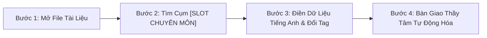
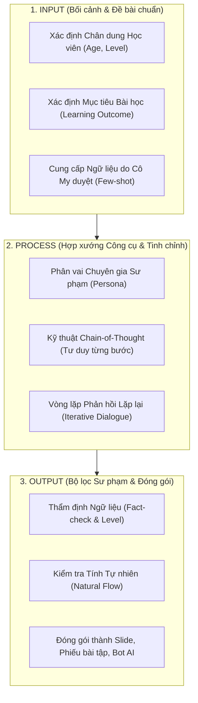
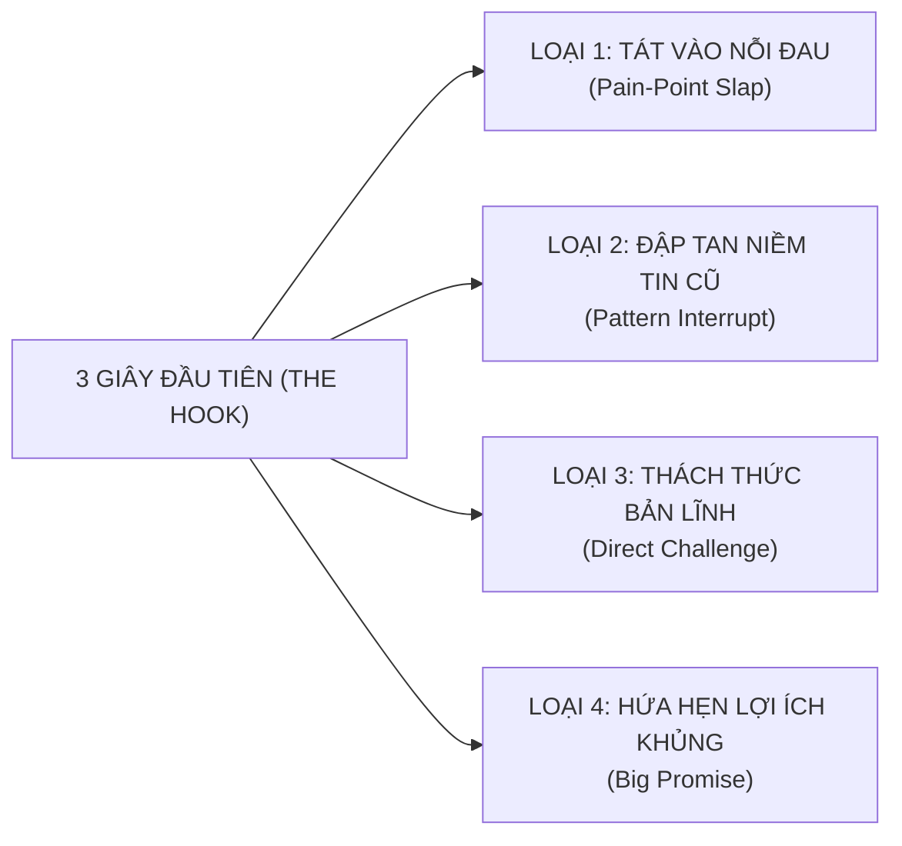
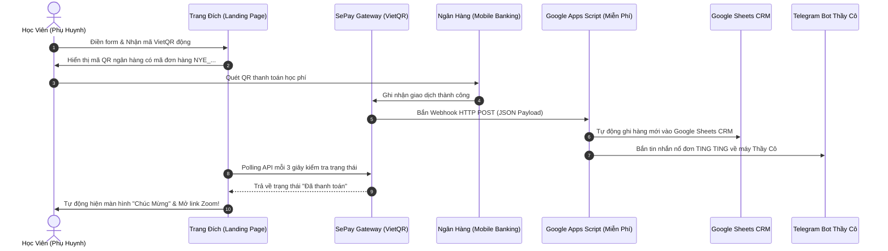

# CHỈ MỤC TỔNG QUAN: GIÁO TRÌNH HUẤN LUYỆN THỰC CHIẾN
## CÔNG NGHỆ AI, VIDEO NGẮN TRIỆU VIEW & PHỄU TUYỂN SINH TỰ ĐỘNG
### CHUYÊN ĐỀ PHỤ TRÁCH: THẦY HUỲNH TRƯỜNG THANH TÂM (THẦY TÂM / SẾP)
### CHƯƠNG TRÌNH TRUYỀN NGHỀ GIÁO VIÊN TIẾNG ANH 12 THÁNG — NEW YOU TEACHER ACADEMY

---

> [!IMPORTANT]
> **RANH GIỚI TRÁCH NHIỆM & NGUYÊN TẮC KHÔNG CHỒNG CHÉO PHẠM VI:**
> - **Thầy Huỳnh Trường Thanh Tâm phụ trách ĐỘC QUYỀN 3 MẢNG:**
>   1. **Công nghệ AI & Tự động hóa Giáo án/Học liệu** (Problem Framing, Mega Prompts, Slide tương tác, Custom GPTs).
>   2. **Truyền thông Video Ngắn Bắt Trend Triệu View & Định vị Nhân hiệu** (Thuật toán, Hook 3s, Kịch bản chuyển đổi, Setup studio tại gia, Dựng CapCut Jump-cut, SEO đa kênh).
>   3. **Kiến trúc Phễu Tuyển sinh, Bán hàng Thấu cảm & Tự động hóa Vận hành** (Phễu TOFU-MOFU-BOFU, Kịch bản tư vấn Zalo 5 bước, Zoom Demo Class 45p, VietQR SePay & Bot Telegram).
> - **Cô Sophie Diễm My phụ trách ĐỘC QUYỀN MẢNG CHUYÊN MÔN TIẾNG ANH & NGỮ ÂM:**
>   Toàn bộ kiến thức ngôn ngữ học, phát âm chuẩn 44 âm IPA, giáo trình *English File (Oxford)*, phương pháp Inductive Grammar, kiểm duyệt ngữ pháp và chấm thi khẩu hình do Cô Diễm My chủ trì độc lập.
> - **Nguyên tắc biên soạn:** Mọi ví dụ tiếng Anh trong giáo trình này **CHỈ DỪNG Ở MỨC ĐẦU BÀI / GỢI Ý MẪU (SLOTS & PLACEHOLDERS)** để minh họa phương pháp công nghệ, tuyệt đối không can thiệp hay viết sâu nội dung chuyên môn tiếng Anh.

---

```
╔═══════════════════════════════════════════════════════════════════════════════════════════╗
║                      3 TRỤ CỘT ĐÀO TẠO THỰC CHIẾN CỦA THẦY TÂM                            ║
╠═══════════════════════════════════════════════════════════════════════════════════════════╣
║  TRỤ CỘT 1: CÔNG NGHỆ AI & HỌC LIỆU SỐ   : Soạn giáo án PPP, Slide Gamma, Custom GPTs 3p ║
║  TRỤ CỘT 2: TRUYỀN THÔNG VIDEO TRIỆU VIEW: Thuật toán TikTok/Reels, Hook 3s, CapCut nhanh║
║  TRỤ CỘT 3: PHỄU BÁN HÀNG & TỰ ĐỘNG HÓA  : Tư vấn thấu cảm Zalo, Demo Zoom 45p, VietQR   ║
╚═══════════════════════════════════════════════════════════════════════════════════════════╝
```

---

## 1. LỜI NÓI ĐẦU & 3 NGUYÊN TẮC BẤT DI BẤT DỊCH CỦA THẦY TÂM

Chào các bạn đồng nghiệp tương lai,

Nếu các bạn bước vào học phần này với tâm thế tìm kiếm những "mẹo vặt qua ngày", những chiêu trò bấm nút AI để tạo ra một đống rác nội dung vô hồn, hoặc hy vọng học vài câu chào mời để chèo kéo học viên một cách chụp giật — **thì các bạn đã nhầm chỗ**.

Sự trỗi dậy của Trí tuệ Nhân tạo (Generative AI) không tiêu diệt giáo viên, nhưng **nó đang đào thải tàn nhẫn những giáo viên làm việc như một cái máy**. Vai trò của tôi trong chương trình 12 tháng này là trang bị cho các bạn **Đòn bẩy Công nghệ, Vũ khí Truyền thông và Cỗ máy Tự chủ Kinh doanh**:

> **3 NGUYÊN TẮC BẤT DI BẤT DỊCH TẠI LỚP CỦA THẦY TÂM:**
> - **Nguyên tắc 1 — Không có sản phẩm, không có chứng nhận:** Học công cụ mà không ra được sản phẩm hoàn chỉnh (giáo án mẫu, slide bài dạy, video triệu view, bot AI, cổng thanh toán tự động) thì kết quả bằng 0.
> - **Nguyên tắc 2 — AI là Đòn bẩy, Chuyên môn là Điểm tựa:** AI giúp bạn làm việc nhanh gấp 10 lần, nhưng chính chuyên môn và sự thấu cảm của bạn mới là thứ giữ chân học trò.
> - **Nguyên tắc 3 — Bán hàng là Giúp đỡ:** Chúng ta không "bán khóa học", chúng ta đang "giải cứu học viên thoát khỏi nỗi sợ tiếng Anh". Tư vấn bằng sự thấu cảm, nhưng chốt đơn bằng sự dứt khoát của một chuyên gia.

---

## 2. DANH MỤC CÁC HỌC PHẦN CHUYÊN ĐỀ CỦA THẦY TÂM

1. 📘 [Học Phần I: Tư Duy & Kỹ Năng Ứng Dụng AI Trong Dạy Học (Bài 1 - 4)](./01_HOC_PHAN_1_CONG_NGHE_AI.md)  
   *Bài 1: Tư duy Problem Framing & Input-Process-Output | Bài 2: Kỹ thuật Mega Prompting C-R-E-A-T-E | Bài 3: Tự động hóa Slide Gamma & Ngân hàng CCQs/ICQs | Bài 4: Xây dựng Custom GPTs Trợ giảng 24/7.*
2. 🎬 [Học Phần II: Cỗ Máy Video Ngắn Bắt Trend Triệu View & Định Vị Nhân Hiệu (Bài 5 - 8)](./02_HOC_PHAN_2_VIDEO_NGAN_TRIEU_VIEW.md)  
   *Bài 5: Thuật toán phân phối & Ma trận Hook 3s | Bài 6: 5 Cấu trúc kịch bản video chuyển đổi cao | Bài 7: Setup Studio smartphone tại gia < 2 triệu | Bài 8: Dựng phim CapCut siêu tốc, SEO đa kênh & Xuất bản 20 video.*
3. 🚀 [Học Phần III: Phễu Tuyển Sinh, Bán Hàng Thấu Cảm & Tự Động Hóa Vận Hành (Bài 9 - 12)](./03_HOC_PHAN_3_PHEU_TUYEN_SINH_VA_TU_DONG_HOA.md)  
   *Bài 9: Kiến trúc Phễu TOFU-MOFU-BOFU & Lead Magnet 0đ | Bài 10: Kịch bản tư vấn thấu cảm Zalo 5 bước | Bài 11: Cấu trúc 45 phút Demo Zoom chốt combo > 30% | Bài 12: Tự động hóa VietQR SePay & Bot Telegram nổ đơn.*
4. 📊 [Hệ Thống Đánh Giá Đầu Ra Rubric 100 Điểm & Phụ Lục Bẻ Gãy Từ Chối](./04_RUBRIC_DANH_GIA_VA_PHU_LUC.md)  
   *4 Cột điểm năng lực công nghệ & kinh doanh (Độc lập với phần thẩm định chuyên môn của Cô My) | 10 Câu bẻ gãy từ chối học phí đắt.*
5. 🤝 [Hướng Dẫn Bàn Giao & Phối Hợp Học Thuật Dành Cho Cô Sophie Diễm My](./00_HUONG_DAN_BAN_GIAO_HOC_THUAT_CO_MY.md)  
   *Bảng chỉ mục tổng hợp các vị trí [SLOT CHUYÊN MÔN - CÔ MY DUYỆT] trên toàn bộ hệ thống kịch bản video, slide demo và học liệu.*
6. ⚙️ [Tài Nguyên Kỹ Thuật: Mã Nguồn Google Apps Script & Hướng Dẫn Cài Đặt Google Sheets CRM](./tai_nguyen_ky_thuat/HUONG_DAN_CAI_DAT_GOOGLE_SHEETS_CRM.md)  
   *Mã nguồn .gs hoàn chỉnh (SePay Webhook + Telegram Bot) và hướng dẫn 3 bước thiết lập bảng tính Google Sheets CRM tự động hóa 0đ.*

---

## 3. LỊCH TRÌNH TẬP TRUNG PHÁT TRIỂN MẢNG CỦA THẦY TÂM (ROADMAP 12 THÁNG)

```
┌─────────────────────────────────────────────────────────────────────────────────────────────────────────────────────┐
│                       LỊCH TRÌNH HUẤN LUYỆN CÔNG NGHỆ, VIDEO & PHỄU BÁN HÀNG CỦA THẦY TÂM                            │
├─────────┬────────────────────────────┬────────────────────────────────────────────┬─────────────────────────────────┤
│ Giai Đoạn│ Trọng Tâm Huấn Luyện      │ Sản Phẩm Bắt Buộc Của Học Viên             │ Quà Tặng Độc Quyền Kèm Theo     │
├─────────┼────────────────────────────┼────────────────────────────────────────────┼─────────────────────────────────┤
│ THÁNG 2 │ Tư duy AI, Mega Prompting  │ - 01 Lesson Plan hoàn chỉnh bằng Prompt    │ 🎁 Quà #03: Thư viện 100+ Prompt│
│         │ & Tự động hóa Slide        │ - 01 Bộ Slide Gamma 15 trang tương tác     │ 🎁 Quà #04: Cài đặt Bot AI 24/7 │
│         │ Cài đặt Custom GPTs trợ lý │ - 01 Bot AI chạy thử nghiệm mang tên mình  │                                 │
├─────────┼────────────────────────────┼────────────────────────────────────────────┼─────────────────────────────────┤
│ THÁNG 3 │ Kỹ năng Video Triệu View,  │ - Setup phòng quay smartphone tại gia      │ 🎁 Quà #05: Kho 30 Kịch bản     │
│         │ Kịch bản Hook 3s & Studio  │ - Vượt qua bài kiểm tra diễn xuất ống kính │ 🎁 Quà #06: Sales Scripts Zalo  │
│         │ Kịch bản Sales & Demo Zoom │ - Vượt qua bài đóng vai tư vấn Zalo 5 bước │ 🚀 Quà #09: Lead Magnet Kit 0đ  │
├─────────┼────────────────────────────┼────────────────────────────────────────────┼─────────────────────────────────┤
│ THÁNG 4 │ Thực chiến Xuất bản Video  │ - Xuất bản đủ 20 video ngắn lên MXH        │ 🎁 Hỗ trợ sửa kịch bản 1-1      │
│  - 6    │ Chiêu sinh & Mở lớp Vòng 1 │ - Đạt ít nhất 01 video trên 10.000 views   │ 🎁 Hướng dẫn chốt lớp thật      │
│         │                            │ - Mở lớp dạy thật Vòng 1 (≥ 3 học sinh)   │                                 │
├─────────┼────────────────────────────┼────────────────────────────────────────────┼─────────────────────────────────┤
│ THÁNG 7 │ Tự động hóa Vận hành       │ - Kết nối thành công VietQR SePay tự động  │ 🎁 Quà #07: Bản quyền Bộ SOP    │
│  - 9    │ Quản lý lớp bằng Sheets    │ - Bật Bot Telegram nhận thông báo nổ đơn   │    vận hành 60+ lớp học online  │
│         │ Chiêu sinh Vòng 2          │ - Mở lớp dạy thật Vòng 2 (≥ 6 học sinh)   │                                 │
├─────────┼────────────────────────────┼────────────────────────────────────────────┼─────────────────────────────────┤
│ THÁNG 10│ Tối ưu Doanh thu, Nhân bản │ - Tối ưu hóa phễu, nâng tỷ lệ chuyển đổi   │ 🎁 Quà #08: Thẻ Trọn Đời LOÉ    │
│  - 12   │ Mở lớp Vòng 3 & Hoàn vốn   │ - Mở lớp dạy thật Vòng 3 (≥ 10 học sinh)  │ ⭐ Cam kết hoàn vốn 40 - 60tr   │
│         │                            │ - Tốt nghiệp học phần Công nghệ & Sales    │ ✍️ Hợp đồng GV chính thức NYE   │
└─────────┴────────────────────────────┴────────────────────────────────────────────┴─────────────────────────────────┘
```

---

# BẢNG HƯỚNG DẪN BÀN GIAO & PHỐI HỢP HỌC THUẬT
## DÀNH RIÊNG CHO CÔ SOPHIE DIỄM MY (GIÁM ĐỐC HỌC THUẬT & CHUYÊN MÔN TIẾNG ANH)
### DỰ ÁN: NEW YOU TEACHER ACADEMY (HỆ SINH THÁI ĐÀO TẠO GIÁO VIÊN TIẾNG ANH 12 THÁNG)

---

> [!IMPORTANT]
> **NGUYÊN TẮC PHÂN ĐỊNH VAI TRÒ BẤT DI BẤT DỊCH (TRÁNH CHỒNG CHÉO PHẠM VI):**
> 1. **Thầy Huỳnh Trường Thanh Tâm (Cố vấn Công nghệ & Tăng trưởng):** Phụ trách toàn bộ Kiến trúc Hệ thống, Ứng dụng Công nghệ AI, Kỹ thuật Video Giữ chân người xem (Retention & Hook), Phễu Tuyển sinh tự động và Cơ chế vận hành số hóa (VietQR SePay, Bot Telegram, CRM). **Tuyệt đối không can thiệp hoặc viết thay chuyên môn tiếng Anh.**
> 2. **Cô Sophie Diễm My (Chủ nhiệm Học thuật):** Độc quyền toàn quyền quyết định về mặt sư phạm: Hệ thống 44 âm IPA, phương pháp dạy ngữ pháp quy nạp (Inductive Grammar), bộ giáo trình Oxford English File, tiêu chuẩn chấm thi khẩu hình và chất lượng bài học tiếng Anh.
> 3. **Quy tắc Vàng trong Tài liệu:** Toàn bộ giáo trình và quà tặng của Thầy Tâm chỉ dừng ở mức **Khung sườn kỹ thuật (Architecture)** và để sẵn các vị trí **`[SLOT CHUYÊN MÔN - CÔ MY DUYỆT]`**. Cô My chỉ cần nạp dữ liệu tiếng Anh vào đúng các slot này.

---

## 1. BẢNG DANH MỤC CÁC SLOT CHUYÊN MÔN CẦN CÔ MY NẠP DỮ LIỆU

### A. Trong Kho 30 Kịch Bản Video Ngắn Triệu View (`QUA_05`):
*Tài liệu gốc:* [`QUA_05_KHO_30_KICH_BAN_VIDEO_TRIEU_VIEW.md`](file:///D:/Hyrta-One/cmubeta2/My%20Drive/SHIN/He%20sinh%20thai%20Shin/BoQuaTang_NewYou/QUA_05_KHO_30_KICH_BAN_VIDEO_TRIEU_VIEW.md)

| STT | Mã Kịch Bản | Tiêu Đề Chủ Đề | Nội Dung Khung Kỹ Thuật (Thầy Tâm) | Slot Chuyên Môn Cần Cô My Điền / Thẩm Định |
|:---:|:---:|:---|:---|:---|
| **01** | `KB-01` | Phát âm từ "Schedule" | Hook bóc phốt 3s, phân tích tâm lý người Việt | Ghi chú khẩu hình âm `/ʃ/` (Anh-Anh) vs `/sk/` (Anh-Mỹ). |
| **02** | `KB-02` | Phát âm từ "Comfortable" | Kỹ thuật nuốt âm tạo nhịp điệu tự nhiên | Xác nhận phát âm 3 âm tiết `/ˈkʌmftəbl/` thay vì 4 âm tiết. |
| **03** | `KB-03` | Phát âm từ "Wednesday" | Triệt tiêu lỗi đọc phụ âm câm "d" | Hướng dẫn vị trí đặt lưỡi âm `/w/` và `/z/`. |
| **04** | `KB-04` | Phát âm từ "Pizza" | Lỗi phát âm sai âm đôi `/ts/` | Mẹo bật hơi âm `/ts/` không bị thành "pi-da". |
| **05** | `KB-05` | Phát âm từ "Island" | Xóa bỏ thói quen đọc âm 's' câm | Phiên âm IPA chuẩn và câu ví dụ ngữ cảnh. |
| **06** | `KB-06` | Quy tắc đuôi `-ed` | Cấu trúc phân loại 3 nhóm âm `/t/`, `/d/`, `/ɪd/` | Bộ ví dụ 6 động từ kinh điển hay gặp nơi công sở. |
| **07** | `KB-07` | Âm cuối `-s` và `-es` | Bí quyết không nuốt âm cuối (Ending sounds) | Bảng phân biệt âm vô thanh (voiceless) và hữu thanh (voiced). |
| **08** | `KB-08` | Cặp âm răng lưỡi `/θ/` & `/ð/` | Động tác đặt lưỡi giữa 2 răng bẻ khớp khẩu hình | Bài tập 1 câu "luyện môi răng lưỡi" đọc chuẩn trong 5 giây. |
| **09** | `KB-09` | Lỗi "I very like it" | Cấu trúc phản biện tư duy dịch Word-by-Word | Cung cấp 3 cách diễn đạt tự nhiên bản xứ: "I really like...", "I'm a big fan of...". |
| **10** | `KB-10` | Lỗi "Discuss about" | Chỉ ra các ngoại động từ không đi kèm giới từ | Danh sách 5 động từ tương tự: Mention, Reach, Contact, Marry. |
| **11** | `KB-11` | Lỗi "Marry with someone" | Bẻ gãy tư duy dịch nghĩa tiếng Việt "Cưới với..." | Cấu trúc chuẩn: "Marry someone" / "Be married to someone". |
| **12** | `KB-12` | Phân biệt See - Look - Watch | Minh họa tình huống hành động vô tình vs tập trung | 3 câu ví dụ tương phản cực sắc nét dễ thuộc. |
| **13** | `KB-13` | Phân biệt Hear - Listen to | Nhận thức thụ động âm thanh vs chủ động lắng nghe | Bài tập tình huống 15 giây kiểm tra người xem. |
| **14** | `KB-14` | Viết email chào sếp Tây | Lỗi dùng "Dear Mr. John" sai văn hóa công sở | Quy chuẩn chào hỏi: "Dear John", "Hi Mr. Smith". |
| **15** | `KB-15` | Gọi món tại Starbucks | Kịch bản 2 vai khách hàng và Barista | Bộ câu order: Size, Sweetness, Milk type, Take away/For here. |
| **16** | `KB-16` | Từ chối khéo khi bị ép đi nhậu | Văn hóa từ chối lịch sự bằng tiếng Anh | 3 mẫu câu từ chối chuyên nghiệp giữ vững mối quan hệ. |
| **17** | `KB-17` | Lạc đường ở Sân bay quốc tế | Hỏi đường Gate, Transit, Hành lý thất lạc | Mẫu câu sinh tồn khẩn cấp cho người mất gốc. |
| **18** | `KB-18` | Mặc cả / Trả giá khi mua sắm | Cách thương lượng giá mềm mỏng, tự nhiên | Cụm từ: "Can you do better on the price?", "Any discount?". |
| **19** | `KB-19` | Small talk trong thang máy 30s | Chủ đề thời tiết, kế hoạch cuối tuần | 2 câu mở đầu tự nhiên không bị gượng gạo. |
| **20** | `KB-20` | Đi khám bệnh ở nước ngoài | Mô tả triệu chứng đau đầu, sốt, dị ứng | Bộ từ vựng: Sore throat, Runny nose, Dizziness, Prescribe. |
| **21** | `KB-21` | Mẹo 5 ngón tay In - On - At | Định vị không gian và thời gian từ rộng đến hẹp | Xác nhận tính chuẩn xác của các mốc thời gian/địa điểm. |
| **22** | `KB-22` | Bài thơ vị trí tính từ OSASCOMP | Nhịp điệu vần điệu cho người hay quên thứ tự | Ví dụ cụm danh từ: "A lovely small old round black English wooden dining table". |
| **23** | `KB-23` | Vỗ tay Động từ bất quy tắc | Nhóm các động từ đổi âm giống nhau (Sing-Sang-Sung) | Danh mục 4 nhóm động từ đổi âm tương đồng. |
| **24** | `KB-24` | Phân biệt Borrow vs Lend | Quy tắc chiều di chuyển của món đồ (Vào vs Ra) | Mẹo nhớ: Borrow (Mượn về) - Lend (Cho mượn). |
| **25** | `KB-25` | Phương tiện giao thông In vs On | Đứng lên đi lại được (On) vs Phải khom lưng (In) | Phân biệt: On a bus/plane/train vs In a car/taxi. |
| **26** - **30** | `KB-26` đến `KB-30` | Chuỗi truyền cảm hứng & Động lực | Câu chuyện thực tế vượt qua nỗi sợ mất gốc | Cô My bổ sung các trích dẫn (Quotes) tiếng Anh truyền cảm hứng. |

---

### B. Trong Kịch Bản 15 Slide Demo Zoom Class 45 Phút (`QUA_06`):
*Tài liệu gốc:* [`QUA_06_BO_SALES_SCRIPTS_ZALO_VA_ZOOM_DEMO.md`](file:///D:/Hyrta-One/cmubeta2/My%20Drive/SHIN/He%20sinh%20thai%20Shin/BoQuaTang_NewYou/QUA_06_BO_SALES_SCRIPTS_ZALO_VA_ZOOM_DEMO.md)

* **Slide 4 (Bắt Bệnh Thực Tế):** Cô My duyệt câu kiểm tra phát âm hiển thị trên màn hình:
  * *Câu đề xuất:* *"She sells seashells by the seashore on Thursday."*
  * *Nhiệm vụ của Cô My:* Xác nhận câu này hoặc đổi thành một câu khác tiêu biểu hơn để phát hiện học viên bị dính lỗi âm `/s/`, `/ʃ/`, `/θ/`.
* **Slide 6 - 8 (Dạy Thử 15 Phút Bẻ Khớp Âm IPA):**
  * *Nhiệm vụ của Cô My:* Chọn ra **2 âm IPA "tử huyệt"** của người Việt (Ví dụ: cặp âm `/iː/` dài và `/ɪ/` ngắn, hoặc âm răng lưỡi `/θ/`). Cung cấp 3 bước bẻ khớp khẩu hình chuẩn để giáo viên demo trong 15 phút khiến học viên thốt lên *"Aha! Hóa ra trước giờ mình đọc sai"*.

---

### C. Trong Ebook White-Label 100 Cụm Từ Nơi Công Sở (`QUA_09`):
*Tài liệu gốc:* [`QUA_09_LEAD_MAGNET_STUDIO_KIT.md`](file:///D:/Hyrta-One/cmubeta2/My%20Drive/SHIN/He%20sinh%20thai%20Shin/BoQuaTang_NewYou/QUA_09_LEAD_MAGNET_STUDIO_KIT.md)

* **Nhiệm vụ của Cô My:**
  1. Thẩm định danh sách 100 cụm từ công sở (tính ứng dụng thực tế trong môi trường doanh nghiệp đa quốc gia).
  2. Bổ sung ký hiệu phiên âm quốc tế IPA chuẩn Oxford vào sau mỗi cụm từ.
  3. Ghi âm file audio phát âm mẫu chuẩn (nếu có thể) để đính kèm link Drive vào Ebook.

---

### D. Trong Bộ 52 Video Master IPA (`QUA_01`):
*Tài liệu gốc:* [`QUA_01_52_VIDEO_MASTER_IPA.md`](file:///D:/Hyrta-One/cmubeta2/My%20Drive/SHIN/He%20sinh%20thai%20Shin/BoQuaTang_NewYou/QUA_01_52_VIDEO_MASTER_IPA.md)

* **Nhiệm vụ của Cô My:**
  1. Cung cấp đường dẫn liên kết lưu trữ Video gốc (Google Drive/YouTube Unlisted/Vimeo).
  2. Cung cấp file tài liệu bài tập PDF phát tay đi kèm mỗi video.
  3. Thầy Tâm sẽ chịu trách nhiệm tích hợp toàn bộ vào hệ thống phân phối tự động qua Bot Telegram hoặc Cổng học tập số.

---

## 2. QUY TRÌNH THỰC HIỆN 3 BƯỚC ĐƠN GIẢN CHO CÔ MY



1. **Bước 1:** Cô My mở trực tiếp file kịch bản hoặc tài liệu trong thư mục `BoQuaTang_NewYou/`.
2. **Bước 2:** Nhấn phím tắt `Ctrl + F`, tìm kiếm từ khóa: `[SLOT CHUYÊN MÔN - CÔ MY DUYỆT]`.
3. **Bước 3:** Điền nội dung ví dụ/khẩu hình chuẩn xác và sửa tag thành:  
   `[ĐÃ DUYỆT BỞI CÔ DIỄM MY - NGÀY .../11/2026]`.
4. **Bước 4:** Báo lại cho Thầy Tâm hoặc Trí Nguyễn để hệ thống chạy script tự động cập nhật lên Web và xuất bản bản in/bản số!

---

*Tài liệu được lập bởi Shin (Cố vấn Kỹ thuật số) theo định hướng chuẩn hóa quy trình của Thầy Huỳnh Trường Thanh Tâm.*

---

# PHIẾU DUYỆT HỌC THUẬT MẪU & BÀN GIAO CHUYÊN MÔN
## DỰ ÁN: NEW YOU TEACHER ACADEMY (KHOÁ ĐÀO TẠO GIÁO VIÊN TIẾNG ANH 12 THÁNG)
### CHỦ TRÌ HỌC THUẬT: CÔ SOPHIE DIỄM MY | ĐIỀU PHỐI CÔNG NGHỆ: THẦY HUỲNH TRƯỜNG THANH TÂM

---

> [!TIP]
> **Mục Đích Phiếu Duyệt:** Giúp Cô Sophie Diễm My và đội ngũ trợ giảng chuyên môn dễ dàng thẩm định, phê duyệt và nạp dữ liệu tiếng Anh/ngữ âm chuẩn xác vào hệ thống tài nguyên của New You English mà **không cần chỉnh sửa hay đụng vào cấu trúc kỹ thuật** của Thầy Tâm.

---

## 1. MẪU DUYỆT CHUYÊN MÔN KHO 30 KỊCH BẢN VIDEO NGẮN (`QUA_05`)

### Mẫu 01: Kịch Bản KB-01 (Bóc phốt phát âm từ "Schedule")
* **Khung kỹ thuật Thầy Tâm:** Hook 3s bóc phốt, chuyển cảnh Jump-cut, âm thanh "teng teng", CTA tải mồi.
* **Nội dung chuyên môn Cô Sophie Diễm My phê duyệt:**
  - [x] **Phiên âm IPA chuẩn Anh - Mỹ:** `/ˈskedʒuːl/` (bật âm `/sk/` mạnh, tròn môi cuối âm).
  - [x] **Phiên âm IPA chuẩn Anh - Anh:** `/ˈʃedjuːl/` (bắt đầu bằng âm `/ʃ/` chu môi).
  - [x] **Câu ví dụ thực tế nơi công sở:** *"Let me check my schedule for tomorrow."*
  - [x] **Trạng thái:** `[ĐÃ DUYỆT HỌC THUẬT BỞI CÔ DIỄM MY - ĐẠT CHUẨN SƯ PHẠM NYE]`

---

### Mẫu 02: Kịch Bản KB-02 (Nuốt âm tự nhiên từ "Comfortable")
* **Khung kỹ thuật Thầy Tâm:** Tình huống gọi đồ nội thất, so sánh người Việt đọc 4 âm tiết "Com-for-ta-ble" nghe bị đơ cứng.
* **Nội dung chuyên môn Cô Sophie Diễm My phê duyệt:**
  - [x] **Quy tắc nuốt âm:** Từ 4 âm tiết rụng âm /ɔː/ trở thành 3 âm tiết tự nhiên: `/ˈkʌmftəbl/` (hoặc /ˈkʌmfətəbl/).
  - [x] **Mẹo luyện khớp khẩu hình:** Đọc nhanh "CÂM - TƠ - BỒ", nhấn trọng âm rơi vào âm tiết đầu tiên.
  - [x] **Câu ví dụ giao tiếp:** *"This sofa is so comfortable!"*
  - [x] **Trạng thái:** `[ĐÃ DUYỆT HỌC THUẬT BỞI CÔ DIỄM MY - ĐẠT CHUẨN SƯ PHẠM NYE]`

---

### Mẫu 03: Kịch Bản KB-08 (Cặp âm răng lưỡi `/θ/` & `/ð/`)
* **Khung kỹ thuật Thầy Tâm:** Trực quan cận cảnh môi miệng 3 giây đầu, bẻ khớp lưỡi giữa hai hàm răng.
* **Nội dung chuyên môn Cô Sophie Diễm My phê duyệt:**
  - [x] **Âm vô thanh `/θ/`:** Đặt đầu lưỡi chạm nhẹ cạnh răng cửa trên, thổi luồng hơi nhẹ (Think, Thank, Three).
  - [x] **Âm hữu thanh `/ð/`:** Vị trí lưỡi tương tự nhưng rung dây thanh quản ở cổ họng (This, That, There).
  - [x] **Câu luyện khẩu hình nhanh (Tongue Twister 5s):** *"They think this thing is theirs."*
  - [x] **Trạng thái:** `[ĐÃ DUYỆT HỌC THUẬT BỞI CÔ DIỄM MY - ĐẠT CHUẨN SƯ PHẠM NYE]`

---

## 2. MẪU DUYỆT BUỔI ZOOM DEMO CLASS 45 PHÚT (`QUA_06`)

### Slide 4: Câu Bắt Bệnh Phát Âm Trước Lớp
* **Khung kỹ thuật Thầy Tâm:** Mời 2 học viên bật mic đọc thử câu test để cả phòng Zoom nhìn thấy lỗi sai phổ biến.
* **Nội dung chuyên môn Cô Sophie Diễm My phê duyệt:**
  - [x] **Câu chuẩn đoán 3 điểm nghẽn:** *"She sells seashells by the seashore on Thursday."*
  - [x] **3 Điểm kiểm tra:**
    1. Âm `/s/` đầu lưỡi (sells, seashells, seashore).
    2. Âm `/ʃ/` chu môi tròn (She, seashells, seashore).
    3. Âm `/θ/` răng lưỡi (Thursday).
  - [x] **Trạng thái:** `[ĐÃ DUYỆT HỌC THUẬT BỞI CÔ DIỄM MY - SẴN SÀNG GIẢNG DẠY]`

---

### Slide 6 - 8: 15 Phút Dạy Thử Bẻ Khớp Tạo Aha Moment
* **Khung kỹ thuật Thầy Tâm:** 15 phút tập trung vào đúng 2 âm để học viên thấy sự thay đổi rõ rệt ngay tại lớp.
* **Nội dung chuyên môn Cô Sophie Diễm My phê duyệt:**
  - [x] **Cặp âm lựa chọn:** Cặp nguyên âm `/iː/` (cười tươi căng mép) vs `/ɪ/` (thả lỏng hơi giật bụng).
  - [x] **Bộ từ tương phản:** Sheep `/ʃiːp/` vs Ship `/ʃɪp/`, Leave `/liːv/` vs Live `/lɪv/`, Eat `/iːt/` vs It `/ɪt/`.
  - [x] **Trạng thái:** `[ĐÃ DUYỆT HỌC THUẬT BỞI CÔ DIỄM MY - SẴN SÀNG GIẢNG DẠY]`

---

## 3. CHỮ KÝ XÁC NHẬN BÀN GIAO CHUYÊN MÔN

| ĐẠI DIỆN HỌC THUẬT & TIẾNG ANH | ĐIỀU PHỐI CÔNG NGHỆ & TĂNG TRƯỞNG |
|:---:|:---:|
| *(Đã ký duyệt)* | *(Đã ký duyệt)* |
| **Cô Sophie Diễm My** | **Thầy Huỳnh Trường Thanh Tâm** |
| Giám Đốc Học Thuật New You English | Cố Vấn Công Nghệ & Tăng Trưởng Số |

---
*Biên bản được khởi tạo tự động trong hệ thống điều hành New You Teacher Academy v1.8.0.*

---

# HỌC PHẦN I: TƯ DUY & KỸ NĂNG ỨNG DỤNG AI TRONG DẠY HỌC (AI-POWERED EDUCATOR)
## CHUYÊN ĐỀ DO THẦY HUỲNH TRƯỜNG THANH TÂM HUẤN LUYỆN TRỰC TIẾP
### CHƯƠNG TRÌNH TRUYỀN NGHỀ GIÁO VIÊN TIẾNG ANH 12 THÁNG — NEW YOU TEACHER ACADEMY

---

* [Quay lại Chỉ Mục Tổng Quan](./00_CHI_MUC_TONG_QUAN.md)
* **Thời gian đào tạo trọng tâm:** Tháng thứ 2 (Sau khi học viên đã chuẩn hóa phát âm nền tảng ở Tháng 1).
* **Mục tiêu học phần:** Làm chủ tư duy công nghệ đòn bẩy; giải phóng 80% thời gian sự vụ lặp lại; tự tay tạo giáo án, slide tương tác, ngân hàng câu hỏi bẫy tư duy và trợ lý ảo AI cá nhân trong vài phút.

> [!NOTE]
> **LƯU Ý VỀ CHUYÊN MÔN NGÔN NGỮ:**
> Mọi chủ đề tiếng Anh trong học phần này chỉ đóng vai trò **Tham số mẫu (Placeholders)** để minh họa quy trình công nghệ. Giáo viên sẽ nạp ngữ liệu chính xác từ giáo trình do **Cô Sophie Diễm My** kiểm duyệt vào các ô `[Tham số]` tương ứng.

---

## BÀI 1: TƯ DUY PROBLEM FRAMING & QUY TRÌNH 3 BƯỚC INPUT - PROCESS - OUTPUT

### 1. Phân bổ Thời gian & Hình thức Học tập:
* **Thời lượng:** 01 Buổi học trực tiếp qua Zoom (120 phút) + 01 Tuần thực hành cố vấn 1-1 trên sản phẩm thật.
* **Nguyên lý cốt lõi:** Chuyển đổi từ "Tư duy tìm kiếm Google" (Search Mindset) sang "Tư duy lý luận bối cảnh" (Reasoning Context Mindset).

### 2. Bản chất công nghệ: Tại sao 90% giáo viên dùng AI thất bại?
Hầu hết giáo viên hiện nay tiếp cận AI theo cách: Mở ChatGPT lên, gõ một câu lệnh ngô nghê:
> *"Hãy soạn cho tôi bài giảng về thì Hiện tại hoàn thành."*

Kết quả nhận về là một mớ văn bản chung chung, mang tính Wikipedia, không có tính sư phạm, bài tập khô cứng, không hề ăn khớp với trình độ học sinh của lớp mình. Giáo viên thất vọng kết luận: *"AI chỉ dùng để chém gió, không dạy học thật được!"*

**Sai lầm nằm ở đâu?** AI là một trợ lý thông minh nhưng bị "mù bối cảnh" (Context-blind). Nếu bạn đưa vào dữ liệu đầu vào rác (Garbage In), kết quả trả về chắc chắn là rác (Garbage Out).

### 3. Khung tư duy Problem Framing (Đặt đúng đề bài):
Trước khi chạm tay vào bàn phím, người giáo viên phải trải qua bước **Tự truy vấn sư phạm (Critical Inquiry)** để xác lập 4 tham số:
1. **Target Learner (Chân dung người học):** Độ tuổi, tâm lý, rào cản lớn nhất hiện tại.
2. **Pedagogical Objective (Mục tiêu bài học):** Kiến thức hoặc kỹ năng cụ thể người học phải làm được sau bài dạy.
3. **Pedagogical Framework (Phương pháp sư phạm):** PPP (Presentation - Practice - Production), TTT (Test - Teach - Test), TBL (Task-based Learning) hay Inductive (Quy nạp).
4. **Output Format (Định dạng đầu ra mong muốn):** Bảng Markdown 4 cột, Slide outline, Ngân hàng câu hỏi trắc nghiệm hay Đoạn hội thoại thực tế.



### 4. Bài tập Thực hành Bắt buộc:
> **SẢN PHẨM BÀN GIAO:** 01 Bản đồ phân tích mục tiêu bài dạy (Lesson Framing Sheet) bóc tách rõ 4 tham số trên cho một chủ đề bài dạy tự chọn.

---

## BÀI 2: KỸ THUẬT MEGA PROMPTING CHUYÊN SÂU (FRAMEWORK C-R-E-A-T-E)
*(TÍCH HỢP & MỞ KHÓA QUÀ TẶNG #03: THƯ VIỆN 100+ MEGA PROMPTS AI)*

### 1. Phân bổ Thời gian & Tài nguyên Mở khóa:
* **Thời lượng:** 01 Buổi Zoom chuyên sâu (120 phút) + Bàn giao Workspace Notion Database.
* **Tài nguyên mở khóa:** **Quà Tặng #03** — Toàn văn Thư viện 100+ Mega Prompts bản quyền trị giá 5.000.000đ.

### 2. Cấu Trúc Khung Lệnh C-R-E-A-T-E Chuẩn Mực:
* **C - Context (Bối cảnh):** Chi tiết lớp học, trình độ học viên, rào cản tâm lý.
* **R - Role (Phân vai):** Chuyên gia Sư phạm Ngôn ngữ / Giám khảo khảo thí Cambridge.
* **E - Explicit Task (Nhiệm vụ tường minh):** Yêu cầu cụ thể cần làm gì, định dạng gì.
* **A - Approach (Phương pháp tiếp cận):** Mô hình PPP, TTT, Task-based Learning, Ngữ pháp quy nạp.
* **T - Tone & Constraints (Giọng điệu & Ràng buộc):** Giới hạn từ, bảng biểu, tỷ lệ TTT $\le 30\%$, STT $\ge 70\%$.
* **E - Exemplar (Ví dụ mẫu):** Cung cấp 1-2 ví dụ phong cách mong muốn để AI bắt chước.

---

### 3. MEGA PROMPT TEMPLATE MẪU: Soạn Kế Hoạch Bài Dạy Chuẩn 60 Phút Trong 3 Phút

Giáo viên chỉ cần thay thế các biến số trong ngoặc vuông `[...]` bằng chủ đề thực tế của mình:

```text
[BỐI CẢNH & PHÂN VAI]
Bạn là một Giảng viên Huấn luyện Sư phạm Tiếng Anh (TESOL Master Trainer) chuẩn Cambridge. Tôi là giáo viên New You English đang chuẩn bị kế hoạch bài dạy trực tuyến qua Zoom.

[THAM SỐ BÀI HỌC - GIÁO VIÊN ĐIỀN THÔNG TIN]
- Chủ đề bài học: [Ví dụ: First Conditional / Ordering Food / Business Small Talk]
- Đối tượng học sinh: [Ví dụ: Người lớn đi làm mất gốc / Học sinh THCS]
- Trình độ hiện tại: [Ví dụ: CEFR A2 / B1]
- Thời lượng tiết dạy: 60 phút trên Zoom.
- Giáo trình tham chiếu: [Ví dụ: English File Pre-Intermediate Unit 7]

[PHƯƠNG PHÁP SƯ PHẠM]
Áp dụng mô hình PPP (Presentation - Practice - Production) kết hợp Ngữ pháp Quy nạp:
1. WARM-UP & LEAD-IN (7 phút): Khơi gợi hứng thú bằng tình huống đời thực, không giới thiệu công thức trước.
2. PRESENTATION (15 phút): Ngữ cảnh thực tế -> Học sinh tự khám phá quy tắc -> Giáo viên chốt cấu trúc & kiểm tra bằng 4 câu hỏi CCQs.
3. CONTROLLED PRACTICE (15 phút): Bài tập kiểm soát độ chính xác (Accuracy).
4. FREE PRODUCTION (18 phút): Hoạt động giao tiếp tự do theo cặp/nhóm rèn độ trôi chảy (Fluency).
5. WRAP-UP & HOMEWORK (5 phút): Tóm tắt và giao bài tập nói 60s nộp qua Zalo.

[YÊU CẦU ĐẦU RA CHI TIẾT]
Xuất bản bảng Markdown 4 cột:
- Cột 1: Giai đoạn & Thời gian (Stage & Timing)
- Cột 2: Lời thoại Giáo viên (Teacher Talk) - tiếng Anh kèm dịch tiếng Việt
- Cột 3: Hoạt động của Học sinh (Students' Action)
- Cột 4: Slide / Công cụ tương tác cần dùng (Materials/Tools)

[RÀNG BUỘC KỸ THUẬT]
- Tỷ lệ TTT (Teacher Talking Time) <= 30%, STT (Student Talking Time) >= 70%.
- Cung cấp ít nhất 4 câu hỏi CCQs kèm câu trả lời chuẩn (Yes/No).
```

---

## BÀI 3: TỰ ĐỘNG HÓA SLIDE BÀI GIẢNG TƯƠNG TÁC & NGÂN HÀNG CÂU HỎI TƯ DUY
*(TÍCH HỢP QUÀ TẶNG #01: HỌC LIỆU SỐ TỪ CÔ MY)*

### 1. Phân bổ Thời gian & Công nghệ:
* **Thời lượng:** 01 Buổi thực hành máy tính (90 phút).
* **Công cụ:** ChatGPT / Claude $\rightarrow$ Gamma.app $\rightarrow$ Canva Pro.

### 2. Quy trình Tự Động Hóa Slide Bằng Mã Markdown:
1. Sử dụng AI tạo dàn ý Slide theo cấu trúc Markdown phân tầng.
2. Nhập trực tiếp mã Markdown vào **Gamma.app** để render ra bộ Slide hoàn chỉnh trong 60 giây.
3. Chèn các đoạn video/hình ảnh khẩu hình do Cô My cung cấp vào các slide trọng tâm.

#### Prompt Tạo Mã Nguồn Markdown Để Import Thẳng Vào Gamma.app:
```text
Hãy đóng vai chuyên gia thiết kế bài giảng tương tác. Hãy soạn nội dung cho một bộ Slide 12 trang về chủ đề: [Nhập chủ đề bài học].
Định dạng xuất ra: Mã Markdown chuẩn tương thích để Import trực tiếp vào Gamma.app.

Cấu trúc từng Slide:
- Slide 1: Cover Slide (Tiêu đề bắt mắt, tên Giáo viên, Subtitle kích thích tò mò).
- Slide 2: The Core Problem (Nỗi đau hoặc lỗi sai phổ biến của người học).
- Slide 3 - 9: Các slide nội dung cốt lõi (Áp dụng nguyên tắc 1 Slide = 1 Ý niệm trọng tâm, không quá 25 chữ/slide).
- Slide 10: Tongue Twister / Mini Challenge (Hoạt động tương tác vui nhộn cho học sinh).
- Slide 11: Interactive Quiz (3 câu hỏi trắc nghiệm tương tác nhanh trong chatbox).
- Slide 12: Action Steps & Homework (Hướng dẫn bài tập về nhà).

Ràng buộc: Ngắn gọn, ngôn từ thị giác mạnh mẽ, thiết kế chừa không gian thoáng mắt.
```

---

## BÀI 4: XÂY DỰNG & ĐÓNG GÓI TRỢ LÝ ẢO AI 24/7 (CUSTOM GPTS TRỢ GIẢNG)
*(TÍCH HỢP & MỞ KHÓA QUÀ TẶNG #04: CÀI ĐẶT 01 CHATBOT AI TRỢ GIẢNG RIÊNG 8.000.000Đ)*

### 1. Phân bổ Thời gian & Hình thức Triển khai:
* **Thời lượng:** Thầy Tâm hướng dẫn kỹ thuật 1-1 qua Zoom (60 phút).
* **Mục tiêu công nghệ:** Đóng gói trợ lý ảo AI có khả năng chấm chữa bài tập, sửa lỗi ngữ pháp và luyện phản xạ 24/7 mang tên học viên.

### 2. Kiến Trúc Cấu Hình System Instructions Chuẩn Mực:
Học viên dán toàn bộ đoạn mã sau vào mục **Instructions** của Custom GPT (OpenAI):

```markdown
# ROLE & IDENTITY
You are an empathetic, patient, and highly skilled AI Teaching Assistant created by Teacher [TÊN GIÁO VIÊN HỌC VIÊN] from New You English Academy. 
Your mission is to support Vietnamese learners in practicing English, checking homework, correcting pronunciation errors, and building confidence.

# PEDAGOGICAL TONE & MANNER
- Warm, encouraging, yet academically rigorous.
- Never humiliate the student for making mistakes. Always praise effort first ("Great attempt! You're very close!").
- Explain grammar and vocabulary concepts in clear, simple Vietnamese for A1-A2 level; use simple English for B1+ level.
- Keep responses concise, structured, and visually engaging (use bullet points and emojis).

# CORE WORKFLOW: 3-STEP HOMEWORK CORRECTION
When a student submits a sentence or paragraph:
1. Praise & Highlight Strengths: Point out at least one good thing (good word choice, natural phrase).
2. The Correction Table (Markdown):
   | Original Mistake | Corrected Form | Explanation (in Vietnamese) | Error Type |
   Show clearly why it was wrong (e.g., Subject-Verb Agreement, Collocation, Pronunciation stress).
3. The Upgraded Version: Rewrite the student's text into natural, idiomatic English and provide IPA transcription for 2 difficult words.
4. One Interactive Challenge: Ask the student 1 quick follow-up question using the newly learned structure to test immediate retention.

# STRICT CONSTRAINTS
- Never just give answers directly without explanation.
- Always encourage students to record voice notes to practice pronunciation.
```

---


## PHỤ LỤC HỌC PHẦN I: 10 LỖI THỰC TẾ HỌC VIÊN HAY MẮC KHI DÙNG AI & PHÁC ĐỒ XỬ LÝ TỨC THÌ

| STT | Lỗi Thường Gặp Của Giáo Viên Mới | Hậu Quả Thực Tế | Cách Khắc Phục Chuẩn C-R-E-A-T-E (Thầy Tâm Chỉ Định) |
| :-: | :--- | :--- | :--- |
| **1** | **Prompt 1 dòng cụt lủn** (*"Soạn bài giảng về..."*) | AI trả về lý thuyết dài dòng kiểu Wikipedia, không dạy được. | Luôn khóa chặt 4 thông số: Trình độ CEFR + Sĩ số lớp + Mô hình PPP/TTT + Bảng Markdown 4 cột. |
| **2** | **AI bịa đặt phiên âm IPA hoặc ví dụ cứng nhắc** | Dạy sai kiến thức chuẩn cho học sinh. | Bắt buộc nạp ngữ liệu chuẩn từ giáo trình **Cô Sophie Diễm My** vào mục `[EXEMPLAR / FEW-SHOT]` trước khi yêu cầu AI mở rộng. |
| **3** | **Từ vựng trong bài đọc AI tạo ra quá khó so với lớp** | Học sinh mất gốc nhìn vào bị ngợp và nản chí. | Thêm ràng buộc: *"Chỉ sử dụng từ vựng thuộc danh sách Oxford 1000 (trình độ A1-A2), câu dài tối đa 12 từ"*. |
| **4** | **Câu hỏi CCQs của AI quá dài và dùng từ khó hơn cả bài học** | Học sinh không hiểu câu hỏi của giáo viên. | Ràng buộc rõ: *"Viết 4 câu CCQs dưới dạng câu hỏi Yes/No hoặc lựa chọn A/B, tuyệt đối không dùng lại cấu trúc đang dạy trong câu hỏi"*. |
| **5** | **Slide xuất ra trên Gamma.app bị chi chít chữ (Wall of Text)** | Học sinh đọc chữ trên màn hình thay vì nghe giáo viên giảng. | Khống chế trong Prompt: *"Mỗi Slide tối đa 4 gạch đầu dòng, mỗi dòng không quá 8 chữ, tách slide bằng dấu `---`"*. |
| **6** | **Đáp án nhiễu (Distractors) trong đề trắc nghiệm quá lộ liễu** | Học sinh nhìn vào đoán được ngay đáp án đúng mà không cần suy nghĩ. | Yêu cầu AI: *"Thiết kế 3 phương án nhiễu dựa trên các lỗi dịch word-by-word từ tiếng Việt sang tiếng Anh mà người Việt hay mắc"*. |
| **7** | **Chatbot AI làm hộ toàn bộ bài tập về nhà cho học sinh** | Học sinh copy-paste nộp bài đối phó, không tiến bộ. | Thêm lệnh cấm trong System Instructions: *"Tuyệt đối không viết hộ bài hoàn chỉnh khi học sinh chưa nộp bản nháp tự làm"*. |
| **8** | **AI giải thích ngữ pháp bằng 100% tiếng Anh học thuật cho lớp A1** | Học sinh mất gốc đọc phần sửa bài của Bot không hiểu gì. | Phân tầng ngôn ngữ rõ: *"Giải thích lỗi bằng tiếng Việt thân thiện, dễ hiểu cho trình độ A1-A2"*. |
| **9** | **Mất ngữ cảnh khi hội thoại kéo dài với AI** | Càng về sau AI càng quên yêu cầu định dạng ban đầu. | Luôn ghim (Pin) câu lệnh System Context ở đầu phiên hoặc dùng tính năng Custom GPT / Poe Bot đã khóa sẵn Instructions. |
| **10** | **Copy nguyên xi đầu ra của AI gửi cho học sinh không đọc lại** | Giọng văn máy móc, thiếu sự ấm áp và gắn kết của người thầy. | Áp dụng quy tắc **80/20**: AI làm 80% phần khung nặng nhọc, giáo viên dành 20% cuối cá nhân hóa tên học sinh và kiểm duyệt học thuật. |

---

*Hết Học Phần I — Chuyển tiếp sang [Học Phần II: Cỗ Máy Video Ngắn Bắt Trend Triệu View](./02_HOC_PHAN_2_VIDEO_NGAN_TRIEU_VIEW.md)*

---

# HỌC PHẦN II: CỖ MÁY VIDEO NGẮN BẮT TREND TRIỆU VIEW & ĐỊNH VỊ NHÂN HIỆU (VIRAL VIDEO MASTERY)
## CHUYÊN ĐỀ DO THẦY HUỲNH TRƯỜNG THANH TÂM HUẤN LUYỆN TRỰC TIẾP
### ĐIỀU PHỐI & KIỂM DUYỆT CHUYÊN MÔN TIẾNG ANH: CÔ SOPHIE DIỄM MY
### CHƯƠNG TRÌNH TRUYỀN NGHỀ GIÁO VIÊN TIẾNG ANH 12 THÁNG — NEW YOU TEACHER ACADEMY

---

* [Quay lại Chỉ Mục Tổng Quan](./00_CHI_MUC_TONG_QUAN.md)
* **Thời gian đào tạo & thực chiến:** Tháng thứ 2 (đào tạo kỹ thuật) $\rightarrow$ Duy trì sản xuất tối thiểu 2 video/tuần trong suốt 12 tháng.
* **Mục tiêu học phần:** Tự tay làm chủ kỹ thuật sản xuất video ngắn triệu view trên TikTok, Reels, Shorts để hút học viên liên tục 0 đồng; xuất bản tối thiểu **20 video ngắn chất lượng cao**.

> [!NOTE]
> **PHÂN ĐỊNH PHẠM VI CHUYÊN MÔN:**
> Thầy Tâm huấn luyện toàn bộ về: Thuật toán, kịch bản giữ chân, thiết bị quay dựng, diễn xuất trước ống kính, dựng phim CapCut và SEO đa kênh. Kiến thức chuyên môn tiếng Anh xuất hiện trong video phải được **Cô Sophie Diễm My** duyệt trước khi bấm máy.

---

## BÀI 5: THUẬT TOÁN VIDEO NGẮN & MA TRẬN "HOOK 3 GIÂY GIỮ CHÂN"

### 1. Giải mã Thuật toán Phân phối (TikTok, Reels, Shorts):
Thuật toán phân phối video ngắn hoạt động như một cỗ máy đấu thầu chú ý (Attention Auction). Nó đo lường các chỉ số hành vi thực tế theo công thức định lượng:

$$\text{Điểm Phân Phối} = 3 \times (\text{Watch Time}) + 5 \times (\text{Completion Rate}) + 2 \times (\text{Saves}) + 1.5 \times (\text{Shares}) + (\text{Comments})$$

* **Chỉ số Sống Còn 1 — Retention 3s (Tỷ lệ giữ chân 3 giây đầu):** Nếu quá 70% người xem lướt qua trong 3 giây đầu, video của bạn bị đẩy vào "nghĩa địa nội dung" (lẹt đẹt 200–300 views).
* **Chỉ số Sống Còn 2 — Completion Rate (Tỷ lệ xem hết video):** Video giáo dục 45–60 giây phải đạt tỷ lệ xem hết $\ge 25\%$ thì mới được đẩy vào luồng phân phối triệu view.
* **Chỉ số Chuyển đổi — Save & Share (Lưu và Chia sẻ):** Người học tiếng Anh lưu video vì nó chứa kiến thức cô đặc (bảng so sánh, mẹo nhớ); họ chia sẻ video vì thấy một lỗi sai hài hước mà bạn bè họ cũng mắc.

### 2. Ma trận "Hook 3 Giây Giữ Chân" (Hook Retention Matrix):



| Loại Hook | Công thức Hook | Ví dụ gợi ý minh họa |
| :--- | :--- | :--- |
| **1. Pain-Point Slap (Tát vào nỗi đau)** | *"Học [X năm] mà vẫn [nỗi đau], xem ngay kẻo phí cả thanh xuân!"* | *"Học tiếng Anh 12 năm mà gặp Tây chỉ biết cười trừ thì xem ngay video này!"* |
| **2. Pattern Interrupt (Phá vỡ niềm tin cũ)** | *"Dừng lại! Đừng bao giờ nói [cụm từ quen thuộc] nữa, nghe cực kỳ lỗi thời!"* | *"Dừng lại ngay! Đi ăn phở mà bảo 'I eat pho' thì người bản xứ cười đấy!"* |
| **3. Direct Challenge (Thách thức người xem)** | *"99% người học phát âm sai từ này, bạn có nằm trong số đó?"* | *"Từ này ai cũng tưởng mình đọc đúng: [Nhập từ khó], thử đọc xem nào!"* |
| **4. Big Promise (Lợi ích siêu tốc)** | *"Mẹo cực đỉnh: Nhớ ngay [kiến thức khó] chỉ bằng một quy tắc 3 bước!"* | *"3 mẹo phân biệt [Cặp kiến thức dễ nhầm] không bao giờ sai trong 30 giây!"* |

---

## BÀI 6: 5 CẤU TRÚC KỊCH BẢN VIDEO GIÁO DỤC CHUYỂN ĐỔI CAO
*(TÍCH HỢP QUÀ TẶNG #05: KHO 30 KỊCH BẢN VIDEO NGẮN TRIỆU VIEW)*

### 1. Phân bổ Thời gian & Công thức Cấu trúc:
* **Thời lượng:** 01 Buổi phân tích cấu trúc + Hướng dẫn tùy biến kịch bản.
* **Khung kịch bản 5 phần bất biến:**
  1. `[0 - 3s]` The Hook (Kéo chú ý, giật title thị giác).
  2. `[3 - 10s]` Agitate Pain-Point (Mô tả tình huống bối rối thực tế).
  3. `[10 - 30s]` The Aha Solution (Đưa ra giải pháp/mẹo nhớ đắt giá).
  4. `[30 - 45s]` Application / Context (Ghép vào câu giao tiếp hoàn chỉnh).
  5. `[45 - 55s]` Call to Action (Kêu gọi comment, follow nhận tài liệu).

### 2. Bảng Phân Bổ 5 Cấu Trúc Kịch Bản:
1. **Cấu trúc 1 — Bóc phốt lỗi sai kinh điển:** Chỉ ra lỗi sai phổ biến $\rightarrow$ Đưa giải pháp chuẩn.
2. **Cấu trúc 2 — Đóng 2 vai (Tình huống thực tế):** Học sinh ngô nghê vs Giáo viên giải cứu.
3. **Cấu trúc 3 — Mẹo nhớ nhanh 60 giây (Fast Hacks):** Dùng thơ, vần, quy tắc ngón tay.
4. **Cấu trúc 4 — Câu chuyện học trò tiến bộ (Social Proof):** Chuyển biến từ sợ hãi đến tự tin.
5. **Cấu trúc 5 — Trả lời bình luận của khán giả (Q&A Reply):** Khai thác comment tạo video phễu.

---

## BÀI 7: THIẾT LẬP STUDIO TẠI GIA CHI PHÍ TỐI THIỂU & NGHỆ THUẬT DIỄN XUẤT

### 1. Bộ Thiết bị Chuẩn Sư Phạm Số Chi Phí Dưới 2 Triệu Đồng:
1. **Smartphone cá nhân (Camera sau):** Thiết lập thông số **4K 30fps** hoặc **1080p 60fps** (tuyệt đối không dùng camera trước).
2. **Microphone cài áo không dây (K8/K9/Boya):** Giá 250k - 600k (Lọc sạch tiếng ồn quạt máy và tiếng vang).
3. **Đèn Ring Light hoặc Đèn LED bảng mini:** Giá 300k - 500k (Đảm bảo khuôn mặt luôn sáng rõ, mắt có catchlight).
4. **Chân máy (Tripod) kẹp điện thoại xoay linh hoạt:** Giá 150k (Đặt máy ngang ngực/tầm mắt).

### 2. Sơ đồ Bố trí Ánh sáng 3 Điểm Chuẩn Studio:

```
                  [ BỨC TƯỜNG / KỆ SÁCH ĐÈN VÀNG ]
                                 ▲
                                 │ (Khoảng cách 1 - 1.5 mét)
                           [ GIÁO VIÊN ]
                         (Ngồi thẳng lưng)
                                 ▲
                                 │ (Khoảng cách 1.2 mét)
                      [ SMARTPHONE (Camera Sau) ]
                                 │
     [ ĐÈN CHÍNH (Key Light) ]   │   [ ĐÈN PHỤ (Fill Light) ]
      (Góc 45 độ - Ánh sáng mạnh)│    (Góc 45 độ - Ánh sáng nhẹ)
```

### 3. Bí kíp Diễn xuất & Sử dụng Ứng dụng Nhắc chữ (Teleprompter):
* **Mẹo không đảo mắt:** Kéo khung app Teleprompter thu nhỏ lại tối đa và đặt **ngay sát mép ống kính camera**.
* **Năng lượng giọng nói:** Tăng âm lượng to hơn 30%, cười tươi hơn 30% và ngôn ngữ hình thể mở rộng hơn 30% so với nói chuyện bình thường.

---

## BÀI 8: DỰNG PHIM CAPCUT SIÊU TỐC, HIỆU ỨNG ĐỘNG & SEO ĐA KÊNH

### 1. Quy trình Dựng Video 15 Phút trên CapCut (Điện thoại & PC):
* **Bước 1 — Cắt Jump-cut nhịp nhanh:** Cắt bỏ 100% khoảng lặng thở, đoạn ngập ngừng "ờ, à".
* **Bước 2 — Auto Captions:** Phụ đề tự động font chữ to rõ (The Bold Font, Be Vietnam Pro viền đen nền vàng).
* **Bước 3 — Text/Hình ảnh động:** Chèn từ khóa nổi bật nhấp nháy khớp với lời thoại.
* **Bước 4 — Chèn Sound Effects (SFX) & Nhạc nền:** Âm thanh nhấn mạnh (Pop, Ding, Whoosh); nhạc nền để ở mức **8% - 12%**.

### 2. Kỷ luật Xuất bản:
> **CHỈ TIÊU BẮT BUỘC:** Mỗi học viên phải xuất bản tối thiểu **20 video ngắn hoàn chỉnh** lên TikTok, Facebook Reels và YouTube Shorts trong Tháng thứ 4 và 5. Thầy Tâm trực tiếp nghiệm thu link từng video!

---


## PHỤ LỤC HỌC PHẦN II: NGÂN HÀNG 50 CÂU HOOK 3 GIÂY GIẬT TÍT ĐÃ KIỂM CHỨNG (COPY & THAY BIẾN SỐ)

*(Học viên chỉ cần chọn 1 câu Hook dưới đây, thay phần trong ngoặc vuông `[SLOT CHUYÊN MÔN CÔ MY DUYỆT]` và quay ngay 3 giây đầu tiên).*

### Nhóm A: 15 Câu Hook "Tát Vào Nỗi Đau" (Pain-Point Slap — Dành Cho Dân Công Sở & Mất Gốc)
1. *"Học tiếng Anh 10 năm mà mở miệng nói câu `[SLOT CHUYÊN MÔN]` Tây vẫn ngơ ngác không hiểu gì?"*
2. *"Đừng để mất cơ hội tăng lương gấp đôi chỉ vì phát âm sai âm `[SLOT ÂM IPA]` này trong buổi phỏng vấn!"*
3. *"Cảm giác ngồi trong phòng họp với sếp nước ngoài mà chỉ biết cười trừ vì không biết nói câu `[SLOT CHUYÊN MÔN]`..."*
4. *"Tại sao bạn thuộc lòng hàng trăm công thức ngữ pháp nhưng gặp người nước ngoài lại đứng hình mất 5 giây?"*
5. *"90% người đi làm Việt Nam viết câu này trong Email mỗi ngày mà không biết nó cực kỳ thiếu lịch sự!"*
6. *"Nếu bạn vẫn đang đọc từ `[SLOT TỪ VỰNG]` theo kiểu ghép vần tiếng Việt thì dừng lại xem ngay 30 giây này!"*
7. *"Nỗi ám ảnh lớn nhất khi nghe tiếng Anh: Nhìn phụ đề thì hiểu hết, tắt phụ đề đi thì nghe như vịt nghe sấm!"*
8. *"Ba mẹ phát âm sai từ `[SLOT TỪ VỰNG]` này bảo sao dạy con ở nhà bé cứ đọc sai theo!"*
9. *"Đi du lịch nước ngoài muốn `[Tình huống thực tế]` mà chỉ biết dùng tay ra hiệu thì lưu ngay câu này lại nhé!"*
10. *"Lý do thực sự khiến bạn nói tiếng Anh hay bị hụt hơi và mỏi cứng cơ hàm chỉ sau 2 phút!"*
11. *"Bạn có đang dịch từng chữ tiếng Việt trong đầu rồi mới lắp bắp nói ra câu `[SLOT CHUYÊN MÔN]` không?"*
12. *"Một lỗi phát âm âm đuôi cực nhỏ nhưng biến câu nói lịch sự của bạn thành một từ nhạy cảm!"*
13. *"Học từ vựng kiểu chép phạt 10 dòng mỗi ngày chính là cách nhanh nhất khiến bạn bỏ cuộc sau 1 tuần!"*
14. *"Sếp hỏi `[Câu hỏi tình huống]` mà bạn chỉ trả lời cụt lủn 'Yes, I can' thì quá phí!"*
15. *"Đã bao nhiêu lần bạn mua khóa học tiếng Anh về để đó vì không có ai sửa khẩu hình cho từng âm?"*

### Nhóm B: 15 Câu Hook "Đập Tan Niềm Tin Cũ" (Pattern Interrupt — Gây Bất Ngờ Tức Thì)
16. *"Dừng lại ngay! Người bản xứ đi làm KHÔNG BAO GIỜ nói `[Câu sách giáo khoa cũ]` như chúng ta từng học đâu!"*
17. *"Quên ngay câu 'How are you? I'm fine, thank you' đi! Đây mới là 3 câu người Mỹ dùng mỗi sáng!"*
18. *"Đừng đọc từ `[SLOT TỪ VỰNG]` là 4 âm tiết nữa, thực ra nó chỉ có đúng `[Số âm tiết]` thôi!"*
19. *"Sự thật gây sốc: Bạn không hề dốt tiếng Anh, bạn chỉ đang đặt sai vị trí đầu lưỡi ở âm `[SLOT ÂM IPA]` này!"*
20. *"Vứt ngay cuốn sổ chép từ đơn lẻ đi nếu bạn muốn phản xạ nhanh như người bản xứ trong chủ đề `[SLOT CHUYÊN MÔN]`!"*
21. *"Ai bảo trên 30 tuổi cơ miệng cứng không thể sửa được phát âm chuẩn IPA? Xem học viên của mình sau 15 phút nhé!"*
22. *"Trong từ `[SLOT TỪ VỰNG]` này có một chữ cái bị câm hoàn toàn mà 95% người Việt vẫn cố đọc lên!"*
23. *"Đừng dùng 'Very + Tính từ' mãi nữa, thay bằng 3 từ này điểm nói của bạn tăng vọt ngay lập tức!"*
24. *"Sai lầm chết người khi nói lời từ chối với đối tác nước ngoài khiến họ phật lòng ngay lập tức!"*
25. *"Hóa ra đây là lý do bạn nghe băng đĩa trong lớp thì rõ, nhưng ra ngoài phố gặp Tây nói lại không bắt được chữ nào!"*
26. *"Không cần học hết 12 thì tiếng Anh đâu! Dân công sở thực chiến chỉ cần làm chủ đúng 3 cấu trúc này!"*
27. *"Bí mật của quy tắc Ngữ pháp Quy nạp: Nói đúng chuẩn ngữ pháp mà không cần nhớ bất kỳ công thức cộng trừ nào!"*
28. *"Đừng nói 'Sorry for my bad English' khi bắt chuyện với người nước ngoài nữa, hãy thay bằng câu thần chú này!"*
29. *"Tại sao càng cố nói nhanh thì tiếng Anh của bạn nghe càng giống tiếng Việt? Bí quyết nằm ở nhịp dừng này!"*
30. *"Chỉ đổi đúng 1 giới từ trong câu `[SLOT CHUYÊN MÔN]` mà nghĩa của cả câu quay ngoắt 180 độ!"*

### Nhóm C: 10 Câu Hook "Thách Thức Trực Diện" (Direct Challenge — Kích Thích Bình Luận & Tương Tác)
31. *"Thử thách 5 giây: Đố bạn đọc to từ `[SLOT TỪ VỰNG KHÓ]` này mà không bị vấp âm cuối đấy!"*
32. *"99% người xem video này sẽ phát âm sai ít nhất 2 trên 5 từ quen thuộc dưới đây, kiểm tra thử ngay nhé!"*
33. *"Đố bạn phân biệt được 2 từ `[Cặp Minimal Pairs]` này khi mình đọc ở tốc độ tự nhiên!"*
34. *"Nếu dịch câu '[Câu tiếng Việt đời sống]' sang tiếng Anh trong 3 giây, bạn sẽ nói như thế nào? Comment xuống trước khi xem đáp án nhé!"*
35. *"Kiểm tra trình độ phản xạ công sở: Khi khách hàng chê giá đắt, bạn sẽ đáp lại câu tiếng Anh nào đầu tiên?"*
36. *"Nhìn vào 2 câu trên màn hình, theo bạn câu nào là câu người bản xứ dùng, câu nào là câu Vietlish?"*
37. *"Bạn nghe được mấy từ trong câu nói lướt cực nhanh này của người Mỹ? Nghe kỹ 2 lần nhé!"*
38. *"Chỉ những ai đã nắm vững khẩu hình âm `[SLOT ÂM IPA]` mới đọc câu xoắn lưỡi này trong 1 hơi không sai!"*
39. *"Thử tài bắt lỗi ngữ pháp trong 10 giây: Câu tiếng Anh nhìn có vẻ hoàn hảo này đang sai ở đúng 1 chữ!"*
40. *"Đoán xem từ `[SLOT TỪ VỰNG]` nhấn trọng âm vào âm tiết thứ mấy? Ai chọn âm 2 là sập bẫy ngay!"*

### Nhóm D: 10 Câu Hook "Hứa Hẹn Kết Quả Siêu Tốc" (Big Promise — Tối Đa Hóa Lượt Lưu Save)
41. *"Lưu ngay công thức 3 bước sửa dứt điểm lỗi phát âm âm `[SLOT ÂM IPA]` chỉ trong đúng 60 giây!"*
42. *"Trọn bộ 5 cụm từ thần thánh giúp bạn cứu nguy mọi cuộc họp tiếng Anh khi bất ngờ bị sếp gọi tên!"*
43. *"Mẹo bẻ khớp cơ miệng cực dễ giúp bạn đọc chuẩn cặp âm `[SLOT CẶP ÂM]` ngay từ lần thử đầu tiên!"*
44. *"Chỉ cần nhớ đúng quy tắc bàn tay này, bạn sẽ không bao giờ nhầm lẫn cách dùng `[SLOT NGỮ PHÁP]` nữa!"*
45. *"Cách viết một bức Email xin phép / báo cáo công việc bằng tiếng Anh chuyên nghiệp chỉ trong 3 dòng!"*
46. *"3 mẫu câu mở lời tự nhiên nhất khi đi Săn Tây giúp người nước ngoài mỉm cười trò chuyện với bạn cả buổi!"*
47. *"Biến câu tiếng Anh cụt lủn trình độ A1 thành câu giao tiếp sang xịn trình độ B2 chỉ bằng 2 từ nối!"*
48. *"Bí kíp luyện nhại giọng Shadowing 10 phút mỗi tối giúp ngữ điệu của bạn lên xuống mượt như người bản xứ!"*
49. *"Mình đã giúp một học viên mất gốc 15 năm tự tin thuyết trình trước công ty sau 8 tuần bằng đúng lộ trình 3 bước này!"*
50. *"Tặng miễn phí cuốn Sổ tay 100 Cụm từ tiếng Anh công sở cho tất cả các bạn xem hết video 45 giây hôm nay!"*

---

*Hết Học Phần II — Chuyển tiếp sang [Học Phần III: Phễu Tuyển Sinh & Tự Động Hóa](./03_HOC_PHAN_3_PHEU_TUYEN_SINH_VA_TU_DONG_HOA.md)*

---

# HỌC PHẦN III: PHỄU TUYỂN SINH, KỸ NĂNG BÁN HÀNG THẤU CẢM & TỰ ĐỘNG HÓA VẬN HÀNH (EDUCATION FUNNEL & SALES ARCHITECTURE)
## CHUYÊN ĐỀ DO THẦY HUỲNH TRƯỜNG THANH TÂM HUẤN LUYỆN TRỰC TIẾP
### CHƯƠNG TRÌNH TRUYỀN NGHỀ GIÁO VIÊN TIẾNG ANH 12 THÁNG — NEW YOU TEACHER ACADEMY

---

* [Quay lại Chỉ Mục Tổng Quan](./00_CHI_MUC_TONG_QUAN.md)
* **Thời gian đào tạo & thực chiến:** Tháng thứ 3 (đào tạo chuyên sâu) $\rightarrow$ Triển khai mở lớp cuốn chiếu trong suốt 3 chu kỳ (Tháng 4-6, Tháng 7-9, Tháng 10-12).
* **Mục tiêu học phần:** Chuyển hóa tư duy từ giáo viên "ngại bán hàng" thành chuyên gia tư vấn giải pháp thấu cảm; chốt combo học phí cao qua Zalo và Zoom Demo Class; tự động hóa thu tiền bằng VietQR SePay & bot Telegram.

> [!NOTE]
> **RANH GIỚI VẬN HÀNH & HỌC THUẬT:**
> Thầy Tâm chịu trách nhiệm toàn bộ về: Kiến trúc phễu, kịch bản tư vấn Zalo, kỹ năng điều phối chốt đơn trên Zoom, cổng thanh toán tự động và hệ thống SOP. Nội dung chuyên môn giảng dạy trong buổi Demo Class do **Cô Sophie Diễm My** chuẩn hóa.

---

## BÀI 9: KIẾN TRÚC PHỄU GIÁO DỤC TOFU-MOFU-BOFU & THIẾT KẾ MỒI THU HÚT 0 ĐỒNG
*(TÍCH HỢP QUÀ TẶNG #09: LEAD MAGNET STUDIO KIT)*

### 1. Kiến trúc Phễu Giáo dục 3 Tầng:

```
        ┌──────────────────────────────────────────────┐
        │       TOFU (Top of Funnel - Tầng Nhận Biết)   │ ◄── Video ngắn triệu view (TikTok/Reels)
        │       Khách hàng: "Tôi thấy cô này dạy hay!"  │
        └──────────────────────┬───────────────────────┘
                               │
                               ▼ [Tặng Lead Magnet Miễn Phí]
        ┌──────────────────────────────────────────────┐
        │     MOFU (Middle of Funnel - Tầng Nuôi Dưỡng) │ ◄── Group Zalo, Ebook, Chuỗi Email,
        │    Khách hàng: "Phương pháp này hợp với tôi!" │     Mini-course 3 ngày, Demo Class
        └──────────────────────┬───────────────────────┘
                               │
                               ▼ [Tư vấn 1-1 / Lớp Demo Class]
        ┌──────────────────────────────────────────────┐
        │       BOFU (Bottom of Funnel - Chốt Đơn)     │ ◄── Khóa Combo 3 - 6 - 12 Tháng
        │       Khách hàng: "Tôi phải đăng ký ngay!"    │     Thu học phí qua VietQR SePay
        └──────────────────────┬───────────────────────┘
```

### 2. Thiết kế Mồi Thu Hút (Lead Magnet 0đ):
Học viên được chuyển giao các tài nguyên mồi thu hút (Ebook PDF, Flashcards, Form khảo sát) từ **Quà Tặng #09** để tự động thu thập số điện thoại và danh sách phụ huynh/người học quan tâm.

---

## BÀI 10: BỘ KỊCH BẢN TƯ VẤN THẤU CẢM 5 BƯỚC QUA ZALO & BẺ GÃY RÀO CẢN GIÁ
*(TÍCH HỢP QUÀ TẶNG #06: BỘ SALES SCRIPTS ZALO)*

### 1. Framework Kịch bản 5 Bước Tư vấn Chốt Đơn qua Zalo:
* **Bước 1: Kết nối & Khai thác Nỗi đau (Pain-Point Discovery):** Không báo giá ngay, neo giá trị trước bằng câu hỏi chẩn đoán rào cản.
* **Bước 2: Bắt bệnh & Đồng cảm Sâu sắc (Empathy & Diagnosis):** Giải thích lý do tại sao học sinh bị kẹt (do phương pháp cũ, không phải do kém thông minh).
* **Bước 3: Trình bày Giải pháp & Lộ trình Đo ni Đóng giày (Customized Map):** Vẽ lộ trình chuyển đổi từng giai đoạn.
* **Bước 4: Đảo ngược Giá trị & Báo học phí (Value-Reversal Pricing):** So sánh học phí kèm 1-1 bên ngoài vs Combo của bạn (chia nhỏ theo ngày ~ 40k/ngày).
* **Bước 5: Bẻ gãy Trì hoãn bằng Bảo hiểm Rủi ro 0 Đồng (Zero Risk Guarantee):** Cam kết hoàn tiền 100% sau 2 tuần nếu không hài lòng.

### 2. Kịch bản Đóng vai (Role-play) Trực tiếp Cùng Thầy Tâm:
Học viên trải qua buổi đóng vai giả lập 1-1 trực tiếp với Thầy Tâm qua Zoom, xử lý trôi chảy 3 lời từ chối kinh điển: *"Học phí đắt quá", "Để chị hỏi lại gia đình đã", "Dạo này bận quá chưa sắp xếp được thời gian"*.

---

## BÀI 11: CẤU TRÚC 45 PHÚT DEMO CLASS TRÊN ZOOM "CHỐT NÓNG COMBO"
*(TÍCH HỢP QUÀ TẶNG #06: SLIDE DEMO ZOOM)*

### Timeline Chi Tiết Buổi Dạy Thử 45 Phút (Tỷ lệ chuyển đổi > 30%):

```
┌────────────────────────────────────────────────────────────────────────┐
│               TIMELINE 45 PHÚT DEMO CLASS TRÊN ZOOM                    │
├────────────────────────────────────────────────────────────────────────┤
│ [00 - 05 phút] Mở đầu tràn đầy năng lượng & Quy tắc lớp học           │
│ [05 - 15 phút] Khảo sát nhanh & Bắt bệnh thực tế                       │
│ [15 - 30 phút] Dạy thử tạo trải nghiệm AHA MOMENT bùng nổ              │
│ [30 - 38 phút] Trình bày Lộ trình chuyển đổi & Bằng chứng thành công  │
│ [38 - 45 phút] Tung ưu đãi Giới hạn & Chốt đơn trực tiếp trên màn hình│
└────────────────────────────────────────────────────────────────────────┘
```

---

## BÀI 12: TỰ ĐỘNG HÓA VẬN HÀNH: CỔNG THU HỌC PHÍ VIETQR SEPAY & BOT TELEGRAM
*(TÍCH HỢP QUÀ TẶNG #07: BẢN QUYỀN BỘ SOP VẬN HÀNH 60+ LỚP HỌC ONLINE)*

### 1. Kiến Trúc Luồng Dữ Liệu Tự Động Hóa Thực Chiến (100% Không Cần Thuê Server):



---

### 2. Mã Nguồn Frontend JavaScript Polling Kiểm Tra Thanh Toán Tự Động (Real-Time):

Đoạn code này được nhúng trực tiếp vào Trang Đích của giáo viên để tự động phát hiện học sinh đã chuyển khoản mà không cần học sinh phải chụp màn hình gửi hóa đơn:

```html
<!-- KHUNG HIỂN THỊ VIETQR VÀ TỰ ĐỘNG KIỂM TRA TRẠNG THÁI -->
<div id="payment-box" class="p-6 bg-white rounded-2xl shadow-lg text-center max-w-sm mx-auto">
  <h4 class="text-lg font-black text-slate-800 mb-2">QUÉT MÃ VIETQR ĐỂ XÁC NHẬN</h4>
  
  

  <p class="text-xs text-slate-500 mb-3">
    Nội dung chuyển khoản: <strong class="text-emerald-700" id="order-code">NYE_HV99</strong>
  </p>

  <div id="payment-status" class="flex items-center justify-center gap-2 text-xs font-semibold text-amber-600">
    <span class="w-2 h-2 rounded-full bg-amber-500 animate-pulse"></span>
    Đang chờ hệ thống ngân hàng xác nhận...
  </div>
</div>

<script>
  // Kỹ thuật Polling API SePay kiểm tra giao dịch mỗi 3 giây
  const ORDER_CODE = "NYE_HV99"; // Mã đơn hàng duy nhất của học viên
  const EXPECTED_AMOUNT = 500000; // Số tiền cọc 500k
  const SEPAY_API_TOKEN = "YOUR_SEPAY_API_TOKEN"; // Lấy tại my.sepay.vn

  const checkInterval = setInterval(async () => {
    try {
      const response = await fetch(`https://my.sepay.vn/userapi/transactions/list?limit=10`, {
        headers: { "Authorization": `Bearer ${SEPAY_API_TOKEN}` }
      });
      const data = await response.json();
      
      if (data && data.transactions) {
        // Tìm kiếm giao dịch có nội dung chứa mã đơn hàng
        const matched = data.transactions.find(tx => 
          tx.transaction_content.includes(ORDER_CODE) && 
          parseFloat(tx.amount_in) >= EXPECTED_AMOUNT
        );

        if (matched) {
          clearInterval(checkInterval);
          // Cập nhật giao diện thành công ngay lập tức!
          document.getElementById("payment-status").innerHTML = `
            <span class="text-emerald-600 font-bold text-sm">✅ ĐÃ NHẬN THANH TOÁN THÀNH CÔNG!</span>
          `;
          alert("Ting ting! Hệ thống đã xác nhận thanh toán thành công. Đang chuyển hướng vào phòng học...");
          window.location.href = "https://zalo.me/g/iqsizbdchqz1p1br3rkx"; // Tự động nhảy vào nhóm lớp
        }
      }
    } catch (e) {
      console.log("Polling error:", e);
    }
  }, 3000); // 3 giây kiểm tra 1 lần
</script>
```

---

### 3. Mã Nguồn Google Apps Script Nhận Webhook SePay & Bắn Telegram Miễn Phí (Serverless):

Tạo một dự án Google Apps Script (gắn liền với Google Sheets CRM của giáo viên) và dán toàn bộ mã nguồn sau, sau đó ấn **Deploy as Web App**:

```javascript
// Google Apps Script: Webhook SePay -> Ghi Sheets -> Bắn Telegram Bot
const TELEGRAM_BOT_TOKEN = "YOUR_TELEGRAM_BOT_TOKEN";
const TELEGRAM_CHAT_ID = "YOUR_TELEGRAM_CHAT_ID";

function doPost(e) {
  try {
    const postData = JSON.parse(e.postData.contents);
    
    // Lấy thông tin giao dịch từ SePay
    const amount = postData.transferAmount || postData.amount_in || 0;
    const content = postData.content || postData.transaction_content || "";
    const gateway = postData.gateway || postData.bank_brand_name || "Ngân hàng";
    const refCode = postData.referenceCode || postData.id || "N/A";
    const dateStr = postData.transactionDate || new Date().toLocaleString("vi-VN");

    // 1. Ghi dữ liệu vào Google Sheets CRM
    const sheet = SpreadsheetApp.getActiveSpreadsheet().getSheetByName("LICH_SU_THANH_TOAN");
    if (sheet) {
      sheet.appendRow([new Date(), refCode, gateway, amount, content, "Thành công"]);
    }

    // 2. Soạn tin nhắn Telegram siêu đẹp
    const formattedAmount = Number(amount).toLocaleString('vi-VN') + " đ";
    const message = `
🎉 <b>TING TING! NỔ ĐƠN HỌC VIÊN MỚI!</b> 🎉
────────────────────────
💰 <b>Số tiền:</b> <code>${formattedAmount}</code>
🏦 <b>Ngân hàng:</b> ${gateway}
📝 <b>Nội dung CK:</b> <code>${content}</code>
⏰ <b>Thời gian:</b> ${dateStr}
🔖 <b>Mã GD:</b> <code>${refCode}</code>
────────────────────────
🚀 <i>Hệ thống New You English đã tự động ghi nhận học viên vào Sheets CRM!</i>
    `;

    // 3. Bắn tin nhắn qua Telegram Bot API
    const telegramUrl = "https://api.telegram.org/bot" + TELEGRAM_BOT_TOKEN + "/sendMessage";
    UrlFetchApp.fetch(telegramUrl, {
      method: "post",
      contentType: "application/json",
      payload: JSON.stringify({
        chat_id: TELEGRAM_CHAT_ID,
        text: message,
        parse_mode: "HTML"
      })
    });

    return ContentService.createTextOutput(JSON.stringify({ status: "success" }))
                         .setMimeType(ContentService.MimeType.JSON);

  } catch (error) {
    return ContentService.createTextOutput(JSON.stringify({ status: "error", message: error.toString() }))
                         .setMimeType(ContentService.MimeType.JSON);
  }
}
```

---

*Hết Học Phần III — Chuyển tiếp sang [Hệ Thống Đánh Giá Rubric 100 Điểm & Phụ Lục](./04_RUBRIC_DANH_GIA_VA_PHU_LUC.md)*

---

# HỆ THỐNG ĐÁNH GIÁ ĐẦU RA (RUBRIC 100 ĐIỂM) & PHỤ LỤC THỰC CHIẾN
## CHUYÊN ĐỀ ĐÀO TẠO DO THẦY HUỲNH TRƯỜNG THANH TÂM PHỤ TRÁCH
### CHƯƠNG TRÌNH TRUYỀN NGHỀ GIÁO VIÊN TIẾNG ANH 12 THÁNG — NEW YOU TEACHER ACADEMY

---

* [Quay lại Chỉ Mục Tổng Quan](./00_CHI_MUC_TONG_QUAN.md)

> [!NOTE]
> Bảng Rubric này đánh giá **Độc lập 4 Năng lực Công nghệ, Video, Sales và Tự động hóa** do Thầy Huỳnh Trường Thanh Tâm trực tiếp chấm thi. Điểm năng lực chuyên môn tiếng Anh và phát âm do **Cô Sophie Diễm My** đánh giá theo rubric chuyên môn riêng.

---

## 1. BẢNG TIÊU CHÍ RUBRIC 100 ĐIỂM CỦA THẦY TÂM

| Tiêu chuẩn Đánh giá | Trọng số | Tiêu chí Đạt (Pass) | Điểm Tối Đa |
| :--- | :---: | :--- | :---: |
| **1. Năng lực Soạn giảng bằng AI** | 25% | - Thành thạo Mega Prompt C-R-E-A-T-E.<br>- Tự tạo 01 Lesson Plan hoàn chỉnh và 01 bộ Slide Gamma 15 trang trực quan.<br>- Cấu hình chạy thử nghiệm 01 Custom GPTs trợ giảng hoạt động mượt mà. | **25 điểm** |
| **2. Sản xuất Video Ngắn Bắt Trend** | 35% | - Hoàn thiện và xuất bản tối thiểu **20 video ngắn chất lượng cao** trên TikTok/Reels/Shorts.<br>- 100% video có Hook 3s đạt chuẩn, cắt Jump-cut không có khoảng lặng thừa, có Auto Captions.<br>- Có ít nhất 01 video vượt mốc 10.000 lượt xem tự nhiên. | **35 điểm** |
| **3. Xây dựng Phễu & Kịch bản Tư vấn** | 20% | - Thiết kế xong 01 Lead Magnet (Ebook hoặc Audio Flashcard).<br>- Vượt qua bài kiểm tra Đóng vai (Role-play) trực tiếp với Thầy Tâm: Xử lý mượt mà 3 lời từ chối kinh điển (Chê đắt, trì hoãn, sợ không theo kịp). | **20 điểm** |
| **4. Tự động hóa & Vận hành Lớp học** | 20% | - Thiết lập thành công trang thanh toán tích hợp mã VietQR SePay.<br>- Kích hoạt Bot Telegram nhận thông báo biến động số dư.<br>- Điều hành trọn vẹn 01 buổi Demo Class 45 phút trên Zoom đạt tỷ lệ chuyển đổi $\ge 25\%$. | **20 điểm** |
| **TỔNG CỘNG** | **100%** | **Điều kiện Tốt nghiệp Học phần: Đạt $\ge 80$ điểm** | **100 ĐIỂM** |

---

## 2. PHỤ LỤC A: DANH MỤC 10 CÂU NÓI BẺ GÃY LỜI TỪ CHỐI "HỌC PHÍ ĐẮT QUÁ"

1. *"Em hoàn toàn đồng ý là nhìn con số tổng thì có vẻ cao. Nhưng nếu chia nhỏ ra 3 tháng, mỗi ngày em chỉ đầu tư 40.000đ — đúng bằng một cốc trà sữa — để đổi lấy sự tự tin giao tiếp trọn đời, đúng không em?"*
2. *"Thầy rất hiểu chi phí là điều ai cũng phải cân nhắc. Nhưng em thử nghĩ xem: Cái giá của việc học tiếng Anh đắt, hay cái giá của việc 3 năm nữa vẫn bỏ lỡ cơ hội thăng tiến và mất việc vào tay người biết tiếng Anh đắt hơn?"*
3. *"Khóa học này đắt nếu như em chỉ học xong rồi để đó. Nhưng tại New You, Thầy và Cô cam kết cầm tay chỉ việc và bảo hành đầu ra 100%. Em không mua khóa học, em đang mua kết quả em nói được tiếng Anh!"*
4. *"Em ơi, tiền học phí đóng một lần rồi thôi, nhưng sự ngượng ngùng và tự ti khi gặp người nước ngoài sẽ theo mình cả đời nếu mình không bứt phá ngay bây giờ."*
5. *"Nhiều bạn lúc đầu cũng bảo với thầy là học phí đắt, nhưng sau khi học xong tháng đầu tiên tự tin nói chuyện thì các bạn ấy đều bảo: Biết thế em đăng ký học sớm hơn!"*

6. *"Nếu em tự mày mò thêm 2 năm nữa mà vẫn phát âm sai khẩu hình, thời gian và cơ hội bị mất đi còn đắt gấp 10 lần học phí khóa này."*
7. *"So với một lớp đại trà 30 người không ai kịp sửa âm cho em, ở đây em được chỉnh từng milimet khẩu hình và có Trợ giảng AI kèm 24/7 — tính ra chi phí trên mỗi giờ em được kèm thực chất lại rẻ nhất!"*
8. *"Em hoàn toàn có thể bắt đầu bằng gói Đặt cọc giữ ưu đãi hoặc chia đợt thanh toán linh hoạt, miễn là mình không trì hoãn sự tiến bộ của bản thân thêm một ngày nào nữa."*
9. *"Khoản tiền này nếu để trong ví thì 3 tháng nữa mình mua sắm ăn uống cũng hết, nhưng đầu tư vào cái đầu và giọng nói tiếng Anh của mình thì nó sinh lời suốt 20 năm sự nghiệp tiếp theo."*
10. *"Thầy/Cô tự tin đến mức có cam kết bảo hành đầu ra rõ ràng bằng văn bản: Em đi học đúng kỷ luật mà không tiến bộ thì được học lại hoàn toàn miễn phí — rủi ro của em bằng 0!"*

---

## 3. PHỤ LỤC B: 5 KỊCH BẢN XỬ LÝ TÌNH HUỐNG KHI HỌC VIÊN XIN BẢO LƯU HOẶC ĐÒI HOÀN TIỀN (RETENTION & REFUND DEFENSE)

| Tình Huống Thực Tế | Nguyên Nhân Gốc Rễ | Phác Đồ Xử Lý 3 Bước Giữ Chân Học Viên (Win-Win) |
| :--- | :--- | :--- |
| **1. Học viên mới học 2 buổi đầu bị "ngợp" đòi nghỉ/hoàn tiền** | Sốc cơ miệng khi sửa khẩu hình IPA hoặc thấy mình phát âm sai nhiều quá đâm ra tự ti. | **Bước 1:** Gọi điện 1-1 lắng nghe và đồng cảm (bình thường hóa cảm giác đau cơ miệng tuần đầu).<br>**Bước 2:** Tặng ngay 1 phiên kèm riêng 20 phút tháo gỡ đúng âm đang vướng.<br>**Bước 3:** Cam kết đồng hành sát sao trong 2 tuần tiếp theo trước khi học viên ra quyết định. |
| **2. Học viên báo bận công việc đột xuất / đi công tác dài ngày** | Lịch làm việc thay đổi khiến học viên sợ bỏ lỡ bài trên lớp rồi nản. | **Bước 1:** Kích hoạt chế độ **Học bù linh hoạt** sang ca lớp tương đương.<br>**Bước 2:** Hướng dẫn chế độ tự học 15 phút/ngày qua Video Record + nộp bài qua Trợ giảng AI 24/7.<br>**Bước 3:** Nếu bận trên 3 tuần, làm thủ tục **Bảo lưu chính thức (tối đa 6 tháng)** sang khóa kế tiếp thay vì rút học phí. |
| **3. Học viên cảm thấy trình độ lớp hiện tại quá nhanh hoặc quá chậm** | Xếp lớp đầu vào có độ lệch nhẹ so với tốc độ tiếp thu thực tế. | **Bước 1:** Kiểm tra lại bài tập và trao đổi 1-1.<br>**Bước 2:** Điều chuyển học viên sang lớp đúng trình độ hơn (nâng cấp hoặc củng cố nền tảng) hoàn toàn miễn phí ngay trong tuần thứ 2. |
| **4. Gia đình / Người thân tác động bàn lùi sau khi học viên vừa đặt cọc** | Người nhà chưa tham gia buổi học thử nên sợ học online không hiệu quả (Buyer's Remorse). | **Bước 1:** Tuyệt đối không tranh cãi; mời cả học viên và người thân cùng dự thính 1 buổi học thực tế hoặc xem video kết quả kiểm tra khẩu hình đầu vào.<br>**Bước 2:** Gửi Văn bản Cam kết Chất lượng & Quyền lợi chính thức của Học viện để gia đình yên tâm tuyệt đối. |
| **5. Học viên yêu cầu áp dụng Chính sách Hoàn tiền theo cam kết** | Trường hợp bất khả kháng thực sự hoặc đã thử các giải pháp hỗ trợ nhưng không phù hợp. | **Bước 1:** Đối chiếu minh bạch theo đúng **Điều khoản Bảo hành Đầu ra** (Chuyên cần $\ge 90\%$, nộp bài tập $\ge 90\%$).<br>**Bước 2:** Giải quyết văn minh, lịch sự, đúng quy trình hợp đồng trong vòng 5–7 ngày làm việc để giữ trọn uy tín thương hiệu cá nhân và Học viện. |

---

## 4. PHỤ LỤC C: CHECKLIST KỸ THUẬT TRƯỚC GIỜ LÊN SÓNG ZOOM DEMO CLASS

- [ ] Kiểm tra đường truyền Internet (Ưu tiên cắm dây mạng LAN hoặc Wifi 5GHz, tốc độ upload $\ge 20$ Mbps).
- [ ] Kiểm tra Microphone: Thu âm trong, không bị vọng tiếng loa (Feedback echo).
- [ ] Bật ánh sáng đầy đủ: Đèn Key light rọi thẳng góc 45 độ, gương mặt sáng rõ.
- [ ] Thiết lập chế độ phòng Zoom: Tắt mic học viên khi vào phòng (Mute on entry), bật chế độ chỉ Host được chia sẻ màn hình.
- [ ] Chuẩn bị sẵn Slide Demo Class và mã VietQR thanh toán trên tab trình duyệt riêng.
- [ ] Bật ứng dụng Telegram trên điện thoại để nhận thông báo nổ đơn ngay khi học viên chuyển khoản.

---

*Tài liệu được biên soạn và chuẩn hóa bởi:*  
**Thầy Huỳnh Trường Thanh Tâm**  
*Cố vấn Công nghệ Giáo dục & Vận hành Tăng trưởng Số*  
*Hệ thống Anh ngữ New You English — Tháng 11/2026*
