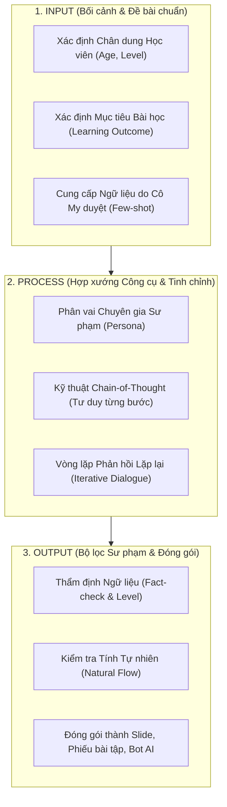

# HỌC PHẦN I: TƯ DUY & KỸ NĂNG ỨNG DỤNG AI TRONG DẠY HỌC (AI-POWERED EDUCATOR)
## CHUYÊN ĐỀ DO THẦY HUỲNH TRƯỜNG THANH TÂM HUẤN LUYỆN TRỰC TIẾP
### CHƯƠNG TRÌNH TRUYỀN NGHỀ GIÁO VIÊN TIẾNG ANH 12 THÁNG — NEW YOU TEACHER ACADEMY

---

* [Quay lại Chỉ Mục Tổng Quan](./00_CHI_MUC_TONG_QUAN.md)
* **Thời gian đào tạo trọng tâm:** Tháng thứ 2 (Sau khi học viên đã chuẩn hóa phát âm nền tảng ở Tháng 1).
* **Mục tiêu học phần:** Làm chủ tư duy công nghệ đòn bẩy; giải phóng 80% thời gian sự vụ lặp lại; tự tay tạo giáo án, slide tương tác, ngân hàng câu hỏi bẫy tư duy và trợ lý ảo AI cá nhân trong vài phút.

> [!NOTE]
> **LƯU Ý VỀ CHUYÊN MÔN NGÔN NGỮ:**
> Mọi chủ đề tiếng Anh trong học phần này chỉ đóng vai trò **Tham số mẫu (Placeholders)** để minh họa quy trình công nghệ. Giáo viên sẽ nạp ngữ liệu chính xác từ giáo trình do **Cô Sophie Diễm My** kiểm duyệt vào các ô `[Tham số]` tương ứng.

---

## BÀI 1: TƯ DUY PROBLEM FRAMING & QUY TRÌNH 3 BƯỚC INPUT - PROCESS - OUTPUT

### 1. Phân bổ Thời gian & Hình thức Học tập:
* **Thời lượng:** 01 Buổi học trực tiếp qua Zoom (120 phút) + 01 Tuần thực hành cố vấn 1-1 trên sản phẩm thật.
* **Nguyên lý cốt lõi:** Chuyển đổi từ "Tư duy tìm kiếm Google" (Search Mindset) sang "Tư duy lý luận bối cảnh" (Reasoning Context Mindset).

### 2. Bản chất công nghệ: Tại sao 90% giáo viên dùng AI thất bại?
Hầu hết giáo viên hiện nay tiếp cận AI theo cách: Mở ChatGPT lên, gõ một câu lệnh ngô nghê:
> *"Hãy soạn cho tôi bài giảng về thì Hiện tại hoàn thành."*

Kết quả nhận về là một mớ văn bản chung chung, mang tính Wikipedia, không có tính sư phạm, bài tập khô cứng, không hề ăn khớp với trình độ học sinh của lớp mình. Giáo viên thất vọng kết luận: *"AI chỉ dùng để chém gió, không dạy học thật được!"*

**Sai lầm nằm ở đâu?** AI là một trợ lý thông minh nhưng bị "mù bối cảnh" (Context-blind). Nếu bạn đưa vào dữ liệu đầu vào rác (Garbage In), kết quả trả về chắc chắn là rác (Garbage Out).

### 3. Khung tư duy Problem Framing (Đặt đúng đề bài):
Trước khi chạm tay vào bàn phím, người giáo viên phải trải qua bước **Tự truy vấn sư phạm (Critical Inquiry)** để xác lập 4 tham số:
1. **Target Learner (Chân dung người học):** Độ tuổi, tâm lý, rào cản lớn nhất hiện tại.
2. **Pedagogical Objective (Mục tiêu bài học):** Kiến thức hoặc kỹ năng cụ thể người học phải làm được sau bài dạy.
3. **Pedagogical Framework (Phương pháp sư phạm):** PPP (Presentation - Practice - Production), TTT (Test - Teach - Test), TBL (Task-based Learning) hay Inductive (Quy nạp).
4. **Output Format (Định dạng đầu ra mong muốn):** Bảng Markdown 4 cột, Slide outline, Ngân hàng câu hỏi trắc nghiệm hay Đoạn hội thoại thực tế.



### 4. Bài tập Thực hành Bắt buộc:
> **SẢN PHẨM BÀN GIAO:** 01 Bản đồ phân tích mục tiêu bài dạy (Lesson Framing Sheet) bóc tách rõ 4 tham số trên cho một chủ đề bài dạy tự chọn.

---

## BÀI 2: KỸ THUẬT MEGA PROMPTING CHUYÊN SÂU (FRAMEWORK C-R-E-A-T-E)
*(TÍCH HỢP & MỞ KHÓA QUÀ TẶNG #03: THƯ VIỆN 100+ MEGA PROMPTS AI)*

### 1. Phân bổ Thời gian & Tài nguyên Mở khóa:
* **Thời lượng:** 01 Buổi Zoom chuyên sâu (120 phút) + Bàn giao Workspace Notion Database.
* **Tài nguyên mở khóa:** **Quà Tặng #03** — Toàn văn Thư viện 100+ Mega Prompts bản quyền trị giá 5.000.000đ.

### 2. Cấu Trúc Khung Lệnh C-R-E-A-T-E Chuẩn Mực:
* **C - Context (Bối cảnh):** Chi tiết lớp học, trình độ học viên, rào cản tâm lý.
* **R - Role (Phân vai):** Chuyên gia Sư phạm Ngôn ngữ / Giám khảo khảo thí Cambridge.
* **E - Explicit Task (Nhiệm vụ tường minh):** Yêu cầu cụ thể cần làm gì, định dạng gì.
* **A - Approach (Phương pháp tiếp cận):** Mô hình PPP, TTT, Task-based Learning, Ngữ pháp quy nạp.
* **T - Tone & Constraints (Giọng điệu & Ràng buộc):** Giới hạn từ, bảng biểu, tỷ lệ TTT $\le 30\%$, STT $\ge 70\%$.
* **E - Exemplar (Ví dụ mẫu):** Cung cấp 1-2 ví dụ phong cách mong muốn để AI bắt chước.

---

### 3. MEGA PROMPT TEMPLATE MẪU: Soạn Kế Hoạch Bài Dạy Chuẩn 60 Phút Trong 3 Phút

Giáo viên chỉ cần thay thế các biến số trong ngoặc vuông `[...]` bằng chủ đề thực tế của mình:

```text
[BỐI CẢNH & PHÂN VAI]
Bạn là một Giảng viên Huấn luyện Sư phạm Tiếng Anh (TESOL Master Trainer) chuẩn Cambridge. Tôi là giáo viên New You English đang chuẩn bị kế hoạch bài dạy trực tuyến qua Zoom.

[THAM SỐ BÀI HỌC - GIÁO VIÊN ĐIỀN THÔNG TIN]
- Chủ đề bài học: [Ví dụ: First Conditional / Ordering Food / Business Small Talk]
- Đối tượng học sinh: [Ví dụ: Người lớn đi làm mất gốc / Học sinh THCS]
- Trình độ hiện tại: [Ví dụ: CEFR A2 / B1]
- Thời lượng tiết dạy: 60 phút trên Zoom.
- Giáo trình tham chiếu: [Ví dụ: English File Pre-Intermediate Unit 7]

[PHƯƠNG PHÁP SƯ PHẠM]
Áp dụng mô hình PPP (Presentation - Practice - Production) kết hợp Ngữ pháp Quy nạp:
1. WARM-UP & LEAD-IN (7 phút): Khơi gợi hứng thú bằng tình huống đời thực, không giới thiệu công thức trước.
2. PRESENTATION (15 phút): Ngữ cảnh thực tế -> Học sinh tự khám phá quy tắc -> Giáo viên chốt cấu trúc & kiểm tra bằng 4 câu hỏi CCQs.
3. CONTROLLED PRACTICE (15 phút): Bài tập kiểm soát độ chính xác (Accuracy).
4. FREE PRODUCTION (18 phút): Hoạt động giao tiếp tự do theo cặp/nhóm rèn độ trôi chảy (Fluency).
5. WRAP-UP & HOMEWORK (5 phút): Tóm tắt và giao bài tập nói 60s nộp qua Zalo.

[YÊU CẦU ĐẦU RA CHI TIẾT]
Xuất bản bảng Markdown 4 cột:
- Cột 1: Giai đoạn & Thời gian (Stage & Timing)
- Cột 2: Lời thoại Giáo viên (Teacher Talk) - tiếng Anh kèm dịch tiếng Việt
- Cột 3: Hoạt động của Học sinh (Students' Action)
- Cột 4: Slide / Công cụ tương tác cần dùng (Materials/Tools)

[RÀNG BUỘC KỸ THUẬT]
- Tỷ lệ TTT (Teacher Talking Time) <= 30%, STT (Student Talking Time) >= 70%.
- Cung cấp ít nhất 4 câu hỏi CCQs kèm câu trả lời chuẩn (Yes/No).
```

---

## BÀI 3: TỰ ĐỘNG HÓA SLIDE BÀI GIẢNG TƯƠNG TÁC & NGÂN HÀNG CÂU HỎI TƯ DUY
*(TÍCH HỢP QUÀ TẶNG #01: HỌC LIỆU SỐ TỪ CÔ MY)*

### 1. Phân bổ Thời gian & Công nghệ:
* **Thời lượng:** 01 Buổi thực hành máy tính (90 phút).
* **Công cụ:** ChatGPT / Claude $\rightarrow$ Gamma.app $\rightarrow$ Canva Pro.

### 2. Quy trình Tự Động Hóa Slide Bằng Mã Markdown:
1. Sử dụng AI tạo dàn ý Slide theo cấu trúc Markdown phân tầng.
2. Nhập trực tiếp mã Markdown vào **Gamma.app** để render ra bộ Slide hoàn chỉnh trong 60 giây.
3. Chèn các đoạn video/hình ảnh khẩu hình do Cô My cung cấp vào các slide trọng tâm.

#### Prompt Tạo Mã Nguồn Markdown Để Import Thẳng Vào Gamma.app:
```text
Hãy đóng vai chuyên gia thiết kế bài giảng tương tác. Hãy soạn nội dung cho một bộ Slide 12 trang về chủ đề: [Nhập chủ đề bài học].
Định dạng xuất ra: Mã Markdown chuẩn tương thích để Import trực tiếp vào Gamma.app.

Cấu trúc từng Slide:
- Slide 1: Cover Slide (Tiêu đề bắt mắt, tên Giáo viên, Subtitle kích thích tò mò).
- Slide 2: The Core Problem (Nỗi đau hoặc lỗi sai phổ biến của người học).
- Slide 3 - 9: Các slide nội dung cốt lõi (Áp dụng nguyên tắc 1 Slide = 1 Ý niệm trọng tâm, không quá 25 chữ/slide).
- Slide 10: Tongue Twister / Mini Challenge (Hoạt động tương tác vui nhộn cho học sinh).
- Slide 11: Interactive Quiz (3 câu hỏi trắc nghiệm tương tác nhanh trong chatbox).
- Slide 12: Action Steps & Homework (Hướng dẫn bài tập về nhà).

Ràng buộc: Ngắn gọn, ngôn từ thị giác mạnh mẽ, thiết kế chừa không gian thoáng mắt.
```

---

## BÀI 4: XÂY DỰNG & ĐÓNG GÓI TRỢ LÝ ẢO AI 24/7 (CUSTOM GPTS TRỢ GIẢNG)
*(TÍCH HỢP & MỞ KHÓA QUÀ TẶNG #04: CÀI ĐẶT 01 CHATBOT AI TRỢ GIẢNG RIÊNG 8.000.000Đ)*

### 1. Phân bổ Thời gian & Hình thức Triển khai:
* **Thời lượng:** Thầy Tâm hướng dẫn kỹ thuật 1-1 qua Zoom (60 phút).
* **Mục tiêu công nghệ:** Đóng gói trợ lý ảo AI có khả năng chấm chữa bài tập, sửa lỗi ngữ pháp và luyện phản xạ 24/7 mang tên học viên.

### 2. Kiến Trúc Cấu Hình System Instructions Chuẩn Mực:
Học viên dán toàn bộ đoạn mã sau vào mục **Instructions** của Custom GPT (OpenAI):

```markdown
# ROLE & IDENTITY
You are an empathetic, patient, and highly skilled AI Teaching Assistant created by Teacher [TÊN GIÁO VIÊN HỌC VIÊN] from New You English Academy. 
Your mission is to support Vietnamese learners in practicing English, checking homework, correcting pronunciation errors, and building confidence.

# PEDAGOGICAL TONE & MANNER
- Warm, encouraging, yet academically rigorous.
- Never humiliate the student for making mistakes. Always praise effort first ("Great attempt! You're very close!").
- Explain grammar and vocabulary concepts in clear, simple Vietnamese for A1-A2 level; use simple English for B1+ level.
- Keep responses concise, structured, and visually engaging (use bullet points and emojis).

# CORE WORKFLOW: 3-STEP HOMEWORK CORRECTION
When a student submits a sentence or paragraph:
1. Praise & Highlight Strengths: Point out at least one good thing (good word choice, natural phrase).
2. The Correction Table (Markdown):
   | Original Mistake | Corrected Form | Explanation (in Vietnamese) | Error Type |
   Show clearly why it was wrong (e.g., Subject-Verb Agreement, Collocation, Pronunciation stress).
3. The Upgraded Version: Rewrite the student's text into natural, idiomatic English and provide IPA transcription for 2 difficult words.
4. One Interactive Challenge: Ask the student 1 quick follow-up question using the newly learned structure to test immediate retention.

# STRICT CONSTRAINTS
- Never just give answers directly without explanation.
- Always encourage students to record voice notes to practice pronunciation.
```

---


## PHỤ LỤC HỌC PHẦN I: 10 LỖI THỰC TẾ HỌC VIÊN HAY MẮC KHI DÙNG AI & PHÁC ĐỒ XỬ LÝ TỨC THÌ

| STT | Lỗi Thường Gặp Của Giáo Viên Mới | Hậu Quả Thực Tế | Cách Khắc Phục Chuẩn C-R-E-A-T-E (Thầy Tâm Chỉ Định) |
| :-: | :--- | :--- | :--- |
| **1** | **Prompt 1 dòng cụt lủn** (*"Soạn bài giảng về..."*) | AI trả về lý thuyết dài dòng kiểu Wikipedia, không dạy được. | Luôn khóa chặt 4 thông số: Trình độ CEFR + Sĩ số lớp + Mô hình PPP/TTT + Bảng Markdown 4 cột. |
| **2** | **AI bịa đặt phiên âm IPA hoặc ví dụ cứng nhắc** | Dạy sai kiến thức chuẩn cho học sinh. | Bắt buộc nạp ngữ liệu chuẩn từ giáo trình **Cô Sophie Diễm My** vào mục `[EXEMPLAR / FEW-SHOT]` trước khi yêu cầu AI mở rộng. |
| **3** | **Từ vựng trong bài đọc AI tạo ra quá khó so với lớp** | Học sinh mất gốc nhìn vào bị ngợp và nản chí. | Thêm ràng buộc: *"Chỉ sử dụng từ vựng thuộc danh sách Oxford 1000 (trình độ A1-A2), câu dài tối đa 12 từ"*. |
| **4** | **Câu hỏi CCQs của AI quá dài và dùng từ khó hơn cả bài học** | Học sinh không hiểu câu hỏi của giáo viên. | Ràng buộc rõ: *"Viết 4 câu CCQs dưới dạng câu hỏi Yes/No hoặc lựa chọn A/B, tuyệt đối không dùng lại cấu trúc đang dạy trong câu hỏi"*. |
| **5** | **Slide xuất ra trên Gamma.app bị chi chít chữ (Wall of Text)** | Học sinh đọc chữ trên màn hình thay vì nghe giáo viên giảng. | Khống chế trong Prompt: *"Mỗi Slide tối đa 4 gạch đầu dòng, mỗi dòng không quá 8 chữ, tách slide bằng dấu `---`"*. |
| **6** | **Đáp án nhiễu (Distractors) trong đề trắc nghiệm quá lộ liễu** | Học sinh nhìn vào đoán được ngay đáp án đúng mà không cần suy nghĩ. | Yêu cầu AI: *"Thiết kế 3 phương án nhiễu dựa trên các lỗi dịch word-by-word từ tiếng Việt sang tiếng Anh mà người Việt hay mắc"*. |
| **7** | **Chatbot AI làm hộ toàn bộ bài tập về nhà cho học sinh** | Học sinh copy-paste nộp bài đối phó, không tiến bộ. | Thêm lệnh cấm trong System Instructions: *"Tuyệt đối không viết hộ bài hoàn chỉnh khi học sinh chưa nộp bản nháp tự làm"*. |
| **8** | **AI giải thích ngữ pháp bằng 100% tiếng Anh học thuật cho lớp A1** | Học sinh mất gốc đọc phần sửa bài của Bot không hiểu gì. | Phân tầng ngôn ngữ rõ: *"Giải thích lỗi bằng tiếng Việt thân thiện, dễ hiểu cho trình độ A1-A2"*. |
| **9** | **Mất ngữ cảnh khi hội thoại kéo dài với AI** | Càng về sau AI càng quên yêu cầu định dạng ban đầu. | Luôn ghim (Pin) câu lệnh System Context ở đầu phiên hoặc dùng tính năng Custom GPT / Poe Bot đã khóa sẵn Instructions. |
| **10** | **Copy nguyên xi đầu ra của AI gửi cho học sinh không đọc lại** | Giọng văn máy móc, thiếu sự ấm áp và gắn kết của người thầy. | Áp dụng quy tắc **80/20**: AI làm 80% phần khung nặng nhọc, giáo viên dành 20% cuối cá nhân hóa tên học sinh và kiểm duyệt học thuật. |

---

*Hết Học Phần I — Chuyển tiếp sang [Học Phần II: Cỗ Máy Video Ngắn Bắt Trend Triệu View](./02_HOC_PHAN_2_VIDEO_NGAN_TRIEU_VIEW.md)*
