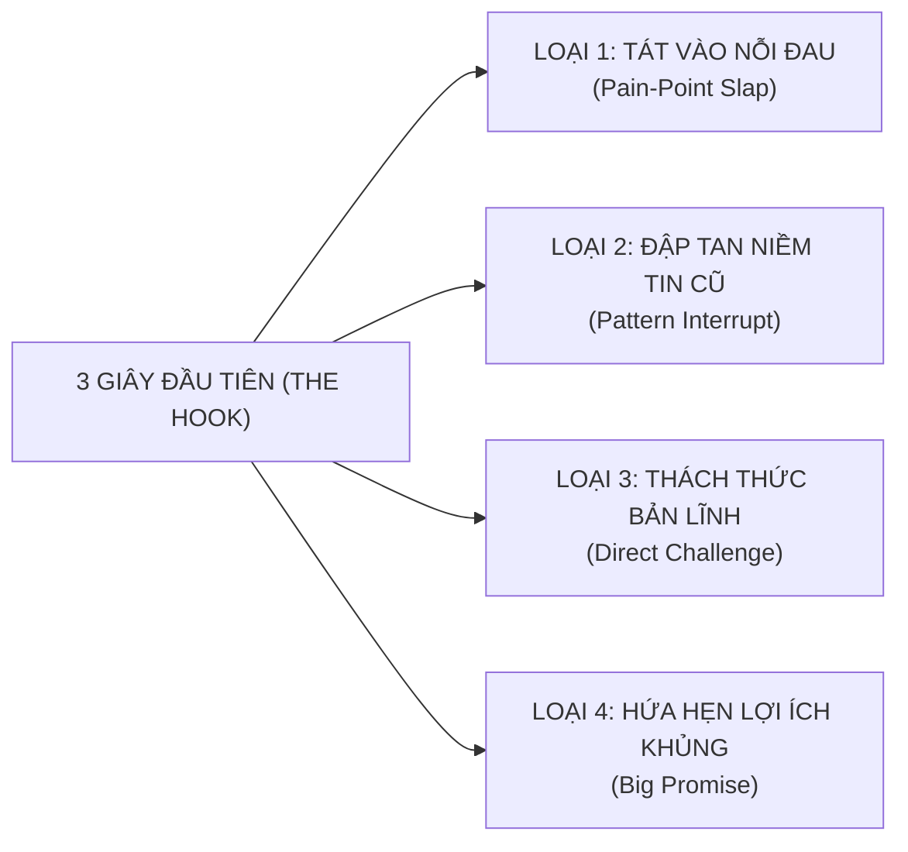

# HỌC PHẦN II: CỖ MÁY VIDEO NGẮN BẮT TREND TRIỆU VIEW & ĐỊNH VỊ NHÂN HIỆU (VIRAL VIDEO MASTERY)
## CHUYÊN ĐỀ DO THẦY HUỲNH TRƯỜNG THANH TÂM HUẤN LUYỆN TRỰC TIẾP
### ĐIỀU PHỐI & KIỂM DUYỆT CHUYÊN MÔN TIẾNG ANH: CÔ SOPHIE DIỄM MY
### CHƯƠNG TRÌNH TRUYỀN NGHỀ GIÁO VIÊN TIẾNG ANH 12 THÁNG — NEW YOU TEACHER ACADEMY

---

* [Quay lại Chỉ Mục Tổng Quan](./00_CHI_MUC_TONG_QUAN.md)
* **Thời gian đào tạo & thực chiến:** Tháng thứ 2 (đào tạo kỹ thuật) $\rightarrow$ Duy trì sản xuất tối thiểu 2 video/tuần trong suốt 12 tháng.
* **Mục tiêu học phần:** Tự tay làm chủ kỹ thuật sản xuất video ngắn triệu view trên TikTok, Reels, Shorts để hút học viên liên tục 0 đồng; xuất bản tối thiểu **20 video ngắn chất lượng cao**.

> [!NOTE]
> **PHÂN ĐỊNH PHẠM VI CHUYÊN MÔN:**
> Thầy Tâm huấn luyện toàn bộ về: Thuật toán, kịch bản giữ chân, thiết bị quay dựng, diễn xuất trước ống kính, dựng phim CapCut và SEO đa kênh. Kiến thức chuyên môn tiếng Anh xuất hiện trong video phải được **Cô Sophie Diễm My** duyệt trước khi bấm máy.

---

## BÀI 5: THUẬT TOÁN VIDEO NGẮN & MA TRẬN "HOOK 3 GIÂY GIỮ CHÂN"

### 1. Giải mã Thuật toán Phân phối (TikTok, Reels, Shorts):
Thuật toán phân phối video ngắn hoạt động như một cỗ máy đấu thầu chú ý (Attention Auction). Nó đo lường các chỉ số hành vi thực tế theo công thức định lượng:

$$\text{Điểm Phân Phối} = 3 \times (\text{Watch Time}) + 5 \times (\text{Completion Rate}) + 2 \times (\text{Saves}) + 1.5 \times (\text{Shares}) + (\text{Comments})$$

* **Chỉ số Sống Còn 1 — Retention 3s (Tỷ lệ giữ chân 3 giây đầu):** Nếu quá 70% người xem lướt qua trong 3 giây đầu, video của bạn bị đẩy vào "nghĩa địa nội dung" (lẹt đẹt 200–300 views).
* **Chỉ số Sống Còn 2 — Completion Rate (Tỷ lệ xem hết video):** Video giáo dục 45–60 giây phải đạt tỷ lệ xem hết $\ge 25\%$ thì mới được đẩy vào luồng phân phối triệu view.
* **Chỉ số Chuyển đổi — Save & Share (Lưu và Chia sẻ):** Người học tiếng Anh lưu video vì nó chứa kiến thức cô đặc (bảng so sánh, mẹo nhớ); họ chia sẻ video vì thấy một lỗi sai hài hước mà bạn bè họ cũng mắc.

### 2. Ma trận "Hook 3 Giây Giữ Chân" (Hook Retention Matrix):



| Loại Hook | Công thức Hook | Ví dụ gợi ý minh họa |
| :--- | :--- | :--- |
| **1. Pain-Point Slap (Tát vào nỗi đau)** | *"Học [X năm] mà vẫn [nỗi đau], xem ngay kẻo phí cả thanh xuân!"* | *"Học tiếng Anh 12 năm mà gặp Tây chỉ biết cười trừ thì xem ngay video này!"* |
| **2. Pattern Interrupt (Phá vỡ niềm tin cũ)** | *"Dừng lại! Đừng bao giờ nói [cụm từ quen thuộc] nữa, nghe cực kỳ lỗi thời!"* | *"Dừng lại ngay! Đi ăn phở mà bảo 'I eat pho' thì người bản xứ cười đấy!"* |
| **3. Direct Challenge (Thách thức người xem)** | *"99% người học phát âm sai từ này, bạn có nằm trong số đó?"* | *"Từ này ai cũng tưởng mình đọc đúng: [Nhập từ khó], thử đọc xem nào!"* |
| **4. Big Promise (Lợi ích siêu tốc)** | *"Mẹo cực đỉnh: Nhớ ngay [kiến thức khó] chỉ bằng một quy tắc 3 bước!"* | *"3 mẹo phân biệt [Cặp kiến thức dễ nhầm] không bao giờ sai trong 30 giây!"* |

---

## BÀI 6: 5 CẤU TRÚC KỊCH BẢN VIDEO GIÁO DỤC CHUYỂN ĐỔI CAO
*(TÍCH HỢP QUÀ TẶNG #05: KHO 30 KỊCH BẢN VIDEO NGẮN TRIỆU VIEW)*

### 1. Phân bổ Thời gian & Công thức Cấu trúc:
* **Thời lượng:** 01 Buổi phân tích cấu trúc + Hướng dẫn tùy biến kịch bản.
* **Khung kịch bản 5 phần bất biến:**
  1. `[0 - 3s]` The Hook (Kéo chú ý, giật title thị giác).
  2. `[3 - 10s]` Agitate Pain-Point (Mô tả tình huống bối rối thực tế).
  3. `[10 - 30s]` The Aha Solution (Đưa ra giải pháp/mẹo nhớ đắt giá).
  4. `[30 - 45s]` Application / Context (Ghép vào câu giao tiếp hoàn chỉnh).
  5. `[45 - 55s]` Call to Action (Kêu gọi comment, follow nhận tài liệu).

### 2. Bảng Phân Bổ 5 Cấu Trúc Kịch Bản:
1. **Cấu trúc 1 — Bóc phốt lỗi sai kinh điển:** Chỉ ra lỗi sai phổ biến $\rightarrow$ Đưa giải pháp chuẩn.
2. **Cấu trúc 2 — Đóng 2 vai (Tình huống thực tế):** Học sinh ngô nghê vs Giáo viên giải cứu.
3. **Cấu trúc 3 — Mẹo nhớ nhanh 60 giây (Fast Hacks):** Dùng thơ, vần, quy tắc ngón tay.
4. **Cấu trúc 4 — Câu chuyện học trò tiến bộ (Social Proof):** Chuyển biến từ sợ hãi đến tự tin.
5. **Cấu trúc 5 — Trả lời bình luận của khán giả (Q&A Reply):** Khai thác comment tạo video phễu.

---

## BÀI 7: THIẾT LẬP STUDIO TẠI GIA CHI PHÍ TỐI THIỂU & NGHỆ THUẬT DIỄN XUẤT

### 1. Bộ Thiết bị Chuẩn Sư Phạm Số Chi Phí Dưới 2 Triệu Đồng:
1. **Smartphone cá nhân (Camera sau):** Thiết lập thông số **4K 30fps** hoặc **1080p 60fps** (tuyệt đối không dùng camera trước).
2. **Microphone cài áo không dây (K8/K9/Boya):** Giá 250k - 600k (Lọc sạch tiếng ồn quạt máy và tiếng vang).
3. **Đèn Ring Light hoặc Đèn LED bảng mini:** Giá 300k - 500k (Đảm bảo khuôn mặt luôn sáng rõ, mắt có catchlight).
4. **Chân máy (Tripod) kẹp điện thoại xoay linh hoạt:** Giá 150k (Đặt máy ngang ngực/tầm mắt).

### 2. Sơ đồ Bố trí Ánh sáng 3 Điểm Chuẩn Studio:

```
                  [ BỨC TƯỜNG / KỆ SÁCH ĐÈN VÀNG ]
                                 ▲
                                 │ (Khoảng cách 1 - 1.5 mét)
                           [ GIÁO VIÊN ]
                         (Ngồi thẳng lưng)
                                 ▲
                                 │ (Khoảng cách 1.2 mét)
                      [ SMARTPHONE (Camera Sau) ]
                                 │
     [ ĐÈN CHÍNH (Key Light) ]   │   [ ĐÈN PHỤ (Fill Light) ]
      (Góc 45 độ - Ánh sáng mạnh)│    (Góc 45 độ - Ánh sáng nhẹ)
```

### 3. Bí kíp Diễn xuất & Sử dụng Ứng dụng Nhắc chữ (Teleprompter):
* **Mẹo không đảo mắt:** Kéo khung app Teleprompter thu nhỏ lại tối đa và đặt **ngay sát mép ống kính camera**.
* **Năng lượng giọng nói:** Tăng âm lượng to hơn 30%, cười tươi hơn 30% và ngôn ngữ hình thể mở rộng hơn 30% so với nói chuyện bình thường.

---

## BÀI 8: DỰNG PHIM CAPCUT SIÊU TỐC, HIỆU ỨNG ĐỘNG & SEO ĐA KÊNH

### 1. Quy trình Dựng Video 15 Phút trên CapCut (Điện thoại & PC):
* **Bước 1 — Cắt Jump-cut nhịp nhanh:** Cắt bỏ 100% khoảng lặng thở, đoạn ngập ngừng "ờ, à".
* **Bước 2 — Auto Captions:** Phụ đề tự động font chữ to rõ (The Bold Font, Be Vietnam Pro viền đen nền vàng).
* **Bước 3 — Text/Hình ảnh động:** Chèn từ khóa nổi bật nhấp nháy khớp với lời thoại.
* **Bước 4 — Chèn Sound Effects (SFX) & Nhạc nền:** Âm thanh nhấn mạnh (Pop, Ding, Whoosh); nhạc nền để ở mức **8% - 12%**.

### 2. Kỷ luật Xuất bản:
> **CHỈ TIÊU BẮT BUỘC:** Mỗi học viên phải xuất bản tối thiểu **20 video ngắn hoàn chỉnh** lên TikTok, Facebook Reels và YouTube Shorts trong Tháng thứ 4 và 5. Thầy Tâm trực tiếp nghiệm thu link từng video!

---


## PHỤ LỤC HỌC PHẦN II: NGÂN HÀNG 50 CÂU HOOK 3 GIÂY GIẬT TÍT ĐÃ KIỂM CHỨNG (COPY & THAY BIẾN SỐ)

*(Học viên chỉ cần chọn 1 câu Hook dưới đây, thay phần trong ngoặc vuông `[SLOT CHUYÊN MÔN CÔ MY DUYỆT]` và quay ngay 3 giây đầu tiên).*

### Nhóm A: 15 Câu Hook "Tát Vào Nỗi Đau" (Pain-Point Slap — Dành Cho Dân Công Sở & Mất Gốc)
1. *"Học tiếng Anh 10 năm mà mở miệng nói câu `[SLOT CHUYÊN MÔN]` Tây vẫn ngơ ngác không hiểu gì?"*
2. *"Đừng để mất cơ hội tăng lương gấp đôi chỉ vì phát âm sai âm `[SLOT ÂM IPA]` này trong buổi phỏng vấn!"*
3. *"Cảm giác ngồi trong phòng họp với sếp nước ngoài mà chỉ biết cười trừ vì không biết nói câu `[SLOT CHUYÊN MÔN]`..."*
4. *"Tại sao bạn thuộc lòng hàng trăm công thức ngữ pháp nhưng gặp người nước ngoài lại đứng hình mất 5 giây?"*
5. *"90% người đi làm Việt Nam viết câu này trong Email mỗi ngày mà không biết nó cực kỳ thiếu lịch sự!"*
6. *"Nếu bạn vẫn đang đọc từ `[SLOT TỪ VỰNG]` theo kiểu ghép vần tiếng Việt thì dừng lại xem ngay 30 giây này!"*
7. *"Nỗi ám ảnh lớn nhất khi nghe tiếng Anh: Nhìn phụ đề thì hiểu hết, tắt phụ đề đi thì nghe như vịt nghe sấm!"*
8. *"Ba mẹ phát âm sai từ `[SLOT TỪ VỰNG]` này bảo sao dạy con ở nhà bé cứ đọc sai theo!"*
9. *"Đi du lịch nước ngoài muốn `[Tình huống thực tế]` mà chỉ biết dùng tay ra hiệu thì lưu ngay câu này lại nhé!"*
10. *"Lý do thực sự khiến bạn nói tiếng Anh hay bị hụt hơi và mỏi cứng cơ hàm chỉ sau 2 phút!"*
11. *"Bạn có đang dịch từng chữ tiếng Việt trong đầu rồi mới lắp bắp nói ra câu `[SLOT CHUYÊN MÔN]` không?"*
12. *"Một lỗi phát âm âm đuôi cực nhỏ nhưng biến câu nói lịch sự của bạn thành một từ nhạy cảm!"*
13. *"Học từ vựng kiểu chép phạt 10 dòng mỗi ngày chính là cách nhanh nhất khiến bạn bỏ cuộc sau 1 tuần!"*
14. *"Sếp hỏi `[Câu hỏi tình huống]` mà bạn chỉ trả lời cụt lủn 'Yes, I can' thì quá phí!"*
15. *"Đã bao nhiêu lần bạn mua khóa học tiếng Anh về để đó vì không có ai sửa khẩu hình cho từng âm?"*

### Nhóm B: 15 Câu Hook "Đập Tan Niềm Tin Cũ" (Pattern Interrupt — Gây Bất Ngờ Tức Thì)
16. *"Dừng lại ngay! Người bản xứ đi làm KHÔNG BAO GIỜ nói `[Câu sách giáo khoa cũ]` như chúng ta từng học đâu!"*
17. *"Quên ngay câu 'How are you? I'm fine, thank you' đi! Đây mới là 3 câu người Mỹ dùng mỗi sáng!"*
18. *"Đừng đọc từ `[SLOT TỪ VỰNG]` là 4 âm tiết nữa, thực ra nó chỉ có đúng `[Số âm tiết]` thôi!"*
19. *"Sự thật gây sốc: Bạn không hề dốt tiếng Anh, bạn chỉ đang đặt sai vị trí đầu lưỡi ở âm `[SLOT ÂM IPA]` này!"*
20. *"Vứt ngay cuốn sổ chép từ đơn lẻ đi nếu bạn muốn phản xạ nhanh như người bản xứ trong chủ đề `[SLOT CHUYÊN MÔN]`!"*
21. *"Ai bảo trên 30 tuổi cơ miệng cứng không thể sửa được phát âm chuẩn IPA? Xem học viên của mình sau 15 phút nhé!"*
22. *"Trong từ `[SLOT TỪ VỰNG]` này có một chữ cái bị câm hoàn toàn mà 95% người Việt vẫn cố đọc lên!"*
23. *"Đừng dùng 'Very + Tính từ' mãi nữa, thay bằng 3 từ này điểm nói của bạn tăng vọt ngay lập tức!"*
24. *"Sai lầm chết người khi nói lời từ chối với đối tác nước ngoài khiến họ phật lòng ngay lập tức!"*
25. *"Hóa ra đây là lý do bạn nghe băng đĩa trong lớp thì rõ, nhưng ra ngoài phố gặp Tây nói lại không bắt được chữ nào!"*
26. *"Không cần học hết 12 thì tiếng Anh đâu! Dân công sở thực chiến chỉ cần làm chủ đúng 3 cấu trúc này!"*
27. *"Bí mật của quy tắc Ngữ pháp Quy nạp: Nói đúng chuẩn ngữ pháp mà không cần nhớ bất kỳ công thức cộng trừ nào!"*
28. *"Đừng nói 'Sorry for my bad English' khi bắt chuyện với người nước ngoài nữa, hãy thay bằng câu thần chú này!"*
29. *"Tại sao càng cố nói nhanh thì tiếng Anh của bạn nghe càng giống tiếng Việt? Bí quyết nằm ở nhịp dừng này!"*
30. *"Chỉ đổi đúng 1 giới từ trong câu `[SLOT CHUYÊN MÔN]` mà nghĩa của cả câu quay ngoắt 180 độ!"*

### Nhóm C: 10 Câu Hook "Thách Thức Trực Diện" (Direct Challenge — Kích Thích Bình Luận & Tương Tác)
31. *"Thử thách 5 giây: Đố bạn đọc to từ `[SLOT TỪ VỰNG KHÓ]` này mà không bị vấp âm cuối đấy!"*
32. *"99% người xem video này sẽ phát âm sai ít nhất 2 trên 5 từ quen thuộc dưới đây, kiểm tra thử ngay nhé!"*
33. *"Đố bạn phân biệt được 2 từ `[Cặp Minimal Pairs]` này khi mình đọc ở tốc độ tự nhiên!"*
34. *"Nếu dịch câu '[Câu tiếng Việt đời sống]' sang tiếng Anh trong 3 giây, bạn sẽ nói như thế nào? Comment xuống trước khi xem đáp án nhé!"*
35. *"Kiểm tra trình độ phản xạ công sở: Khi khách hàng chê giá đắt, bạn sẽ đáp lại câu tiếng Anh nào đầu tiên?"*
36. *"Nhìn vào 2 câu trên màn hình, theo bạn câu nào là câu người bản xứ dùng, câu nào là câu Vietlish?"*
37. *"Bạn nghe được mấy từ trong câu nói lướt cực nhanh này của người Mỹ? Nghe kỹ 2 lần nhé!"*
38. *"Chỉ những ai đã nắm vững khẩu hình âm `[SLOT ÂM IPA]` mới đọc câu xoắn lưỡi này trong 1 hơi không sai!"*
39. *"Thử tài bắt lỗi ngữ pháp trong 10 giây: Câu tiếng Anh nhìn có vẻ hoàn hảo này đang sai ở đúng 1 chữ!"*
40. *"Đoán xem từ `[SLOT TỪ VỰNG]` nhấn trọng âm vào âm tiết thứ mấy? Ai chọn âm 2 là sập bẫy ngay!"*

### Nhóm D: 10 Câu Hook "Hứa Hẹn Kết Quả Siêu Tốc" (Big Promise — Tối Đa Hóa Lượt Lưu Save)
41. *"Lưu ngay công thức 3 bước sửa dứt điểm lỗi phát âm âm `[SLOT ÂM IPA]` chỉ trong đúng 60 giây!"*
42. *"Trọn bộ 5 cụm từ thần thánh giúp bạn cứu nguy mọi cuộc họp tiếng Anh khi bất ngờ bị sếp gọi tên!"*
43. *"Mẹo bẻ khớp cơ miệng cực dễ giúp bạn đọc chuẩn cặp âm `[SLOT CẶP ÂM]` ngay từ lần thử đầu tiên!"*
44. *"Chỉ cần nhớ đúng quy tắc bàn tay này, bạn sẽ không bao giờ nhầm lẫn cách dùng `[SLOT NGỮ PHÁP]` nữa!"*
45. *"Cách viết một bức Email xin phép / báo cáo công việc bằng tiếng Anh chuyên nghiệp chỉ trong 3 dòng!"*
46. *"3 mẫu câu mở lời tự nhiên nhất khi đi Săn Tây giúp người nước ngoài mỉm cười trò chuyện với bạn cả buổi!"*
47. *"Biến câu tiếng Anh cụt lủn trình độ A1 thành câu giao tiếp sang xịn trình độ B2 chỉ bằng 2 từ nối!"*
48. *"Bí kíp luyện nhại giọng Shadowing 10 phút mỗi tối giúp ngữ điệu của bạn lên xuống mượt như người bản xứ!"*
49. *"Mình đã giúp một học viên mất gốc 15 năm tự tin thuyết trình trước công ty sau 8 tuần bằng đúng lộ trình 3 bước này!"*
50. *"Tặng miễn phí cuốn Sổ tay 100 Cụm từ tiếng Anh công sở cho tất cả các bạn xem hết video 45 giây hôm nay!"*

---

*Hết Học Phần II — Chuyển tiếp sang [Học Phần III: Phễu Tuyển Sinh & Tự Động Hóa](./03_HOC_PHAN_3_PHEU_TUYEN_SINH_VA_TU_DONG_HOA.md)*
